# Projects and dependencies analysis

This document provides a comprehensive overview of the projects and their dependencies in the context of upgrading to .NETCoreApp,Version=v8.0.

## Table of Contents

- [Executive Summary](#executive-Summary)
  - [Highlevel Metrics](#highlevel-metrics)
  - [Projects Compatibility](#projects-compatibility)
  - [Package Compatibility](#package-compatibility)
  - [API Compatibility](#api-compatibility)
- [Aggregate NuGet packages details](#aggregate-nuget-packages-details)
- [Top API Migration Challenges](#top-api-migration-challenges)
  - [Technologies and Features](#technologies-and-features)
  - [Most Frequent API Issues](#most-frequent-api-issues)
- [Projects Relationship Graph](#projects-relationship-graph)
- [Project Details](#project-details)

  - [Components\AAA\BExIS.Security.Entities\BExIS.Security.Entities.csproj](#componentsaaabexissecurityentitiesbexissecurityentitiescsproj)
  - [Components\AAA\BExIS.Security.Orm.NH\BExIS.Security.Orm.NH.csproj](#componentsaaabexissecurityormnhbexissecurityormnhcsproj)
  - [Components\AAA\BExIS.Security.Services.Tests\BExIS.Security.Services.Tests.csproj](#componentsaaabexissecurityservicestestsbexissecurityservicestestscsproj)
  - [Components\AAA\BExIS.Security.Services\BExIS.Security.Services.csproj](#componentsaaabexissecurityservicesbexissecurityservicescsproj)
  - [Components\App\BExIS.App.Bootstrap\BExIS.App.Bootstrap.csproj](#componentsappbexisappbootstrapbexisappbootstrapcsproj)
  - [Components\App\BExIS.App.Testing\BExIS.App.Testing.csproj](#componentsappbexisapptestingbexisapptestingcsproj)
  - [Components\DLM\BExIS.Dlm.Entities\BExIS.Dlm.Entities.csproj](#componentsdlmbexisdlmentitiesbexisdlmentitiescsproj)
  - [Components\DLM\BExIS.Dlm.Orm.NH\BExIS.Dlm.Orm.NH.csproj](#componentsdlmbexisdlmormnhbexisdlmormnhcsproj)
  - [Components\DLM\BExIS.Dlm.Services\BExIS.Dlm.Services.csproj](#componentsdlmbexisdlmservicesbexisdlmservicescsproj)
  - [Components\DLM\BExIS.Dlm.Tests\BExIS.Dlm.Tests.csproj](#componentsdlmbexisdlmtestsbexisdlmtestscsproj)
  - [Components\EXT\BExIS.Ext.Entities\BExIS.Ext.Entities.csproj](#componentsextbexisextentitiesbexisextentitiescsproj)
  - [Components\EXT\BExIS.Ext.Model\BExIS.Ext.Model.csproj](#componentsextbexisextmodelbexisextmodelcsproj)
  - [Components\EXT\BExIS.Ext.Orm.NH\BExIS.Ext.Orm.NH.csproj](#componentsextbexisextormnhbexisextormnhcsproj)
  - [Components\EXT\BExIS.Ext.Services\BExIS.Ext.Services.csproj](#componentsextbexisextservicesbexisextservicescsproj)
  - [Components\IO\BExIS.IO.DataType.DisplayPattern\BExIS.IO.DataType.DisplayPattern.csproj](#componentsiobexisiodatatypedisplaypatternbexisiodatatypedisplaypatterncsproj)
  - [Components\IO\BExIS.IO.Tests\BExIS.IO.Tests.csproj](#componentsiobexisiotestsbexisiotestscsproj)
  - [Components\IO\BExIS.IO.Transform.Input\BExIS.IO.Transform.Input.csproj](#componentsiobexisiotransforminputbexisiotransforminputcsproj)
  - [Components\IO\BExIS.Io.Transform.Output\BExIS.IO.Transform.Output.csproj](#componentsiobexisiotransformoutputbexisiotransformoutputcsproj)
  - [Components\IO\BExIS.IO.Transform.Validation\BExIS.IO.Transform.Validation.csproj](#componentsiobexisiotransformvalidationbexisiotransformvalidationcsproj)
  - [Components\IO\BExIS.IO\BExIS.IO.csproj](#componentsiobexisiobexisiocsproj)
  - [Components\JSON\BExIS.JSON.Helpers.Tests\BExIS.JSON.Helpers.Tests.csproj](#componentsjsonbexisjsonhelperstestsbexisjsonhelperstestscsproj)
  - [Components\JSON\BEXIS.JSON.Helpers\BEXIS.JSON.Helpers.csproj](#componentsjsonbexisjsonhelpersbexisjsonhelperscsproj)
  - [Components\UI\BExIS.UI.Tests\BExIS.UI.Tests.csproj](#componentsuibexisuitestsbexisuitestscsproj)
  - [Components\UI\BExIS.UI\BExIS.UI.csproj](#componentsuibexisuibexisuicsproj)
  - [Components\Utils\BExIS.Utils.Config\BExIS.Utils.Config.csproj](#componentsutilsbexisutilsconfigbexisutilsconfigcsproj)
  - [Components\Utils\BExIS.Utils.Data.Tests\BExIS.Utils.Data.Tests.csproj](#componentsutilsbexisutilsdatatestsbexisutilsdatatestscsproj)
  - [Components\Utils\BExIS.Utils.Data\BExIS.Utils.Data.csproj](#componentsutilsbexisutilsdatabexisutilsdatacsproj)
  - [Components\Utils\BExIS.Utils.NH\BExIS.Utils.NH.csproj](#componentsutilsbexisutilsnhbexisutilsnhcsproj)
  - [Components\Utils\BExIS.Utils.Tests\BExIS.Utils.Tests.csproj](#componentsutilsbexisutilstestsbexisutilstestscsproj)
  - [Components\Utils\BExIS.Utils\BExIS.Utils.csproj](#componentsutilsbexisutilsbexisutilscsproj)
  - [Components\Vaiona\Vaiona.Core\Vaiona.Core.csproj](#componentsvaionavaionacorevaionacorecsproj)
  - [Components\Vaiona\Vaiona.Entities.Orm.NH\Vaiona.Entities.Orm.NH.csproj](#componentsvaionavaionaentitiesormnhvaionaentitiesormnhcsproj)
  - [Components\Vaiona\Vaiona.Entities\Vaiona.Entities.csproj](#componentsvaionavaionaentitiesvaionaentitiescsproj)
  - [Components\Vaiona\Vaiona.IoC\Vaiona.IoC.csproj](#componentsvaionavaionaiocvaionaioccsproj)
  - [Components\Vaiona\Vaiona.Logging\Vaiona.Logging.csproj](#componentsvaionavaionaloggingvaionaloggingcsproj)
  - [Components\Vaiona\Vaiona.Model\Vaiona.Model.csproj](#componentsvaionavaionamodelvaionamodelcsproj)
  - [Components\Vaiona\Vaiona.MultiTenancy.Api\Vaiona.MultiTenancy.Api.csproj](#componentsvaionavaionamultitenancyapivaionamultitenancyapicsproj)
  - [Components\Vaiona\Vaiona.MultiTenancy.Services\Vaiona.MultiTenancy.Services.csproj](#componentsvaionavaionamultitenancyservicesvaionamultitenancyservicescsproj)
  - [Components\Vaiona\Vaiona.Persistence.Api\Vaiona.Persistence.Api.csproj](#componentsvaionavaionapersistenceapivaionapersistenceapicsproj)
  - [Components\Vaiona\Vaiona.Persistence.NH\Vaiona.Persistence.NH.csproj](#componentsvaionavaionapersistencenhvaionapersistencenhcsproj)
  - [Components\Vaiona\Vaiona.PersistenceProviders.NH\Vaiona.PersistenceProviders.NH.csproj](#componentsvaionavaionapersistenceprovidersnhvaionapersistenceprovidersnhcsproj)
  - [Components\Vaiona\Vaiona.Utils\Vaiona.Utils.csproj](#componentsvaionavaionautilsvaionautilscsproj)
  - [Components\Vaiona\Vaiona.Web.Mvc.Modularity\Vaiona.Web.Mvc.Modularity.csproj](#componentsvaionavaionawebmvcmodularityvaionawebmvcmodularitycsproj)
  - [Components\Vaiona\Vaiona.Web.Mvc\Vaiona.Web.Mvc.csproj](#componentsvaionavaionawebmvcvaionawebmvccsproj)
  - [Components\Vaiona\Vaiona.Web.Security\Vaiona.Web.Security.csproj](#componentsvaionavaionawebsecurityvaionawebsecuritycsproj)
  - [Components\Vaiona\Vaiona.Web\Vaiona.Web.csproj](#componentsvaionavaionawebvaionawebcsproj)
  - [Components\XML\BExIS.Xml.Helpers.UnitTests\BExIS.Xml.Helpers.UnitTests.csproj](#componentsxmlbexisxmlhelpersunittestsbexisxmlhelpersunittestscsproj)
  - [Components\XML\BExIS.Xml.Helpers\BExIS.Xml.Helpers.csproj](#componentsxmlbexisxmlhelpersbexisxmlhelperscsproj)
  - [Components\XML\BExIS.Xml.Models\BExIS.Xml.Models.csproj](#componentsxmlbexisxmlmodelsbexisxmlmodelscsproj)
  - [Console\BExIS.Web.Shell\Areas\BAM\BExIS.Modules.Bam.UI.csproj](#consolebexiswebshellareasbambexismodulesbamuicsproj)
  - [Console\BExIS.Web.Shell\Areas\DCM\BExIS.Modules.Dcm.UI\BExIS.Modules.Dcm.UI.csproj](#consolebexiswebshellareasdcmbexismodulesdcmuibexismodulesdcmuicsproj)
  - [Console\BExIS.Web.Shell\Areas\DDM\BExIS.Modules.Ddm.UI\BExIS.Modules.Ddm.UI.csproj](#consolebexiswebshellareasddmbexismodulesddmuibexismodulesddmuicsproj)
  - [Console\BExIS.Web.Shell\Areas\DIM\BExIS.Modules.Dim.UI\BExIS.Modules.Dim.UI.csproj](#consolebexiswebshellareasdimbexismodulesdimuibexismodulesdimuicsproj)
  - [Console\BExIS.Web.Shell\Areas\MMM\IDIV.Modules.Mmm.UI.csproj](#consolebexiswebshellareasmmmidivmodulesmmmuicsproj)
  - [Console\BExIS.Web.Shell\Areas\PUM\BExIS.Modules.PUM.UI\BExIS.Modules.PUM.UI.csproj](#consolebexiswebshellareaspumbexismodulespumuibexismodulespumuicsproj)
  - [Console\BExIS.Web.Shell\Areas\RPM\BExIS.Modules.Rpm.UI\BExIS.Modules.Rpm.UI.csproj](#consolebexiswebshellareasrpmbexismodulesrpmuibexismodulesrpmuicsproj)
  - [Console\BExIS.Web.Shell\Areas\SAM\BExIS.Modules.Sam.UI\BExIS.Modules.Sam.UI.csproj](#consolebexiswebshellareassambexismodulessamuibexismodulessamuicsproj)
  - [Console\BExIS.Web.Shell\Areas\SMM\BExIS.Modules.SMM.UI\BExIS.Modules.SMM.UI.csproj](#consolebexiswebshellareassmmbexismodulessmmuibexismodulessmmuicsproj)
  - [Console\BExIS.Web.Shell\Areas\VIM\BExIS.Modules.Vim.UI.csproj](#consolebexiswebshellareasvimbexismodulesvimuicsproj)
  - [Console\BExIS.Web.Shell\BExIS.Web.Shell.csproj](#consolebexiswebshellbexiswebshellcsproj)
  - [Modules\DCM\BExIS.Dcm.CreateDatasetWizard\BExIS.Dcm.CreateDatasetWizard.csproj](#modulesdcmbexisdcmcreatedatasetwizardbexisdcmcreatedatasetwizardcsproj)
  - [Modules\DCM\BExIS.Dcm.ImportMetadataStructure\BExIS.Dcm.ImportMetadataStructureWizard.csproj](#modulesdcmbexisdcmimportmetadatastructurebexisdcmimportmetadatastructurewizardcsproj)
  - [Modules\DCM\BExIS.Dcm.UploadWizard\BExIS.Dcm.UploadWizard.csproj](#modulesdcmbexisdcmuploadwizardbexisdcmuploadwizardcsproj)
  - [Modules\DCM\BExIS.Dcm.Wizard\BExIS.Dcm.Wizard.csproj](#modulesdcmbexisdcmwizardbexisdcmwizardcsproj)
  - [Modules\DDM\BExIS.Ddm.Api\BExIS.Ddm.Api.csproj](#modulesddmbexisddmapibexisddmapicsproj)
  - [Modules\DDM\BExIS.Ddm.Providers.LuceneProvider\BExIS.Ddm.Providers.LuceneProvider.csproj](#modulesddmbexisddmprovidersluceneproviderbexisddmprovidersluceneprovidercsproj)
  - [Modules\DIM\BExIS.Dim.Entities\BExIS.Dim.Entities.csproj](#modulesdimbexisdimentitiesbexisdimentitiescsproj)
  - [Modules\DIM\BExIS.Dim.Helper\BExIS.Dim.Helpers.csproj](#modulesdimbexisdimhelperbexisdimhelperscsproj)
  - [Modules\DIM\BExIS.Dim.Helpers.Tests\BExIS.Dim.Helpers.Tests.csproj](#modulesdimbexisdimhelperstestsbexisdimhelperstestscsproj)
  - [Modules\DIM\BExIS.Dim.NH.ORM\BExIS.Dim.Orm.NH.csproj](#modulesdimbexisdimnhormbexisdimormnhcsproj)
  - [Modules\DIM\BExIS.Dim.Services\BExIS.Dim.Services.csproj](#modulesdimbexisdimservicesbexisdimservicescsproj)
  - [Modules\RPM\BExIS.Modules.Rpm.UI.Tests\BExIS.Modules.Rpm.UI.Tests.csproj](#modulesrpmbexismodulesrpmuitestsbexismodulesrpmuitestscsproj)
  - [Modules\SAM\BExIS.Sam.Providers.Ldap\BExIS.Sam.Providers.Ldap.csproj](#modulessambexissamprovidersldapbexissamprovidersldapcsproj)


## Executive Summary

### Highlevel Metrics

| Metric | Count | Status |
| :--- | :---: | :--- |
| Total Projects | 73 | All require upgrade |
| Total NuGet Packages | 177 | 60 need upgrade |
| Total Code Files | 1369 |  |
| Total Code Files with Incidents | 316 |  |
| Total Lines of Code | 190556 |  |
| Total Number of Issues | 11126 |  |
| Estimated LOC to modify | 10435+ | at least 5,5% of codebase |

### Projects Compatibility

| Project | Target Framework | Difficulty | Package Issues | API Issues | Est. LOC Impact | Description |
| :--- | :---: | :---: | :---: | :---: | :---: | :--- |
| [Components\AAA\BExIS.Security.Entities\BExIS.Security.Entities.csproj](#componentsaaabexissecurityentitiesbexissecurityentitiescsproj) | net48 | 🟢 Low | 0 | 36 | 36+ | ClassicClassLibrary, Sdk Style = False |
| [Components\AAA\BExIS.Security.Orm.NH\BExIS.Security.Orm.NH.csproj](#componentsaaabexissecurityormnhbexissecurityormnhcsproj) | net48 | 🟢 Low | 0 | 0 |  | ClassicClassLibrary, Sdk Style = False |
| [Components\AAA\BExIS.Security.Services.Tests\BExIS.Security.Services.Tests.csproj](#componentsaaabexissecurityservicestestsbexissecurityservicestestscsproj) | net48 | 🟢 Low | 18 | 17 | 17+ | ClassicClassLibrary, Sdk Style = False |
| [Components\AAA\BExIS.Security.Services\BExIS.Security.Services.csproj](#componentsaaabexissecurityservicesbexissecurityservicescsproj) | net48 | 🟡 Medium | 24 | 100 | 100+ | ClassicClassLibrary, Sdk Style = False |
| [Components\App\BExIS.App.Bootstrap\BExIS.App.Bootstrap.csproj](#componentsappbexisappbootstrapbexisappbootstrapcsproj) | net48 | 🔴 High | 13 | 355 | 355+ | ClassicClassLibrary, Sdk Style = False |
| [Components\App\BExIS.App.Testing\BExIS.App.Testing.csproj](#componentsappbexisapptestingbexisapptestingcsproj) | net48 | 🟢 Low | 12 | 51 | 51+ | ClassicClassLibrary, Sdk Style = False |
| [Components\DLM\BExIS.Dlm.Entities\BExIS.Dlm.Entities.csproj](#componentsdlmbexisdlmentitiesbexisdlmentitiescsproj) | net48 | 🟢 Low | 0 | 0 |  | ClassicClassLibrary, Sdk Style = False |
| [Components\DLM\BExIS.Dlm.Orm.NH\BExIS.Dlm.Orm.NH.csproj](#componentsdlmbexisdlmormnhbexisdlmormnhcsproj) | net48 | 🟢 Low | 0 | 0 |  | ClassicClassLibrary, Sdk Style = False |
| [Components\DLM\BExIS.Dlm.Services\BExIS.Dlm.Services.csproj](#componentsdlmbexisdlmservicesbexisdlmservicescsproj) | net48 | 🟢 Low | 1 | 0 |  | ClassicClassLibrary, Sdk Style = False |
| [Components\DLM\BExIS.Dlm.Tests\BExIS.Dlm.Tests.csproj](#componentsdlmbexisdlmtestsbexisdlmtestscsproj) | net48 | 🟢 Low | 12 | 0 |  | ClassicClassLibrary, Sdk Style = False |
| [Components\EXT\BExIS.Ext.Entities\BExIS.Ext.Entities.csproj](#componentsextbexisextentitiesbexisextentitiescsproj) | net48 | 🟢 Low | 0 | 0 |  | ClassicClassLibrary, Sdk Style = False |
| [Components\EXT\BExIS.Ext.Model\BExIS.Ext.Model.csproj](#componentsextbexisextmodelbexisextmodelcsproj) | net48 | 🟢 Low | 0 | 0 |  | ClassicClassLibrary, Sdk Style = False |
| [Components\EXT\BExIS.Ext.Orm.NH\BExIS.Ext.Orm.NH.csproj](#componentsextbexisextormnhbexisextormnhcsproj) | net48 | 🟢 Low | 1 | 0 |  | ClassicClassLibrary, Sdk Style = False |
| [Components\EXT\BExIS.Ext.Services\BExIS.Ext.Services.csproj](#componentsextbexisextservicesbexisextservicescsproj) | net48 | 🟢 Low | 1 | 0 |  | ClassicClassLibrary, Sdk Style = False |
| [Components\IO\BExIS.IO.DataType.DisplayPattern\BExIS.IO.DataType.DisplayPattern.csproj](#componentsiobexisiodatatypedisplaypatternbexisiodatatypedisplaypatterncsproj) | net48 | 🟢 Low | 0 | 0 |  | ClassicClassLibrary, Sdk Style = False |
| [Components\IO\BExIS.IO.Tests\BExIS.IO.Tests.csproj](#componentsiobexisiotestsbexisiotestscsproj) | net48 | 🟢 Low | 8 | 0 |  | ClassicClassLibrary, Sdk Style = False |
| [Components\IO\BExIS.IO.Transform.Input\BExIS.IO.Transform.Input.csproj](#componentsiobexisiotransforminputbexisiotransforminputcsproj) | net48 | 🟢 Low | 0 | 0 |  | ClassicClassLibrary, Sdk Style = False |
| [Components\IO\BExIS.Io.Transform.Output\BExIS.IO.Transform.Output.csproj](#componentsiobexisiotransformoutputbexisiotransformoutputcsproj) | net48 | 🟢 Low | 0 | 2 | 2+ | ClassicClassLibrary, Sdk Style = False |
| [Components\IO\BExIS.IO.Transform.Validation\BExIS.IO.Transform.Validation.csproj](#componentsiobexisiotransformvalidationbexisiotransformvalidationcsproj) | net48 | 🟢 Low | 0 | 0 |  | ClassicClassLibrary, Sdk Style = False |
| [Components\IO\BExIS.IO\BExIS.IO.csproj](#componentsiobexisiobexisiocsproj) | net48 | 🟢 Low | 0 | 1 | 1+ | ClassicClassLibrary, Sdk Style = False |
| [Components\JSON\BExIS.JSON.Helpers.Tests\BExIS.JSON.Helpers.Tests.csproj](#componentsjsonbexisjsonhelperstestsbexisjsonhelperstestscsproj) | net48 | 🟢 Low | 5 | 0 |  | ClassLibrary, Sdk Style = True |
| [Components\JSON\BEXIS.JSON.Helpers\BEXIS.JSON.Helpers.csproj](#componentsjsonbexisjsonhelpersbexisjsonhelperscsproj) | net48 | 🟢 Low | 0 | 0 |  | ClassicClassLibrary, Sdk Style = False |
| [Components\UI\BExIS.UI.Tests\BExIS.UI.Tests.csproj](#componentsuibexisuitestsbexisuitestscsproj) | net48 | 🟢 Low | 8 | 0 |  | ClassicClassLibrary, Sdk Style = False |
| [Components\UI\BExIS.UI\BExIS.UI.csproj](#componentsuibexisuibexisuicsproj) | net48 | 🟡 Medium | 7 | 135 | 135+ | ClassicClassLibrary, Sdk Style = False |
| [Components\Utils\BExIS.Utils.Config\BExIS.Utils.Config.csproj](#componentsutilsbexisutilsconfigbexisutilsconfigcsproj) | net48 | 🟢 Low | 8 | 25 | 25+ | ClassicClassLibrary, Sdk Style = False |
| [Components\Utils\BExIS.Utils.Data.Tests\BExIS.Utils.Data.Tests.csproj](#componentsutilsbexisutilsdatatestsbexisutilsdatatestscsproj) | net48 | 🟢 Low | 11 | 0 |  | ClassicClassLibrary, Sdk Style = False |
| [Components\Utils\BExIS.Utils.Data\BExIS.Utils.Data.csproj](#componentsutilsbexisutilsdatabexisutilsdatacsproj) | net48 | 🟡 Medium | 5 | 54 | 54+ | ClassicClassLibrary, Sdk Style = False |
| [Components\Utils\BExIS.Utils.NH\BExIS.Utils.NH.csproj](#componentsutilsbexisutilsnhbexisutilsnhcsproj) | net48 | 🟢 Low | 9 | 0 |  | ClassicClassLibrary, Sdk Style = False |
| [Components\Utils\BExIS.Utils.Tests\BExIS.Utils.Tests.csproj](#componentsutilsbexisutilstestsbexisutilstestscsproj) | net48 | 🟢 Low | 10 | 0 |  | ClassicClassLibrary, Sdk Style = False |
| [Components\Utils\BExIS.Utils\BExIS.Utils.csproj](#componentsutilsbexisutilsbexisutilscsproj) | net48 | 🔴 High | 10 | 175 | 175+ | ClassicClassLibrary, Sdk Style = False |
| [Components\Vaiona\Vaiona.Core\Vaiona.Core.csproj](#componentsvaionavaionacorevaionacorecsproj) | net48 | 🟢 Low | 0 | 0 |  | ClassicClassLibrary, Sdk Style = False |
| [Components\Vaiona\Vaiona.Entities.Orm.NH\Vaiona.Entities.Orm.NH.csproj](#componentsvaionavaionaentitiesormnhvaionaentitiesormnhcsproj) | net48 | 🟢 Low | 0 | 0 |  | ClassicClassLibrary, Sdk Style = False |
| [Components\Vaiona\Vaiona.Entities\Vaiona.Entities.csproj](#componentsvaionavaionaentitiesvaionaentitiescsproj) | net48 | 🟢 Low | 0 | 0 |  | ClassicClassLibrary, Sdk Style = False |
| [Components\Vaiona\Vaiona.IoC\Vaiona.IoC.csproj](#componentsvaionavaionaiocvaionaioccsproj) | net48 | 🟢 Low | 1 | 110 | 110+ | ClassicClassLibrary, Sdk Style = False |
| [Components\Vaiona\Vaiona.Logging\Vaiona.Logging.csproj](#componentsvaionavaionaloggingvaionaloggingcsproj) | net48 | 🟢 Low | 1 | 29 | 29+ | ClassicClassLibrary, Sdk Style = False |
| [Components\Vaiona\Vaiona.Model\Vaiona.Model.csproj](#componentsvaionavaionamodelvaionamodelcsproj) | net48 | 🟢 Low | 0 | 0 |  | ClassicClassLibrary, Sdk Style = False |
| [Components\Vaiona\Vaiona.MultiTenancy.Api\Vaiona.MultiTenancy.Api.csproj](#componentsvaionavaionamultitenancyapivaionamultitenancyapicsproj) | net48 | 🟢 Low | 0 | 1 | 1+ | ClassicClassLibrary, Sdk Style = False |
| [Components\Vaiona\Vaiona.MultiTenancy.Services\Vaiona.MultiTenancy.Services.csproj](#componentsvaionavaionamultitenancyservicesvaionamultitenancyservicescsproj) | net48 | 🟢 Low | 2 | 2 | 2+ | ClassicClassLibrary, Sdk Style = False |
| [Components\Vaiona\Vaiona.Persistence.Api\Vaiona.Persistence.Api.csproj](#componentsvaionavaionapersistenceapivaionapersistenceapicsproj) | net48 | 🟢 Low | 0 | 0 |  | ClassicClassLibrary, Sdk Style = False |
| [Components\Vaiona\Vaiona.Persistence.NH\Vaiona.Persistence.NH.csproj](#componentsvaionavaionapersistencenhvaionapersistencenhcsproj) | net48 | 🟢 Low | 0 | 15 | 15+ | ClassicClassLibrary, Sdk Style = False |
| [Components\Vaiona\Vaiona.PersistenceProviders.NH\Vaiona.PersistenceProviders.NH.csproj](#componentsvaionavaionapersistenceprovidersnhvaionapersistenceprovidersnhcsproj) | net48 | 🟢 Low | 0 | 19 | 19+ | ClassicClassLibrary, Sdk Style = False |
| [Components\Vaiona\Vaiona.Utils\Vaiona.Utils.csproj](#componentsvaionavaionautilsvaionautilscsproj) | net48 | 🟢 Low | 0 | 86 | 86+ | ClassicClassLibrary, Sdk Style = False |
| [Components\Vaiona\Vaiona.Web.Mvc.Modularity\Vaiona.Web.Mvc.Modularity.csproj](#componentsvaionavaionawebmvcmodularityvaionawebmvcmodularitycsproj) | net48 | 🔴 High | 6 | 202 | 202+ | ClassicClassLibrary, Sdk Style = False |
| [Components\Vaiona\Vaiona.Web.Mvc\Vaiona.Web.Mvc.csproj](#componentsvaionavaionawebmvcvaionawebmvccsproj) | net48 | 🟡 Medium | 11 | 185 | 185+ | ClassicClassLibrary, Sdk Style = False |
| [Components\Vaiona\Vaiona.Web.Security\Vaiona.Web.Security.csproj](#componentsvaionavaionawebsecurityvaionawebsecuritycsproj) | net48 | 🟡 Medium | 4 | 111 | 111+ | ClassicClassLibrary, Sdk Style = False |
| [Components\Vaiona\Vaiona.Web\Vaiona.Web.csproj](#componentsvaionavaionawebvaionawebcsproj) | net48 | 🟢 Low | 0 | 35 | 35+ | ClassicClassLibrary, Sdk Style = False |
| [Components\XML\BExIS.Xml.Helpers.UnitTests\BExIS.Xml.Helpers.UnitTests.csproj](#componentsxmlbexisxmlhelpersunittestsbexisxmlhelpersunittestscsproj) | net48 | 🟢 Low | 11 | 0 |  | ClassicClassLibrary, Sdk Style = False |
| [Components\XML\BExIS.Xml.Helpers\BExIS.Xml.Helpers.csproj](#componentsxmlbexisxmlhelpersbexisxmlhelperscsproj) | net48 | 🟢 Low | 5 | 3 | 3+ | ClassicClassLibrary, Sdk Style = False |
| [Components\XML\BExIS.Xml.Models\BExIS.Xml.Models.csproj](#componentsxmlbexisxmlmodelsbexisxmlmodelscsproj) | net48 | 🟢 Low | 0 | 0 |  | ClassicClassLibrary, Sdk Style = False |
| [Console\BExIS.Web.Shell\Areas\BAM\BExIS.Modules.Bam.UI.csproj](#consolebexiswebshellareasbambexismodulesbamuicsproj) | net48 | 🔴 High | 8 | 275 | 275+ | Wap, Sdk Style = False |
| [Console\BExIS.Web.Shell\Areas\DCM\BExIS.Modules.Dcm.UI\BExIS.Modules.Dcm.UI.csproj](#consolebexiswebshellareasdcmbexismodulesdcmuibexismodulesdcmuicsproj) | net48 | 🔴 High | 66 | 2342 | 2342+ | Wap, Sdk Style = False |
| [Console\BExIS.Web.Shell\Areas\DDM\BExIS.Modules.Ddm.UI\BExIS.Modules.Ddm.UI.csproj](#consolebexiswebshellareasddmbexismodulesddmuibexismodulesddmuicsproj) | net48 | 🔴 High | 20 | 1443 | 1443+ | Wap, Sdk Style = False |
| [Console\BExIS.Web.Shell\Areas\DIM\BExIS.Modules.Dim.UI\BExIS.Modules.Dim.UI.csproj](#consolebexiswebshellareasdimbexismodulesdimuibexismodulesdimuicsproj) | net48 | 🔴 High | 77 | 1010 | 1010+ | Wap, Sdk Style = False |
| [Console\BExIS.Web.Shell\Areas\MMM\IDIV.Modules.Mmm.UI.csproj](#consolebexiswebshellareasmmmidivmodulesmmmuicsproj) | net48 | 🔴 High | 10 | 243 | 243+ | Wap, Sdk Style = False |
| [Console\BExIS.Web.Shell\Areas\PUM\BExIS.Modules.PUM.UI\BExIS.Modules.PUM.UI.csproj](#consolebexiswebshellareaspumbexismodulespumuibexismodulespumuicsproj) | net48 | 🔴 High | 8 | 45 | 45+ | Wap, Sdk Style = False |
| [Console\BExIS.Web.Shell\Areas\RPM\BExIS.Modules.Rpm.UI\BExIS.Modules.Rpm.UI.csproj](#consolebexiswebshellareasrpmbexismodulesrpmuibexismodulesrpmuicsproj) | net48 | 🔴 High | 19 | 988 | 988+ | Wap, Sdk Style = False |
| [Console\BExIS.Web.Shell\Areas\SAM\BExIS.Modules.Sam.UI\BExIS.Modules.Sam.UI.csproj](#consolebexiswebshellareassambexismodulessamuibexismodulessamuicsproj) | net48 | 🔴 High | 8 | 796 | 796+ | Wap, Sdk Style = False |
| [Console\BExIS.Web.Shell\Areas\SMM\BExIS.Modules.SMM.UI\BExIS.Modules.SMM.UI.csproj](#consolebexiswebshellareassmmbexismodulessmmuibexismodulessmmuicsproj) | net48 | 🔴 High | 11 | 336 | 336+ | Wap, Sdk Style = False |
| [Console\BExIS.Web.Shell\Areas\VIM\BExIS.Modules.Vim.UI.csproj](#consolebexiswebshellareasvimbexismodulesvimuicsproj) | net48 | 🔴 High | 7 | 5 | 5+ | Wap, Sdk Style = False |
| [Console\BExIS.Web.Shell\BExIS.Web.Shell.csproj](#consolebexiswebshellbexiswebshellcsproj) | net48 | 🔴 High | 51 | 1159 | 1159+ | Wap, Sdk Style = False |
| [Modules\DCM\BExIS.Dcm.CreateDatasetWizard\BExIS.Dcm.CreateDatasetWizard.csproj](#modulesdcmbexisdcmcreatedatasetwizardbexisdcmcreatedatasetwizardcsproj) | net48 | 🟢 Low | 0 | 0 |  | ClassicClassLibrary, Sdk Style = False |
| [Modules\DCM\BExIS.Dcm.ImportMetadataStructure\BExIS.Dcm.ImportMetadataStructureWizard.csproj](#modulesdcmbexisdcmimportmetadatastructurebexisdcmimportmetadatastructurewizardcsproj) | net48 | 🟢 Low | 0 | 0 |  | ClassicClassLibrary, Sdk Style = False |
| [Modules\DCM\BExIS.Dcm.UploadWizard\BExIS.Dcm.UploadWizard.csproj](#modulesdcmbexisdcmuploadwizardbexisdcmuploadwizardcsproj) | net48 | 🟢 Low | 0 | 0 |  | ClassicClassLibrary, Sdk Style = False |
| [Modules\DCM\BExIS.Dcm.Wizard\BExIS.Dcm.Wizard.csproj](#modulesdcmbexisdcmwizardbexisdcmwizardcsproj) | net48 | 🟢 Low | 0 | 0 |  | ClassicClassLibrary, Sdk Style = False |
| [Modules\DDM\BExIS.Ddm.Api\BExIS.Ddm.Api.csproj](#modulesddmbexisddmapibexisddmapicsproj) | net48 | 🟢 Low | 0 | 0 |  | ClassicClassLibrary, Sdk Style = False |
| [Modules\DDM\BExIS.Ddm.Providers.LuceneProvider\BExIS.Ddm.Providers.LuceneProvider.csproj](#modulesddmbexisddmprovidersluceneproviderbexisddmprovidersluceneprovidercsproj) | net48 | 🟢 Low | 9 | 0 |  | ClassicClassLibrary, Sdk Style = False |
| [Modules\DIM\BExIS.Dim.Entities\BExIS.Dim.Entities.csproj](#modulesdimbexisdimentitiesbexisdimentitiescsproj) | net48 | 🟢 Low | 0 | 0 |  | ClassicClassLibrary, Sdk Style = False |
| [Modules\DIM\BExIS.Dim.Helper\BExIS.Dim.Helpers.csproj](#modulesdimbexisdimhelperbexisdimhelperscsproj) | net48 | 🔴 High | 25 | 44 | 44+ | ClassicClassLibrary, Sdk Style = False |
| [Modules\DIM\BExIS.Dim.Helpers.Tests\BExIS.Dim.Helpers.Tests.csproj](#modulesdimbexisdimhelperstestsbexisdimhelperstestscsproj) | net48 | 🟢 Low | 7 | 0 |  | ClassicClassLibrary, Sdk Style = False |
| [Modules\DIM\BExIS.Dim.NH.ORM\BExIS.Dim.Orm.NH.csproj](#modulesdimbexisdimnhormbexisdimormnhcsproj) | net48 | 🟢 Low | 0 | 0 |  | ClassicClassLibrary, Sdk Style = False |
| [Modules\DIM\BExIS.Dim.Services\BExIS.Dim.Services.csproj](#modulesdimbexisdimservicesbexisdimservicescsproj) | net48 | 🟢 Low | 0 | 0 |  | ClassicClassLibrary, Sdk Style = False |
| [Modules\RPM\BExIS.Modules.Rpm.UI.Tests\BExIS.Modules.Rpm.UI.Tests.csproj](#modulesrpmbexismodulesrpmuitestsbexismodulesrpmuitestscsproj) | net48 | 🟢 Low | 4 | 0 |  | ClassicClassLibrary, Sdk Style = False |
| [Modules\SAM\BExIS.Sam.Providers.Ldap\BExIS.Sam.Providers.Ldap.csproj](#modulessambexissamprovidersldapbexissamprovidersldapcsproj) | net48 | 🟢 Low | 4 | 0 |  | ClassicClassLibrary, Sdk Style = False |

### Package Compatibility

| Status | Count | Percentage |
| :--- | :---: | :---: |
| ✅ Compatible | 117 | 66,1% |
| ⚠️ Incompatible | 46 | 26,0% |
| 🔄 Upgrade Recommended | 14 | 7,9% |
| ***Total NuGet Packages*** | ***177*** | ***100%*** |

### API Compatibility

| Category | Count | Impact |
| :--- | :---: | :--- |
| 🔴 Binary Incompatible | 7936 | High - Require code changes |
| 🟡 Source Incompatible | 2499 | Medium - Needs re-compilation and potential conflicting API error fixing |
| 🔵 Behavioral change | 0 | Low - Behavioral changes that may require testing at runtime |
| ✅ Compatible | 142346 |  |
| ***Total APIs Analyzed*** | ***152781*** |  |

## Aggregate NuGet packages details

| Package | Current Version | Suggested Version | Projects | Description |
| :--- | :---: | :---: | :--- | :--- |
| Antlr | 3.5.0.2 |  | [BExIS.Dlm.Services.csproj](#componentsdlmbexisdlmservicesbexisdlmservicescsproj)<br/>[BExIS.Web.Shell.csproj](#consolebexiswebshellbexiswebshellcsproj) | Needs to be replaced with Replace with new package Antlr4=4.6.6 |
| Antlr3.Runtime | 3.5.1 |  | [BExIS.Dim.Helpers.Tests.csproj](#modulesdimbexisdimhelperstestsbexisdimhelperstestscsproj)<br/>[BExIS.Dlm.Tests.csproj](#componentsdlmbexisdlmtestsbexisdlmtestscsproj)<br/>[BExIS.IO.Tests.csproj](#componentsiobexisiotestsbexisiotestscsproj)<br/>[BExIS.Modules.Dcm.UI.csproj](#consolebexiswebshellareasdcmbexismodulesdcmuibexismodulesdcmuicsproj)<br/>[BExIS.Modules.Ddm.UI.csproj](#consolebexiswebshellareasddmbexismodulesddmuibexismodulesddmuicsproj)<br/>[BExIS.Security.Services.csproj](#componentsaaabexissecurityservicesbexissecurityservicescsproj)<br/>[BExIS.Security.Services.Tests.csproj](#componentsaaabexissecurityservicestestsbexissecurityservicestestscsproj)<br/>[BExIS.UI.Tests.csproj](#componentsuibexisuitestsbexisuitestscsproj)<br/>[BExIS.Utils.Data.Tests.csproj](#componentsutilsbexisutilsdatatestsbexisutilsdatatestscsproj)<br/>[BExIS.Utils.NH.csproj](#componentsutilsbexisutilsnhbexisutilsnhcsproj)<br/>[BExIS.Utils.Tests.csproj](#componentsutilsbexisutilstestsbexisutilstestscsproj)<br/>[BExIS.Web.Shell.csproj](#consolebexiswebshellbexiswebshellcsproj)<br/>[Vaiona.Persistence.Api.csproj](#componentsvaionavaionapersistenceapivaionapersistenceapicsproj)<br/>[Vaiona.Persistence.NH.csproj](#componentsvaionavaionapersistencenhvaionapersistencenhcsproj)<br/>[Vaiona.PersistenceProviders.NH.csproj](#componentsvaionavaionapersistenceprovidersnhvaionapersistenceprovidersnhcsproj)<br/>[Vaiona.Web.csproj](#componentsvaionavaionawebvaionawebcsproj)<br/>[Vaiona.Web.Security.csproj](#componentsvaionavaionawebsecurityvaionawebsecuritycsproj) | ✅Compatible |
| BeginCollectionItem | 1.2.1.0 |  | [BExIS.Web.Shell.csproj](#consolebexiswebshellbexiswebshellcsproj) | ⚠️Das NuGet-Paket ist nicht kompatibel |
| bootstrap | 3.4.1 |  | [BExIS.Web.Shell.csproj](#consolebexiswebshellbexiswebshellcsproj) | ✅Compatible |
| BouncyCastle.Cryptography | 2.4.0 |  | [BExIS.Security.Services.csproj](#componentsaaabexissecurityservicesbexissecurityservicescsproj) | ✅Compatible |
| Castle.Core | 4.4.1 |  | [BExIS.App.Testing.csproj](#componentsappbexisapptestingbexisapptestingcsproj)<br/>[BExIS.Dlm.Tests.csproj](#componentsdlmbexisdlmtestsbexisdlmtestscsproj)<br/>[BExIS.IO.Tests.csproj](#componentsiobexisiotestsbexisiotestscsproj)<br/>[BExIS.Security.Services.Tests.csproj](#componentsaaabexissecurityservicestestsbexissecurityservicestestscsproj)<br/>[BExIS.UI.Tests.csproj](#componentsuibexisuitestsbexisuitestscsproj)<br/>[BExIS.Utils.Data.Tests.csproj](#componentsutilsbexisutilsdatatestsbexisutilsdatatestscsproj)<br/>[BExIS.Utils.Tests.csproj](#componentsutilsbexisutilstestsbexisutilstestscsproj)<br/>[BExIS.Xml.Helpers.UnitTests.csproj](#componentsxmlbexisxmlhelpersunittestsbexisxmlhelpersunittestscsproj) | ✅Compatible |
| CommonServiceLocator | 2.0.7 |  | [BExIS.Dlm.Tests.csproj](#componentsdlmbexisdlmtestsbexisdlmtestscsproj)<br/>[BExIS.Web.Shell.csproj](#consolebexiswebshellbexiswebshellcsproj)<br/>[BExIS.Xml.Helpers.UnitTests.csproj](#componentsxmlbexisxmlhelpersunittestsbexisxmlhelpersunittestscsproj)<br/>[Vaiona.IoC.csproj](#componentsvaionavaionaiocvaionaioccsproj) | ✅Compatible |
| DataAnnotationsExtensions | 5.0.1.27 |  | [BExIS.Dim.Helpers.csproj](#modulesdimbexisdimhelperbexisdimhelperscsproj)<br/>[BExIS.Modules.Dim.UI.csproj](#consolebexiswebshellareasdimbexismodulesdimuibexismodulesdimuicsproj)<br/>[BExIS.Web.Shell.csproj](#consolebexiswebshellbexiswebshellcsproj) | ⚠️Das NuGet-Paket ist nicht kompatibel |
| DataAnnotationsExtensions.MVC3 | 5.0.1.27 |  | [BExIS.Web.Shell.csproj](#consolebexiswebshellbexiswebshellcsproj) | ⚠️Das NuGet-Paket ist nicht kompatibel |
| DataAnnotationsValidator | 2.2.0 | 2.3.0 | [BExIS.Dim.Helpers.Tests.csproj](#modulesdimbexisdimhelperstestsbexisdimhelperstestscsproj) | ⚠️Das NuGet-Paket ist nicht kompatibel |
| DataAnnotationsValidatorNetStandard | 1.0.3 |  | [BExIS.Dim.Helpers.csproj](#modulesdimbexisdimhelperbexisdimhelperscsproj)<br/>[BExIS.Modules.Dim.UI.csproj](#consolebexiswebshellareasdimbexismodulesdimuibexismodulesdimuicsproj) | ✅Compatible |
| DocumentFormat.OpenXml | 2.15.0 |  | [BExIS.Modules.Dcm.UI.csproj](#consolebexiswebshellareasdcmbexismodulesdcmuibexismodulesdcmuicsproj) | ✅Compatible |
| EPPlus | 5.0.3 |  | [BExIS.Modules.Dcm.UI.csproj](#consolebexiswebshellareasdcmbexismodulesdcmuibexismodulesdcmuicsproj) | ⚠️Das NuGet-Paket ist veraltet |
| Exceptionless | 4.6.2 |  | [BExIS.Web.Shell.csproj](#consolebexiswebshellbexiswebshellcsproj) | ✅Compatible |
| Exceptionless.Mvc | 4.6.2 |  | [BExIS.Web.Shell.csproj](#consolebexiswebshellbexiswebshellcsproj) | ⚠️Das NuGet-Paket ist nicht kompatibel |
| F23.StringSimilarity | 5.0.0 |  | [BExIS.IO.Transform.Input.csproj](#componentsiobexisiotransforminputbexisiotransforminputcsproj) | ✅Compatible |
| FluentAssertions | 5.10.3 |  | [BExIS.App.Testing.csproj](#componentsappbexisapptestingbexisapptestingcsproj)<br/>[BExIS.Dlm.Tests.csproj](#componentsdlmbexisdlmtestsbexisdlmtestscsproj)<br/>[BExIS.IO.Tests.csproj](#componentsiobexisiotestsbexisiotestscsproj)<br/>[BExIS.JSON.Helpers.Tests.csproj](#componentsjsonbexisjsonhelperstestsbexisjsonhelperstestscsproj)<br/>[BExIS.UI.Tests.csproj](#componentsuibexisuitestsbexisuitestscsproj)<br/>[BExIS.Utils.Data.Tests.csproj](#componentsutilsbexisutilsdatatestsbexisutilsdatatestscsproj) | ✅Compatible |
| FluentBootstrap | 3.3.5.4 |  | [BExIS.Web.Shell.csproj](#consolebexiswebshellbexiswebshellcsproj) | ⚠️Das NuGet-Paket ist nicht kompatibel |
| FluentBootstrap.Mvc | 3.3.5.4 |  | [BExIS.Web.Shell.csproj](#consolebexiswebshellbexiswebshellcsproj) | ⚠️Das NuGet-Paket ist nicht kompatibel |
| Glimpse | 1.8.6 |  | [BExIS.Web.Shell.csproj](#consolebexiswebshellbexiswebshellcsproj) | ⚠️Das NuGet-Paket ist nicht kompatibel |
| Glimpse.AspNet | 1.9.2 |  | [BExIS.Web.Shell.csproj](#consolebexiswebshellbexiswebshellcsproj) | ⚠️Das NuGet-Paket ist nicht kompatibel |
| Glimpse.Mvc5 | 1.5.3 |  | [BExIS.Web.Shell.csproj](#consolebexiswebshellbexiswebshellcsproj) | ⚠️Das NuGet-Paket ist nicht kompatibel |
| Handsontable | 0.31.2 |  | [BExIS.Web.Shell.csproj](#consolebexiswebshellbexiswebshellcsproj) | ✅Compatible |
| HtmlAgilityPack | 1.11.43 |  | [BExIS.Web.Shell.csproj](#consolebexiswebshellbexiswebshellcsproj) | ✅Compatible |
| Iesi.Collections | 4.0.4 |  | [BExIS.Dim.Helpers.Tests.csproj](#modulesdimbexisdimhelperstestsbexisdimhelperstestscsproj)<br/>[BExIS.Dlm.Tests.csproj](#componentsdlmbexisdlmtestsbexisdlmtestscsproj)<br/>[BExIS.IO.Tests.csproj](#componentsiobexisiotestsbexisiotestscsproj)<br/>[BExIS.Modules.Dcm.UI.csproj](#consolebexiswebshellareasdcmbexismodulesdcmuibexismodulesdcmuicsproj)<br/>[BExIS.Modules.Ddm.UI.csproj](#consolebexiswebshellareasddmbexismodulesddmuibexismodulesddmuicsproj)<br/>[BExIS.Security.Services.csproj](#componentsaaabexissecurityservicesbexissecurityservicescsproj)<br/>[BExIS.Security.Services.Tests.csproj](#componentsaaabexissecurityservicestestsbexissecurityservicestestscsproj)<br/>[BExIS.UI.Tests.csproj](#componentsuibexisuitestsbexisuitestscsproj)<br/>[BExIS.Utils.Data.Tests.csproj](#componentsutilsbexisutilsdatatestsbexisutilsdatatestscsproj)<br/>[BExIS.Utils.NH.csproj](#componentsutilsbexisutilsnhbexisutilsnhcsproj)<br/>[BExIS.Utils.Tests.csproj](#componentsutilsbexisutilstestsbexisutilstestscsproj)<br/>[BExIS.Web.Shell.csproj](#consolebexiswebshellbexiswebshellcsproj)<br/>[BExIS.Xml.Helpers.UnitTests.csproj](#componentsxmlbexisxmlhelpersunittestsbexisxmlhelpersunittestscsproj)<br/>[Vaiona.Persistence.Api.csproj](#componentsvaionavaionapersistenceapivaionapersistenceapicsproj)<br/>[Vaiona.Persistence.NH.csproj](#componentsvaionavaionapersistencenhvaionapersistencenhcsproj)<br/>[Vaiona.PersistenceProviders.NH.csproj](#componentsvaionavaionapersistenceprovidersnhvaionapersistenceprovidersnhcsproj)<br/>[Vaiona.Web.csproj](#componentsvaionavaionawebvaionawebcsproj)<br/>[Vaiona.Web.Security.csproj](#componentsvaionavaionawebsecurityvaionawebsecuritycsproj) | ✅Compatible |
| jQuery | 2.2.4 | 3.7.1 | [BExIS.Modules.Ddm.UI.csproj](#consolebexiswebshellareasddmbexismodulesddmuibexismodulesddmuicsproj)<br/>[BExIS.Modules.Dim.UI.csproj](#consolebexiswebshellareasdimbexismodulesdimuibexismodulesdimuicsproj)<br/>[BExIS.Modules.Rpm.UI.csproj](#consolebexiswebshellareasrpmbexismodulesrpmuibexismodulesrpmuicsproj)<br/>[BExIS.Web.Shell.csproj](#consolebexiswebshellbexiswebshellcsproj) | Das NuGet-Paket enthält Sicherheitsrisiken |
| jQuery.Migrate | 1.2.1 |  | [BExIS.Web.Shell.csproj](#consolebexiswebshellbexiswebshellcsproj) | ✅Compatible |
| jQuery.Validation | 1.19.5 |  | [BExIS.Modules.Dim.UI.csproj](#consolebexiswebshellareasdimbexismodulesdimuibexismodulesdimuicsproj)<br/>[BExIS.Modules.Rpm.UI.csproj](#consolebexiswebshellareasrpmbexismodulesrpmuibexismodulesrpmuicsproj)<br/>[BExIS.Web.Shell.csproj](#consolebexiswebshellbexiswebshellcsproj) | ✅Compatible |
| jQuery.Validation.Unobtrusive | 2.0.20710.0 |  | [BExIS.Web.Shell.csproj](#consolebexiswebshellbexiswebshellcsproj) | ✅Compatible |
| LiteDB | 5.0.21 |  | [BExIS.Dim.Helpers.csproj](#modulesdimbexisdimhelperbexisdimhelperscsproj)<br/>[BExIS.Modules.Dim.UI.csproj](#consolebexiswebshellareasdimbexismodulesdimuibexismodulesdimuicsproj) | ✅Compatible |
| Lucene.Net | 3.0.3 |  | [BExIS.Ddm.Providers.LuceneProvider.csproj](#modulesddmbexisddmprovidersluceneproviderbexisddmprovidersluceneprovidercsproj) | ⚠️Das NuGet-Paket ist nicht kompatibel |
| Lucene.Net.Contrib | 3.0.3 |  | [BExIS.Ddm.Providers.LuceneProvider.csproj](#modulesddmbexisddmprovidersluceneproviderbexisddmprovidersluceneprovidercsproj) | ⚠️Das NuGet-Paket ist nicht kompatibel |
| Lucifron.ReST.Library | 1.0.0.11 |  | [BExIS.Dim.Helpers.Tests.csproj](#modulesdimbexisdimhelperstestsbexisdimhelperstestscsproj) | ⚠️Das NuGet-Paket ist nicht kompatibel |
| MailKit | 3.1.1 | 4.18.1 | [BExIS.Security.Services.csproj](#componentsaaabexissecurityservicesbexissecurityservicescsproj) | Das NuGet-Paket enthält Sicherheitsrisiken |
| MediaInfoDotNet | 0.7.79.40925 |  | [IDIV.Modules.Mmm.UI.csproj](#consolebexiswebshellareasmmmidivmodulesmmmuicsproj) | ⚠️Das NuGet-Paket ist nicht kompatibel |
| MetadataExtractor | 2.8.1 |  | [IDIV.Modules.Mmm.UI.csproj](#consolebexiswebshellareasmmmidivmodulesmmmuicsproj) | ✅Compatible |
| Microsoft.AspNet.Identity.Core | 2.2.4 |  | [BExIS.App.Bootstrap.csproj](#componentsappbexisappbootstrapbexisappbootstrapcsproj)<br/>[BExIS.Ddm.Providers.LuceneProvider.csproj](#modulesddmbexisddmprovidersluceneproviderbexisddmprovidersluceneprovidercsproj)<br/>[BExIS.Ext.Services.csproj](#componentsextbexisextservicesbexisextservicescsproj)<br/>[BExIS.Modules.Dcm.UI.csproj](#consolebexiswebshellareasdcmbexismodulesdcmuibexismodulesdcmuicsproj)<br/>[BExIS.Modules.Ddm.UI.csproj](#consolebexiswebshellareasddmbexismodulesddmuibexismodulesddmuicsproj)<br/>[BExIS.Modules.Dim.UI.csproj](#consolebexiswebshellareasdimbexismodulesdimuibexismodulesdimuicsproj)<br/>[BExIS.Modules.Rpm.UI.csproj](#consolebexiswebshellareasrpmbexismodulesrpmuibexismodulesrpmuicsproj)<br/>[BExIS.Security.Services.csproj](#componentsaaabexissecurityservicesbexissecurityservicescsproj)<br/>[BExIS.Security.Services.Tests.csproj](#componentsaaabexissecurityservicestestsbexissecurityservicestestscsproj)<br/>[BExIS.UI.csproj](#componentsuibexisuibexisuicsproj)<br/>[BExIS.Web.Shell.csproj](#consolebexiswebshellbexiswebshellcsproj) | ⚠️Das NuGet-Paket ist nicht kompatibel |
| Microsoft.AspNet.Identity.Owin | 2.2.4 |  | [BExIS.App.Bootstrap.csproj](#componentsappbexisappbootstrapbexisappbootstrapcsproj)<br/>[BExIS.Security.Services.csproj](#componentsaaabexissecurityservicesbexissecurityservicescsproj)<br/>[BExIS.Security.Services.Tests.csproj](#componentsaaabexissecurityservicestestsbexissecurityservicestestscsproj)<br/>[BExIS.Web.Shell.csproj](#consolebexiswebshellbexiswebshellcsproj) | ⚠️Das NuGet-Paket ist nicht kompatibel |
| Microsoft.AspNet.Mvc | 5.2.3 |  | [BExIS.App.Bootstrap.csproj](#componentsappbexisappbootstrapbexisappbootstrapcsproj)<br/>[BExIS.App.Testing.csproj](#componentsappbexisapptestingbexisapptestingcsproj)<br/>[BExIS.Modules.Bam.UI.csproj](#consolebexiswebshellareasbambexismodulesbamuicsproj)<br/>[BExIS.Modules.Dcm.UI.csproj](#consolebexiswebshellareasdcmbexismodulesdcmuibexismodulesdcmuicsproj)<br/>[BExIS.Modules.Ddm.UI.csproj](#consolebexiswebshellareasddmbexismodulesddmuibexismodulesddmuicsproj)<br/>[BExIS.Modules.Dim.UI.csproj](#consolebexiswebshellareasdimbexismodulesdimuibexismodulesdimuicsproj)<br/>[BExIS.Modules.PUM.UI.csproj](#consolebexiswebshellareaspumbexismodulespumuibexismodulespumuicsproj)<br/>[BExIS.Modules.Rpm.UI.csproj](#consolebexiswebshellareasrpmbexismodulesrpmuibexismodulesrpmuicsproj)<br/>[BExIS.Modules.Sam.UI.csproj](#consolebexiswebshellareassambexismodulessamuibexismodulessamuicsproj)<br/>[BExIS.Modules.SMM.UI.csproj](#consolebexiswebshellareassmmbexismodulessmmuibexismodulessmmuicsproj)<br/>[BExIS.Modules.Vim.UI.csproj](#consolebexiswebshellareasvimbexismodulesvimuicsproj)<br/>[BExIS.UI.csproj](#componentsuibexisuibexisuicsproj)<br/>[BExIS.Utils.csproj](#componentsutilsbexisutilsbexisutilscsproj)<br/>[BExIS.Utils.Data.csproj](#componentsutilsbexisutilsdatabexisutilsdatacsproj)<br/>[BExIS.Web.Shell.csproj](#consolebexiswebshellbexiswebshellcsproj)<br/>[IDIV.Modules.Mmm.UI.csproj](#consolebexiswebshellareasmmmidivmodulesmmmuicsproj)<br/>[Vaiona.Web.Mvc.csproj](#componentsvaionavaionawebmvcvaionawebmvccsproj)<br/>[Vaiona.Web.Mvc.Modularity.csproj](#componentsvaionavaionawebmvcmodularityvaionawebmvcmodularitycsproj)<br/>[Vaiona.Web.Security.csproj](#componentsvaionavaionawebsecurityvaionawebsecuritycsproj) | Die Funktionalität des NuGet-Pakets ist im Frameworkverweis enthalten |
| Microsoft.AspNet.Razor | 3.2.9 |  | [BExIS.App.Bootstrap.csproj](#componentsappbexisappbootstrapbexisappbootstrapcsproj)<br/>[BExIS.App.Testing.csproj](#componentsappbexisapptestingbexisapptestingcsproj)<br/>[BExIS.Modules.Bam.UI.csproj](#consolebexiswebshellareasbambexismodulesbamuicsproj)<br/>[BExIS.Modules.Dcm.UI.csproj](#consolebexiswebshellareasdcmbexismodulesdcmuibexismodulesdcmuicsproj)<br/>[BExIS.Modules.Ddm.UI.csproj](#consolebexiswebshellareasddmbexismodulesddmuibexismodulesddmuicsproj)<br/>[BExIS.Modules.Dim.UI.csproj](#consolebexiswebshellareasdimbexismodulesdimuibexismodulesdimuicsproj)<br/>[BExIS.Modules.PUM.UI.csproj](#consolebexiswebshellareaspumbexismodulespumuibexismodulespumuicsproj)<br/>[BExIS.Modules.Rpm.UI.csproj](#consolebexiswebshellareasrpmbexismodulesrpmuibexismodulesrpmuicsproj)<br/>[BExIS.Modules.Sam.UI.csproj](#consolebexiswebshellareassambexismodulessamuibexismodulessamuicsproj)<br/>[BExIS.Modules.SMM.UI.csproj](#consolebexiswebshellareassmmbexismodulessmmuibexismodulessmmuicsproj)<br/>[BExIS.Modules.Vim.UI.csproj](#consolebexiswebshellareasvimbexismodulesvimuicsproj)<br/>[BExIS.UI.csproj](#componentsuibexisuibexisuicsproj)<br/>[BExIS.Utils.csproj](#componentsutilsbexisutilsbexisutilscsproj)<br/>[BExIS.Utils.Data.csproj](#componentsutilsbexisutilsdatabexisutilsdatacsproj)<br/>[BExIS.Web.Shell.csproj](#consolebexiswebshellbexiswebshellcsproj)<br/>[IDIV.Modules.Mmm.UI.csproj](#consolebexiswebshellareasmmmidivmodulesmmmuicsproj)<br/>[Vaiona.Web.Mvc.csproj](#componentsvaionavaionawebmvcvaionawebmvccsproj)<br/>[Vaiona.Web.Mvc.Modularity.csproj](#componentsvaionavaionawebmvcmodularityvaionawebmvcmodularitycsproj)<br/>[Vaiona.Web.Security.csproj](#componentsvaionavaionawebsecurityvaionawebsecuritycsproj) | Die Funktionalität des NuGet-Pakets ist im Frameworkverweis enthalten |
| Microsoft.AspNet.Web.Optimization | 1.1.3 |  | [BExIS.Web.Shell.csproj](#consolebexiswebshellbexiswebshellcsproj) | ⚠️Das NuGet-Paket ist nicht kompatibel |
| Microsoft.AspNet.WebApi | 5.2.3 |  | [BExIS.Modules.Dcm.UI.csproj](#consolebexiswebshellareasdcmbexismodulesdcmuibexismodulesdcmuicsproj)<br/>[BExIS.Modules.Ddm.UI.csproj](#consolebexiswebshellareasddmbexismodulesddmuibexismodulesddmuicsproj)<br/>[BExIS.Modules.Dim.UI.csproj](#consolebexiswebshellareasdimbexismodulesdimuibexismodulesdimuicsproj)<br/>[BExIS.Modules.Rpm.UI.csproj](#consolebexiswebshellareasrpmbexismodulesrpmuibexismodulesrpmuicsproj)<br/>[BExIS.Web.Shell.csproj](#consolebexiswebshellbexiswebshellcsproj)<br/>[BExIS.Xml.Helpers.csproj](#componentsxmlbexisxmlhelpersbexisxmlhelperscsproj) | Die Funktionalität des NuGet-Pakets ist im Frameworkverweis enthalten |
| Microsoft.AspNet.WebApi.Client | 5.2.3 | 6.0.0 | [BExIS.App.Testing.csproj](#componentsappbexisapptestingbexisapptestingcsproj)<br/>[BExIS.Dim.Helpers.Tests.csproj](#modulesdimbexisdimhelperstestsbexisdimhelperstestscsproj)<br/>[BExIS.Dlm.Tests.csproj](#componentsdlmbexisdlmtestsbexisdlmtestscsproj)<br/>[BExIS.Modules.Dcm.UI.csproj](#consolebexiswebshellareasdcmbexismodulesdcmuibexismodulesdcmuicsproj)<br/>[BExIS.Modules.Ddm.UI.csproj](#consolebexiswebshellareasddmbexismodulesddmuibexismodulesddmuicsproj)<br/>[BExIS.Modules.Dim.UI.csproj](#consolebexiswebshellareasdimbexismodulesdimuibexismodulesdimuicsproj)<br/>[BExIS.Modules.Rpm.UI.csproj](#consolebexiswebshellareasrpmbexismodulesrpmuibexismodulesrpmuicsproj)<br/>[BExIS.Security.Services.Tests.csproj](#componentsaaabexissecurityservicestestsbexissecurityservicestestscsproj)<br/>[BExIS.UI.Tests.csproj](#componentsuibexisuitestsbexisuitestscsproj)<br/>[BExIS.Utils.Config.csproj](#componentsutilsbexisutilsconfigbexisutilsconfigcsproj)<br/>[BExIS.Utils.Data.Tests.csproj](#componentsutilsbexisutilsdatatestsbexisutilsdatatestscsproj)<br/>[BExIS.Utils.Tests.csproj](#componentsutilsbexisutilstestsbexisutilstestscsproj)<br/>[BExIS.Web.Shell.csproj](#consolebexiswebshellbexiswebshellcsproj)<br/>[BExIS.Xml.Helpers.csproj](#componentsxmlbexisxmlhelpersbexisxmlhelperscsproj)<br/>[BExIS.Xml.Helpers.UnitTests.csproj](#componentsxmlbexisxmlhelpersunittestsbexisxmlhelpersunittestscsproj)<br/>[Vaiona.Web.Mvc.csproj](#componentsvaionavaionawebmvcvaionawebmvccsproj)<br/>[Vaiona.Web.Mvc.Modularity.csproj](#componentsvaionavaionawebmvcmodularityvaionawebmvcmodularitycsproj) | ⚠️Das NuGet-Paket ist nicht kompatibel |
| Microsoft.AspNet.WebApi.Client.de | 5.2.3 | 6.0.0 | [BExIS.Modules.Dim.UI.csproj](#consolebexiswebshellareasdimbexismodulesdimuibexismodulesdimuicsproj) | ⚠️Das NuGet-Paket ist nicht kompatibel |
| Microsoft.AspNet.WebApi.Core | 5.2.3 |  | [BExIS.App.Testing.csproj](#componentsappbexisapptestingbexisapptestingcsproj)<br/>[BExIS.Dim.Helpers.Tests.csproj](#modulesdimbexisdimhelperstestsbexisdimhelperstestscsproj)<br/>[BExIS.Dlm.Tests.csproj](#componentsdlmbexisdlmtestsbexisdlmtestscsproj)<br/>[BExIS.JSON.Helpers.Tests.csproj](#componentsjsonbexisjsonhelperstestsbexisjsonhelperstestscsproj)<br/>[BExIS.Modules.Dcm.UI.csproj](#consolebexiswebshellareasdcmbexismodulesdcmuibexismodulesdcmuicsproj)<br/>[BExIS.Modules.Ddm.UI.csproj](#consolebexiswebshellareasddmbexismodulesddmuibexismodulesddmuicsproj)<br/>[BExIS.Modules.Dim.UI.csproj](#consolebexiswebshellareasdimbexismodulesdimuibexismodulesdimuicsproj)<br/>[BExIS.Modules.Rpm.UI.csproj](#consolebexiswebshellareasrpmbexismodulesrpmuibexismodulesrpmuicsproj)<br/>[BExIS.Security.Services.Tests.csproj](#componentsaaabexissecurityservicestestsbexissecurityservicestestscsproj)<br/>[BExIS.UI.Tests.csproj](#componentsuibexisuitestsbexisuitestscsproj)<br/>[BExIS.Utils.Config.csproj](#componentsutilsbexisutilsconfigbexisutilsconfigcsproj)<br/>[BExIS.Utils.Data.Tests.csproj](#componentsutilsbexisutilsdatatestsbexisutilsdatatestscsproj)<br/>[BExIS.Utils.Tests.csproj](#componentsutilsbexisutilstestsbexisutilstestscsproj)<br/>[BExIS.Web.Shell.csproj](#consolebexiswebshellbexiswebshellcsproj)<br/>[BExIS.Xml.Helpers.csproj](#componentsxmlbexisxmlhelpersbexisxmlhelperscsproj)<br/>[BExIS.Xml.Helpers.UnitTests.csproj](#componentsxmlbexisxmlhelpersunittestsbexisxmlhelpersunittestscsproj)<br/>[Vaiona.Web.Mvc.csproj](#componentsvaionavaionawebmvcvaionawebmvccsproj)<br/>[Vaiona.Web.Mvc.Modularity.csproj](#componentsvaionavaionawebmvcmodularityvaionawebmvcmodularitycsproj) | ⚠️Das NuGet-Paket ist nicht kompatibel |
| Microsoft.AspNet.WebApi.Core.de | 5.2.3 |  | [BExIS.Modules.Dcm.UI.csproj](#consolebexiswebshellareasdcmbexismodulesdcmuibexismodulesdcmuicsproj)<br/>[BExIS.Modules.Dim.UI.csproj](#consolebexiswebshellareasdimbexismodulesdimuibexismodulesdimuicsproj) | ⚠️Das NuGet-Paket ist nicht kompatibel |
| Microsoft.AspNet.WebApi.Owin | 5.2.3 |  | [BExIS.Utils.Config.csproj](#componentsutilsbexisutilsconfigbexisutilsconfigcsproj)<br/>[BExIS.Web.Shell.csproj](#consolebexiswebshellbexiswebshellcsproj) | ⚠️Das NuGet-Paket ist nicht kompatibel |
| Microsoft.AspNet.WebApi.WebHost | 5.2.3 |  | [BExIS.Modules.Dcm.UI.csproj](#consolebexiswebshellareasdcmbexismodulesdcmuibexismodulesdcmuicsproj)<br/>[BExIS.Modules.Ddm.UI.csproj](#consolebexiswebshellareasddmbexismodulesddmuibexismodulesddmuicsproj)<br/>[BExIS.Modules.Dim.UI.csproj](#consolebexiswebshellareasdimbexismodulesdimuibexismodulesdimuicsproj)<br/>[BExIS.Modules.Rpm.UI.csproj](#consolebexiswebshellareasrpmbexismodulesrpmuibexismodulesrpmuicsproj)<br/>[BExIS.Web.Shell.csproj](#consolebexiswebshellbexiswebshellcsproj)<br/>[BExIS.Xml.Helpers.csproj](#componentsxmlbexisxmlhelpersbexisxmlhelperscsproj) | ⚠️Das NuGet-Paket ist nicht kompatibel |
| Microsoft.AspNet.WebApi.WebHost.de | 5.2.3 |  | [BExIS.Modules.Dcm.UI.csproj](#consolebexiswebshellareasdcmbexismodulesdcmuibexismodulesdcmuicsproj)<br/>[BExIS.Modules.Dim.UI.csproj](#consolebexiswebshellareasdimbexismodulesdimuibexismodulesdimuicsproj) | ⚠️Das NuGet-Paket ist nicht kompatibel |
| Microsoft.AspNet.WebHelpers | 3.2.9 |  | [BExIS.Modules.Bam.UI.csproj](#consolebexiswebshellareasbambexismodulesbamuicsproj)<br/>[BExIS.Modules.Dcm.UI.csproj](#consolebexiswebshellareasdcmbexismodulesdcmuibexismodulesdcmuicsproj)<br/>[BExIS.Modules.Ddm.UI.csproj](#consolebexiswebshellareasddmbexismodulesddmuibexismodulesddmuicsproj)<br/>[BExIS.Modules.Dim.UI.csproj](#consolebexiswebshellareasdimbexismodulesdimuibexismodulesdimuicsproj)<br/>[BExIS.Modules.PUM.UI.csproj](#consolebexiswebshellareaspumbexismodulespumuibexismodulespumuicsproj)<br/>[BExIS.Modules.Rpm.UI.csproj](#consolebexiswebshellareasrpmbexismodulesrpmuibexismodulesrpmuicsproj)<br/>[BExIS.Modules.Sam.UI.csproj](#consolebexiswebshellareassambexismodulessamuibexismodulessamuicsproj)<br/>[BExIS.Modules.SMM.UI.csproj](#consolebexiswebshellareassmmbexismodulessmmuibexismodulessmmuicsproj)<br/>[BExIS.Modules.Vim.UI.csproj](#consolebexiswebshellareasvimbexismodulesvimuicsproj)<br/>[BExIS.Web.Shell.csproj](#consolebexiswebshellbexiswebshellcsproj) | ⚠️Das NuGet-Paket ist nicht kompatibel |
| Microsoft.AspNet.WebPages | 3.2.9 |  | [BExIS.App.Bootstrap.csproj](#componentsappbexisappbootstrapbexisappbootstrapcsproj)<br/>[BExIS.App.Testing.csproj](#componentsappbexisapptestingbexisapptestingcsproj)<br/>[BExIS.Modules.Bam.UI.csproj](#consolebexiswebshellareasbambexismodulesbamuicsproj)<br/>[BExIS.Modules.Dcm.UI.csproj](#consolebexiswebshellareasdcmbexismodulesdcmuibexismodulesdcmuicsproj)<br/>[BExIS.Modules.Ddm.UI.csproj](#consolebexiswebshellareasddmbexismodulesddmuibexismodulesddmuicsproj)<br/>[BExIS.Modules.Dim.UI.csproj](#consolebexiswebshellareasdimbexismodulesdimuibexismodulesdimuicsproj)<br/>[BExIS.Modules.PUM.UI.csproj](#consolebexiswebshellareaspumbexismodulespumuibexismodulespumuicsproj)<br/>[BExIS.Modules.Rpm.UI.csproj](#consolebexiswebshellareasrpmbexismodulesrpmuibexismodulesrpmuicsproj)<br/>[BExIS.Modules.Sam.UI.csproj](#consolebexiswebshellareassambexismodulessamuibexismodulessamuicsproj)<br/>[BExIS.Modules.SMM.UI.csproj](#consolebexiswebshellareassmmbexismodulessmmuibexismodulessmmuicsproj)<br/>[BExIS.Modules.Vim.UI.csproj](#consolebexiswebshellareasvimbexismodulesvimuicsproj)<br/>[BExIS.UI.csproj](#componentsuibexisuibexisuicsproj)<br/>[BExIS.Utils.csproj](#componentsutilsbexisutilsbexisutilscsproj)<br/>[BExIS.Utils.Data.csproj](#componentsutilsbexisutilsdatabexisutilsdatacsproj)<br/>[BExIS.Web.Shell.csproj](#consolebexiswebshellbexiswebshellcsproj)<br/>[IDIV.Modules.Mmm.UI.csproj](#consolebexiswebshellareasmmmidivmodulesmmmuicsproj)<br/>[Vaiona.Web.Mvc.csproj](#componentsvaionavaionawebmvcvaionawebmvccsproj)<br/>[Vaiona.Web.Mvc.Modularity.csproj](#componentsvaionavaionawebmvcmodularityvaionawebmvcmodularitycsproj)<br/>[Vaiona.Web.Security.csproj](#componentsvaionavaionawebsecurityvaionawebsecuritycsproj) | Die Funktionalität des NuGet-Pakets ist im Frameworkverweis enthalten |
| Microsoft.AspNet.WebPages.Data | 3.3.0 |  | [BExIS.Modules.Bam.UI.csproj](#consolebexiswebshellareasbambexismodulesbamuicsproj)<br/>[BExIS.Modules.Dcm.UI.csproj](#consolebexiswebshellareasdcmbexismodulesdcmuibexismodulesdcmuicsproj)<br/>[BExIS.Modules.Ddm.UI.csproj](#consolebexiswebshellareasddmbexismodulesddmuibexismodulesddmuicsproj)<br/>[BExIS.Modules.Dim.UI.csproj](#consolebexiswebshellareasdimbexismodulesdimuibexismodulesdimuicsproj)<br/>[BExIS.Modules.PUM.UI.csproj](#consolebexiswebshellareaspumbexismodulespumuibexismodulespumuicsproj)<br/>[BExIS.Modules.Rpm.UI.csproj](#consolebexiswebshellareasrpmbexismodulesrpmuibexismodulesrpmuicsproj)<br/>[BExIS.Modules.Sam.UI.csproj](#consolebexiswebshellareassambexismodulessamuibexismodulessamuicsproj)<br/>[BExIS.Modules.SMM.UI.csproj](#consolebexiswebshellareassmmbexismodulessmmuibexismodulessmmuicsproj)<br/>[BExIS.Modules.Vim.UI.csproj](#consolebexiswebshellareasvimbexismodulesvimuicsproj)<br/>[BExIS.Web.Shell.csproj](#consolebexiswebshellbexiswebshellcsproj) | ⚠️Das NuGet-Paket ist nicht kompatibel |
| Microsoft.AspNet.WebPages.de | 3.2.9 |  | [BExIS.Web.Shell.csproj](#consolebexiswebshellbexiswebshellcsproj) | ⚠️Das NuGet-Paket ist nicht kompatibel |
| Microsoft.AspNet.WebPages.WebData | 3.2.9 |  | [BExIS.Modules.Bam.UI.csproj](#consolebexiswebshellareasbambexismodulesbamuicsproj)<br/>[BExIS.Modules.Dcm.UI.csproj](#consolebexiswebshellareasdcmbexismodulesdcmuibexismodulesdcmuicsproj)<br/>[BExIS.Modules.Ddm.UI.csproj](#consolebexiswebshellareasddmbexismodulesddmuibexismodulesddmuicsproj)<br/>[BExIS.Modules.Dim.UI.csproj](#consolebexiswebshellareasdimbexismodulesdimuibexismodulesdimuicsproj)<br/>[BExIS.Modules.PUM.UI.csproj](#consolebexiswebshellareaspumbexismodulespumuibexismodulespumuicsproj)<br/>[BExIS.Modules.Rpm.UI.csproj](#consolebexiswebshellareasrpmbexismodulesrpmuibexismodulesrpmuicsproj)<br/>[BExIS.Modules.Sam.UI.csproj](#consolebexiswebshellareassambexismodulessamuibexismodulessamuicsproj)<br/>[BExIS.Modules.SMM.UI.csproj](#consolebexiswebshellareassmmbexismodulessmmuibexismodulessmmuicsproj)<br/>[BExIS.Modules.Vim.UI.csproj](#consolebexiswebshellareasvimbexismodulesvimuicsproj)<br/>[BExIS.Web.Shell.csproj](#consolebexiswebshellbexiswebshellcsproj) | ⚠️Das NuGet-Paket ist nicht kompatibel |
| Microsoft.AspNetCore.Http.Features | 2.2.0 |  | [BExIS.Dim.Helpers.csproj](#modulesdimbexisdimhelperbexisdimhelperscsproj)<br/>[BExIS.Modules.Dim.UI.csproj](#consolebexiswebshellareasdimbexismodulesdimuibexismodulesdimuicsproj) | Die Funktionalität des NuGet-Pakets ist im Frameworkverweis enthalten |
| Microsoft.Bcl.AsyncInterfaces | 8.0.0 |  | [BExIS.Dim.Helpers.csproj](#modulesdimbexisdimhelperbexisdimhelperscsproj)<br/>[BExIS.Modules.Dcm.UI.csproj](#consolebexiswebshellareasdcmbexismodulesdcmuibexismodulesdcmuicsproj)<br/>[BExIS.Modules.Ddm.UI.csproj](#consolebexiswebshellareasddmbexismodulesddmuibexismodulesddmuicsproj)<br/>[BExIS.Modules.Dim.UI.csproj](#consolebexiswebshellareasdimbexismodulesdimuibexismodulesdimuicsproj) | ✅Compatible |
| Microsoft.CodeAnalysis.NetAnalyzers | 8.0.0 |  | [BExIS.App.Bootstrap.csproj](#componentsappbexisappbootstrapbexisappbootstrapcsproj)<br/>[BExIS.App.Testing.csproj](#componentsappbexisapptestingbexisapptestingcsproj)<br/>[BExIS.Dcm.CreateDatasetWizard.csproj](#modulesdcmbexisdcmcreatedatasetwizardbexisdcmcreatedatasetwizardcsproj)<br/>[BExIS.Dcm.ImportMetadataStructureWizard.csproj](#modulesdcmbexisdcmimportmetadatastructurebexisdcmimportmetadatastructurewizardcsproj)<br/>[BExIS.Dcm.UploadWizard.csproj](#modulesdcmbexisdcmuploadwizardbexisdcmuploadwizardcsproj)<br/>[BExIS.Dcm.Wizard.csproj](#modulesdcmbexisdcmwizardbexisdcmwizardcsproj)<br/>[BExIS.Ddm.Api.csproj](#modulesddmbexisddmapibexisddmapicsproj)<br/>[BExIS.Ddm.Providers.LuceneProvider.csproj](#modulesddmbexisddmprovidersluceneproviderbexisddmprovidersluceneprovidercsproj)<br/>[BExIS.Dim.Entities.csproj](#modulesdimbexisdimentitiesbexisdimentitiescsproj)<br/>[BExIS.Dim.Helpers.csproj](#modulesdimbexisdimhelperbexisdimhelperscsproj)<br/>[BExIS.Dim.Helpers.Tests.csproj](#modulesdimbexisdimhelperstestsbexisdimhelperstestscsproj)<br/>[BExIS.Dim.Orm.NH.csproj](#modulesdimbexisdimnhormbexisdimormnhcsproj)<br/>[BExIS.Dim.Services.csproj](#modulesdimbexisdimservicesbexisdimservicescsproj)<br/>[BExIS.Dlm.Entities.csproj](#componentsdlmbexisdlmentitiesbexisdlmentitiescsproj)<br/>[BExIS.Dlm.Orm.NH.csproj](#componentsdlmbexisdlmormnhbexisdlmormnhcsproj)<br/>[BExIS.Dlm.Services.csproj](#componentsdlmbexisdlmservicesbexisdlmservicescsproj)<br/>[BExIS.Dlm.Tests.csproj](#componentsdlmbexisdlmtestsbexisdlmtestscsproj)<br/>[BExIS.Ext.Model.csproj](#componentsextbexisextmodelbexisextmodelcsproj)<br/>[BExIS.Ext.Services.csproj](#componentsextbexisextservicesbexisextservicescsproj)<br/>[BExIS.IO.csproj](#componentsiobexisiobexisiocsproj)<br/>[BExIS.IO.DataType.DisplayPattern.csproj](#componentsiobexisiodatatypedisplaypatternbexisiodatatypedisplaypatterncsproj)<br/>[BExIS.IO.Tests.csproj](#componentsiobexisiotestsbexisiotestscsproj)<br/>[BExIS.IO.Transform.Input.csproj](#componentsiobexisiotransforminputbexisiotransforminputcsproj)<br/>[BExIS.IO.Transform.Output.csproj](#componentsiobexisiotransformoutputbexisiotransformoutputcsproj)<br/>[BExIS.IO.Transform.Validation.csproj](#componentsiobexisiotransformvalidationbexisiotransformvalidationcsproj)<br/>[BEXIS.JSON.Helpers.csproj](#componentsjsonbexisjsonhelpersbexisjsonhelperscsproj)<br/>[BExIS.JSON.Helpers.Tests.csproj](#componentsjsonbexisjsonhelperstestsbexisjsonhelperstestscsproj)<br/>[BExIS.Modules.Bam.UI.csproj](#consolebexiswebshellareasbambexismodulesbamuicsproj)<br/>[BExIS.Modules.Dcm.UI.csproj](#consolebexiswebshellareasdcmbexismodulesdcmuibexismodulesdcmuicsproj)<br/>[BExIS.Modules.Ddm.UI.csproj](#consolebexiswebshellareasddmbexismodulesddmuibexismodulesddmuicsproj)<br/>[BExIS.Modules.Dim.UI.csproj](#consolebexiswebshellareasdimbexismodulesdimuibexismodulesdimuicsproj)<br/>[BExIS.Modules.PUM.UI.csproj](#consolebexiswebshellareaspumbexismodulespumuibexismodulespumuicsproj)<br/>[BExIS.Modules.Rpm.UI.csproj](#consolebexiswebshellareasrpmbexismodulesrpmuibexismodulesrpmuicsproj)<br/>[BExIS.Modules.Rpm.UI.Tests.csproj](#modulesrpmbexismodulesrpmuitestsbexismodulesrpmuitestscsproj)<br/>[BExIS.Modules.Sam.UI.csproj](#consolebexiswebshellareassambexismodulessamuibexismodulessamuicsproj)<br/>[BExIS.Modules.SMM.UI.csproj](#consolebexiswebshellareassmmbexismodulessmmuibexismodulessmmuicsproj)<br/>[BExIS.Modules.Vim.UI.csproj](#consolebexiswebshellareasvimbexismodulesvimuicsproj)<br/>[BExIS.Sam.Providers.Ldap.csproj](#modulessambexissamprovidersldapbexissamprovidersldapcsproj)<br/>[BExIS.Security.Entities.csproj](#componentsaaabexissecurityentitiesbexissecurityentitiescsproj)<br/>[BExIS.Security.Orm.NH.csproj](#componentsaaabexissecurityormnhbexissecurityormnhcsproj)<br/>[BExIS.Security.Services.csproj](#componentsaaabexissecurityservicesbexissecurityservicescsproj)<br/>[BExIS.Security.Services.Tests.csproj](#componentsaaabexissecurityservicestestsbexissecurityservicestestscsproj)<br/>[BExIS.UI.csproj](#componentsuibexisuibexisuicsproj)<br/>[BExIS.Utils.Config.csproj](#componentsutilsbexisutilsconfigbexisutilsconfigcsproj)<br/>[BExIS.Utils.csproj](#componentsutilsbexisutilsbexisutilscsproj)<br/>[BExIS.Utils.Data.csproj](#componentsutilsbexisutilsdatabexisutilsdatacsproj)<br/>[BExIS.Utils.Data.Tests.csproj](#componentsutilsbexisutilsdatatestsbexisutilsdatatestscsproj)<br/>[BExIS.Utils.NH.csproj](#componentsutilsbexisutilsnhbexisutilsnhcsproj)<br/>[BExIS.Utils.Tests.csproj](#componentsutilsbexisutilstestsbexisutilstestscsproj)<br/>[BExIS.Web.Shell.csproj](#consolebexiswebshellbexiswebshellcsproj)<br/>[BExIS.Xml.Helpers.csproj](#componentsxmlbexisxmlhelpersbexisxmlhelperscsproj)<br/>[BExIS.Xml.Helpers.UnitTests.csproj](#componentsxmlbexisxmlhelpersunittestsbexisxmlhelpersunittestscsproj)<br/>[BExIS.Xml.Models.csproj](#componentsxmlbexisxmlmodelsbexisxmlmodelscsproj)<br/>[IDIV.Modules.Mmm.UI.csproj](#consolebexiswebshellareasmmmidivmodulesmmmuicsproj) | ✅Compatible |
| Microsoft.Extensions.Configuration.Abstractions | 7.0.0 | 8.0.0 | [BExIS.Modules.Dim.UI.csproj](#consolebexiswebshellareasdimbexismodulesdimuibexismodulesdimuicsproj)<br/>[BExIS.Web.Shell.csproj](#consolebexiswebshellbexiswebshellcsproj) | Ein NuGet-Paketupgrade wird empfohlen |
| Microsoft.Extensions.Primitives | 7.0.0 | 8.0.0 | [BExIS.Dim.Helpers.csproj](#modulesdimbexisdimhelperbexisdimhelperscsproj)<br/>[BExIS.Modules.Dim.UI.csproj](#consolebexiswebshellareasdimbexismodulesdimuibexismodulesdimuicsproj)<br/>[BExIS.Web.Shell.csproj](#consolebexiswebshellbexiswebshellcsproj) | Ein NuGet-Paketupgrade wird empfohlen |
| Microsoft.IdentityModel.JsonWebTokens | 5.7.0 |  | [BExIS.Modules.SMM.UI.csproj](#consolebexiswebshellareassmmbexismodulessmmuibexismodulessmmuicsproj)<br/>[BExIS.Security.Services.csproj](#componentsaaabexissecurityservicesbexissecurityservicescsproj)<br/>[BExIS.Web.Shell.csproj](#consolebexiswebshellbexiswebshellcsproj) | ✅Compatible |
| Microsoft.IdentityModel.Logging | 5.7.0 |  | [BExIS.Modules.SMM.UI.csproj](#consolebexiswebshellareassmmbexismodulessmmuibexismodulessmmuicsproj)<br/>[BExIS.Security.Services.csproj](#componentsaaabexissecurityservicesbexissecurityservicescsproj)<br/>[BExIS.Web.Shell.csproj](#consolebexiswebshellbexiswebshellcsproj) | ✅Compatible |
| Microsoft.IdentityModel.Tokens | 5.7.0 |  | [BExIS.Modules.SMM.UI.csproj](#consolebexiswebshellareassmmbexismodulessmmuibexismodulessmmuicsproj)<br/>[BExIS.Security.Services.csproj](#componentsaaabexissecurityservicesbexissecurityservicescsproj)<br/>[BExIS.Web.Shell.csproj](#consolebexiswebshellbexiswebshellcsproj) | ✅Compatible |
| Microsoft.jQuery.Unobtrusive.Ajax | 3.2.6 |  | [BExIS.Web.Shell.csproj](#consolebexiswebshellbexiswebshellcsproj) | ✅Compatible |
| Microsoft.jQuery.Unobtrusive.Validation | 4.0.0 |  | [BExIS.Web.Shell.csproj](#consolebexiswebshellbexiswebshellcsproj) | ✅Compatible |
| Microsoft.NETCore.Platforms | 1.1.0 | 8.0.0-preview.7.23375.6 | [BExIS.Dim.Helpers.csproj](#modulesdimbexisdimhelperbexisdimhelperscsproj)<br/>[BExIS.Modules.Dcm.UI.csproj](#consolebexiswebshellareasdcmbexismodulesdcmuibexismodulesdcmuicsproj)<br/>[BExIS.Modules.Dim.UI.csproj](#consolebexiswebshellareasdimbexismodulesdimuibexismodulesdimuicsproj) | Ein NuGet-Paketupgrade wird empfohlen |
| Microsoft.Owin | 4.2.2 |  | [BExIS.App.Bootstrap.csproj](#componentsappbexisappbootstrapbexisappbootstrapcsproj)<br/>[BExIS.Sam.Providers.Ldap.csproj](#modulessambexissamprovidersldapbexissamprovidersldapcsproj)<br/>[BExIS.Security.Services.csproj](#componentsaaabexissecurityservicesbexissecurityservicescsproj)<br/>[BExIS.Security.Services.Tests.csproj](#componentsaaabexissecurityservicestestsbexissecurityservicestestscsproj)<br/>[BExIS.Utils.Config.csproj](#componentsutilsbexisutilsconfigbexisutilsconfigcsproj)<br/>[BExIS.Web.Shell.csproj](#consolebexiswebshellbexiswebshellcsproj) | ⚠️Das NuGet-Paket ist nicht kompatibel |
| Microsoft.Owin.Host.SystemWeb | 4.2.2 |  | [BExIS.App.Bootstrap.csproj](#componentsappbexisappbootstrapbexisappbootstrapcsproj)<br/>[BExIS.Web.Shell.csproj](#consolebexiswebshellbexiswebshellcsproj) | ⚠️Das NuGet-Paket ist nicht kompatibel |
| Microsoft.Owin.Security | 4.2.2 |  | [BExIS.App.Bootstrap.csproj](#componentsappbexisappbootstrapbexisappbootstrapcsproj)<br/>[BExIS.Sam.Providers.Ldap.csproj](#modulessambexissamprovidersldapbexissamprovidersldapcsproj)<br/>[BExIS.Security.Services.csproj](#componentsaaabexissecurityservicesbexissecurityservicescsproj)<br/>[BExIS.Security.Services.Tests.csproj](#componentsaaabexissecurityservicestestsbexissecurityservicestestscsproj)<br/>[BExIS.Utils.Config.csproj](#componentsutilsbexisutilsconfigbexisutilsconfigcsproj)<br/>[BExIS.Web.Shell.csproj](#consolebexiswebshellbexiswebshellcsproj) | ⚠️Das NuGet-Paket ist nicht kompatibel |
| Microsoft.Owin.Security.Cookies | 4.2.2 |  | [BExIS.App.Bootstrap.csproj](#componentsappbexisappbootstrapbexisappbootstrapcsproj)<br/>[BExIS.Security.Services.csproj](#componentsaaabexissecurityservicesbexissecurityservicescsproj)<br/>[BExIS.Security.Services.Tests.csproj](#componentsaaabexissecurityservicestestsbexissecurityservicestestscsproj)<br/>[BExIS.Web.Shell.csproj](#consolebexiswebshellbexiswebshellcsproj) | ⚠️Das NuGet-Paket ist nicht kompatibel |
| Microsoft.Owin.Security.Facebook | 4.2.2 |  | [BExIS.Security.Services.csproj](#componentsaaabexissecurityservicesbexissecurityservicescsproj) | ⚠️Das NuGet-Paket ist nicht kompatibel |
| Microsoft.Owin.Security.Google | 4.2.2 |  | [BExIS.Security.Services.csproj](#componentsaaabexissecurityservicesbexissecurityservicescsproj) | ⚠️Das NuGet-Paket ist nicht kompatibel |
| Microsoft.Owin.Security.Jwt | 4.2.2 |  | [BExIS.Security.Services.csproj](#componentsaaabexissecurityservicesbexissecurityservicescsproj)<br/>[BExIS.Web.Shell.csproj](#consolebexiswebshellbexiswebshellcsproj) | ⚠️Das NuGet-Paket ist nicht kompatibel |
| Microsoft.Owin.Security.OAuth | 4.2.2 |  | [BExIS.App.Bootstrap.csproj](#componentsappbexisappbootstrapbexisappbootstrapcsproj)<br/>[BExIS.Security.Services.csproj](#componentsaaabexissecurityservicesbexissecurityservicescsproj)<br/>[BExIS.Security.Services.Tests.csproj](#componentsaaabexissecurityservicestestsbexissecurityservicestestscsproj)<br/>[BExIS.Utils.Config.csproj](#componentsutilsbexisutilsconfigbexisutilsconfigcsproj)<br/>[BExIS.Web.Shell.csproj](#consolebexiswebshellbexiswebshellcsproj) | ⚠️Das NuGet-Paket ist nicht kompatibel |
| Microsoft.Owin.Security.Twitter | 4.2.2 |  | [BExIS.Security.Services.csproj](#componentsaaabexissecurityservicesbexissecurityservicescsproj) | ⚠️Das NuGet-Paket ist nicht kompatibel |
| Microsoft.Web.Infrastructure | 2.0.0 |  | [BExIS.App.Bootstrap.csproj](#componentsappbexisappbootstrapbexisappbootstrapcsproj)<br/>[BExIS.App.Testing.csproj](#componentsappbexisapptestingbexisapptestingcsproj)<br/>[BExIS.Modules.Bam.UI.csproj](#consolebexiswebshellareasbambexismodulesbamuicsproj)<br/>[BExIS.Modules.Dcm.UI.csproj](#consolebexiswebshellareasdcmbexismodulesdcmuibexismodulesdcmuicsproj)<br/>[BExIS.Modules.Ddm.UI.csproj](#consolebexiswebshellareasddmbexismodulesddmuibexismodulesddmuicsproj)<br/>[BExIS.Modules.Dim.UI.csproj](#consolebexiswebshellareasdimbexismodulesdimuibexismodulesdimuicsproj)<br/>[BExIS.Modules.PUM.UI.csproj](#consolebexiswebshellareaspumbexismodulespumuibexismodulespumuicsproj)<br/>[BExIS.Modules.Rpm.UI.csproj](#consolebexiswebshellareasrpmbexismodulesrpmuibexismodulesrpmuicsproj)<br/>[BExIS.Modules.Sam.UI.csproj](#consolebexiswebshellareassambexismodulessamuibexismodulessamuicsproj)<br/>[BExIS.Modules.SMM.UI.csproj](#consolebexiswebshellareassmmbexismodulessmmuibexismodulessmmuicsproj)<br/>[BExIS.Modules.Vim.UI.csproj](#consolebexiswebshellareasvimbexismodulesvimuicsproj)<br/>[BExIS.UI.csproj](#componentsuibexisuibexisuicsproj)<br/>[BExIS.Utils.csproj](#componentsutilsbexisutilsbexisutilscsproj)<br/>[BExIS.Utils.Data.csproj](#componentsutilsbexisutilsdatabexisutilsdatacsproj)<br/>[BExIS.Web.Shell.csproj](#consolebexiswebshellbexiswebshellcsproj)<br/>[IDIV.Modules.Mmm.UI.csproj](#consolebexiswebshellareasmmmidivmodulesmmmuicsproj)<br/>[Vaiona.Web.Mvc.csproj](#componentsvaionavaionawebmvcvaionawebmvccsproj)<br/>[Vaiona.Web.Mvc.Modularity.csproj](#componentsvaionavaionawebmvcmodularityvaionawebmvcmodularitycsproj)<br/>[Vaiona.Web.Security.csproj](#componentsvaionavaionawebsecurityvaionawebsecuritycsproj) | Die Funktionalität des NuGet-Pakets ist im Frameworkverweis enthalten |
| Microsoft.Win32.Primitives | 4.3.0 |  | [BExIS.Modules.Dcm.UI.csproj](#consolebexiswebshellareasdcmbexismodulesdcmuibexismodulesdcmuicsproj)<br/>[BExIS.Modules.Dim.UI.csproj](#consolebexiswebshellareasdimbexismodulesdimuibexismodulesdimuicsproj) | Die Funktionalität des NuGet-Pakets ist im Frameworkverweis enthalten |
| MimeKit | 4.8.0 | 4.18.1 | [BExIS.Security.Services.csproj](#componentsaaabexissecurityservicesbexissecurityservicescsproj) | Das NuGet-Paket enthält Sicherheitsrisiken |
| Modernizr | 2.8.3 |  | [BExIS.Modules.Dim.UI.csproj](#consolebexiswebshellareasdimbexismodulesdimuibexismodulesdimuicsproj) | ✅Compatible |
| Moq | 4.8.1 |  | [BExIS.App.Testing.csproj](#componentsappbexisapptestingbexisapptestingcsproj)<br/>[BExIS.IO.Tests.csproj](#componentsiobexisiotestsbexisiotestscsproj)<br/>[BExIS.Security.Services.Tests.csproj](#componentsaaabexissecurityservicestestsbexissecurityservicestestscsproj)<br/>[BExIS.UI.Tests.csproj](#componentsuibexisuitestsbexisuitestscsproj)<br/>[BExIS.Xml.Helpers.UnitTests.csproj](#componentsxmlbexisxmlhelpersunittestsbexisxmlhelpersunittestscsproj) | ✅Compatible |
| MSTest.TestAdapter | 2.2.10 |  | [BExIS.Modules.Rpm.UI.Tests.csproj](#modulesrpmbexismodulesrpmuitestsbexismodulesrpmuitestscsproj) | ⚠️Das NuGet-Paket ist veraltet |
| MSTest.TestFramework | 2.2.10 |  | [BExIS.Modules.Rpm.UI.Tests.csproj](#modulesrpmbexismodulesrpmuitestsbexismodulesrpmuitestscsproj) | ⚠️Das NuGet-Paket ist veraltet |
| NameParserSharp | 1.5.0 |  | [BExIS.Dim.Helpers.csproj](#modulesdimbexisdimhelperbexisdimhelperscsproj)<br/>[BExIS.Dim.Helpers.Tests.csproj](#modulesdimbexisdimhelperstestsbexisdimhelperstestscsproj)<br/>[BExIS.Modules.Dcm.UI.csproj](#consolebexiswebshellareasdcmbexismodulesdcmuibexismodulesdcmuicsproj)<br/>[BExIS.Modules.Ddm.UI.csproj](#consolebexiswebshellareasddmbexismodulesddmuibexismodulesddmuicsproj)<br/>[BExIS.Modules.Dim.UI.csproj](#consolebexiswebshellareasdimbexismodulesdimuibexismodulesdimuicsproj)<br/>[BExIS.Web.Shell.csproj](#consolebexiswebshellbexiswebshellcsproj) | ✅Compatible |
| NCalc-Edge | 1.4.3 |  | [BExIS.Dlm.Services.csproj](#componentsdlmbexisdlmservicesbexisdlmservicescsproj) | ✅Compatible |
| NETStandard.Library | 2.0.0 |  | [BExIS.Modules.Dcm.UI.csproj](#consolebexiswebshellareasdcmbexismodulesdcmuibexismodulesdcmuicsproj)<br/>[BExIS.Modules.Dim.UI.csproj](#consolebexiswebshellareasdimbexismodulesdimuibexismodulesdimuicsproj) | Die Funktionalität des NuGet-Pakets ist im Frameworkverweis enthalten |
| Newtonsoft.Json | 13.0.1 | 13.0.4 | [BExIS.Modules.SMM.UI.csproj](#consolebexiswebshellareassmmbexismodulessmmuibexismodulessmmuicsproj) | Ein NuGet-Paketupgrade wird empfohlen |
| Newtonsoft.Json | 13.0.3 | 13.0.4 | [BExIS.Utils.Data.csproj](#componentsutilsbexisutilsdatabexisutilsdatacsproj) | Ein NuGet-Paketupgrade wird empfohlen |
| Newtonsoft.Json | 13.0.4 |  | [BExIS.App.Bootstrap.csproj](#componentsappbexisappbootstrapbexisappbootstrapcsproj)<br/>[BExIS.App.Testing.csproj](#componentsappbexisapptestingbexisapptestingcsproj)<br/>[BExIS.Dim.Helpers.csproj](#modulesdimbexisdimhelperbexisdimhelperscsproj)<br/>[BExIS.Dim.Helpers.Tests.csproj](#modulesdimbexisdimhelperstestsbexisdimhelperstestscsproj)<br/>[BExIS.Dlm.Entities.csproj](#componentsdlmbexisdlmentitiesbexisdlmentitiescsproj)<br/>[BExIS.Dlm.Services.csproj](#componentsdlmbexisdlmservicesbexisdlmservicescsproj)<br/>[BExIS.Dlm.Tests.csproj](#componentsdlmbexisdlmtestsbexisdlmtestscsproj)<br/>[BExIS.IO.Transform.Input.csproj](#componentsiobexisiotransforminputbexisiotransforminputcsproj)<br/>[BExIS.IO.Transform.Output.csproj](#componentsiobexisiotransformoutputbexisiotransformoutputcsproj)<br/>[BEXIS.JSON.Helpers.csproj](#componentsjsonbexisjsonhelpersbexisjsonhelperscsproj)<br/>[BExIS.JSON.Helpers.Tests.csproj](#componentsjsonbexisjsonhelperstestsbexisjsonhelperstestscsproj)<br/>[BExIS.Modules.Bam.UI.csproj](#consolebexiswebshellareasbambexismodulesbamuicsproj)<br/>[BExIS.Modules.Dcm.UI.csproj](#consolebexiswebshellareasdcmbexismodulesdcmuibexismodulesdcmuicsproj)<br/>[BExIS.Modules.Ddm.UI.csproj](#consolebexiswebshellareasddmbexismodulesddmuibexismodulesddmuicsproj)<br/>[BExIS.Modules.Dim.UI.csproj](#consolebexiswebshellareasdimbexismodulesdimuibexismodulesdimuicsproj)<br/>[BExIS.Modules.Rpm.UI.csproj](#consolebexiswebshellareasrpmbexismodulesrpmuibexismodulesrpmuicsproj)<br/>[BExIS.Modules.Sam.UI.csproj](#consolebexiswebshellareassambexismodulessamuibexismodulessamuicsproj)<br/>[BExIS.Security.Services.csproj](#componentsaaabexissecurityservicesbexissecurityservicescsproj)<br/>[BExIS.Security.Services.Tests.csproj](#componentsaaabexissecurityservicestestsbexissecurityservicestestscsproj)<br/>[BExIS.UI.csproj](#componentsuibexisuibexisuicsproj)<br/>[BExIS.UI.Tests.csproj](#componentsuibexisuitestsbexisuitestscsproj)<br/>[BExIS.Utils.Config.csproj](#componentsutilsbexisutilsconfigbexisutilsconfigcsproj)<br/>[BExIS.Utils.Data.Tests.csproj](#componentsutilsbexisutilsdatatestsbexisutilsdatatestscsproj)<br/>[BExIS.Utils.Tests.csproj](#componentsutilsbexisutilstestsbexisutilstestscsproj)<br/>[BExIS.Web.Shell.csproj](#consolebexiswebshellbexiswebshellcsproj)<br/>[BExIS.Xml.Helpers.csproj](#componentsxmlbexisxmlhelpersbexisxmlhelperscsproj)<br/>[BExIS.Xml.Helpers.UnitTests.csproj](#componentsxmlbexisxmlhelpersunittestsbexisxmlhelpersunittestscsproj)<br/>[Vaiona.Utils.csproj](#componentsvaionavaionautilsvaionautilscsproj)<br/>[Vaiona.Web.Mvc.csproj](#componentsvaionavaionawebmvcvaionawebmvccsproj)<br/>[Vaiona.Web.Mvc.Modularity.csproj](#componentsvaionavaionawebmvcmodularityvaionawebmvcmodularitycsproj) | ✅Compatible |
| Newtonsoft.Json.Bson | 1.0.2 |  | [Vaiona.Web.Mvc.csproj](#componentsvaionavaionawebmvcvaionawebmvccsproj) | ✅Compatible |
| Newtonsoft.Json.Schema | 3.0.16 |  | [BEXIS.JSON.Helpers.csproj](#componentsjsonbexisjsonhelpersbexisjsonhelperscsproj)<br/>[BExIS.JSON.Helpers.Tests.csproj](#componentsjsonbexisjsonhelperstestsbexisjsonhelperstestscsproj)<br/>[BExIS.Modules.Dcm.UI.csproj](#consolebexiswebshellareasdcmbexismodulesdcmuibexismodulesdcmuicsproj)<br/>[BExIS.Modules.Dim.UI.csproj](#consolebexiswebshellareasdimbexismodulesdimuibexismodulesdimuicsproj)<br/>[BExIS.Xml.Helpers.UnitTests.csproj](#componentsxmlbexisxmlhelpersunittestsbexisxmlhelpersunittestscsproj) | ✅Compatible |
| NHibernate | 5.4.9 |  | [BExIS.Dim.Helpers.Tests.csproj](#modulesdimbexisdimhelperstestsbexisdimhelperstestscsproj)<br/>[BExIS.IO.Tests.csproj](#componentsiobexisiotestsbexisiotestscsproj)<br/>[BExIS.JSON.Helpers.Tests.csproj](#componentsjsonbexisjsonhelperstestsbexisjsonhelperstestscsproj)<br/>[BExIS.Modules.Dcm.UI.csproj](#consolebexiswebshellareasdcmbexismodulesdcmuibexismodulesdcmuicsproj)<br/>[BExIS.Modules.Ddm.UI.csproj](#consolebexiswebshellareasddmbexismodulesddmuibexismodulesddmuicsproj)<br/>[BExIS.Security.Services.csproj](#componentsaaabexissecurityservicesbexissecurityservicescsproj)<br/>[BExIS.Security.Services.Tests.csproj](#componentsaaabexissecurityservicestestsbexissecurityservicestestscsproj)<br/>[BExIS.UI.Tests.csproj](#componentsuibexisuitestsbexisuitestscsproj)<br/>[BExIS.Utils.Data.Tests.csproj](#componentsutilsbexisutilsdatatestsbexisutilsdatatestscsproj)<br/>[BExIS.Utils.NH.csproj](#componentsutilsbexisutilsnhbexisutilsnhcsproj)<br/>[BExIS.Utils.Tests.csproj](#componentsutilsbexisutilstestsbexisutilstestscsproj)<br/>[BExIS.Web.Shell.csproj](#consolebexiswebshellbexiswebshellcsproj)<br/>[Vaiona.Persistence.NH.csproj](#componentsvaionavaionapersistencenhvaionapersistencenhcsproj)<br/>[Vaiona.PersistenceProviders.NH.csproj](#componentsvaionavaionapersistenceprovidersnhvaionapersistenceprovidersnhcsproj)<br/>[Vaiona.Web.csproj](#componentsvaionavaionawebvaionawebcsproj)<br/>[Vaiona.Web.Security.csproj](#componentsvaionavaionawebsecurityvaionawebsecuritycsproj) | ✅Compatible |
| Npgsql | 4.0.17 |  | [BExIS.Dlm.Tests.csproj](#componentsdlmbexisdlmtestsbexisdlmtestscsproj)<br/>[BExIS.IO.Tests.csproj](#componentsiobexisiotestsbexisiotestscsproj)<br/>[BExIS.JSON.Helpers.Tests.csproj](#componentsjsonbexisjsonhelperstestsbexisjsonhelperstestscsproj)<br/>[BExIS.Security.Services.Tests.csproj](#componentsaaabexissecurityservicestestsbexissecurityservicestestscsproj)<br/>[BExIS.UI.Tests.csproj](#componentsuibexisuitestsbexisuitestscsproj)<br/>[BExIS.Utils.Data.Tests.csproj](#componentsutilsbexisutilsdatatestsbexisutilsdatatestscsproj)<br/>[BExIS.Utils.NH.csproj](#componentsutilsbexisutilsnhbexisutilsnhcsproj)<br/>[BExIS.Utils.Tests.csproj](#componentsutilsbexisutilstestsbexisutilstestscsproj)<br/>[BExIS.Web.Shell.csproj](#consolebexiswebshellbexiswebshellcsproj)<br/>[BExIS.Xml.Helpers.UnitTests.csproj](#componentsxmlbexisxmlhelpersunittestsbexisxmlhelpersunittestscsproj) | ✅Compatible |
| NUnit | 3.14.0 |  | [BExIS.App.Testing.csproj](#componentsappbexisapptestingbexisapptestingcsproj)<br/>[BExIS.Dim.Helpers.Tests.csproj](#modulesdimbexisdimhelperstestsbexisdimhelperstestscsproj)<br/>[BExIS.Dlm.Tests.csproj](#componentsdlmbexisdlmtestsbexisdlmtestscsproj)<br/>[BExIS.IO.Tests.csproj](#componentsiobexisiotestsbexisiotestscsproj)<br/>[BExIS.JSON.Helpers.Tests.csproj](#componentsjsonbexisjsonhelperstestsbexisjsonhelperstestscsproj)<br/>[BExIS.Modules.Rpm.UI.Tests.csproj](#modulesrpmbexismodulesrpmuitestsbexismodulesrpmuitestscsproj)<br/>[BExIS.Security.Services.Tests.csproj](#componentsaaabexissecurityservicestestsbexissecurityservicestestscsproj)<br/>[BExIS.UI.Tests.csproj](#componentsuibexisuitestsbexisuitestscsproj)<br/>[BExIS.Utils.Data.Tests.csproj](#componentsutilsbexisutilsdatatestsbexisutilsdatatestscsproj)<br/>[BExIS.Utils.Tests.csproj](#componentsutilsbexisutilstestsbexisutilstestscsproj)<br/>[BExIS.Xml.Helpers.UnitTests.csproj](#componentsxmlbexisxmlhelpersunittestsbexisxmlhelpersunittestscsproj) | ✅Compatible |
| NUnit.ConsoleRunner | 3.15.4 |  | [BExIS.Dim.Helpers.Tests.csproj](#modulesdimbexisdimhelperstestsbexisdimhelperstestscsproj)<br/>[BExIS.Dlm.Tests.csproj](#componentsdlmbexisdlmtestsbexisdlmtestscsproj)<br/>[BExIS.JSON.Helpers.Tests.csproj](#componentsjsonbexisjsonhelperstestsbexisjsonhelperstestscsproj)<br/>[BExIS.Security.Services.Tests.csproj](#componentsaaabexissecurityservicestestsbexissecurityservicestestscsproj) | ✅Compatible |
| NUnit3TestAdapter | 4.5.0 |  | [BExIS.Dim.Helpers.Tests.csproj](#modulesdimbexisdimhelperstestsbexisdimhelperstestscsproj)<br/>[BExIS.Dlm.Tests.csproj](#componentsdlmbexisdlmtestsbexisdlmtestscsproj)<br/>[BExIS.IO.Tests.csproj](#componentsiobexisiotestsbexisiotestscsproj)<br/>[BExIS.JSON.Helpers.Tests.csproj](#componentsjsonbexisjsonhelperstestsbexisjsonhelperstestscsproj)<br/>[BExIS.Modules.Rpm.UI.Tests.csproj](#modulesrpmbexismodulesrpmuitestsbexismodulesrpmuitestscsproj)<br/>[BExIS.Security.Services.Tests.csproj](#componentsaaabexissecurityservicestestsbexissecurityservicestestscsproj)<br/>[BExIS.UI.Tests.csproj](#componentsuibexisuitestsbexisuitestscsproj)<br/>[BExIS.Xml.Helpers.UnitTests.csproj](#componentsxmlbexisxmlhelpersunittestsbexisxmlhelpersunittestscsproj) | ✅Compatible |
| NUnitTestAdapter | 2.3.0 |  | [BExIS.Dim.Helpers.Tests.csproj](#modulesdimbexisdimhelperstestsbexisdimhelperstestscsproj)<br/>[BExIS.IO.Tests.csproj](#componentsiobexisiotestsbexisiotestscsproj)<br/>[BExIS.UI.Tests.csproj](#componentsuibexisuitestsbexisuitestscsproj)<br/>[BExIS.Xml.Helpers.UnitTests.csproj](#componentsxmlbexisxmlhelpersunittestsbexisxmlhelpersunittestscsproj) | ✅Compatible |
| Owin | 1.0 |  | [BExIS.App.Bootstrap.csproj](#componentsappbexisappbootstrapbexisappbootstrapcsproj)<br/>[BExIS.Sam.Providers.Ldap.csproj](#modulessambexissamprovidersldapbexissamprovidersldapcsproj)<br/>[BExIS.Security.Services.csproj](#componentsaaabexissecurityservicesbexissecurityservicescsproj)<br/>[BExIS.Security.Services.Tests.csproj](#componentsaaabexissecurityservicestestsbexissecurityservicestestscsproj)<br/>[BExIS.Utils.Config.csproj](#componentsutilsbexisutilsconfigbexisutilsconfigcsproj)<br/>[BExIS.Web.Shell.csproj](#consolebexiswebshellbexiswebshellcsproj) | ⚠️Das NuGet-Paket ist nicht kompatibel |
| Owin.Security.Providers.Orcid | 2.26.0 |  | [BExIS.Security.Services.csproj](#componentsaaabexissecurityservicesbexissecurityservicescsproj) | ⚠️Das NuGet-Paket ist nicht kompatibel |
| Portable.BouncyCastle | 1.9.0 |  | [BExIS.Security.Services.csproj](#componentsaaabexissecurityservicesbexissecurityservicescsproj) | ✅Compatible |
| PostSharp | 4.3.48 | 2026.0.19 | [Vaiona.Logging.csproj](#componentsvaionavaionaloggingvaionaloggingcsproj) | ⚠️Das NuGet-Paket ist nicht kompatibel |
| Remotion.Linq | 2.2.0 |  | [BExIS.Dim.Helpers.Tests.csproj](#modulesdimbexisdimhelperstestsbexisdimhelperstestscsproj)<br/>[BExIS.Dlm.Tests.csproj](#componentsdlmbexisdlmtestsbexisdlmtestscsproj)<br/>[BExIS.IO.Tests.csproj](#componentsiobexisiotestsbexisiotestscsproj)<br/>[BExIS.Modules.Dcm.UI.csproj](#consolebexiswebshellareasdcmbexismodulesdcmuibexismodulesdcmuicsproj)<br/>[BExIS.Modules.Ddm.UI.csproj](#consolebexiswebshellareasddmbexismodulesddmuibexismodulesddmuicsproj)<br/>[BExIS.Security.Services.csproj](#componentsaaabexissecurityservicesbexissecurityservicescsproj)<br/>[BExIS.Security.Services.Tests.csproj](#componentsaaabexissecurityservicestestsbexissecurityservicestestscsproj)<br/>[BExIS.UI.Tests.csproj](#componentsuibexisuitestsbexisuitestscsproj)<br/>[BExIS.Utils.Data.Tests.csproj](#componentsutilsbexisutilsdatatestsbexisutilsdatatestscsproj)<br/>[BExIS.Utils.NH.csproj](#componentsutilsbexisutilsnhbexisutilsnhcsproj)<br/>[BExIS.Utils.Tests.csproj](#componentsutilsbexisutilstestsbexisutilstestscsproj)<br/>[BExIS.Web.Shell.csproj](#consolebexiswebshellbexiswebshellcsproj)<br/>[Vaiona.Persistence.Api.csproj](#componentsvaionavaionapersistenceapivaionapersistenceapicsproj)<br/>[Vaiona.Persistence.NH.csproj](#componentsvaionavaionapersistencenhvaionapersistencenhcsproj)<br/>[Vaiona.PersistenceProviders.NH.csproj](#componentsvaionavaionapersistenceprovidersnhvaionapersistenceprovidersnhcsproj)<br/>[Vaiona.Web.csproj](#componentsvaionavaionawebvaionawebcsproj)<br/>[Vaiona.Web.Security.csproj](#componentsvaionavaionawebsecurityvaionawebsecuritycsproj) | ✅Compatible |
| Remotion.Linq.EagerFetching | 2.2.0 |  | [BExIS.Dim.Helpers.Tests.csproj](#modulesdimbexisdimhelperstestsbexisdimhelperstestscsproj)<br/>[BExIS.Dlm.Tests.csproj](#componentsdlmbexisdlmtestsbexisdlmtestscsproj)<br/>[BExIS.IO.Tests.csproj](#componentsiobexisiotestsbexisiotestscsproj)<br/>[BExIS.Modules.Dcm.UI.csproj](#consolebexiswebshellareasdcmbexismodulesdcmuibexismodulesdcmuicsproj)<br/>[BExIS.Modules.Ddm.UI.csproj](#consolebexiswebshellareasddmbexismodulesddmuibexismodulesddmuicsproj)<br/>[BExIS.Security.Services.csproj](#componentsaaabexissecurityservicesbexissecurityservicescsproj)<br/>[BExIS.Security.Services.Tests.csproj](#componentsaaabexissecurityservicestestsbexissecurityservicestestscsproj)<br/>[BExIS.UI.Tests.csproj](#componentsuibexisuitestsbexisuitestscsproj)<br/>[BExIS.Utils.Data.Tests.csproj](#componentsutilsbexisutilsdatatestsbexisutilsdatatestscsproj)<br/>[BExIS.Utils.NH.csproj](#componentsutilsbexisutilsnhbexisutilsnhcsproj)<br/>[BExIS.Utils.Tests.csproj](#componentsutilsbexisutilstestsbexisutilstestscsproj)<br/>[BExIS.Web.Shell.csproj](#consolebexiswebshellbexiswebshellcsproj)<br/>[Vaiona.Persistence.Api.csproj](#componentsvaionavaionapersistenceapivaionapersistenceapicsproj)<br/>[Vaiona.Persistence.NH.csproj](#componentsvaionavaionapersistencenhvaionapersistencenhcsproj)<br/>[Vaiona.PersistenceProviders.NH.csproj](#componentsvaionavaionapersistenceprovidersnhvaionapersistenceprovidersnhcsproj)<br/>[Vaiona.Web.csproj](#componentsvaionavaionawebvaionawebcsproj)<br/>[Vaiona.Web.Security.csproj](#componentsvaionavaionawebsecurityvaionawebsecuritycsproj) | ✅Compatible |
| Respond | 1.4.2 |  | [BExIS.Modules.Bam.UI.csproj](#consolebexiswebshellareasbambexismodulesbamuicsproj)<br/>[BExIS.Modules.PUM.UI.csproj](#consolebexiswebshellareaspumbexismodulespumuibexismodulespumuicsproj)<br/>[BExIS.Modules.SMM.UI.csproj](#consolebexiswebshellareassmmbexismodulessmmuibexismodulessmmuicsproj)<br/>[BExIS.Web.Shell.csproj](#consolebexiswebshellbexiswebshellcsproj) | ✅Compatible |
| RestSharp | 106.15.0 |  | [BExIS.Dim.Helpers.Tests.csproj](#modulesdimbexisdimhelperstestsbexisdimhelperstestscsproj)<br/>[BExIS.Modules.Dim.UI.csproj](#consolebexiswebshellareasdimbexismodulesdimuibexismodulesdimuicsproj) | ✅Compatible |
| SharpZipLib | 1.4.2 |  | [BExIS.Ddm.Providers.LuceneProvider.csproj](#modulesddmbexisddmprovidersluceneproviderbexisddmprovidersluceneprovidercsproj)<br/>[BExIS.Dim.Helpers.csproj](#modulesdimbexisdimhelperbexisdimhelperscsproj)<br/>[BExIS.Modules.Dcm.UI.csproj](#consolebexiswebshellareasdcmbexismodulesdcmuibexismodulesdcmuicsproj)<br/>[BExIS.Modules.Ddm.UI.csproj](#consolebexiswebshellareasddmbexismodulesddmuibexismodulesddmuicsproj)<br/>[BExIS.Modules.Dim.UI.csproj](#consolebexiswebshellareasdimbexismodulesdimuibexismodulesdimuicsproj)<br/>[BExIS.Utils.csproj](#componentsutilsbexisutilsbexisutilscsproj) | ✅Compatible |
| Swashbuckle | 5.6.0 |  | [BExIS.Web.Shell.csproj](#consolebexiswebshellbexiswebshellcsproj) | ✅Compatible |
| Swashbuckle.Core | 5.6.0 |  | [BExIS.Web.Shell.csproj](#consolebexiswebshellbexiswebshellcsproj) | ⚠️Das NuGet-Paket ist nicht kompatibel |
| Sylvan.Data.Csv | 1.3.5 |  | [BExIS.Modules.Rpm.UI.csproj](#consolebexiswebshellareasrpmbexismodulesrpmuibexismodulesrpmuicsproj) | ✅Compatible |
| Sylvan.Data.Excel | 0.4.18 |  | [BExIS.Modules.Rpm.UI.csproj](#consolebexiswebshellareasrpmbexismodulesrpmuibexismodulesrpmuicsproj) | ✅Compatible |
| System.AppContext | 4.3.0 |  | [BExIS.Modules.Dcm.UI.csproj](#consolebexiswebshellareasdcmbexismodulesdcmuibexismodulesdcmuicsproj)<br/>[BExIS.Modules.Dim.UI.csproj](#consolebexiswebshellareasdimbexismodulesdimuibexismodulesdimuicsproj) | Die Funktionalität des NuGet-Pakets ist im Frameworkverweis enthalten |
| System.Buffers | 4.5.1 |  | [BExIS.Ddm.Providers.LuceneProvider.csproj](#modulesddmbexisddmprovidersluceneproviderbexisddmprovidersluceneprovidercsproj)<br/>[BExIS.Dim.Helpers.csproj](#modulesdimbexisdimhelperbexisdimhelperscsproj)<br/>[BExIS.Dlm.Tests.csproj](#componentsdlmbexisdlmtestsbexisdlmtestscsproj)<br/>[BExIS.IO.Tests.csproj](#componentsiobexisiotestsbexisiotestscsproj)<br/>[BExIS.JSON.Helpers.Tests.csproj](#componentsjsonbexisjsonhelperstestsbexisjsonhelperstestscsproj)<br/>[BExIS.Modules.Dcm.UI.csproj](#consolebexiswebshellareasdcmbexismodulesdcmuibexismodulesdcmuicsproj)<br/>[BExIS.Modules.Ddm.UI.csproj](#consolebexiswebshellareasddmbexismodulesddmuibexismodulesddmuicsproj)<br/>[BExIS.Modules.Dim.UI.csproj](#consolebexiswebshellareasdimbexismodulesdimuibexismodulesdimuicsproj)<br/>[BExIS.Modules.Rpm.UI.csproj](#consolebexiswebshellareasrpmbexismodulesrpmuibexismodulesrpmuicsproj)<br/>[BExIS.Modules.Sam.UI.csproj](#consolebexiswebshellareassambexismodulessamuibexismodulessamuicsproj)<br/>[BExIS.Sam.Providers.Ldap.csproj](#modulessambexissamprovidersldapbexissamprovidersldapcsproj)<br/>[BExIS.Security.Services.csproj](#componentsaaabexissecurityservicesbexissecurityservicescsproj)<br/>[BExIS.Security.Services.Tests.csproj](#componentsaaabexissecurityservicestestsbexissecurityservicestestscsproj)<br/>[BExIS.UI.Tests.csproj](#componentsuibexisuitestsbexisuitestscsproj)<br/>[BExIS.Utils.Config.csproj](#componentsutilsbexisutilsconfigbexisutilsconfigcsproj)<br/>[BExIS.Utils.csproj](#componentsutilsbexisutilsbexisutilscsproj)<br/>[BExIS.Utils.Data.Tests.csproj](#componentsutilsbexisutilsdatatestsbexisutilsdatatestscsproj)<br/>[BExIS.Utils.NH.csproj](#componentsutilsbexisutilsnhbexisutilsnhcsproj)<br/>[BExIS.Utils.Tests.csproj](#componentsutilsbexisutilstestsbexisutilstestscsproj)<br/>[BExIS.Web.Shell.csproj](#consolebexiswebshellbexiswebshellcsproj)<br/>[BExIS.Xml.Helpers.UnitTests.csproj](#componentsxmlbexisxmlhelpersunittestsbexisxmlhelpersunittestscsproj)<br/>[IDIV.Modules.Mmm.UI.csproj](#consolebexiswebshellareasmmmidivmodulesmmmuicsproj)<br/>[Vaiona.Web.Mvc.csproj](#componentsvaionavaionawebmvcvaionawebmvccsproj) | Die Funktionalität des NuGet-Pakets ist im Frameworkverweis enthalten |
| System.Collections | 4.3.0 |  | [BExIS.Modules.Dcm.UI.csproj](#consolebexiswebshellareasdcmbexismodulesdcmuibexismodulesdcmuicsproj)<br/>[BExIS.Modules.Dim.UI.csproj](#consolebexiswebshellareasdimbexismodulesdimuibexismodulesdimuicsproj) | Die Funktionalität des NuGet-Pakets ist im Frameworkverweis enthalten |
| System.Collections.Concurrent | 4.3.0 |  | [BExIS.Modules.Dcm.UI.csproj](#consolebexiswebshellareasdcmbexismodulesdcmuibexismodulesdcmuicsproj)<br/>[BExIS.Modules.Dim.UI.csproj](#consolebexiswebshellareasdimbexismodulesdimuibexismodulesdimuicsproj) | Die Funktionalität des NuGet-Pakets ist im Frameworkverweis enthalten |
| System.Collections.Immutable | 8.0.0 |  | [BExIS.Web.Shell.csproj](#consolebexiswebshellbexiswebshellcsproj) | ✅Compatible |
| System.ComponentModel.Annotations | 5.0.0 |  | [BExIS.Dim.Helpers.csproj](#modulesdimbexisdimhelperbexisdimhelperscsproj)<br/>[BExIS.Dim.Helpers.Tests.csproj](#modulesdimbexisdimhelperstestsbexisdimhelperstestscsproj)<br/>[BExIS.Modules.Dcm.UI.csproj](#consolebexiswebshellareasdcmbexismodulesdcmuibexismodulesdcmuicsproj)<br/>[BExIS.Modules.Dim.UI.csproj](#consolebexiswebshellareasdimbexismodulesdimuibexismodulesdimuicsproj)<br/>[BExIS.UI.csproj](#componentsuibexisuibexisuicsproj)<br/>[BExIS.Web.Shell.csproj](#consolebexiswebshellbexiswebshellcsproj) | Die Funktionalität des NuGet-Pakets ist im Frameworkverweis enthalten |
| System.Console | 4.3.0 |  | [BExIS.Modules.Dcm.UI.csproj](#consolebexiswebshellareasdcmbexismodulesdcmuibexismodulesdcmuicsproj)<br/>[BExIS.Modules.Dim.UI.csproj](#consolebexiswebshellareasdimbexismodulesdimuibexismodulesdimuicsproj) | Die Funktionalität des NuGet-Pakets ist im Frameworkverweis enthalten |
| System.Data.DataSetExtensions | 4.5.0 |  | [BExIS.Security.Services.csproj](#componentsaaabexissecurityservicesbexissecurityservicescsproj) | Die Funktionalität des NuGet-Pakets ist im Frameworkverweis enthalten |
| System.Diagnostics.Debug | 4.3.0 |  | [BExIS.Modules.Dcm.UI.csproj](#consolebexiswebshellareasdcmbexismodulesdcmuibexismodulesdcmuicsproj)<br/>[BExIS.Modules.Dim.UI.csproj](#consolebexiswebshellareasdimbexismodulesdimuibexismodulesdimuicsproj) | Die Funktionalität des NuGet-Pakets ist im Frameworkverweis enthalten |
| System.Diagnostics.Tools | 4.3.0 |  | [BExIS.Modules.Dcm.UI.csproj](#consolebexiswebshellareasdcmbexismodulesdcmuibexismodulesdcmuicsproj)<br/>[BExIS.Modules.Dim.UI.csproj](#consolebexiswebshellareasdimbexismodulesdimuibexismodulesdimuicsproj) | Die Funktionalität des NuGet-Pakets ist im Frameworkverweis enthalten |
| System.Diagnostics.Tracing | 4.3.0 |  | [BExIS.Modules.Dcm.UI.csproj](#consolebexiswebshellareasdcmbexismodulesdcmuibexismodulesdcmuicsproj)<br/>[BExIS.Modules.Dim.UI.csproj](#consolebexiswebshellareasdimbexismodulesdimuibexismodulesdimuicsproj) | Die Funktionalität des NuGet-Pakets ist im Frameworkverweis enthalten |
| System.Globalization | 4.3.0 |  | [BExIS.Modules.Dcm.UI.csproj](#consolebexiswebshellareasdcmbexismodulesdcmuibexismodulesdcmuicsproj)<br/>[BExIS.Modules.Dim.UI.csproj](#consolebexiswebshellareasdimbexismodulesdimuibexismodulesdimuicsproj) | Die Funktionalität des NuGet-Pakets ist im Frameworkverweis enthalten |
| System.Globalization.Calendars | 4.3.0 |  | [BExIS.Modules.Dcm.UI.csproj](#consolebexiswebshellareasdcmbexismodulesdcmuibexismodulesdcmuicsproj)<br/>[BExIS.Modules.Dim.UI.csproj](#consolebexiswebshellareasdimbexismodulesdimuibexismodulesdimuicsproj) | Die Funktionalität des NuGet-Pakets ist im Frameworkverweis enthalten |
| System.IdentityModel.Tokens.Jwt | 5.7.0 |  | [BExIS.Modules.SMM.UI.csproj](#consolebexiswebshellareassmmbexismodulessmmuibexismodulessmmuicsproj)<br/>[BExIS.Security.Services.csproj](#componentsaaabexissecurityservicesbexissecurityservicescsproj)<br/>[BExIS.Web.Shell.csproj](#consolebexiswebshellbexiswebshellcsproj) | ✅Compatible |
| System.IO | 4.3.0 |  | [BExIS.Dim.Helpers.csproj](#modulesdimbexisdimhelperbexisdimhelperscsproj)<br/>[BExIS.Modules.Dcm.UI.csproj](#consolebexiswebshellareasdcmbexismodulesdcmuibexismodulesdcmuicsproj)<br/>[BExIS.Modules.Dim.UI.csproj](#consolebexiswebshellareasdimbexismodulesdimuibexismodulesdimuicsproj) | Die Funktionalität des NuGet-Pakets ist im Frameworkverweis enthalten |
| System.IO.Compression | 4.3.0 |  | [BExIS.Dim.Helpers.csproj](#modulesdimbexisdimhelperbexisdimhelperscsproj)<br/>[BExIS.Modules.Dcm.UI.csproj](#consolebexiswebshellareasdcmbexismodulesdcmuibexismodulesdcmuicsproj)<br/>[BExIS.Modules.Ddm.UI.csproj](#consolebexiswebshellareasddmbexismodulesddmuibexismodulesddmuicsproj)<br/>[BExIS.Modules.Dim.UI.csproj](#consolebexiswebshellareasdimbexismodulesdimuibexismodulesdimuicsproj)<br/>[BExIS.Modules.SMM.UI.csproj](#consolebexiswebshellareassmmbexismodulessmmuibexismodulessmmuicsproj)<br/>[BExIS.Utils.csproj](#componentsutilsbexisutilsbexisutilscsproj)<br/>[Vaiona.MultiTenancy.Services.csproj](#componentsvaionavaionamultitenancyservicesvaionamultitenancyservicescsproj) | Die Funktionalität des NuGet-Pakets ist im Frameworkverweis enthalten |
| System.IO.Compression.ZipFile | 4.3.0 |  | [BExIS.Modules.Dcm.UI.csproj](#consolebexiswebshellareasdcmbexismodulesdcmuibexismodulesdcmuicsproj)<br/>[BExIS.Modules.Dim.UI.csproj](#consolebexiswebshellareasdimbexismodulesdimuibexismodulesdimuicsproj)<br/>[BExIS.Modules.SMM.UI.csproj](#consolebexiswebshellareassmmbexismodulessmmuibexismodulessmmuicsproj)<br/>[Vaiona.MultiTenancy.Services.csproj](#componentsvaionavaionamultitenancyservicesvaionamultitenancyservicescsproj) | Die Funktionalität des NuGet-Pakets ist im Frameworkverweis enthalten |
| System.IO.FileSystem | 4.3.0 |  | [BExIS.Modules.Dcm.UI.csproj](#consolebexiswebshellareasdcmbexismodulesdcmuibexismodulesdcmuicsproj)<br/>[BExIS.Modules.Dim.UI.csproj](#consolebexiswebshellareasdimbexismodulesdimuibexismodulesdimuicsproj) | Die Funktionalität des NuGet-Pakets ist im Frameworkverweis enthalten |
| System.IO.FileSystem.Primitives | 4.3.0 |  | [BExIS.Modules.Dcm.UI.csproj](#consolebexiswebshellareasdcmbexismodulesdcmuibexismodulesdcmuicsproj)<br/>[BExIS.Modules.Dim.UI.csproj](#consolebexiswebshellareasdimbexismodulesdimuibexismodulesdimuicsproj) | Die Funktionalität des NuGet-Pakets ist im Frameworkverweis enthalten |
| System.Linq | 4.3.0 |  | [BExIS.Modules.Dcm.UI.csproj](#consolebexiswebshellareasdcmbexismodulesdcmuibexismodulesdcmuicsproj)<br/>[BExIS.Modules.Dim.UI.csproj](#consolebexiswebshellareasdimbexismodulesdimuibexismodulesdimuicsproj) | Die Funktionalität des NuGet-Pakets ist im Frameworkverweis enthalten |
| System.Linq.Dynamic.Core | 1.3.0 | 1.7.4 | [BExIS.Security.Services.csproj](#componentsaaabexissecurityservicesbexissecurityservicescsproj)<br/>[BExIS.Xml.Helpers.csproj](#componentsxmlbexisxmlhelpersbexisxmlhelperscsproj) | Das NuGet-Paket enthält Sicherheitsrisiken |
| System.Linq.Dynamic.Core | 1.7.2 |  | [BExIS.Dim.Helpers.csproj](#modulesdimbexisdimhelperbexisdimhelperscsproj)<br/>[BExIS.Modules.Dim.UI.csproj](#consolebexiswebshellareasdimbexismodulesdimuibexismodulesdimuicsproj) | ✅Compatible |
| System.Linq.Expressions | 4.3.0 |  | [BExIS.Modules.Dcm.UI.csproj](#consolebexiswebshellareasdcmbexismodulesdcmuibexismodulesdcmuicsproj)<br/>[BExIS.Modules.Dim.UI.csproj](#consolebexiswebshellareasdimbexismodulesdimuibexismodulesdimuicsproj) | Die Funktionalität des NuGet-Pakets ist im Frameworkverweis enthalten |
| System.Memory | 4.5.4 |  | [BExIS.Modules.Rpm.UI.csproj](#consolebexiswebshellareasrpmbexismodulesrpmuibexismodulesrpmuicsproj)<br/>[BExIS.Utils.csproj](#componentsutilsbexisutilsbexisutilscsproj)<br/>[IDIV.Modules.Mmm.UI.csproj](#consolebexiswebshellareasmmmidivmodulesmmmuicsproj) | Die Funktionalität des NuGet-Pakets ist im Frameworkverweis enthalten |
| System.Memory | 4.5.5 |  | [BExIS.Ddm.Providers.LuceneProvider.csproj](#modulesddmbexisddmprovidersluceneproviderbexisddmprovidersluceneprovidercsproj)<br/>[BExIS.Dim.Helpers.csproj](#modulesdimbexisdimhelperbexisdimhelperscsproj)<br/>[BExIS.Dlm.Tests.csproj](#componentsdlmbexisdlmtestsbexisdlmtestscsproj)<br/>[BExIS.IO.Tests.csproj](#componentsiobexisiotestsbexisiotestscsproj)<br/>[BExIS.Modules.Dcm.UI.csproj](#consolebexiswebshellareasdcmbexismodulesdcmuibexismodulesdcmuicsproj)<br/>[BExIS.Modules.Ddm.UI.csproj](#consolebexiswebshellareasddmbexismodulesddmuibexismodulesddmuicsproj)<br/>[BExIS.Modules.Dim.UI.csproj](#consolebexiswebshellareasdimbexismodulesdimuibexismodulesdimuicsproj)<br/>[BExIS.Security.Services.csproj](#componentsaaabexissecurityservicesbexissecurityservicescsproj)<br/>[BExIS.Security.Services.Tests.csproj](#componentsaaabexissecurityservicestestsbexissecurityservicestestscsproj)<br/>[BExIS.UI.Tests.csproj](#componentsuibexisuitestsbexisuitestscsproj)<br/>[BExIS.Utils.Data.Tests.csproj](#componentsutilsbexisutilsdatatestsbexisutilsdatatestscsproj)<br/>[BExIS.Utils.NH.csproj](#componentsutilsbexisutilsnhbexisutilsnhcsproj)<br/>[BExIS.Utils.Tests.csproj](#componentsutilsbexisutilstestsbexisutilstestscsproj)<br/>[BExIS.Web.Shell.csproj](#consolebexiswebshellbexiswebshellcsproj)<br/>[BExIS.Xml.Helpers.UnitTests.csproj](#componentsxmlbexisxmlhelpersunittestsbexisxmlhelpersunittestscsproj)<br/>[Vaiona.Web.Mvc.csproj](#componentsvaionavaionawebmvcvaionawebmvccsproj) | Die Funktionalität des NuGet-Pakets ist im Frameworkverweis enthalten |
| System.Net.Http | 4.3.4 |  | [BExIS.Dim.Helpers.csproj](#modulesdimbexisdimhelperbexisdimhelperscsproj)<br/>[BExIS.Modules.Dcm.UI.csproj](#consolebexiswebshellareasdcmbexismodulesdcmuibexismodulesdcmuicsproj)<br/>[BExIS.Modules.Dim.UI.csproj](#consolebexiswebshellareasdimbexismodulesdimuibexismodulesdimuicsproj) | Die Funktionalität des NuGet-Pakets ist im Frameworkverweis enthalten |
| System.Net.Primitives | 4.3.0 |  | [BExIS.Modules.Dcm.UI.csproj](#consolebexiswebshellareasdcmbexismodulesdcmuibexismodulesdcmuicsproj)<br/>[BExIS.Modules.Dim.UI.csproj](#consolebexiswebshellareasdimbexismodulesdimuibexismodulesdimuicsproj) | Die Funktionalität des NuGet-Pakets ist im Frameworkverweis enthalten |
| System.Net.Sockets | 4.3.0 |  | [BExIS.Modules.Dcm.UI.csproj](#consolebexiswebshellareasdcmbexismodulesdcmuibexismodulesdcmuicsproj)<br/>[BExIS.Modules.Dim.UI.csproj](#consolebexiswebshellareasdimbexismodulesdimuibexismodulesdimuicsproj) | Die Funktionalität des NuGet-Pakets ist im Frameworkverweis enthalten |
| System.Numerics.Vectors | 4.5.0 |  | [BExIS.Ddm.Providers.LuceneProvider.csproj](#modulesddmbexisddmprovidersluceneproviderbexisddmprovidersluceneprovidercsproj)<br/>[BExIS.Dim.Helpers.csproj](#modulesdimbexisdimhelperbexisdimhelperscsproj)<br/>[BExIS.Dlm.Tests.csproj](#componentsdlmbexisdlmtestsbexisdlmtestscsproj)<br/>[BExIS.IO.Tests.csproj](#componentsiobexisiotestsbexisiotestscsproj)<br/>[BExIS.Modules.Dcm.UI.csproj](#consolebexiswebshellareasdcmbexismodulesdcmuibexismodulesdcmuicsproj)<br/>[BExIS.Modules.Ddm.UI.csproj](#consolebexiswebshellareasddmbexismodulesddmuibexismodulesddmuicsproj)<br/>[BExIS.Modules.Dim.UI.csproj](#consolebexiswebshellareasdimbexismodulesdimuibexismodulesdimuicsproj)<br/>[BExIS.Modules.Rpm.UI.csproj](#consolebexiswebshellareasrpmbexismodulesrpmuibexismodulesrpmuicsproj)<br/>[BExIS.Security.Services.csproj](#componentsaaabexissecurityservicesbexissecurityservicescsproj)<br/>[BExIS.Security.Services.Tests.csproj](#componentsaaabexissecurityservicestestsbexissecurityservicestestscsproj)<br/>[BExIS.UI.Tests.csproj](#componentsuibexisuitestsbexisuitestscsproj)<br/>[BExIS.Utils.csproj](#componentsutilsbexisutilsbexisutilscsproj)<br/>[BExIS.Utils.Data.Tests.csproj](#componentsutilsbexisutilsdatatestsbexisutilsdatatestscsproj)<br/>[BExIS.Utils.NH.csproj](#componentsutilsbexisutilsnhbexisutilsnhcsproj)<br/>[BExIS.Utils.Tests.csproj](#componentsutilsbexisutilstestsbexisutilstestscsproj)<br/>[BExIS.Web.Shell.csproj](#consolebexiswebshellbexiswebshellcsproj)<br/>[BExIS.Xml.Helpers.UnitTests.csproj](#componentsxmlbexisxmlhelpersunittestsbexisxmlhelpersunittestscsproj)<br/>[IDIV.Modules.Mmm.UI.csproj](#consolebexiswebshellareasmmmidivmodulesmmmuicsproj)<br/>[Vaiona.Web.Mvc.csproj](#componentsvaionavaionawebmvcvaionawebmvccsproj) | Die Funktionalität des NuGet-Pakets ist im Frameworkverweis enthalten |
| System.ObjectModel | 4.3.0 |  | [BExIS.Modules.Dcm.UI.csproj](#consolebexiswebshellareasdcmbexismodulesdcmuibexismodulesdcmuicsproj)<br/>[BExIS.Modules.Dim.UI.csproj](#consolebexiswebshellareasdimbexismodulesdimuibexismodulesdimuicsproj) | Die Funktionalität des NuGet-Pakets ist im Frameworkverweis enthalten |
| System.Reflection | 4.3.0 |  | [BExIS.Modules.Dcm.UI.csproj](#consolebexiswebshellareasdcmbexismodulesdcmuibexismodulesdcmuicsproj)<br/>[BExIS.Modules.Dim.UI.csproj](#consolebexiswebshellareasdimbexismodulesdimuibexismodulesdimuicsproj) | Die Funktionalität des NuGet-Pakets ist im Frameworkverweis enthalten |
| System.Reflection.Extensions | 4.3.0 |  | [BExIS.Modules.Dcm.UI.csproj](#consolebexiswebshellareasdcmbexismodulesdcmuibexismodulesdcmuicsproj)<br/>[BExIS.Modules.Dim.UI.csproj](#consolebexiswebshellareasdimbexismodulesdimuibexismodulesdimuicsproj) | Die Funktionalität des NuGet-Pakets ist im Frameworkverweis enthalten |
| System.Reflection.Metadata | 1.8.1 | 8.0.1 | [BExIS.Web.Shell.csproj](#consolebexiswebshellbexiswebshellcsproj) | Ein NuGet-Paketupgrade wird empfohlen |
| System.Reflection.Primitives | 4.3.0 |  | [BExIS.Modules.Dcm.UI.csproj](#consolebexiswebshellareasdcmbexismodulesdcmuibexismodulesdcmuicsproj)<br/>[BExIS.Modules.Dim.UI.csproj](#consolebexiswebshellareasdimbexismodulesdimuibexismodulesdimuicsproj) | Die Funktionalität des NuGet-Pakets ist im Frameworkverweis enthalten |
| System.Resources.ResourceManager | 4.3.0 |  | [BExIS.Modules.Dcm.UI.csproj](#consolebexiswebshellareasdcmbexismodulesdcmuibexismodulesdcmuicsproj)<br/>[BExIS.Modules.Dim.UI.csproj](#consolebexiswebshellareasdimbexismodulesdimuibexismodulesdimuicsproj) | Die Funktionalität des NuGet-Pakets ist im Frameworkverweis enthalten |
| System.Runtime | 4.3.0 |  | [BExIS.App.Testing.csproj](#componentsappbexisapptestingbexisapptestingcsproj)<br/>[BExIS.Ddm.Providers.LuceneProvider.csproj](#modulesddmbexisddmprovidersluceneproviderbexisddmprovidersluceneprovidercsproj)<br/>[BExIS.Dim.Helpers.csproj](#modulesdimbexisdimhelperbexisdimhelperscsproj)<br/>[BExIS.Dlm.Services.csproj](#componentsdlmbexisdlmservicesbexisdlmservicescsproj)<br/>[BExIS.Dlm.Tests.csproj](#componentsdlmbexisdlmtestsbexisdlmtestscsproj)<br/>[BExIS.IO.Tests.csproj](#componentsiobexisiotestsbexisiotestscsproj)<br/>[BExIS.Modules.Dcm.UI.csproj](#consolebexiswebshellareasdcmbexismodulesdcmuibexismodulesdcmuicsproj)<br/>[BExIS.Modules.Dim.UI.csproj](#consolebexiswebshellareasdimbexismodulesdimuibexismodulesdimuicsproj)<br/>[BExIS.Security.Services.csproj](#componentsaaabexissecurityservicesbexissecurityservicescsproj)<br/>[BExIS.Security.Services.Tests.csproj](#componentsaaabexissecurityservicestestsbexissecurityservicestestscsproj)<br/>[BExIS.Utils.Data.Tests.csproj](#componentsutilsbexisutilsdatatestsbexisutilsdatatestscsproj)<br/>[BExIS.Utils.NH.csproj](#componentsutilsbexisutilsnhbexisutilsnhcsproj)<br/>[BExIS.Web.Shell.csproj](#consolebexiswebshellbexiswebshellcsproj)<br/>[BExIS.Xml.Helpers.csproj](#componentsxmlbexisxmlhelpersbexisxmlhelperscsproj)<br/>[BExIS.Xml.Helpers.UnitTests.csproj](#componentsxmlbexisxmlhelpersunittestsbexisxmlhelpersunittestscsproj) | Die Funktionalität des NuGet-Pakets ist im Frameworkverweis enthalten |
| System.Runtime.CompilerServices.Unsafe | 4.5.3 | 6.1.2 | [BExIS.Modules.Rpm.UI.csproj](#consolebexiswebshellareasrpmbexismodulesrpmuibexismodulesrpmuicsproj)<br/>[BExIS.Utils.csproj](#componentsutilsbexisutilsbexisutilscsproj)<br/>[IDIV.Modules.Mmm.UI.csproj](#consolebexiswebshellareasmmmidivmodulesmmmuicsproj) | Ein NuGet-Paketupgrade wird empfohlen |
| System.Runtime.CompilerServices.Unsafe | 6.0.0 | 6.1.2 | [BExIS.App.Testing.csproj](#componentsappbexisapptestingbexisapptestingcsproj)<br/>[BExIS.Ddm.Providers.LuceneProvider.csproj](#modulesddmbexisddmprovidersluceneproviderbexisddmprovidersluceneprovidercsproj)<br/>[BExIS.Dim.Helpers.csproj](#modulesdimbexisdimhelperbexisdimhelperscsproj)<br/>[BExIS.Dim.Helpers.Tests.csproj](#modulesdimbexisdimhelperstestsbexisdimhelperstestscsproj)<br/>[BExIS.Dlm.Tests.csproj](#componentsdlmbexisdlmtestsbexisdlmtestscsproj)<br/>[BExIS.Ext.Orm.NH.csproj](#componentsextbexisextormnhbexisextormnhcsproj)<br/>[BExIS.IO.Tests.csproj](#componentsiobexisiotestsbexisiotestscsproj)<br/>[BExIS.JSON.Helpers.Tests.csproj](#componentsjsonbexisjsonhelperstestsbexisjsonhelperstestscsproj)<br/>[BExIS.Modules.Bam.UI.csproj](#consolebexiswebshellareasbambexismodulesbamuicsproj)<br/>[BExIS.Modules.Dcm.UI.csproj](#consolebexiswebshellareasdcmbexismodulesdcmuibexismodulesdcmuicsproj)<br/>[BExIS.Modules.Ddm.UI.csproj](#consolebexiswebshellareasddmbexismodulesddmuibexismodulesddmuicsproj)<br/>[BExIS.Modules.Dim.UI.csproj](#consolebexiswebshellareasdimbexismodulesdimuibexismodulesdimuicsproj)<br/>[BExIS.Modules.PUM.UI.csproj](#consolebexiswebshellareaspumbexismodulespumuibexismodulespumuicsproj)<br/>[BExIS.Modules.Rpm.UI.Tests.csproj](#modulesrpmbexismodulesrpmuitestsbexismodulesrpmuitestscsproj)<br/>[BExIS.Modules.SMM.UI.csproj](#consolebexiswebshellareassmmbexismodulessmmuibexismodulessmmuicsproj)<br/>[BExIS.Security.Services.csproj](#componentsaaabexissecurityservicesbexissecurityservicescsproj)<br/>[BExIS.Security.Services.Tests.csproj](#componentsaaabexissecurityservicestestsbexissecurityservicestestscsproj)<br/>[BExIS.UI.csproj](#componentsuibexisuibexisuicsproj)<br/>[BExIS.UI.Tests.csproj](#componentsuibexisuitestsbexisuitestscsproj)<br/>[BExIS.Utils.Data.Tests.csproj](#componentsutilsbexisutilsdatatestsbexisutilsdatatestscsproj)<br/>[BExIS.Utils.NH.csproj](#componentsutilsbexisutilsnhbexisutilsnhcsproj)<br/>[BExIS.Utils.Tests.csproj](#componentsutilsbexisutilstestsbexisutilstestscsproj)<br/>[BExIS.Web.Shell.csproj](#consolebexiswebshellbexiswebshellcsproj)<br/>[BExIS.Xml.Helpers.UnitTests.csproj](#componentsxmlbexisxmlhelpersunittestsbexisxmlhelpersunittestscsproj)<br/>[Vaiona.Web.Mvc.csproj](#componentsvaionavaionawebmvcvaionawebmvccsproj) | Ein NuGet-Paketupgrade wird empfohlen |
| System.Runtime.Extensions | 4.3.1 |  | [BExIS.App.Testing.csproj](#componentsappbexisapptestingbexisapptestingcsproj)<br/>[BExIS.Dlm.Tests.csproj](#componentsdlmbexisdlmtestsbexisdlmtestscsproj)<br/>[BExIS.Modules.Dcm.UI.csproj](#consolebexiswebshellareasdcmbexismodulesdcmuibexismodulesdcmuicsproj)<br/>[BExIS.Modules.Dim.UI.csproj](#consolebexiswebshellareasdimbexismodulesdimuibexismodulesdimuicsproj)<br/>[BExIS.Security.Services.csproj](#componentsaaabexissecurityservicesbexissecurityservicescsproj)<br/>[BExIS.Security.Services.Tests.csproj](#componentsaaabexissecurityservicestestsbexissecurityservicestestscsproj)<br/>[BExIS.Utils.Data.Tests.csproj](#componentsutilsbexisutilsdatatestsbexisutilsdatatestscsproj)<br/>[BExIS.Utils.NH.csproj](#componentsutilsbexisutilsnhbexisutilsnhcsproj)<br/>[BExIS.Utils.Tests.csproj](#componentsutilsbexisutilstestsbexisutilstestscsproj)<br/>[BExIS.Web.Shell.csproj](#consolebexiswebshellbexiswebshellcsproj) | Die Funktionalität des NuGet-Pakets ist im Frameworkverweis enthalten |
| System.Runtime.Handles | 4.3.0 |  | [BExIS.Modules.Dcm.UI.csproj](#consolebexiswebshellareasdcmbexismodulesdcmuibexismodulesdcmuicsproj)<br/>[BExIS.Modules.Dim.UI.csproj](#consolebexiswebshellareasdimbexismodulesdimuibexismodulesdimuicsproj) | ✅Compatible |
| System.Runtime.InteropServices | 4.3.0 |  | [BExIS.App.Testing.csproj](#componentsappbexisapptestingbexisapptestingcsproj)<br/>[BExIS.Dlm.Tests.csproj](#componentsdlmbexisdlmtestsbexisdlmtestscsproj)<br/>[BExIS.IO.Tests.csproj](#componentsiobexisiotestsbexisiotestscsproj)<br/>[BExIS.Modules.Dcm.UI.csproj](#consolebexiswebshellareasdcmbexismodulesdcmuibexismodulesdcmuicsproj)<br/>[BExIS.Modules.Dim.UI.csproj](#consolebexiswebshellareasdimbexismodulesdimuibexismodulesdimuicsproj)<br/>[BExIS.Security.Services.csproj](#componentsaaabexissecurityservicesbexissecurityservicescsproj)<br/>[BExIS.Security.Services.Tests.csproj](#componentsaaabexissecurityservicestestsbexissecurityservicestestscsproj)<br/>[BExIS.Utils.Data.Tests.csproj](#componentsutilsbexisutilsdatatestsbexisutilsdatatestscsproj)<br/>[BExIS.Utils.NH.csproj](#componentsutilsbexisutilsnhbexisutilsnhcsproj)<br/>[BExIS.Utils.Tests.csproj](#componentsutilsbexisutilstestsbexisutilstestscsproj)<br/>[BExIS.Web.Shell.csproj](#consolebexiswebshellbexiswebshellcsproj)<br/>[BExIS.Xml.Helpers.UnitTests.csproj](#componentsxmlbexisxmlhelpersunittestsbexisxmlhelpersunittestscsproj) | Die Funktionalität des NuGet-Pakets ist im Frameworkverweis enthalten |
| System.Runtime.InteropServices.RuntimeInformation | 4.3.0 |  | [BExIS.Modules.Dcm.UI.csproj](#consolebexiswebshellareasdcmbexismodulesdcmuibexismodulesdcmuicsproj)<br/>[BExIS.Modules.Dim.UI.csproj](#consolebexiswebshellareasdimbexismodulesdimuibexismodulesdimuicsproj) | Die Funktionalität des NuGet-Pakets ist im Frameworkverweis enthalten |
| System.Runtime.Numerics | 4.3.0 |  | [BExIS.Modules.Dcm.UI.csproj](#consolebexiswebshellareasdcmbexismodulesdcmuibexismodulesdcmuicsproj)<br/>[BExIS.Modules.Dim.UI.csproj](#consolebexiswebshellareasdimbexismodulesdimuibexismodulesdimuicsproj) | Die Funktionalität des NuGet-Pakets ist im Frameworkverweis enthalten |
| System.Security.Cryptography.Algorithms | 4.3.0 |  | [BExIS.Dim.Helpers.csproj](#modulesdimbexisdimhelperbexisdimhelperscsproj)<br/>[BExIS.Modules.Dcm.UI.csproj](#consolebexiswebshellareasdcmbexismodulesdcmuibexismodulesdcmuicsproj)<br/>[BExIS.Modules.Dim.UI.csproj](#consolebexiswebshellareasdimbexismodulesdimuibexismodulesdimuicsproj) | Die Funktionalität des NuGet-Pakets ist im Frameworkverweis enthalten |
| System.Security.Cryptography.Encoding | 4.3.0 |  | [BExIS.Dim.Helpers.csproj](#modulesdimbexisdimhelperbexisdimhelperscsproj)<br/>[BExIS.Modules.Dcm.UI.csproj](#consolebexiswebshellareasdcmbexismodulesdcmuibexismodulesdcmuicsproj)<br/>[BExIS.Modules.Dim.UI.csproj](#consolebexiswebshellareasdimbexismodulesdimuibexismodulesdimuicsproj) | Die Funktionalität des NuGet-Pakets ist im Frameworkverweis enthalten |
| System.Security.Cryptography.Primitives | 4.3.0 |  | [BExIS.Dim.Helpers.csproj](#modulesdimbexisdimhelperbexisdimhelperscsproj)<br/>[BExIS.Modules.Dcm.UI.csproj](#consolebexiswebshellareasdcmbexismodulesdcmuibexismodulesdcmuicsproj)<br/>[BExIS.Modules.Dim.UI.csproj](#consolebexiswebshellareasdimbexismodulesdimuibexismodulesdimuicsproj) | Die Funktionalität des NuGet-Pakets ist im Frameworkverweis enthalten |
| System.Security.Cryptography.X509Certificates | 4.3.0 |  | [BExIS.Dim.Helpers.csproj](#modulesdimbexisdimhelperbexisdimhelperscsproj)<br/>[BExIS.Modules.Dcm.UI.csproj](#consolebexiswebshellareasdcmbexismodulesdcmuibexismodulesdcmuicsproj)<br/>[BExIS.Modules.Dim.UI.csproj](#consolebexiswebshellareasdimbexismodulesdimuibexismodulesdimuicsproj) | Die Funktionalität des NuGet-Pakets ist im Frameworkverweis enthalten |
| System.Text.Encoding | 4.3.0 |  | [BExIS.Modules.Dcm.UI.csproj](#consolebexiswebshellareasdcmbexismodulesdcmuibexismodulesdcmuicsproj)<br/>[BExIS.Modules.Dim.UI.csproj](#consolebexiswebshellareasdimbexismodulesdimuibexismodulesdimuicsproj) | Die Funktionalität des NuGet-Pakets ist im Frameworkverweis enthalten |
| System.Text.Encoding.CodePages | 8.0.0 |  | [BExIS.Modules.Dcm.UI.csproj](#consolebexiswebshellareasdcmbexismodulesdcmuibexismodulesdcmuicsproj)<br/>[BExIS.Modules.Ddm.UI.csproj](#consolebexiswebshellareasddmbexismodulesddmuibexismodulesddmuicsproj) | ✅Compatible |
| System.Text.Encoding.Extensions | 4.3.0 |  | [BExIS.Modules.Dcm.UI.csproj](#consolebexiswebshellareasdcmbexismodulesdcmuibexismodulesdcmuicsproj)<br/>[BExIS.Modules.Dim.UI.csproj](#consolebexiswebshellareasdimbexismodulesdimuibexismodulesdimuicsproj) | Die Funktionalität des NuGet-Pakets ist im Frameworkverweis enthalten |
| System.Text.Encodings.Web | 7.0.0 | 8.0.0 | [BExIS.Dim.Helpers.csproj](#modulesdimbexisdimhelperbexisdimhelperscsproj)<br/>[BExIS.Modules.Dim.UI.csproj](#consolebexiswebshellareasdimbexismodulesdimuibexismodulesdimuicsproj) | Ein NuGet-Paketupgrade wird empfohlen |
| System.Text.Json | 7.0.2 | 8.0.6 | [BExIS.Dim.Helpers.csproj](#modulesdimbexisdimhelperbexisdimhelperscsproj)<br/>[BExIS.Modules.Dim.UI.csproj](#consolebexiswebshellareasdimbexismodulesdimuibexismodulesdimuicsproj) | Ein NuGet-Paketupgrade wird empfohlen |
| System.Text.RegularExpressions | 4.3.1 |  | [BExIS.Dim.Helpers.csproj](#modulesdimbexisdimhelperbexisdimhelperscsproj)<br/>[BExIS.Modules.Dcm.UI.csproj](#consolebexiswebshellareasdcmbexismodulesdcmuibexismodulesdcmuicsproj)<br/>[BExIS.Modules.Dim.UI.csproj](#consolebexiswebshellareasdimbexismodulesdimuibexismodulesdimuicsproj) | Die Funktionalität des NuGet-Pakets ist im Frameworkverweis enthalten |
| System.Threading | 4.3.0 |  | [BExIS.Modules.Dcm.UI.csproj](#consolebexiswebshellareasdcmbexismodulesdcmuibexismodulesdcmuicsproj)<br/>[BExIS.Modules.Dim.UI.csproj](#consolebexiswebshellareasdimbexismodulesdimuibexismodulesdimuicsproj) | Die Funktionalität des NuGet-Pakets ist im Frameworkverweis enthalten |
| System.Threading.Tasks | 4.3.0 |  | [BExIS.Modules.Dcm.UI.csproj](#consolebexiswebshellareasdcmbexismodulesdcmuibexismodulesdcmuicsproj)<br/>[BExIS.Modules.Dim.UI.csproj](#consolebexiswebshellareasdimbexismodulesdimuibexismodulesdimuicsproj) | Die Funktionalität des NuGet-Pakets ist im Frameworkverweis enthalten |
| System.Threading.Tasks.Extensions | 4.4.0 |  | [BExIS.App.Testing.csproj](#componentsappbexisapptestingbexisapptestingcsproj) | Die Funktionalität des NuGet-Pakets ist im Frameworkverweis enthalten |
| System.Threading.Tasks.Extensions | 4.5.2 |  | [BExIS.Modules.Rpm.UI.csproj](#consolebexiswebshellareasrpmbexismodulesrpmuibexismodulesrpmuicsproj)<br/>[BExIS.Utils.csproj](#componentsutilsbexisutilsbexisutilscsproj)<br/>[IDIV.Modules.Mmm.UI.csproj](#consolebexiswebshellareasmmmidivmodulesmmmuicsproj) | Die Funktionalität des NuGet-Pakets ist im Frameworkverweis enthalten |
| System.Threading.Tasks.Extensions | 4.5.4 |  | [BExIS.Ddm.Providers.LuceneProvider.csproj](#modulesddmbexisddmprovidersluceneproviderbexisddmprovidersluceneprovidercsproj)<br/>[BExIS.Dim.Helpers.csproj](#modulesdimbexisdimhelperbexisdimhelperscsproj)<br/>[BExIS.Dim.Helpers.Tests.csproj](#modulesdimbexisdimhelperstestsbexisdimhelperstestscsproj)<br/>[BExIS.Dlm.Tests.csproj](#componentsdlmbexisdlmtestsbexisdlmtestscsproj)<br/>[BExIS.IO.Tests.csproj](#componentsiobexisiotestsbexisiotestscsproj)<br/>[BExIS.JSON.Helpers.Tests.csproj](#componentsjsonbexisjsonhelperstestsbexisjsonhelperstestscsproj)<br/>[BExIS.Modules.Dcm.UI.csproj](#consolebexiswebshellareasdcmbexismodulesdcmuibexismodulesdcmuicsproj)<br/>[BExIS.Modules.Ddm.UI.csproj](#consolebexiswebshellareasddmbexismodulesddmuibexismodulesddmuicsproj)<br/>[BExIS.Modules.Dim.UI.csproj](#consolebexiswebshellareasdimbexismodulesdimuibexismodulesdimuicsproj)<br/>[BExIS.Modules.Rpm.UI.Tests.csproj](#modulesrpmbexismodulesrpmuitestsbexismodulesrpmuitestscsproj)<br/>[BExIS.Security.Services.csproj](#componentsaaabexissecurityservicesbexissecurityservicescsproj)<br/>[BExIS.Security.Services.Tests.csproj](#componentsaaabexissecurityservicestestsbexissecurityservicestestscsproj)<br/>[BExIS.UI.Tests.csproj](#componentsuibexisuitestsbexisuitestscsproj)<br/>[BExIS.Utils.Data.Tests.csproj](#componentsutilsbexisutilsdatatestsbexisutilsdatatestscsproj)<br/>[BExIS.Utils.NH.csproj](#componentsutilsbexisutilsnhbexisutilsnhcsproj)<br/>[BExIS.Utils.Tests.csproj](#componentsutilsbexisutilstestsbexisutilstestscsproj)<br/>[BExIS.Web.Shell.csproj](#consolebexiswebshellbexiswebshellcsproj)<br/>[BExIS.Xml.Helpers.UnitTests.csproj](#componentsxmlbexisxmlhelpersunittestsbexisxmlhelpersunittestscsproj)<br/>[Vaiona.Web.Mvc.csproj](#componentsvaionavaionawebmvcvaionawebmvccsproj) | Die Funktionalität des NuGet-Pakets ist im Frameworkverweis enthalten |
| System.Threading.Timer | 4.3.0 |  | [BExIS.Modules.Dcm.UI.csproj](#consolebexiswebshellareasdcmbexismodulesdcmuibexismodulesdcmuicsproj)<br/>[BExIS.Modules.Dim.UI.csproj](#consolebexiswebshellareasdimbexismodulesdimuibexismodulesdimuicsproj) | Die Funktionalität des NuGet-Pakets ist im Frameworkverweis enthalten |
| System.ValueTuple | 4.5.0 |  | [BExIS.App.Bootstrap.csproj](#componentsappbexisappbootstrapbexisappbootstrapcsproj)<br/>[BExIS.App.Testing.csproj](#componentsappbexisapptestingbexisapptestingcsproj)<br/>[BExIS.Dim.Helpers.csproj](#modulesdimbexisdimhelperbexisdimhelperscsproj)<br/>[BExIS.Dlm.Tests.csproj](#componentsdlmbexisdlmtestsbexisdlmtestscsproj)<br/>[BExIS.IO.Tests.csproj](#componentsiobexisiotestsbexisiotestscsproj)<br/>[BExIS.Modules.Dim.UI.csproj](#consolebexiswebshellareasdimbexismodulesdimuibexismodulesdimuicsproj)<br/>[BExIS.Security.Services.Tests.csproj](#componentsaaabexissecurityservicestestsbexissecurityservicestestscsproj)<br/>[BExIS.UI.Tests.csproj](#componentsuibexisuitestsbexisuitestscsproj)<br/>[BExIS.Utils.Data.Tests.csproj](#componentsutilsbexisutilsdatatestsbexisutilsdatatestscsproj)<br/>[BExIS.Utils.NH.csproj](#componentsutilsbexisutilsnhbexisutilsnhcsproj)<br/>[BExIS.Utils.Tests.csproj](#componentsutilsbexisutilstestsbexisutilstestscsproj)<br/>[BExIS.Web.Shell.csproj](#consolebexiswebshellbexiswebshellcsproj)<br/>[BExIS.Xml.Helpers.UnitTests.csproj](#componentsxmlbexisxmlhelpersunittestsbexisxmlhelpersunittestscsproj) | Die Funktionalität des NuGet-Pakets ist im Frameworkverweis enthalten |
| System.Xml.ReaderWriter | 4.3.0 |  | [BExIS.Modules.Dcm.UI.csproj](#consolebexiswebshellareasdcmbexismodulesdcmuibexismodulesdcmuicsproj)<br/>[BExIS.Modules.Dim.UI.csproj](#consolebexiswebshellareasdimbexismodulesdimuibexismodulesdimuicsproj) | Die Funktionalität des NuGet-Pakets ist im Frameworkverweis enthalten |
| System.Xml.XDocument | 4.3.0 |  | [BExIS.Modules.Dcm.UI.csproj](#consolebexiswebshellareasdcmbexismodulesdcmuibexismodulesdcmuicsproj)<br/>[BExIS.Modules.Dim.UI.csproj](#consolebexiswebshellareasdimbexismodulesdimuibexismodulesdimuicsproj) | Die Funktionalität des NuGet-Pakets ist im Frameworkverweis enthalten |
| System.Xml.XmlSerializer | 4.3.0 |  | [BExIS.Dim.Helpers.csproj](#modulesdimbexisdimhelperbexisdimhelperscsproj)<br/>[BExIS.Modules.Dim.UI.csproj](#consolebexiswebshellareasdimbexismodulesdimuibexismodulesdimuicsproj) | Die Funktionalität des NuGet-Pakets ist im Frameworkverweis enthalten |
| TelerikMvcExtensions | 2013.2.611 |  | [BExIS.Modules.Dcm.UI.csproj](#consolebexiswebshellareasdcmbexismodulesdcmuibexismodulesdcmuicsproj)<br/>[BExIS.Modules.Ddm.UI.csproj](#consolebexiswebshellareasddmbexismodulesddmuibexismodulesddmuicsproj)<br/>[BExIS.Modules.Dim.UI.csproj](#consolebexiswebshellareasdimbexismodulesdimuibexismodulesdimuicsproj)<br/>[BExIS.Web.Shell.csproj](#consolebexiswebshellbexiswebshellcsproj) | ✅Compatible |
| Unity | 4.0.1 | 5.11.10 | [BExIS.Dlm.Tests.csproj](#componentsdlmbexisdlmtestsbexisdlmtestscsproj)<br/>[BExIS.JSON.Helpers.Tests.csproj](#componentsjsonbexisjsonhelperstestsbexisjsonhelperstestscsproj)<br/>[BExIS.Web.Shell.csproj](#consolebexiswebshellbexiswebshellcsproj)<br/>[BExIS.Xml.Helpers.UnitTests.csproj](#componentsxmlbexisxmlhelpersunittestsbexisxmlhelpersunittestscsproj)<br/>[Vaiona.IoC.csproj](#componentsvaionavaionaiocvaionaioccsproj) | ⚠️Das NuGet-Paket ist nicht kompatibel |
| Vaelastrasz.Library | 6.3.0 |  | [BExIS.Dim.Helpers.csproj](#modulesdimbexisdimhelperbexisdimhelperscsproj)<br/>[BExIS.Modules.Dim.UI.csproj](#consolebexiswebshellareasdimbexismodulesdimuibexismodulesdimuicsproj) | ✅Compatible |
| WebActivatorEx | 2.2.0 |  | [BExIS.Modules.Dcm.UI.csproj](#consolebexiswebshellareasdcmbexismodulesdcmuibexismodulesdcmuicsproj)<br/>[BExIS.Modules.Ddm.UI.csproj](#consolebexiswebshellareasddmbexismodulesddmuibexismodulesddmuicsproj)<br/>[BExIS.Modules.Dim.UI.csproj](#consolebexiswebshellareasdimbexismodulesdimuibexismodulesdimuicsproj)<br/>[BExIS.Modules.Rpm.UI.csproj](#consolebexiswebshellareasrpmbexismodulesrpmuibexismodulesrpmuicsproj)<br/>[BExIS.Web.Shell.csproj](#consolebexiswebshellbexiswebshellcsproj) | ⚠️Das NuGet-Paket ist nicht kompatibel |
| WebGrease | 1.6.0 |  | [BExIS.Web.Shell.csproj](#consolebexiswebshellbexiswebshellcsproj) | ✅Compatible |
| XmpCore | 6.1.10.1 |  | [IDIV.Modules.Mmm.UI.csproj](#consolebexiswebshellareasmmmidivmodulesmmmuicsproj) | ✅Compatible |

## Top API Migration Challenges

### Technologies and Features

| Technology | Issues | Percentage | Migration Path |
| :--- | :---: | :---: | :--- |
| ASP.NET Framework (System.Web) | 9345 | 89,6% | Legacy ASP.NET Framework APIs for web applications (System.Web.*) that don't exist in ASP.NET Core due to architectural differences. ASP.NET Core represents a complete redesign of the web framework. Migrate to ASP.NET Core equivalents or consider System.Web.Adapters package for compatibility. |
| Legacy Configuration System | 167 | 1,6% | Legacy XML-based configuration system (app.config/web.config) that has been replaced by a more flexible configuration model in .NET Core. The old system was rigid and XML-based. Migrate to Microsoft.Extensions.Configuration with JSON/environment variables; use System.Configuration.ConfigurationManager NuGet package as interim bridge if needed. |
| IdentityModel & Claims-based Security | 45 | 0,4% | Windows Identity Foundation (WIF), SAML, and claims-based authentication APIs that have been replaced by modern identity libraries. WIF was the original identity framework for .NET Framework. Migrate to Microsoft.IdentityModel.* packages (modern identity stack). |
| Directory Services (LDAP/Active Directory) | 32 | 0,3% | APIs for interacting with directory services like Active Directory and LDAP that are available via NuGet packages. The core functionality has been moved to separate packages. Install System.DirectoryServices (AD/LDAP), System.DirectoryServices.AccountManagement (user/group management), System.DirectoryServices.Protocols (LDAP protocol). |
| GDI+ / System.Drawing | 29 | 0,3% | System.Drawing APIs for 2D graphics, imaging, and printing that are available via NuGet package System.Drawing.Common. Note: Not recommended for server scenarios due to Windows dependencies; consider cross-platform alternatives like SkiaSharp or ImageSharp for new code. |
| Deprecated Remoting & Serialization | 5 | 0,0% | Legacy .NET Remoting, BinaryFormatter, and related serialization APIs that are deprecated and removed for security reasons. Remoting provided distributed object communication but had significant security vulnerabilities. Migrate to gRPC, HTTP APIs, or modern serialization (System.Text.Json, protobuf). |

### Most Frequent API Issues

| API | Count | Percentage | Category |
| :--- | :---: | :---: | :--- |
| T:System.Web.Mvc.JsonResult | 653 | 6,3% | Binary Incompatible |
| T:System.Web.Mvc.JsonRequestBehavior | 496 | 4,8% | Binary Incompatible |
| T:System.Web.Mvc.ActionResult | 390 | 3,7% | Binary Incompatible |
| P:System.Web.Http.ApiController.Request | 343 | 3,3% | Binary Incompatible |
| T:System.Web.HttpSessionStateBase | 323 | 3,1% | Source Incompatible |
| T:System.Net.Http.HttpRequestMessageExtensions | 321 | 3,1% | Source Incompatible |
| P:System.Web.Mvc.Controller.Session | 315 | 3,0% | Binary Incompatible |
| F:System.Web.Mvc.JsonRequestBehavior.AllowGet | 245 | 2,3% | Binary Incompatible |
| T:System.Web.Mvc.ViewDataDictionary | 240 | 2,3% | Binary Incompatible |
| P:System.Web.HttpSessionStateBase.Item(System.String) | 239 | 2,3% | Source Incompatible |
| T:System.Web.Mvc.ViewResult | 234 | 2,2% | Binary Incompatible |
| P:System.Web.Mvc.ControllerBase.ViewData | 231 | 2,2% | Binary Incompatible |
| M:System.Web.Mvc.Controller.Json(System.Object,System.Web.Mvc.JsonRequestBehavior) | 223 | 2,1% | Binary Incompatible |
| P:System.Web.Mvc.ViewDataDictionary.Item(System.String) | 220 | 2,1% | Binary Incompatible |
| T:System.Web.HttpContext | 193 | 1,8% | Source Incompatible |
| T:System.Web.HttpContextBase | 169 | 1,6% | Source Incompatible |
| M:System.Net.Http.HttpRequestMessageExtensions.CreateErrorResponse(System.Net.Http.HttpRequestMessage,System.Net.HttpStatusCode,System.String) | 144 | 1,4% | Binary Incompatible |
| M:System.Web.Mvc.HttpPostAttribute.#ctor | 144 | 1,4% | Binary Incompatible |
| T:System.Web.Mvc.HttpPostAttribute | 144 | 1,4% | Binary Incompatible |
| T:System.Web.Mvc.PartialViewResult | 127 | 1,2% | Binary Incompatible |
| P:System.Web.Mvc.Controller.HttpContext | 124 | 1,2% | Binary Incompatible |
| M:System.Web.Mvc.Controller.Json(System.Object) | 120 | 1,1% | Binary Incompatible |
| M:System.Web.Mvc.Controller.PartialView(System.String,System.Object) | 115 | 1,1% | Binary Incompatible |
| P:System.Web.Mvc.ControllerBase.ViewBag | 106 | 1,0% | Binary Incompatible |
| M:System.Web.Mvc.Controller.#ctor | 104 | 1,0% | Binary Incompatible |
| M:System.Web.Mvc.Controller.View | 103 | 1,0% | Binary Incompatible |
| T:System.Web.Mvc.Controller | 88 | 0,8% | Binary Incompatible |
| P:System.Web.HttpContextBase.User | 86 | 0,8% | Source Incompatible |
| P:System.Web.HttpContext.Current | 83 | 0,8% | Source Incompatible |
| T:System.Web.HttpRequestBase | 77 | 0,7% | Source Incompatible |
| T:System.Web.Mvc.MvcHtmlString | 68 | 0,7% | Binary Incompatible |
| T:System.Web.Mvc.RedirectToRouteResult | 67 | 0,6% | Binary Incompatible |
| T:System.Configuration.ConfigurationManager | 66 | 0,6% | Source Incompatible |
| T:System.Web.Mvc.ModelStateDictionary | 65 | 0,6% | Binary Incompatible |
| P:System.Configuration.ConfigurationManager.AppSettings | 63 | 0,6% | Source Incompatible |
| T:System.Web.SessionState.HttpSessionState | 60 | 0,6% | Source Incompatible |
| M:System.Web.Http.ApiController.#ctor | 59 | 0,6% | Binary Incompatible |
| M:System.Web.Mvc.HttpGetAttribute.#ctor | 57 | 0,5% | Binary Incompatible |
| T:System.Web.Mvc.HttpGetAttribute | 57 | 0,5% | Binary Incompatible |
| M:System.Web.Mvc.Controller.View(System.Object) | 55 | 0,5% | Binary Incompatible |
| P:System.Web.Mvc.Controller.Request | 55 | 0,5% | Binary Incompatible |
| M:System.Web.Routing.RouteValueDictionary.Add(System.String,System.Object) | 54 | 0,5% | Binary Incompatible |
| P:System.Web.HttpContext.Session | 52 | 0,5% | Source Incompatible |
| P:System.Web.Mvc.Controller.ModelState | 52 | 0,5% | Binary Incompatible |
| T:System.Web.Routing.RouteValueDictionary | 48 | 0,5% | Binary Incompatible |
| M:System.Web.Http.HttpGetAttribute.#ctor | 47 | 0,5% | Binary Incompatible |
| T:System.Web.Http.HttpGetAttribute | 47 | 0,5% | Binary Incompatible |
| T:System.Web.Mvc.HtmlHelper | 45 | 0,4% | Binary Incompatible |
| M:System.Web.Mvc.ModelStateDictionary.AddModelError(System.String,System.String) | 44 | 0,4% | Binary Incompatible |
| M:System.Net.Http.HttpRequestMessageExtensions.CreateErrorResponse(System.Net.Http.HttpRequestMessage,System.Net.HttpStatusCode,System.Exception) | 43 | 0,4% | Binary Incompatible |

## Projects Relationship Graph

Legend:
📦 SDK-style project
⚙️ Classic project

```mermaid
flowchart LR
    P1["<b>⚙️&nbsp;BExIS.Security.Entities.csproj</b><br/><small>net48</small>"]
    P2["<b>⚙️&nbsp;BExIS.Security.Orm.NH.csproj</b><br/><small>net48</small>"]
    P3["<b>⚙️&nbsp;BExIS.Security.Services.csproj</b><br/><small>net48</small>"]
    P4["<b>⚙️&nbsp;BExIS.Dlm.Entities.csproj</b><br/><small>net48</small>"]
    P5["<b>⚙️&nbsp;BExIS.Dlm.Orm.NH.csproj</b><br/><small>net48</small>"]
    P6["<b>⚙️&nbsp;BExIS.Dlm.Services.csproj</b><br/><small>net48</small>"]
    P7["<b>⚙️&nbsp;BExIS.Web.Shell.csproj</b><br/><small>net48</small>"]
    P8["<b>⚙️&nbsp;BExIS.Ext.Services.csproj</b><br/><small>net48</small>"]
    P9["<b>⚙️&nbsp;BExIS.Dcm.CreateDatasetWizard.csproj</b><br/><small>net48</small>"]
    P10["<b>⚙️&nbsp;BExIS.Dcm.Wizard.csproj</b><br/><small>net48</small>"]
    P11["<b>⚙️&nbsp;BExIS.Dcm.UploadWizard.csproj</b><br/><small>net48</small>"]
    P12["<b>⚙️&nbsp;BExIS.Ddm.Api.csproj</b><br/><small>net48</small>"]
    P13["<b>⚙️&nbsp;BExIS.Ddm.Providers.LuceneProvider.csproj</b><br/><small>net48</small>"]
    P14["<b>⚙️&nbsp;BExIS.IO.Transform.Input.csproj</b><br/><small>net48</small>"]
    P15["<b>⚙️&nbsp;BExIS.IO.csproj</b><br/><small>net48</small>"]
    P16["<b>⚙️&nbsp;BExIS.IO.Transform.Validation.csproj</b><br/><small>net48</small>"]
    P17["<b>⚙️&nbsp;BExIS.Xml.Helpers.csproj</b><br/><small>net48</small>"]
    P18["<b>⚙️&nbsp;BExIS.Xml.Models.csproj</b><br/><small>net48</small>"]
    P19["<b>⚙️&nbsp;BExIS.Dcm.ImportMetadataStructureWizard.csproj</b><br/><small>net48</small>"]
    P20["<b>⚙️&nbsp;BExIS.Ext.Model.csproj</b><br/><small>net48</small>"]
    P21["<b>⚙️&nbsp;BExIS.IO.DataType.DisplayPattern.csproj</b><br/><small>net48</small>"]
    P22["<b>⚙️&nbsp;BExIS.Utils.csproj</b><br/><small>net48</small>"]
    P23["<b>⚙️&nbsp;BExIS.Dim.Entities.csproj</b><br/><small>net48</small>"]
    P24["<b>⚙️&nbsp;BExIS.Dim.Helpers.csproj</b><br/><small>net48</small>"]
    P25["<b>⚙️&nbsp;BExIS.Dim.Orm.NH.csproj</b><br/><small>net48</small>"]
    P26["<b>⚙️&nbsp;BExIS.UI.csproj</b><br/><small>net48</small>"]
    P27["<b>⚙️&nbsp;BExIS.Utils.Data.csproj</b><br/><small>net48</small>"]
    P28["<b>⚙️&nbsp;BExIS.Sam.Providers.Ldap.csproj</b><br/><small>net48</small>"]
    P29["<b>⚙️&nbsp;BExIS.Modules.Bam.UI.csproj</b><br/><small>net48</small>"]
    P30["<b>⚙️&nbsp;BExIS.App.Bootstrap.csproj</b><br/><small>net48</small>"]
    P31["<b>⚙️&nbsp;BExIS.App.Testing.csproj</b><br/><small>net48</small>"]
    P32["<b>⚙️&nbsp;BExIS.IO.Tests.csproj</b><br/><small>net48</small>"]
    P33["<b>⚙️&nbsp;BExIS.Modules.Vim.UI.csproj</b><br/><small>net48</small>"]
    P34["<b>⚙️&nbsp;BExIS.Utils.NH.csproj</b><br/><small>net48</small>"]
    P35["<b>⚙️&nbsp;IDIV.Modules.Mmm.UI.csproj</b><br/><small>net48</small>"]
    P36["<b>⚙️&nbsp;BExIS.Xml.Helpers.UnitTests.csproj</b><br/><small>net48</small>"]
    P37["<b>⚙️&nbsp;BExIS.Security.Services.Tests.csproj</b><br/><small>net48</small>"]
    P38["<b>⚙️&nbsp;BExIS.Dim.Helpers.Tests.csproj</b><br/><small>net48</small>"]
    P39["<b>⚙️&nbsp;BEXIS.JSON.Helpers.csproj</b><br/><small>net48</small>"]
    P40["<b>⚙️&nbsp;BExIS.Utils.Data.Tests.csproj</b><br/><small>net48</small>"]
    P41["<b>⚙️&nbsp;BExIS.Utils.Tests.csproj</b><br/><small>net48</small>"]
    P42["<b>⚙️&nbsp;Vaiona.Core.csproj</b><br/><small>net48</small>"]
    P43["<b>⚙️&nbsp;Vaiona.Entities.csproj</b><br/><small>net48</small>"]
    P44["<b>⚙️&nbsp;Vaiona.Entities.Orm.NH.csproj</b><br/><small>net48</small>"]
    P45["<b>⚙️&nbsp;Vaiona.IoC.csproj</b><br/><small>net48</small>"]
    P46["<b>⚙️&nbsp;Vaiona.Model.csproj</b><br/><small>net48</small>"]
    P47["<b>⚙️&nbsp;Vaiona.MultiTenancy.Api.csproj</b><br/><small>net48</small>"]
    P48["<b>⚙️&nbsp;Vaiona.MultiTenancy.Services.csproj</b><br/><small>net48</small>"]
    P49["<b>⚙️&nbsp;Vaiona.Persistence.Api.csproj</b><br/><small>net48</small>"]
    P50["<b>⚙️&nbsp;Vaiona.PersistenceProviders.NH.csproj</b><br/><small>net48</small>"]
    P51["<b>⚙️&nbsp;Vaiona.Persistence.NH.csproj</b><br/><small>net48</small>"]
    P52["<b>⚙️&nbsp;Vaiona.Utils.csproj</b><br/><small>net48</small>"]
    P53["<b>⚙️&nbsp;Vaiona.Web.csproj</b><br/><small>net48</small>"]
    P54["<b>⚙️&nbsp;Vaiona.Web.Mvc.csproj</b><br/><small>net48</small>"]
    P55["<b>⚙️&nbsp;Vaiona.Web.Mvc.Modularity.csproj</b><br/><small>net48</small>"]
    P56["<b>⚙️&nbsp;Vaiona.Web.Security.csproj</b><br/><small>net48</small>"]
    P57["<b>⚙️&nbsp;BExIS.Utils.Config.csproj</b><br/><small>net48</small>"]
    P58["<b>⚙️&nbsp;Vaiona.Logging.csproj</b><br/><small>net48</small>"]
    P59["<b>⚙️&nbsp;BExIS.Modules.Dcm.UI.csproj</b><br/><small>net48</small>"]
    P60["<b>📦&nbsp;BExIS.JSON.Helpers.Tests.csproj</b><br/><small>net48</small>"]
    P61["<b>⚙️&nbsp;BExIS.Dlm.Tests.csproj</b><br/><small>net48</small>"]
    P62["<b>⚙️&nbsp;BExIS.Modules.Rpm.UI.csproj</b><br/><small>net48</small>"]
    P63["<b>⚙️&nbsp;BExIS.Modules.Sam.UI.csproj</b><br/><small>net48</small>"]
    P65["<b>⚙️&nbsp;BExIS.Modules.Rpm.UI.Tests.csproj</b><br/><small>net48</small>"]
    P66["<b>⚙️&nbsp;BExIS.Dim.Services.csproj</b><br/><small>net48</small>"]
    P67["<b>⚙️&nbsp;BExIS.Modules.Ddm.UI.csproj</b><br/><small>net48</small>"]
    P68["<b>⚙️&nbsp;BExIS.UI.Tests.csproj</b><br/><small>net48</small>"]
    P69["<b>⚙️&nbsp;BExIS.Ext.Entities.csproj</b><br/><small>net48</small>"]
    P70["<b>⚙️&nbsp;BExIS.Ext.Orm.NH.csproj</b><br/><small>net48</small>"]
    P71["<b>⚙️&nbsp;BExIS.Modules.Dim.UI.csproj</b><br/><small>net48</small>"]
    P72["<b>⚙️&nbsp;BExIS.Modules.PUM.UI.csproj</b><br/><small>net48</small>"]
    P73["<b>⚙️&nbsp;BExIS.Modules.SMM.UI.csproj</b><br/><small>net48</small>"]
    P1 --> P43
    P3 --> P4
    P3 --> P57
    P3 --> P34
    P3 --> P45
    P3 --> P52
    P3 --> P55
    P3 --> P1
    P4 --> P1
    P4 --> P43
    P5 --> P34
    P5 --> P49
    P5 --> P52
    P6 --> P1
    P6 --> P20
    P6 --> P34
    P6 --> P43
    P6 --> P58
    P6 --> P49
    P6 --> P52
    P6 --> P4
    P6 --> P5
    P7 --> P1
    P7 --> P3
    P7 --> P30
    P7 --> P4
    P7 --> P6
    P7 --> P26
    P7 --> P57
    P7 --> P27
    P7 --> P22
    P7 --> P43
    P7 --> P45
    P7 --> P46
    P7 --> P47
    P7 --> P49
    P7 --> P51
    P7 --> P50
    P7 --> P52
    P7 --> P55
    P7 --> P54
    P7 --> P53
    P7 --> P17
    P7 --> P13
    P8 --> P1
    P8 --> P3
    P8 --> P43
    P8 --> P45
    P8 --> P48
    P8 --> P52
    P9 --> P10
    P11 --> P10
    P12 --> P22
    P13 --> P1
    P13 --> P3
    P13 --> P4
    P13 --> P6
    P13 --> P57
    P13 --> P22
    P13 --> P43
    P13 --> P58
    P13 --> P49
    P13 --> P52
    P13 --> P17
    P13 --> P23
    P13 --> P66
    P13 --> P12
    P14 --> P4
    P14 --> P6
    P14 --> P22
    P14 --> P43
    P14 --> P49
    P14 --> P21
    P14 --> P16
    P14 --> P15
    P15 --> P57
    P15 --> P22
    P16 --> P4
    P16 --> P43
    P16 --> P15
    P17 --> P3
    P17 --> P4
    P17 --> P6
    P17 --> P16
    P17 --> P15
    P17 --> P22
    P17 --> P43
    P17 --> P49
    P17 --> P52
    P17 --> P18
    P19 --> P10
    P20 --> P43
    P21 --> P6
    P21 --> P17
    P22 --> P1
    P22 --> P3
    P22 --> P43
    P22 --> P52
    P22 --> P55
    P22 --> P57
    P23 --> P4
    P23 --> P43
    P24 --> P1
    P24 --> P3
    P24 --> P4
    P24 --> P6
    P24 --> P64
    P24 --> P15
    P24 --> P39
    P24 --> P26
    P24 --> P27
    P24 --> P22
    P24 --> P43
    P24 --> P58
    P24 --> P49
    P24 --> P52
    P24 --> P55
    P24 --> P17
    P24 --> P23
    P24 --> P66
    P26 --> P1
    P26 --> P3
    P26 --> P4
    P26 --> P21
    P26 --> P14
    P26 --> P16
    P26 --> P15
    P26 --> P57
    P26 --> P34
    P26 --> P22
    P26 --> P43
    P26 --> P58
    P26 --> P52
    P26 --> P55
    P26 --> P17
    P27 --> P1
    P27 --> P3
    P27 --> P4
    P27 --> P6
    P27 --> P14
    P27 --> P15
    P27 --> P26
    P27 --> P43
    P27 --> P46
    P27 --> P49
    P27 --> P52
    P27 --> P55
    P29 --> P1
    P29 --> P3
    P29 --> P4
    P29 --> P6
    P29 --> P16
    P29 --> P57
    P29 --> P43
    P29 --> P58
    P29 --> P49
    P29 --> P52
    P29 --> P55
    P29 --> P54
    P29 --> P22
    P29 --> P17
    P30 --> P1
    P30 --> P3
    P30 --> P8
    P30 --> P57
    P30 --> P27
    P30 --> P43
    P30 --> P45
    P30 --> P58
    P30 --> P46
    P30 --> P47
    P30 --> P48
    P30 --> P49
    P30 --> P51
    P30 --> P50
    P30 --> P52
    P30 --> P55
    P31 --> P57
    P31 --> P45
    P31 --> P46
    P31 --> P47
    P31 --> P49
    P31 --> P51
    P31 --> P50
    P31 --> P52
    P31 --> P55
    P31 --> P30
    P32 --> P31
    P32 --> P4
    P32 --> P6
    P32 --> P57
    P32 --> P27
    P32 --> P22
    P32 --> P43
    P32 --> P49
    P32 --> P50
    P32 --> P52
    P32 --> P21
    P32 --> P14
    P32 --> P16
    P32 --> P15
    P33 --> P1
    P33 --> P3
    P33 --> P4
    P33 --> P6
    P33 --> P22
    P33 --> P43
    P33 --> P58
    P33 --> P49
    P33 --> P52
    P33 --> P55
    P33 --> P54
    P35 --> P1
    P35 --> P3
    P35 --> P4
    P35 --> P6
    P35 --> P15
    P35 --> P57
    P35 --> P43
    P35 --> P58
    P35 --> P49
    P35 --> P52
    P35 --> P55
    P35 --> P54
    P35 --> P23
    P35 --> P24
    P36 --> P31
    P36 --> P4
    P36 --> P6
    P36 --> P39
    P36 --> P57
    P36 --> P27
    P36 --> P43
    P36 --> P49
    P36 --> P50
    P36 --> P52
    P36 --> P17
    P37 --> P31
    P37 --> P57
    P37 --> P27
    P37 --> P50
    P37 --> P1
    P37 --> P3
    P38 --> P31
    P38 --> P57
    P38 --> P49
    P38 --> P52
    P38 --> P23
    P38 --> P66
    P39 --> P4
    P39 --> P6
    P39 --> P17
    P40 --> P31
    P40 --> P27
    P40 --> P4
    P40 --> P6
    P40 --> P43
    P40 --> P49
    P40 --> P50
    P40 --> P57
    P41 --> P22
    P41 --> P50
    P41 --> P27
    P43 --> P42
    P45 --> P52
    P47 --> P45
    P47 --> P46
    P48 --> P46
    P48 --> P47
    P48 --> P52
    P49 --> P45
    P49 --> P52
    P50 --> P43
    P50 --> P45
    P50 --> P58
    P50 --> P49
    P50 --> P52
    P50 --> P55
    P51 --> P49
    P53 --> P46
    P53 --> P49
    P54 --> P57
    P54 --> P46
    P54 --> P49
    P54 --> P52
    P54 --> P53
    P55 --> P43
    P55 --> P58
    P55 --> P52
    P56 --> P43
    P56 --> P45
    P56 --> P49
    P56 --> P54
    P57 --> P45
    P57 --> P52
    P58 --> P43
    P58 --> P45
    P58 --> P49
    P58 --> P52
    P59 --> P1
    P59 --> P3
    P59 --> P30
    P59 --> P4
    P59 --> P6
    P59 --> P21
    P59 --> P14
    P59 --> P64
    P59 --> P16
    P59 --> P15
    P59 --> P39
    P59 --> P26
    P59 --> P57
    P59 --> P27
    P59 --> P34
    P59 --> P22
    P59 --> P43
    P59 --> P45
    P59 --> P58
    P59 --> P46
    P59 --> P49
    P59 --> P52
    P59 --> P55
    P59 --> P54
    P59 --> P53
    P59 --> P17
    P59 --> P18
    P59 --> P9
    P59 --> P19
    P59 --> P11
    P59 --> P10
    P59 --> P12
    P59 --> P13
    P59 --> P23
    P59 --> P24
    P59 --> P66
    P59 --> P71
    P60 --> P39
    P60 --> P27
    P60 --> P31
    P60 --> P50
    P61 --> P1
    P61 --> P3
    P61 --> P31
    P61 --> P57
    P61 --> P27
    P61 --> P34
    P61 --> P43
    P61 --> P45
    P61 --> P49
    P61 --> P50
    P61 --> P17
    P61 --> P4
    P61 --> P6
    P62 --> P1
    P62 --> P3
    P62 --> P30
    P62 --> P4
    P62 --> P6
    P62 --> P21
    P62 --> P14
    P62 --> P64
    P62 --> P15
    P62 --> P26
    P62 --> P27
    P62 --> P34
    P62 --> P22
    P62 --> P43
    P62 --> P58
    P62 --> P49
    P62 --> P52
    P62 --> P55
    P62 --> P54
    P62 --> P23
    P62 --> P24
    P63 --> P1
    P63 --> P3
    P63 --> P30
    P63 --> P4
    P63 --> P6
    P63 --> P8
    P63 --> P26
    P63 --> P57
    P63 --> P34
    P63 --> P22
    P63 --> P43
    P63 --> P45
    P63 --> P58
    P63 --> P46
    P63 --> P47
    P63 --> P48
    P63 --> P49
    P63 --> P52
    P63 --> P55
    P63 --> P54
    P63 --> P53
    P63 --> P17
    P64 --> P4
    P64 --> P6
    P64 --> P43
    P64 --> P49
    P64 --> P52
    P64 --> P17
    P64 --> P21
    P64 --> P18
    P64 --> P16
    P64 --> P15
    P65 --> P31
    P65 --> P62
    P66 --> P4
    P66 --> P43
    P66 --> P49
    P66 --> P52
    P66 --> P23
    P67 --> P1
    P67 --> P3
    P67 --> P30
    P67 --> P4
    P67 --> P6
    P67 --> P21
    P67 --> P64
    P67 --> P15
    P67 --> P26
    P67 --> P57
    P67 --> P27
    P67 --> P34
    P67 --> P22
    P67 --> P43
    P67 --> P45
    P67 --> P58
    P67 --> P46
    P67 --> P49
    P67 --> P52
    P67 --> P55
    P67 --> P54
    P67 --> P53
    P67 --> P17
    P67 --> P12
    P67 --> P13
    P67 --> P23
    P67 --> P24
    P67 --> P66
    P67 --> P59
    P68 --> P30
    P68 --> P31
    P68 --> P14
    P68 --> P42
    P68 --> P44
    P68 --> P43
    P68 --> P45
    P68 --> P58
    P68 --> P46
    P68 --> P47
    P68 --> P48
    P68 --> P49
    P68 --> P51
    P68 --> P50
    P68 --> P52
    P68 --> P55
    P68 --> P54
    P68 --> P56
    P68 --> P53
    P68 --> P26
    P68 --> P4
    P68 --> P27
    P68 --> P22
    P71 --> P1
    P71 --> P3
    P71 --> P30
    P71 --> P4
    P71 --> P6
    P71 --> P21
    P71 --> P64
    P71 --> P15
    P71 --> P39
    P71 --> P26
    P71 --> P57
    P71 --> P27
    P71 --> P34
    P71 --> P22
    P71 --> P43
    P71 --> P58
    P71 --> P46
    P71 --> P49
    P71 --> P52
    P71 --> P55
    P71 --> P54
    P71 --> P53
    P71 --> P17
    P71 --> P23
    P71 --> P24
    P71 --> P66
    P72 --> P1
    P72 --> P3
    P72 --> P4
    P72 --> P6
    P72 --> P16
    P72 --> P26
    P72 --> P43
    P72 --> P58
    P72 --> P49
    P72 --> P52
    P72 --> P55
    P72 --> P54
    P72 --> P22
    P72 --> P17
    P73 --> P1
    P73 --> P3
    P73 --> P4
    P73 --> P6
    P73 --> P16
    P73 --> P64
    P73 --> P43
    P73 --> P58
    P73 --> P49
    P73 --> P52
    P73 --> P55
    P73 --> P54
    P73 --> P22
    P73 --> P17
    P73 --> P30
    P73 --> P26
    P73 --> P57
    P73 --> P23
    P73 --> P71
    click P1 "#componentsaaabexissecurityentitiesbexissecurityentitiescsproj"
    click P2 "#componentsaaabexissecurityormnhbexissecurityormnhcsproj"
    click P3 "#componentsaaabexissecurityservicesbexissecurityservicescsproj"
    click P4 "#componentsdlmbexisdlmentitiesbexisdlmentitiescsproj"
    click P5 "#componentsdlmbexisdlmormnhbexisdlmormnhcsproj"
    click P6 "#componentsdlmbexisdlmservicesbexisdlmservicescsproj"
    click P7 "#consolebexiswebshellbexiswebshellcsproj"
    click P8 "#componentsextbexisextservicesbexisextservicescsproj"
    click P9 "#modulesdcmbexisdcmcreatedatasetwizardbexisdcmcreatedatasetwizardcsproj"
    click P10 "#modulesdcmbexisdcmwizardbexisdcmwizardcsproj"
    click P11 "#modulesdcmbexisdcmuploadwizardbexisdcmuploadwizardcsproj"
    click P12 "#modulesddmbexisddmapibexisddmapicsproj"
    click P13 "#modulesddmbexisddmprovidersluceneproviderbexisddmprovidersluceneprovidercsproj"
    click P14 "#componentsiobexisiotransforminputbexisiotransforminputcsproj"
    click P15 "#componentsiobexisiobexisiocsproj"
    click P16 "#componentsiobexisiotransformvalidationbexisiotransformvalidationcsproj"
    click P17 "#componentsxmlbexisxmlhelpersbexisxmlhelperscsproj"
    click P18 "#componentsxmlbexisxmlmodelsbexisxmlmodelscsproj"
    click P19 "#modulesdcmbexisdcmimportmetadatastructurebexisdcmimportmetadatastructurewizardcsproj"
    click P20 "#componentsextbexisextmodelbexisextmodelcsproj"
    click P21 "#componentsiobexisiodatatypedisplaypatternbexisiodatatypedisplaypatterncsproj"
    click P22 "#componentsutilsbexisutilsbexisutilscsproj"
    click P23 "#modulesdimbexisdimentitiesbexisdimentitiescsproj"
    click P24 "#modulesdimbexisdimhelperbexisdimhelperscsproj"
    click P25 "#modulesdimbexisdimnhormbexisdimormnhcsproj"
    click P26 "#componentsuibexisuibexisuicsproj"
    click P27 "#componentsutilsbexisutilsdatabexisutilsdatacsproj"
    click P28 "#modulessambexissamprovidersldapbexissamprovidersldapcsproj"
    click P29 "#consolebexiswebshellareasbambexismodulesbamuicsproj"
    click P30 "#componentsappbexisappbootstrapbexisappbootstrapcsproj"
    click P31 "#componentsappbexisapptestingbexisapptestingcsproj"
    click P32 "#componentsiobexisiotestsbexisiotestscsproj"
    click P33 "#consolebexiswebshellareasvimbexismodulesvimuicsproj"
    click P34 "#componentsutilsbexisutilsnhbexisutilsnhcsproj"
    click P35 "#consolebexiswebshellareasmmmidivmodulesmmmuicsproj"
    click P36 "#componentsxmlbexisxmlhelpersunittestsbexisxmlhelpersunittestscsproj"
    click P37 "#componentsaaabexissecurityservicestestsbexissecurityservicestestscsproj"
    click P38 "#modulesdimbexisdimhelperstestsbexisdimhelperstestscsproj"
    click P39 "#componentsjsonbexisjsonhelpersbexisjsonhelperscsproj"
    click P40 "#componentsutilsbexisutilsdatatestsbexisutilsdatatestscsproj"
    click P41 "#componentsutilsbexisutilstestsbexisutilstestscsproj"
    click P42 "#componentsvaionavaionacorevaionacorecsproj"
    click P43 "#componentsvaionavaionaentitiesvaionaentitiescsproj"
    click P44 "#componentsvaionavaionaentitiesormnhvaionaentitiesormnhcsproj"
    click P45 "#componentsvaionavaionaiocvaionaioccsproj"
    click P46 "#componentsvaionavaionamodelvaionamodelcsproj"
    click P47 "#componentsvaionavaionamultitenancyapivaionamultitenancyapicsproj"
    click P48 "#componentsvaionavaionamultitenancyservicesvaionamultitenancyservicescsproj"
    click P49 "#componentsvaionavaionapersistenceapivaionapersistenceapicsproj"
    click P50 "#componentsvaionavaionapersistenceprovidersnhvaionapersistenceprovidersnhcsproj"
    click P51 "#componentsvaionavaionapersistencenhvaionapersistencenhcsproj"
    click P52 "#componentsvaionavaionautilsvaionautilscsproj"
    click P53 "#componentsvaionavaionawebvaionawebcsproj"
    click P54 "#componentsvaionavaionawebmvcvaionawebmvccsproj"
    click P55 "#componentsvaionavaionawebmvcmodularityvaionawebmvcmodularitycsproj"
    click P56 "#componentsvaionavaionawebsecurityvaionawebsecuritycsproj"
    click P57 "#componentsutilsbexisutilsconfigbexisutilsconfigcsproj"
    click P58 "#componentsvaionavaionaloggingvaionaloggingcsproj"
    click P59 "#consolebexiswebshellareasdcmbexismodulesdcmuibexismodulesdcmuicsproj"
    click P60 "#componentsjsonbexisjsonhelperstestsbexisjsonhelperstestscsproj"
    click P61 "#componentsdlmbexisdlmtestsbexisdlmtestscsproj"
    click P62 "#consolebexiswebshellareasrpmbexismodulesrpmuibexismodulesrpmuicsproj"
    click P63 "#consolebexiswebshellareassambexismodulessamuibexismodulessamuicsproj"
    click P65 "#modulesrpmbexismodulesrpmuitestsbexismodulesrpmuitestscsproj"
    click P66 "#modulesdimbexisdimservicesbexisdimservicescsproj"
    click P67 "#consolebexiswebshellareasddmbexismodulesddmuibexismodulesddmuicsproj"
    click P68 "#componentsuibexisuitestsbexisuitestscsproj"
    click P69 "#componentsextbexisextentitiesbexisextentitiescsproj"
    click P70 "#componentsextbexisextormnhbexisextormnhcsproj"
    click P71 "#consolebexiswebshellareasdimbexismodulesdimuibexismodulesdimuicsproj"
    click P72 "#consolebexiswebshellareaspumbexismodulespumuibexismodulespumuicsproj"
    click P73 "#consolebexiswebshellareassmmbexismodulessmmuibexismodulessmmuicsproj"

```

## Project Details

<a id="componentsaaabexissecurityentitiesbexissecurityentitiescsproj"></a>
### Components\AAA\BExIS.Security.Entities\BExIS.Security.Entities.csproj

#### Project Info

- **Current Target Framework:** net48
- **Proposed Target Framework:** net8.0
- **SDK-style**: False
- **Project Kind:** ClassicClassLibrary
- **Dependencies**: 1
- **Dependants**: 23
- **Number of Files**: 22
- **Number of Files with Incidents**: 2
- **Lines of Code**: 543
- **Estimated LOC to modify**: 36+ (at least 6,6% of the project)

#### Dependency Graph

Legend:
📦 SDK-style project
⚙️ Classic project

```mermaid
flowchart TB
    subgraph upstream["Dependants (23)"]
        P3["<b>⚙️&nbsp;BExIS.Security.Services.csproj</b><br/><small>net48</small>"]
        P4["<b>⚙️&nbsp;BExIS.Dlm.Entities.csproj</b><br/><small>net48</small>"]
        P6["<b>⚙️&nbsp;BExIS.Dlm.Services.csproj</b><br/><small>net48</small>"]
        P7["<b>⚙️&nbsp;BExIS.Web.Shell.csproj</b><br/><small>net48</small>"]
        P8["<b>⚙️&nbsp;BExIS.Ext.Services.csproj</b><br/><small>net48</small>"]
        P13["<b>⚙️&nbsp;BExIS.Ddm.Providers.LuceneProvider.csproj</b><br/><small>net48</small>"]
        P22["<b>⚙️&nbsp;BExIS.Utils.csproj</b><br/><small>net48</small>"]
        P24["<b>⚙️&nbsp;BExIS.Dim.Helpers.csproj</b><br/><small>net48</small>"]
        P26["<b>⚙️&nbsp;BExIS.UI.csproj</b><br/><small>net48</small>"]
        P27["<b>⚙️&nbsp;BExIS.Utils.Data.csproj</b><br/><small>net48</small>"]
        P29["<b>⚙️&nbsp;BExIS.Modules.Bam.UI.csproj</b><br/><small>net48</small>"]
        P30["<b>⚙️&nbsp;BExIS.App.Bootstrap.csproj</b><br/><small>net48</small>"]
        P33["<b>⚙️&nbsp;BExIS.Modules.Vim.UI.csproj</b><br/><small>net48</small>"]
        P35["<b>⚙️&nbsp;IDIV.Modules.Mmm.UI.csproj</b><br/><small>net48</small>"]
        P37["<b>⚙️&nbsp;BExIS.Security.Services.Tests.csproj</b><br/><small>net48</small>"]
        P59["<b>⚙️&nbsp;BExIS.Modules.Dcm.UI.csproj</b><br/><small>net48</small>"]
        P61["<b>⚙️&nbsp;BExIS.Dlm.Tests.csproj</b><br/><small>net48</small>"]
        P62["<b>⚙️&nbsp;BExIS.Modules.Rpm.UI.csproj</b><br/><small>net48</small>"]
        P63["<b>⚙️&nbsp;BExIS.Modules.Sam.UI.csproj</b><br/><small>net48</small>"]
        P67["<b>⚙️&nbsp;BExIS.Modules.Ddm.UI.csproj</b><br/><small>net48</small>"]
        P71["<b>⚙️&nbsp;BExIS.Modules.Dim.UI.csproj</b><br/><small>net48</small>"]
        P72["<b>⚙️&nbsp;BExIS.Modules.PUM.UI.csproj</b><br/><small>net48</small>"]
        P73["<b>⚙️&nbsp;BExIS.Modules.SMM.UI.csproj</b><br/><small>net48</small>"]
        click P3 "#componentsaaabexissecurityservicesbexissecurityservicescsproj"
        click P4 "#componentsdlmbexisdlmentitiesbexisdlmentitiescsproj"
        click P6 "#componentsdlmbexisdlmservicesbexisdlmservicescsproj"
        click P7 "#consolebexiswebshellbexiswebshellcsproj"
        click P8 "#componentsextbexisextservicesbexisextservicescsproj"
        click P13 "#modulesddmbexisddmprovidersluceneproviderbexisddmprovidersluceneprovidercsproj"
        click P22 "#componentsutilsbexisutilsbexisutilscsproj"
        click P24 "#modulesdimbexisdimhelperbexisdimhelperscsproj"
        click P26 "#componentsuibexisuibexisuicsproj"
        click P27 "#componentsutilsbexisutilsdatabexisutilsdatacsproj"
        click P29 "#consolebexiswebshellareasbambexismodulesbamuicsproj"
        click P30 "#componentsappbexisappbootstrapbexisappbootstrapcsproj"
        click P33 "#consolebexiswebshellareasvimbexismodulesvimuicsproj"
        click P35 "#consolebexiswebshellareasmmmidivmodulesmmmuicsproj"
        click P37 "#componentsaaabexissecurityservicestestsbexissecurityservicestestscsproj"
        click P59 "#consolebexiswebshellareasdcmbexismodulesdcmuibexismodulesdcmuicsproj"
        click P61 "#componentsdlmbexisdlmtestsbexisdlmtestscsproj"
        click P62 "#consolebexiswebshellareasrpmbexismodulesrpmuibexismodulesrpmuicsproj"
        click P63 "#consolebexiswebshellareassambexismodulessamuibexismodulessamuicsproj"
        click P67 "#consolebexiswebshellareasddmbexismodulesddmuibexismodulesddmuicsproj"
        click P71 "#consolebexiswebshellareasdimbexismodulesdimuibexismodulesdimuicsproj"
        click P72 "#consolebexiswebshellareaspumbexismodulespumuibexismodulespumuicsproj"
        click P73 "#consolebexiswebshellareassmmbexismodulessmmuibexismodulessmmuicsproj"
    end
    subgraph current["BExIS.Security.Entities.csproj"]
        MAIN["<b>⚙️&nbsp;BExIS.Security.Entities.csproj</b><br/><small>net48</small>"]
        click MAIN "#componentsaaabexissecurityentitiesbexissecurityentitiescsproj"
    end
    subgraph downstream["Dependencies (1"]
        P43["<b>⚙️&nbsp;Vaiona.Entities.csproj</b><br/><small>net48</small>"]
        click P43 "#componentsvaionavaionaentitiesvaionaentitiescsproj"
    end
    P3 --> MAIN
    P4 --> MAIN
    P6 --> MAIN
    P7 --> MAIN
    P8 --> MAIN
    P13 --> MAIN
    P22 --> MAIN
    P24 --> MAIN
    P26 --> MAIN
    P27 --> MAIN
    P29 --> MAIN
    P30 --> MAIN
    P33 --> MAIN
    P35 --> MAIN
    P37 --> MAIN
    P59 --> MAIN
    P61 --> MAIN
    P62 --> MAIN
    P63 --> MAIN
    P67 --> MAIN
    P71 --> MAIN
    P72 --> MAIN
    P73 --> MAIN
    MAIN --> P43

```

### API Compatibility

| Category | Count | Impact |
| :--- | :---: | :--- |
| 🔴 Binary Incompatible | 0 | High - Require code changes |
| 🟡 Source Incompatible | 36 | Medium - Needs re-compilation and potential conflicting API error fixing |
| 🔵 Behavioral change | 0 | Low - Behavioral changes that may require testing at runtime |
| ✅ Compatible | 764 |  |
| ***Total APIs Analyzed*** | ***800*** |  |

#### Project Technologies and Features

| Technology | Issues | Percentage | Migration Path |
| :--- | :---: | :---: | :--- |
| Legacy Configuration System | 36 | 100,0% | Legacy XML-based configuration system (app.config/web.config) that has been replaced by a more flexible configuration model in .NET Core. The old system was rigid and XML-based. Migrate to Microsoft.Extensions.Configuration with JSON/environment variables; use System.Configuration.ConfigurationManager NuGet package as interim bridge if needed. |

<a id="componentsaaabexissecurityormnhbexissecurityormnhcsproj"></a>
### Components\AAA\BExIS.Security.Orm.NH\BExIS.Security.Orm.NH.csproj

#### Project Info

- **Current Target Framework:** net48
- **Proposed Target Framework:** net8.0
- **SDK-style**: False
- **Project Kind:** ClassicClassLibrary
- **Dependencies**: 0
- **Dependants**: 0
- **Number of Files**: 17
- **Number of Files with Incidents**: 1
- **Lines of Code**: 35
- **Estimated LOC to modify**: 0+ (at least 0,0% of the project)

#### Dependency Graph

Legend:
📦 SDK-style project
⚙️ Classic project

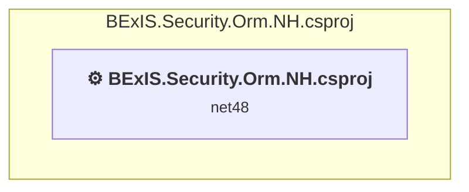

### API Compatibility

| Category | Count | Impact |
| :--- | :---: | :--- |
| 🔴 Binary Incompatible | 0 | High - Require code changes |
| 🟡 Source Incompatible | 0 | Medium - Needs re-compilation and potential conflicting API error fixing |
| 🔵 Behavioral change | 0 | Low - Behavioral changes that may require testing at runtime |
| ✅ Compatible | 0 |  |
| ***Total APIs Analyzed*** | ***0*** |  |

<a id="componentsaaabexissecurityservicestestsbexissecurityservicestestscsproj"></a>
### Components\AAA\BExIS.Security.Services.Tests\BExIS.Security.Services.Tests.csproj

#### Project Info

- **Current Target Framework:** net48
- **Proposed Target Framework:** net8.0
- **SDK-style**: False
- **Project Kind:** ClassicClassLibrary
- **Dependencies**: 6
- **Dependants**: 0
- **Number of Files**: 5
- **Number of Files with Incidents**: 2
- **Lines of Code**: 296
- **Estimated LOC to modify**: 17+ (at least 5,7% of the project)

#### Dependency Graph

Legend:
📦 SDK-style project
⚙️ Classic project

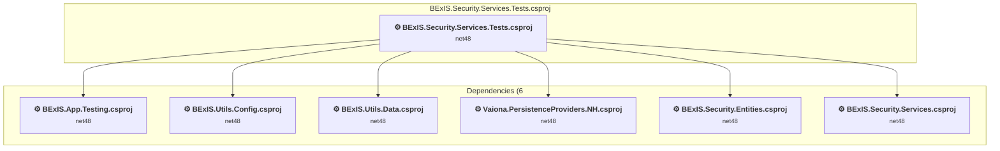

### API Compatibility

| Category | Count | Impact |
| :--- | :---: | :--- |
| 🔴 Binary Incompatible | 1 | High - Require code changes |
| 🟡 Source Incompatible | 16 | Medium - Needs re-compilation and potential conflicting API error fixing |
| 🔵 Behavioral change | 0 | Low - Behavioral changes that may require testing at runtime |
| ✅ Compatible | 168 |  |
| ***Total APIs Analyzed*** | ***185*** |  |

#### Project Technologies and Features

| Technology | Issues | Percentage | Migration Path |
| :--- | :---: | :---: | :--- |
| Legacy Configuration System | 16 | 94,1% | Legacy XML-based configuration system (app.config/web.config) that has been replaced by a more flexible configuration model in .NET Core. The old system was rigid and XML-based. Migrate to Microsoft.Extensions.Configuration with JSON/environment variables; use System.Configuration.ConfigurationManager NuGet package as interim bridge if needed. |

<a id="componentsaaabexissecurityservicesbexissecurityservicescsproj"></a>
### Components\AAA\BExIS.Security.Services\BExIS.Security.Services.csproj

#### Project Info

- **Current Target Framework:** net48
- **Proposed Target Framework:** net8.0
- **SDK-style**: False
- **Project Kind:** ClassicClassLibrary
- **Dependencies**: 7
- **Dependants**: 21
- **Number of Files**: 26
- **Number of Files with Incidents**: 8
- **Lines of Code**: 4345
- **Estimated LOC to modify**: 100+ (at least 2,3% of the project)

#### Dependency Graph

Legend:
📦 SDK-style project
⚙️ Classic project

```mermaid
flowchart TB
    subgraph upstream["Dependants (21)"]
        P7["<b>⚙️&nbsp;BExIS.Web.Shell.csproj</b><br/><small>net48</small>"]
        P8["<b>⚙️&nbsp;BExIS.Ext.Services.csproj</b><br/><small>net48</small>"]
        P13["<b>⚙️&nbsp;BExIS.Ddm.Providers.LuceneProvider.csproj</b><br/><small>net48</small>"]
        P17["<b>⚙️&nbsp;BExIS.Xml.Helpers.csproj</b><br/><small>net48</small>"]
        P22["<b>⚙️&nbsp;BExIS.Utils.csproj</b><br/><small>net48</small>"]
        P24["<b>⚙️&nbsp;BExIS.Dim.Helpers.csproj</b><br/><small>net48</small>"]
        P26["<b>⚙️&nbsp;BExIS.UI.csproj</b><br/><small>net48</small>"]
        P27["<b>⚙️&nbsp;BExIS.Utils.Data.csproj</b><br/><small>net48</small>"]
        P29["<b>⚙️&nbsp;BExIS.Modules.Bam.UI.csproj</b><br/><small>net48</small>"]
        P30["<b>⚙️&nbsp;BExIS.App.Bootstrap.csproj</b><br/><small>net48</small>"]
        P33["<b>⚙️&nbsp;BExIS.Modules.Vim.UI.csproj</b><br/><small>net48</small>"]
        P35["<b>⚙️&nbsp;IDIV.Modules.Mmm.UI.csproj</b><br/><small>net48</small>"]
        P37["<b>⚙️&nbsp;BExIS.Security.Services.Tests.csproj</b><br/><small>net48</small>"]
        P59["<b>⚙️&nbsp;BExIS.Modules.Dcm.UI.csproj</b><br/><small>net48</small>"]
        P61["<b>⚙️&nbsp;BExIS.Dlm.Tests.csproj</b><br/><small>net48</small>"]
        P62["<b>⚙️&nbsp;BExIS.Modules.Rpm.UI.csproj</b><br/><small>net48</small>"]
        P63["<b>⚙️&nbsp;BExIS.Modules.Sam.UI.csproj</b><br/><small>net48</small>"]
        P67["<b>⚙️&nbsp;BExIS.Modules.Ddm.UI.csproj</b><br/><small>net48</small>"]
        P71["<b>⚙️&nbsp;BExIS.Modules.Dim.UI.csproj</b><br/><small>net48</small>"]
        P72["<b>⚙️&nbsp;BExIS.Modules.PUM.UI.csproj</b><br/><small>net48</small>"]
        P73["<b>⚙️&nbsp;BExIS.Modules.SMM.UI.csproj</b><br/><small>net48</small>"]
        click P7 "#consolebexiswebshellbexiswebshellcsproj"
        click P8 "#componentsextbexisextservicesbexisextservicescsproj"
        click P13 "#modulesddmbexisddmprovidersluceneproviderbexisddmprovidersluceneprovidercsproj"
        click P17 "#componentsxmlbexisxmlhelpersbexisxmlhelperscsproj"
        click P22 "#componentsutilsbexisutilsbexisutilscsproj"
        click P24 "#modulesdimbexisdimhelperbexisdimhelperscsproj"
        click P26 "#componentsuibexisuibexisuicsproj"
        click P27 "#componentsutilsbexisutilsdatabexisutilsdatacsproj"
        click P29 "#consolebexiswebshellareasbambexismodulesbamuicsproj"
        click P30 "#componentsappbexisappbootstrapbexisappbootstrapcsproj"
        click P33 "#consolebexiswebshellareasvimbexismodulesvimuicsproj"
        click P35 "#consolebexiswebshellareasmmmidivmodulesmmmuicsproj"
        click P37 "#componentsaaabexissecurityservicestestsbexissecurityservicestestscsproj"
        click P59 "#consolebexiswebshellareasdcmbexismodulesdcmuibexismodulesdcmuicsproj"
        click P61 "#componentsdlmbexisdlmtestsbexisdlmtestscsproj"
        click P62 "#consolebexiswebshellareasrpmbexismodulesrpmuibexismodulesrpmuicsproj"
        click P63 "#consolebexiswebshellareassambexismodulessamuibexismodulessamuicsproj"
        click P67 "#consolebexiswebshellareasddmbexismodulesddmuibexismodulesddmuicsproj"
        click P71 "#consolebexiswebshellareasdimbexismodulesdimuibexismodulesdimuicsproj"
        click P72 "#consolebexiswebshellareaspumbexismodulespumuibexismodulespumuicsproj"
        click P73 "#consolebexiswebshellareassmmbexismodulessmmuibexismodulessmmuicsproj"
    end
    subgraph current["BExIS.Security.Services.csproj"]
        MAIN["<b>⚙️&nbsp;BExIS.Security.Services.csproj</b><br/><small>net48</small>"]
        click MAIN "#componentsaaabexissecurityservicesbexissecurityservicescsproj"
    end
    subgraph downstream["Dependencies (7"]
        P4["<b>⚙️&nbsp;BExIS.Dlm.Entities.csproj</b><br/><small>net48</small>"]
        P57["<b>⚙️&nbsp;BExIS.Utils.Config.csproj</b><br/><small>net48</small>"]
        P34["<b>⚙️&nbsp;BExIS.Utils.NH.csproj</b><br/><small>net48</small>"]
        P45["<b>⚙️&nbsp;Vaiona.IoC.csproj</b><br/><small>net48</small>"]
        P52["<b>⚙️&nbsp;Vaiona.Utils.csproj</b><br/><small>net48</small>"]
        P55["<b>⚙️&nbsp;Vaiona.Web.Mvc.Modularity.csproj</b><br/><small>net48</small>"]
        P1["<b>⚙️&nbsp;BExIS.Security.Entities.csproj</b><br/><small>net48</small>"]
        click P4 "#componentsdlmbexisdlmentitiesbexisdlmentitiescsproj"
        click P57 "#componentsutilsbexisutilsconfigbexisutilsconfigcsproj"
        click P34 "#componentsutilsbexisutilsnhbexisutilsnhcsproj"
        click P45 "#componentsvaionavaionaiocvaionaioccsproj"
        click P52 "#componentsvaionavaionautilsvaionautilscsproj"
        click P55 "#componentsvaionavaionawebmvcmodularityvaionawebmvcmodularitycsproj"
        click P1 "#componentsaaabexissecurityentitiesbexissecurityentitiescsproj"
    end
    P7 --> MAIN
    P8 --> MAIN
    P13 --> MAIN
    P17 --> MAIN
    P22 --> MAIN
    P24 --> MAIN
    P26 --> MAIN
    P27 --> MAIN
    P29 --> MAIN
    P30 --> MAIN
    P33 --> MAIN
    P35 --> MAIN
    P37 --> MAIN
    P59 --> MAIN
    P61 --> MAIN
    P62 --> MAIN
    P63 --> MAIN
    P67 --> MAIN
    P71 --> MAIN
    P72 --> MAIN
    P73 --> MAIN
    MAIN --> P4
    MAIN --> P57
    MAIN --> P34
    MAIN --> P45
    MAIN --> P52
    MAIN --> P55
    MAIN --> P1

```

### API Compatibility

| Category | Count | Impact |
| :--- | :---: | :--- |
| 🔴 Binary Incompatible | 68 | High - Require code changes |
| 🟡 Source Incompatible | 32 | Medium - Needs re-compilation and potential conflicting API error fixing |
| 🔵 Behavioral change | 0 | Low - Behavioral changes that may require testing at runtime |
| ✅ Compatible | 4840 |  |
| ***Total APIs Analyzed*** | ***4940*** |  |

#### Project Technologies and Features

| Technology | Issues | Percentage | Migration Path |
| :--- | :---: | :---: | :--- |
| Directory Services (LDAP/Active Directory) | 32 | 32,0% | APIs for interacting with directory services like Active Directory and LDAP that are available via NuGet packages. The core functionality has been moved to separate packages. Install System.DirectoryServices (AD/LDAP), System.DirectoryServices.AccountManagement (user/group management), System.DirectoryServices.Protocols (LDAP protocol). |

<a id="componentsappbexisappbootstrapbexisappbootstrapcsproj"></a>
### Components\App\BExIS.App.Bootstrap\BExIS.App.Bootstrap.csproj

#### Project Info

- **Current Target Framework:** net48
- **Proposed Target Framework:** net8.0
- **SDK-style**: False
- **Project Kind:** ClassicClassLibrary
- **Dependencies**: 16
- **Dependants**: 9
- **Number of Files**: 20
- **Number of Files with Incidents**: 14
- **Lines of Code**: 1619
- **Estimated LOC to modify**: 355+ (at least 21,9% of the project)

#### Dependency Graph

Legend:
📦 SDK-style project
⚙️ Classic project

```mermaid
flowchart TB
    subgraph upstream["Dependants (9)"]
        P7["<b>⚙️&nbsp;BExIS.Web.Shell.csproj</b><br/><small>net48</small>"]
        P31["<b>⚙️&nbsp;BExIS.App.Testing.csproj</b><br/><small>net48</small>"]
        P59["<b>⚙️&nbsp;BExIS.Modules.Dcm.UI.csproj</b><br/><small>net48</small>"]
        P62["<b>⚙️&nbsp;BExIS.Modules.Rpm.UI.csproj</b><br/><small>net48</small>"]
        P63["<b>⚙️&nbsp;BExIS.Modules.Sam.UI.csproj</b><br/><small>net48</small>"]
        P67["<b>⚙️&nbsp;BExIS.Modules.Ddm.UI.csproj</b><br/><small>net48</small>"]
        P68["<b>⚙️&nbsp;BExIS.UI.Tests.csproj</b><br/><small>net48</small>"]
        P71["<b>⚙️&nbsp;BExIS.Modules.Dim.UI.csproj</b><br/><small>net48</small>"]
        P73["<b>⚙️&nbsp;BExIS.Modules.SMM.UI.csproj</b><br/><small>net48</small>"]
        click P7 "#consolebexiswebshellbexiswebshellcsproj"
        click P31 "#componentsappbexisapptestingbexisapptestingcsproj"
        click P59 "#consolebexiswebshellareasdcmbexismodulesdcmuibexismodulesdcmuicsproj"
        click P62 "#consolebexiswebshellareasrpmbexismodulesrpmuibexismodulesrpmuicsproj"
        click P63 "#consolebexiswebshellareassambexismodulessamuibexismodulessamuicsproj"
        click P67 "#consolebexiswebshellareasddmbexismodulesddmuibexismodulesddmuicsproj"
        click P68 "#componentsuibexisuitestsbexisuitestscsproj"
        click P71 "#consolebexiswebshellareasdimbexismodulesdimuibexismodulesdimuicsproj"
        click P73 "#consolebexiswebshellareassmmbexismodulessmmuibexismodulessmmuicsproj"
    end
    subgraph current["BExIS.App.Bootstrap.csproj"]
        MAIN["<b>⚙️&nbsp;BExIS.App.Bootstrap.csproj</b><br/><small>net48</small>"]
        click MAIN "#componentsappbexisappbootstrapbexisappbootstrapcsproj"
    end
    subgraph downstream["Dependencies (16"]
        P1["<b>⚙️&nbsp;BExIS.Security.Entities.csproj</b><br/><small>net48</small>"]
        P3["<b>⚙️&nbsp;BExIS.Security.Services.csproj</b><br/><small>net48</small>"]
        P8["<b>⚙️&nbsp;BExIS.Ext.Services.csproj</b><br/><small>net48</small>"]
        P57["<b>⚙️&nbsp;BExIS.Utils.Config.csproj</b><br/><small>net48</small>"]
        P27["<b>⚙️&nbsp;BExIS.Utils.Data.csproj</b><br/><small>net48</small>"]
        P43["<b>⚙️&nbsp;Vaiona.Entities.csproj</b><br/><small>net48</small>"]
        P45["<b>⚙️&nbsp;Vaiona.IoC.csproj</b><br/><small>net48</small>"]
        P58["<b>⚙️&nbsp;Vaiona.Logging.csproj</b><br/><small>net48</small>"]
        P46["<b>⚙️&nbsp;Vaiona.Model.csproj</b><br/><small>net48</small>"]
        P47["<b>⚙️&nbsp;Vaiona.MultiTenancy.Api.csproj</b><br/><small>net48</small>"]
        P48["<b>⚙️&nbsp;Vaiona.MultiTenancy.Services.csproj</b><br/><small>net48</small>"]
        P49["<b>⚙️&nbsp;Vaiona.Persistence.Api.csproj</b><br/><small>net48</small>"]
        P51["<b>⚙️&nbsp;Vaiona.Persistence.NH.csproj</b><br/><small>net48</small>"]
        P50["<b>⚙️&nbsp;Vaiona.PersistenceProviders.NH.csproj</b><br/><small>net48</small>"]
        P52["<b>⚙️&nbsp;Vaiona.Utils.csproj</b><br/><small>net48</small>"]
        P55["<b>⚙️&nbsp;Vaiona.Web.Mvc.Modularity.csproj</b><br/><small>net48</small>"]
        click P1 "#componentsaaabexissecurityentitiesbexissecurityentitiescsproj"
        click P3 "#componentsaaabexissecurityservicesbexissecurityservicescsproj"
        click P8 "#componentsextbexisextservicesbexisextservicescsproj"
        click P57 "#componentsutilsbexisutilsconfigbexisutilsconfigcsproj"
        click P27 "#componentsutilsbexisutilsdatabexisutilsdatacsproj"
        click P43 "#componentsvaionavaionaentitiesvaionaentitiescsproj"
        click P45 "#componentsvaionavaionaiocvaionaioccsproj"
        click P58 "#componentsvaionavaionaloggingvaionaloggingcsproj"
        click P46 "#componentsvaionavaionamodelvaionamodelcsproj"
        click P47 "#componentsvaionavaionamultitenancyapivaionamultitenancyapicsproj"
        click P48 "#componentsvaionavaionamultitenancyservicesvaionamultitenancyservicescsproj"
        click P49 "#componentsvaionavaionapersistenceapivaionapersistenceapicsproj"
        click P51 "#componentsvaionavaionapersistencenhvaionapersistencenhcsproj"
        click P50 "#componentsvaionavaionapersistenceprovidersnhvaionapersistenceprovidersnhcsproj"
        click P52 "#componentsvaionavaionautilsvaionautilscsproj"
        click P55 "#componentsvaionavaionawebmvcmodularityvaionawebmvcmodularitycsproj"
    end
    P7 --> MAIN
    P31 --> MAIN
    P59 --> MAIN
    P62 --> MAIN
    P63 --> MAIN
    P67 --> MAIN
    P68 --> MAIN
    P71 --> MAIN
    P73 --> MAIN
    MAIN --> P1
    MAIN --> P3
    MAIN --> P8
    MAIN --> P57
    MAIN --> P27
    MAIN --> P43
    MAIN --> P45
    MAIN --> P58
    MAIN --> P46
    MAIN --> P47
    MAIN --> P48
    MAIN --> P49
    MAIN --> P51
    MAIN --> P50
    MAIN --> P52
    MAIN --> P55

```

### API Compatibility

| Category | Count | Impact |
| :--- | :---: | :--- |
| 🔴 Binary Incompatible | 238 | High - Require code changes |
| 🟡 Source Incompatible | 117 | Medium - Needs re-compilation and potential conflicting API error fixing |
| 🔵 Behavioral change | 0 | Low - Behavioral changes that may require testing at runtime |
| ✅ Compatible | 1013 |  |
| ***Total APIs Analyzed*** | ***1368*** |  |

#### Project Technologies and Features

| Technology | Issues | Percentage | Migration Path |
| :--- | :---: | :---: | :--- |
| Legacy Configuration System | 4 | 1,1% | Legacy XML-based configuration system (app.config/web.config) that has been replaced by a more flexible configuration model in .NET Core. The old system was rigid and XML-based. Migrate to Microsoft.Extensions.Configuration with JSON/environment variables; use System.Configuration.ConfigurationManager NuGet package as interim bridge if needed. |
| IdentityModel & Claims-based Security | 10 | 2,8% | Windows Identity Foundation (WIF), SAML, and claims-based authentication APIs that have been replaced by modern identity libraries. WIF was the original identity framework for .NET Framework. Migrate to Microsoft.IdentityModel.* packages (modern identity stack). |
| ASP.NET Framework (System.Web) | 319 | 89,9% | Legacy ASP.NET Framework APIs for web applications (System.Web.*) that don't exist in ASP.NET Core due to architectural differences. ASP.NET Core represents a complete redesign of the web framework. Migrate to ASP.NET Core equivalents or consider System.Web.Adapters package for compatibility. |

<a id="componentsappbexisapptestingbexisapptestingcsproj"></a>
### Components\App\BExIS.App.Testing\BExIS.App.Testing.csproj

#### Project Info

- **Current Target Framework:** net48
- **Proposed Target Framework:** net8.0
- **SDK-style**: False
- **Project Kind:** ClassicClassLibrary
- **Dependencies**: 10
- **Dependants**: 9
- **Number of Files**: 4
- **Number of Files with Incidents**: 4
- **Lines of Code**: 347
- **Estimated LOC to modify**: 51+ (at least 14,7% of the project)

#### Dependency Graph

Legend:
📦 SDK-style project
⚙️ Classic project


### API Compatibility

| Category | Count | Impact |
| :--- | :---: | :--- |
| 🔴 Binary Incompatible | 19 | High - Require code changes |
| 🟡 Source Incompatible | 32 | Medium - Needs re-compilation and potential conflicting API error fixing |
| 🔵 Behavioral change | 0 | Low - Behavioral changes that may require testing at runtime |
| ✅ Compatible | 285 |  |
| ***Total APIs Analyzed*** | ***336*** |  |

#### Project Technologies and Features

| Technology | Issues | Percentage | Migration Path |
| :--- | :---: | :---: | :--- |
| Legacy Configuration System | 8 | 15,7% | Legacy XML-based configuration system (app.config/web.config) that has been replaced by a more flexible configuration model in .NET Core. The old system was rigid and XML-based. Migrate to Microsoft.Extensions.Configuration with JSON/environment variables; use System.Configuration.ConfigurationManager NuGet package as interim bridge if needed. |
| ASP.NET Framework (System.Web) | 42 | 82,4% | Legacy ASP.NET Framework APIs for web applications (System.Web.*) that don't exist in ASP.NET Core due to architectural differences. ASP.NET Core represents a complete redesign of the web framework. Migrate to ASP.NET Core equivalents or consider System.Web.Adapters package for compatibility. |

<a id="componentsdlmbexisdlmentitiesbexisdlmentitiescsproj"></a>
### Components\DLM\BExIS.Dlm.Entities\BExIS.Dlm.Entities.csproj

#### Project Info

- **Current Target Framework:** net48
- **Proposed Target Framework:** net8.0
- **SDK-style**: False
- **Project Kind:** ClassicClassLibrary
- **Dependencies**: 2
- **Dependants**: 29
- **Number of Files**: 65
- **Number of Files with Incidents**: 1
- **Lines of Code**: 5039
- **Estimated LOC to modify**: 0+ (at least 0,0% of the project)

#### Dependency Graph

Legend:
📦 SDK-style project
⚙️ Classic project

```mermaid
flowchart TB
    subgraph upstream["Dependants (29)"]
        P3["<b>⚙️&nbsp;BExIS.Security.Services.csproj</b><br/><small>net48</small>"]
        P6["<b>⚙️&nbsp;BExIS.Dlm.Services.csproj</b><br/><small>net48</small>"]
        P7["<b>⚙️&nbsp;BExIS.Web.Shell.csproj</b><br/><small>net48</small>"]
        P13["<b>⚙️&nbsp;BExIS.Ddm.Providers.LuceneProvider.csproj</b><br/><small>net48</small>"]
        P14["<b>⚙️&nbsp;BExIS.IO.Transform.Input.csproj</b><br/><small>net48</small>"]
        P16["<b>⚙️&nbsp;BExIS.IO.Transform.Validation.csproj</b><br/><small>net48</small>"]
        P17["<b>⚙️&nbsp;BExIS.Xml.Helpers.csproj</b><br/><small>net48</small>"]
        P23["<b>⚙️&nbsp;BExIS.Dim.Entities.csproj</b><br/><small>net48</small>"]
        P24["<b>⚙️&nbsp;BExIS.Dim.Helpers.csproj</b><br/><small>net48</small>"]
        P26["<b>⚙️&nbsp;BExIS.UI.csproj</b><br/><small>net48</small>"]
        P27["<b>⚙️&nbsp;BExIS.Utils.Data.csproj</b><br/><small>net48</small>"]
        P29["<b>⚙️&nbsp;BExIS.Modules.Bam.UI.csproj</b><br/><small>net48</small>"]
        P32["<b>⚙️&nbsp;BExIS.IO.Tests.csproj</b><br/><small>net48</small>"]
        P33["<b>⚙️&nbsp;BExIS.Modules.Vim.UI.csproj</b><br/><small>net48</small>"]
        P35["<b>⚙️&nbsp;IDIV.Modules.Mmm.UI.csproj</b><br/><small>net48</small>"]
        P36["<b>⚙️&nbsp;BExIS.Xml.Helpers.UnitTests.csproj</b><br/><small>net48</small>"]
        P39["<b>⚙️&nbsp;BEXIS.JSON.Helpers.csproj</b><br/><small>net48</small>"]
        P40["<b>⚙️&nbsp;BExIS.Utils.Data.Tests.csproj</b><br/><small>net48</small>"]
        P59["<b>⚙️&nbsp;BExIS.Modules.Dcm.UI.csproj</b><br/><small>net48</small>"]
        P61["<b>⚙️&nbsp;BExIS.Dlm.Tests.csproj</b><br/><small>net48</small>"]
        P62["<b>⚙️&nbsp;BExIS.Modules.Rpm.UI.csproj</b><br/><small>net48</small>"]
        P63["<b>⚙️&nbsp;BExIS.Modules.Sam.UI.csproj</b><br/><small>net48</small>"]
        P66["<b>⚙️&nbsp;BExIS.Dim.Services.csproj</b><br/><small>net48</small>"]
        P67["<b>⚙️&nbsp;BExIS.Modules.Ddm.UI.csproj</b><br/><small>net48</small>"]
        P68["<b>⚙️&nbsp;BExIS.UI.Tests.csproj</b><br/><small>net48</small>"]
        P71["<b>⚙️&nbsp;BExIS.Modules.Dim.UI.csproj</b><br/><small>net48</small>"]
        P72["<b>⚙️&nbsp;BExIS.Modules.PUM.UI.csproj</b><br/><small>net48</small>"]
        P73["<b>⚙️&nbsp;BExIS.Modules.SMM.UI.csproj</b><br/><small>net48</small>"]
        click P3 "#componentsaaabexissecurityservicesbexissecurityservicescsproj"
        click P6 "#componentsdlmbexisdlmservicesbexisdlmservicescsproj"
        click P7 "#consolebexiswebshellbexiswebshellcsproj"
        click P13 "#modulesddmbexisddmprovidersluceneproviderbexisddmprovidersluceneprovidercsproj"
        click P14 "#componentsiobexisiotransforminputbexisiotransforminputcsproj"
        click P16 "#componentsiobexisiotransformvalidationbexisiotransformvalidationcsproj"
        click P17 "#componentsxmlbexisxmlhelpersbexisxmlhelperscsproj"
        click P23 "#modulesdimbexisdimentitiesbexisdimentitiescsproj"
        click P24 "#modulesdimbexisdimhelperbexisdimhelperscsproj"
        click P26 "#componentsuibexisuibexisuicsproj"
        click P27 "#componentsutilsbexisutilsdatabexisutilsdatacsproj"
        click P29 "#consolebexiswebshellareasbambexismodulesbamuicsproj"
        click P32 "#componentsiobexisiotestsbexisiotestscsproj"
        click P33 "#consolebexiswebshellareasvimbexismodulesvimuicsproj"
        click P35 "#consolebexiswebshellareasmmmidivmodulesmmmuicsproj"
        click P36 "#componentsxmlbexisxmlhelpersunittestsbexisxmlhelpersunittestscsproj"
        click P39 "#componentsjsonbexisjsonhelpersbexisjsonhelperscsproj"
        click P40 "#componentsutilsbexisutilsdatatestsbexisutilsdatatestscsproj"
        click P59 "#consolebexiswebshellareasdcmbexismodulesdcmuibexismodulesdcmuicsproj"
        click P61 "#componentsdlmbexisdlmtestsbexisdlmtestscsproj"
        click P62 "#consolebexiswebshellareasrpmbexismodulesrpmuibexismodulesrpmuicsproj"
        click P63 "#consolebexiswebshellareassambexismodulessamuibexismodulessamuicsproj"
        click P66 "#modulesdimbexisdimservicesbexisdimservicescsproj"
        click P67 "#consolebexiswebshellareasddmbexismodulesddmuibexismodulesddmuicsproj"
        click P68 "#componentsuibexisuitestsbexisuitestscsproj"
        click P71 "#consolebexiswebshellareasdimbexismodulesdimuibexismodulesdimuicsproj"
        click P72 "#consolebexiswebshellareaspumbexismodulespumuibexismodulespumuicsproj"
        click P73 "#consolebexiswebshellareassmmbexismodulessmmuibexismodulessmmuicsproj"
    end
    subgraph current["BExIS.Dlm.Entities.csproj"]
        MAIN["<b>⚙️&nbsp;BExIS.Dlm.Entities.csproj</b><br/><small>net48</small>"]
        click MAIN "#componentsdlmbexisdlmentitiesbexisdlmentitiescsproj"
    end
    subgraph downstream["Dependencies (2"]
        P1["<b>⚙️&nbsp;BExIS.Security.Entities.csproj</b><br/><small>net48</small>"]
        P43["<b>⚙️&nbsp;Vaiona.Entities.csproj</b><br/><small>net48</small>"]
        click P1 "#componentsaaabexissecurityentitiesbexissecurityentitiescsproj"
        click P43 "#componentsvaionavaionaentitiesvaionaentitiescsproj"
    end
    P3 --> MAIN
    P6 --> MAIN
    P7 --> MAIN
    P13 --> MAIN
    P14 --> MAIN
    P16 --> MAIN
    P17 --> MAIN
    P23 --> MAIN
    P24 --> MAIN
    P26 --> MAIN
    P27 --> MAIN
    P29 --> MAIN
    P32 --> MAIN
    P33 --> MAIN
    P35 --> MAIN
    P36 --> MAIN
    P39 --> MAIN
    P40 --> MAIN
    P59 --> MAIN
    P61 --> MAIN
    P62 --> MAIN
    P63 --> MAIN
    P64 --> MAIN
    P66 --> MAIN
    P67 --> MAIN
    P68 --> MAIN
    P71 --> MAIN
    P72 --> MAIN
    P73 --> MAIN
    MAIN --> P1
    MAIN --> P43

```

### API Compatibility

| Category | Count | Impact |
| :--- | :---: | :--- |
| 🔴 Binary Incompatible | 0 | High - Require code changes |
| 🟡 Source Incompatible | 0 | Medium - Needs re-compilation and potential conflicting API error fixing |
| 🔵 Behavioral change | 0 | Low - Behavioral changes that may require testing at runtime |
| ✅ Compatible | 3275 |  |
| ***Total APIs Analyzed*** | ***3275*** |  |

<a id="componentsdlmbexisdlmormnhbexisdlmormnhcsproj"></a>
### Components\DLM\BExIS.Dlm.Orm.NH\BExIS.Dlm.Orm.NH.csproj

#### Project Info

- **Current Target Framework:** net48
- **Proposed Target Framework:** net8.0
- **SDK-style**: False
- **Project Kind:** ClassicClassLibrary
- **Dependencies**: 3
- **Dependants**: 1
- **Number of Files**: 63
- **Number of Files with Incidents**: 1
- **Lines of Code**: 462
- **Estimated LOC to modify**: 0+ (at least 0,0% of the project)

#### Dependency Graph

Legend:
📦 SDK-style project
⚙️ Classic project

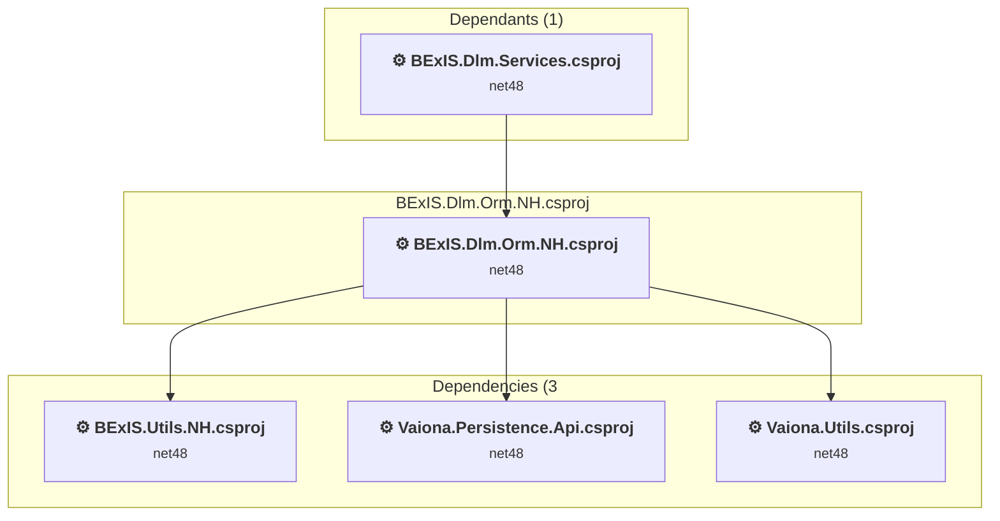

### API Compatibility

| Category | Count | Impact |
| :--- | :---: | :--- |
| 🔴 Binary Incompatible | 0 | High - Require code changes |
| 🟡 Source Incompatible | 0 | Medium - Needs re-compilation and potential conflicting API error fixing |
| 🔵 Behavioral change | 0 | Low - Behavioral changes that may require testing at runtime |
| ✅ Compatible | 478 |  |
| ***Total APIs Analyzed*** | ***478*** |  |

<a id="componentsdlmbexisdlmservicesbexisdlmservicescsproj"></a>
### Components\DLM\BExIS.Dlm.Services\BExIS.Dlm.Services.csproj

#### Project Info

- **Current Target Framework:** net48
- **Proposed Target Framework:** net8.0
- **SDK-style**: False
- **Project Kind:** ClassicClassLibrary
- **Dependencies**: 9
- **Dependants**: 23
- **Number of Files**: 35
- **Number of Files with Incidents**: 1
- **Lines of Code**: 14194
- **Estimated LOC to modify**: 0+ (at least 0,0% of the project)

#### Dependency Graph

Legend:
📦 SDK-style project
⚙️ Classic project

```mermaid
flowchart TB
    subgraph upstream["Dependants (23)"]
        P7["<b>⚙️&nbsp;BExIS.Web.Shell.csproj</b><br/><small>net48</small>"]
        P13["<b>⚙️&nbsp;BExIS.Ddm.Providers.LuceneProvider.csproj</b><br/><small>net48</small>"]
        P14["<b>⚙️&nbsp;BExIS.IO.Transform.Input.csproj</b><br/><small>net48</small>"]
        P17["<b>⚙️&nbsp;BExIS.Xml.Helpers.csproj</b><br/><small>net48</small>"]
        P21["<b>⚙️&nbsp;BExIS.IO.DataType.DisplayPattern.csproj</b><br/><small>net48</small>"]
        P24["<b>⚙️&nbsp;BExIS.Dim.Helpers.csproj</b><br/><small>net48</small>"]
        P27["<b>⚙️&nbsp;BExIS.Utils.Data.csproj</b><br/><small>net48</small>"]
        P29["<b>⚙️&nbsp;BExIS.Modules.Bam.UI.csproj</b><br/><small>net48</small>"]
        P32["<b>⚙️&nbsp;BExIS.IO.Tests.csproj</b><br/><small>net48</small>"]
        P33["<b>⚙️&nbsp;BExIS.Modules.Vim.UI.csproj</b><br/><small>net48</small>"]
        P35["<b>⚙️&nbsp;IDIV.Modules.Mmm.UI.csproj</b><br/><small>net48</small>"]
        P36["<b>⚙️&nbsp;BExIS.Xml.Helpers.UnitTests.csproj</b><br/><small>net48</small>"]
        P39["<b>⚙️&nbsp;BEXIS.JSON.Helpers.csproj</b><br/><small>net48</small>"]
        P40["<b>⚙️&nbsp;BExIS.Utils.Data.Tests.csproj</b><br/><small>net48</small>"]
        P59["<b>⚙️&nbsp;BExIS.Modules.Dcm.UI.csproj</b><br/><small>net48</small>"]
        P61["<b>⚙️&nbsp;BExIS.Dlm.Tests.csproj</b><br/><small>net48</small>"]
        P62["<b>⚙️&nbsp;BExIS.Modules.Rpm.UI.csproj</b><br/><small>net48</small>"]
        P63["<b>⚙️&nbsp;BExIS.Modules.Sam.UI.csproj</b><br/><small>net48</small>"]
        P67["<b>⚙️&nbsp;BExIS.Modules.Ddm.UI.csproj</b><br/><small>net48</small>"]
        P71["<b>⚙️&nbsp;BExIS.Modules.Dim.UI.csproj</b><br/><small>net48</small>"]
        P72["<b>⚙️&nbsp;BExIS.Modules.PUM.UI.csproj</b><br/><small>net48</small>"]
        P73["<b>⚙️&nbsp;BExIS.Modules.SMM.UI.csproj</b><br/><small>net48</small>"]
        click P7 "#consolebexiswebshellbexiswebshellcsproj"
        click P13 "#modulesddmbexisddmprovidersluceneproviderbexisddmprovidersluceneprovidercsproj"
        click P14 "#componentsiobexisiotransforminputbexisiotransforminputcsproj"
        click P17 "#componentsxmlbexisxmlhelpersbexisxmlhelperscsproj"
        click P21 "#componentsiobexisiodatatypedisplaypatternbexisiodatatypedisplaypatterncsproj"
        click P24 "#modulesdimbexisdimhelperbexisdimhelperscsproj"
        click P27 "#componentsutilsbexisutilsdatabexisutilsdatacsproj"
        click P29 "#consolebexiswebshellareasbambexismodulesbamuicsproj"
        click P32 "#componentsiobexisiotestsbexisiotestscsproj"
        click P33 "#consolebexiswebshellareasvimbexismodulesvimuicsproj"
        click P35 "#consolebexiswebshellareasmmmidivmodulesmmmuicsproj"
        click P36 "#componentsxmlbexisxmlhelpersunittestsbexisxmlhelpersunittestscsproj"
        click P39 "#componentsjsonbexisjsonhelpersbexisjsonhelperscsproj"
        click P40 "#componentsutilsbexisutilsdatatestsbexisutilsdatatestscsproj"
        click P59 "#consolebexiswebshellareasdcmbexismodulesdcmuibexismodulesdcmuicsproj"
        click P61 "#componentsdlmbexisdlmtestsbexisdlmtestscsproj"
        click P62 "#consolebexiswebshellareasrpmbexismodulesrpmuibexismodulesrpmuicsproj"
        click P63 "#consolebexiswebshellareassambexismodulessamuibexismodulessamuicsproj"
        click P67 "#consolebexiswebshellareasddmbexismodulesddmuibexismodulesddmuicsproj"
        click P71 "#consolebexiswebshellareasdimbexismodulesdimuibexismodulesdimuicsproj"
        click P72 "#consolebexiswebshellareaspumbexismodulespumuibexismodulespumuicsproj"
        click P73 "#consolebexiswebshellareassmmbexismodulessmmuibexismodulessmmuicsproj"
    end
    subgraph current["BExIS.Dlm.Services.csproj"]
        MAIN["<b>⚙️&nbsp;BExIS.Dlm.Services.csproj</b><br/><small>net48</small>"]
        click MAIN "#componentsdlmbexisdlmservicesbexisdlmservicescsproj"
    end
    subgraph downstream["Dependencies (9"]
        P1["<b>⚙️&nbsp;BExIS.Security.Entities.csproj</b><br/><small>net48</small>"]
        P20["<b>⚙️&nbsp;BExIS.Ext.Model.csproj</b><br/><small>net48</small>"]
        P34["<b>⚙️&nbsp;BExIS.Utils.NH.csproj</b><br/><small>net48</small>"]
        P43["<b>⚙️&nbsp;Vaiona.Entities.csproj</b><br/><small>net48</small>"]
        P58["<b>⚙️&nbsp;Vaiona.Logging.csproj</b><br/><small>net48</small>"]
        P49["<b>⚙️&nbsp;Vaiona.Persistence.Api.csproj</b><br/><small>net48</small>"]
        P52["<b>⚙️&nbsp;Vaiona.Utils.csproj</b><br/><small>net48</small>"]
        P4["<b>⚙️&nbsp;BExIS.Dlm.Entities.csproj</b><br/><small>net48</small>"]
        P5["<b>⚙️&nbsp;BExIS.Dlm.Orm.NH.csproj</b><br/><small>net48</small>"]
        click P1 "#componentsaaabexissecurityentitiesbexissecurityentitiescsproj"
        click P20 "#componentsextbexisextmodelbexisextmodelcsproj"
        click P34 "#componentsutilsbexisutilsnhbexisutilsnhcsproj"
        click P43 "#componentsvaionavaionaentitiesvaionaentitiescsproj"
        click P58 "#componentsvaionavaionaloggingvaionaloggingcsproj"
        click P49 "#componentsvaionavaionapersistenceapivaionapersistenceapicsproj"
        click P52 "#componentsvaionavaionautilsvaionautilscsproj"
        click P4 "#componentsdlmbexisdlmentitiesbexisdlmentitiescsproj"
        click P5 "#componentsdlmbexisdlmormnhbexisdlmormnhcsproj"
    end
    P7 --> MAIN
    P13 --> MAIN
    P14 --> MAIN
    P17 --> MAIN
    P21 --> MAIN
    P24 --> MAIN
    P27 --> MAIN
    P29 --> MAIN
    P32 --> MAIN
    P33 --> MAIN
    P35 --> MAIN
    P36 --> MAIN
    P39 --> MAIN
    P40 --> MAIN
    P59 --> MAIN
    P61 --> MAIN
    P62 --> MAIN
    P63 --> MAIN
    P64 --> MAIN
    P67 --> MAIN
    P71 --> MAIN
    P72 --> MAIN
    P73 --> MAIN
    MAIN --> P1
    MAIN --> P20
    MAIN --> P34
    MAIN --> P43
    MAIN --> P58
    MAIN --> P49
    MAIN --> P52
    MAIN --> P4
    MAIN --> P5

```

### API Compatibility

| Category | Count | Impact |
| :--- | :---: | :--- |
| 🔴 Binary Incompatible | 0 | High - Require code changes |
| 🟡 Source Incompatible | 0 | Medium - Needs re-compilation and potential conflicting API error fixing |
| 🔵 Behavioral change | 0 | Low - Behavioral changes that may require testing at runtime |
| ✅ Compatible | 11322 |  |
| ***Total APIs Analyzed*** | ***11322*** |  |

<a id="componentsdlmbexisdlmtestsbexisdlmtestscsproj"></a>
### Components\DLM\BExIS.Dlm.Tests\BExIS.Dlm.Tests.csproj

#### Project Info

- **Current Target Framework:** net48
- **Proposed Target Framework:** net8.0
- **SDK-style**: False
- **Project Kind:** ClassicClassLibrary
- **Dependencies**: 13
- **Dependants**: 0
- **Number of Files**: 26
- **Number of Files with Incidents**: 1
- **Lines of Code**: 6483
- **Estimated LOC to modify**: 0+ (at least 0,0% of the project)

#### Dependency Graph

Legend:
📦 SDK-style project
⚙️ Classic project

```mermaid
flowchart TB
    subgraph current["BExIS.Dlm.Tests.csproj"]
        MAIN["<b>⚙️&nbsp;BExIS.Dlm.Tests.csproj</b><br/><small>net48</small>"]
        click MAIN "#componentsdlmbexisdlmtestsbexisdlmtestscsproj"
    end
    subgraph downstream["Dependencies (13"]
        P1["<b>⚙️&nbsp;BExIS.Security.Entities.csproj</b><br/><small>net48</small>"]
        P3["<b>⚙️&nbsp;BExIS.Security.Services.csproj</b><br/><small>net48</small>"]
        P31["<b>⚙️&nbsp;BExIS.App.Testing.csproj</b><br/><small>net48</small>"]
        P57["<b>⚙️&nbsp;BExIS.Utils.Config.csproj</b><br/><small>net48</small>"]
        P27["<b>⚙️&nbsp;BExIS.Utils.Data.csproj</b><br/><small>net48</small>"]
        P34["<b>⚙️&nbsp;BExIS.Utils.NH.csproj</b><br/><small>net48</small>"]
        P43["<b>⚙️&nbsp;Vaiona.Entities.csproj</b><br/><small>net48</small>"]
        P45["<b>⚙️&nbsp;Vaiona.IoC.csproj</b><br/><small>net48</small>"]
        P49["<b>⚙️&nbsp;Vaiona.Persistence.Api.csproj</b><br/><small>net48</small>"]
        P50["<b>⚙️&nbsp;Vaiona.PersistenceProviders.NH.csproj</b><br/><small>net48</small>"]
        P17["<b>⚙️&nbsp;BExIS.Xml.Helpers.csproj</b><br/><small>net48</small>"]
        P4["<b>⚙️&nbsp;BExIS.Dlm.Entities.csproj</b><br/><small>net48</small>"]
        P6["<b>⚙️&nbsp;BExIS.Dlm.Services.csproj</b><br/><small>net48</small>"]
        click P1 "#componentsaaabexissecurityentitiesbexissecurityentitiescsproj"
        click P3 "#componentsaaabexissecurityservicesbexissecurityservicescsproj"
        click P31 "#componentsappbexisapptestingbexisapptestingcsproj"
        click P57 "#componentsutilsbexisutilsconfigbexisutilsconfigcsproj"
        click P27 "#componentsutilsbexisutilsdatabexisutilsdatacsproj"
        click P34 "#componentsutilsbexisutilsnhbexisutilsnhcsproj"
        click P43 "#componentsvaionavaionaentitiesvaionaentitiescsproj"
        click P45 "#componentsvaionavaionaiocvaionaioccsproj"
        click P49 "#componentsvaionavaionapersistenceapivaionapersistenceapicsproj"
        click P50 "#componentsvaionavaionapersistenceprovidersnhvaionapersistenceprovidersnhcsproj"
        click P17 "#componentsxmlbexisxmlhelpersbexisxmlhelperscsproj"
        click P4 "#componentsdlmbexisdlmentitiesbexisdlmentitiescsproj"
        click P6 "#componentsdlmbexisdlmservicesbexisdlmservicescsproj"
    end
    MAIN --> P1
    MAIN --> P3
    MAIN --> P31
    MAIN --> P57
    MAIN --> P27
    MAIN --> P34
    MAIN --> P43
    MAIN --> P45
    MAIN --> P49
    MAIN --> P50
    MAIN --> P17
    MAIN --> P4
    MAIN --> P6

```

### API Compatibility

| Category | Count | Impact |
| :--- | :---: | :--- |
| 🔴 Binary Incompatible | 0 | High - Require code changes |
| 🟡 Source Incompatible | 0 | Medium - Needs re-compilation and potential conflicting API error fixing |
| 🔵 Behavioral change | 0 | Low - Behavioral changes that may require testing at runtime |
| ✅ Compatible | 6077 |  |
| ***Total APIs Analyzed*** | ***6077*** |  |

<a id="componentsextbexisextentitiesbexisextentitiescsproj"></a>
### Components\EXT\BExIS.Ext.Entities\BExIS.Ext.Entities.csproj

#### Project Info

- **Current Target Framework:** net48
- **Proposed Target Framework:** net8.0
- **SDK-style**: False
- **Project Kind:** ClassicClassLibrary
- **Dependencies**: 0
- **Dependants**: 0
- **Number of Files**: 1
- **Number of Files with Incidents**: 1
- **Lines of Code**: 35
- **Estimated LOC to modify**: 0+ (at least 0,0% of the project)

#### Dependency Graph

Legend:
📦 SDK-style project
⚙️ Classic project

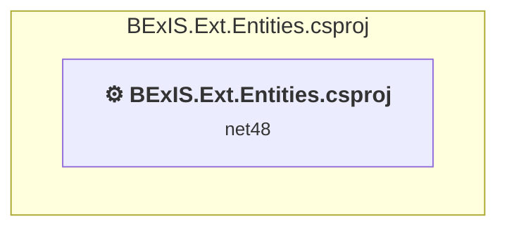

### API Compatibility

| Category | Count | Impact |
| :--- | :---: | :--- |
| 🔴 Binary Incompatible | 0 | High - Require code changes |
| 🟡 Source Incompatible | 0 | Medium - Needs re-compilation and potential conflicting API error fixing |
| 🔵 Behavioral change | 0 | Low - Behavioral changes that may require testing at runtime |
| ✅ Compatible | 0 |  |
| ***Total APIs Analyzed*** | ***0*** |  |

<a id="componentsextbexisextmodelbexisextmodelcsproj"></a>
### Components\EXT\BExIS.Ext.Model\BExIS.Ext.Model.csproj

#### Project Info

- **Current Target Framework:** net48
- **Proposed Target Framework:** net8.0
- **SDK-style**: False
- **Project Kind:** ClassicClassLibrary
- **Dependencies**: 1
- **Dependants**: 1
- **Number of Files**: 11
- **Number of Files with Incidents**: 1
- **Lines of Code**: 251
- **Estimated LOC to modify**: 0+ (at least 0,0% of the project)

#### Dependency Graph

Legend:
📦 SDK-style project
⚙️ Classic project

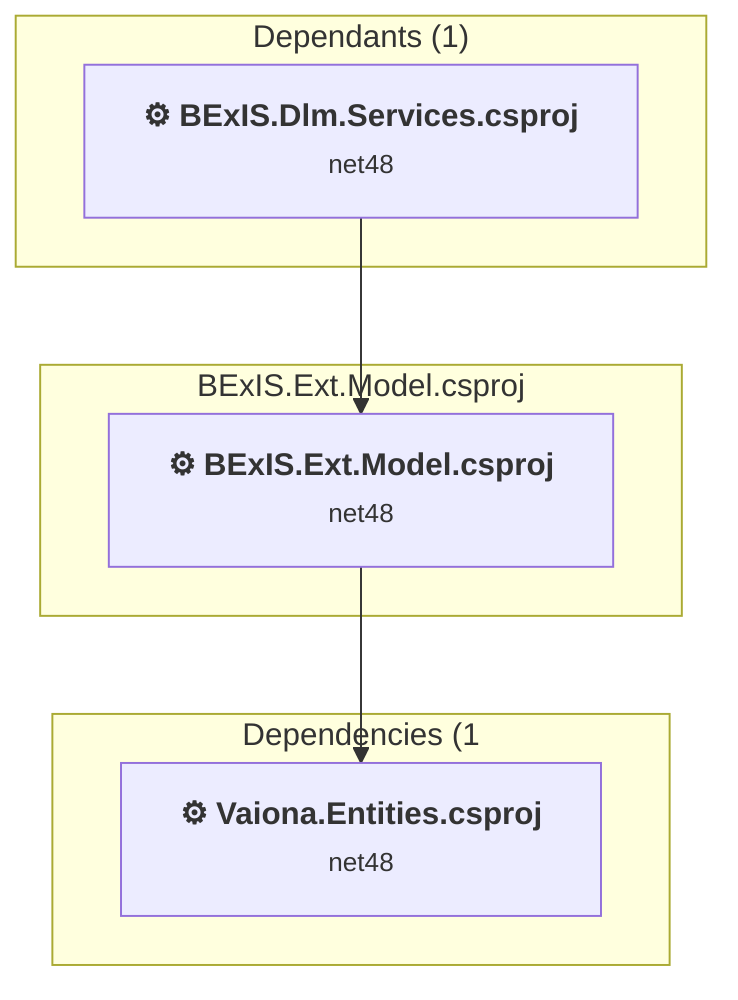

### API Compatibility

| Category | Count | Impact |
| :--- | :---: | :--- |
| 🔴 Binary Incompatible | 0 | High - Require code changes |
| 🟡 Source Incompatible | 0 | Medium - Needs re-compilation and potential conflicting API error fixing |
| 🔵 Behavioral change | 0 | Low - Behavioral changes that may require testing at runtime |
| ✅ Compatible | 123 |  |
| ***Total APIs Analyzed*** | ***123*** |  |

<a id="componentsextbexisextormnhbexisextormnhcsproj"></a>
### Components\EXT\BExIS.Ext.Orm.NH\BExIS.Ext.Orm.NH.csproj

#### Project Info

- **Current Target Framework:** net48
- **Proposed Target Framework:** net8.0
- **SDK-style**: False
- **Project Kind:** ClassicClassLibrary
- **Dependencies**: 0
- **Dependants**: 0
- **Number of Files**: 1
- **Number of Files with Incidents**: 1
- **Lines of Code**: 35
- **Estimated LOC to modify**: 0+ (at least 0,0% of the project)

#### Dependency Graph

Legend:
📦 SDK-style project
⚙️ Classic project

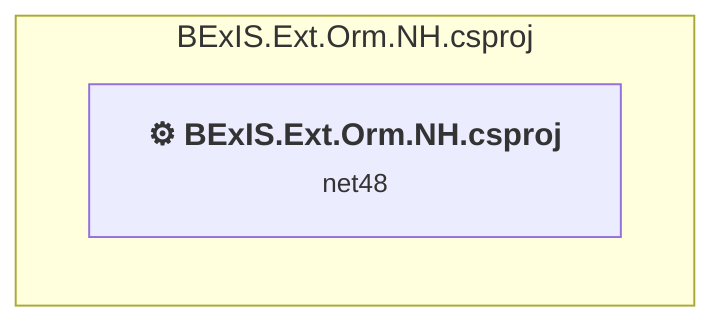

### API Compatibility

| Category | Count | Impact |
| :--- | :---: | :--- |
| 🔴 Binary Incompatible | 0 | High - Require code changes |
| 🟡 Source Incompatible | 0 | Medium - Needs re-compilation and potential conflicting API error fixing |
| 🔵 Behavioral change | 0 | Low - Behavioral changes that may require testing at runtime |
| ✅ Compatible | 0 |  |
| ***Total APIs Analyzed*** | ***0*** |  |

<a id="componentsextbexisextservicesbexisextservicescsproj"></a>
### Components\EXT\BExIS.Ext.Services\BExIS.Ext.Services.csproj

#### Project Info

- **Current Target Framework:** net48
- **Proposed Target Framework:** net8.0
- **SDK-style**: False
- **Project Kind:** ClassicClassLibrary
- **Dependencies**: 6
- **Dependants**: 2
- **Number of Files**: 3
- **Number of Files with Incidents**: 1
- **Lines of Code**: 114
- **Estimated LOC to modify**: 0+ (at least 0,0% of the project)

#### Dependency Graph

Legend:
📦 SDK-style project
⚙️ Classic project

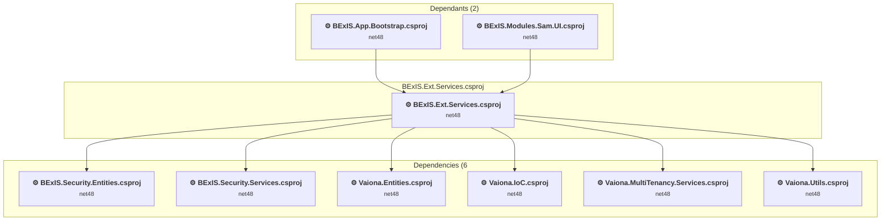

### API Compatibility

| Category | Count | Impact |
| :--- | :---: | :--- |
| 🔴 Binary Incompatible | 0 | High - Require code changes |
| 🟡 Source Incompatible | 0 | Medium - Needs re-compilation and potential conflicting API error fixing |
| 🔵 Behavioral change | 0 | Low - Behavioral changes that may require testing at runtime |
| ✅ Compatible | 51 |  |
| ***Total APIs Analyzed*** | ***51*** |  |

<a id="componentsiobexisiodatatypedisplaypatternbexisiodatatypedisplaypatterncsproj"></a>
### Components\IO\BExIS.IO.DataType.DisplayPattern\BExIS.IO.DataType.DisplayPattern.csproj

#### Project Info

- **Current Target Framework:** net48
- **Proposed Target Framework:** net8.0
- **SDK-style**: False
- **Project Kind:** ClassicClassLibrary
- **Dependencies**: 2
- **Dependants**: 8
- **Number of Files**: 2
- **Number of Files with Incidents**: 1
- **Lines of Code**: 200
- **Estimated LOC to modify**: 0+ (at least 0,0% of the project)

#### Dependency Graph

Legend:
📦 SDK-style project
⚙️ Classic project

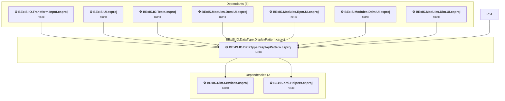

### API Compatibility

| Category | Count | Impact |
| :--- | :---: | :--- |
| 🔴 Binary Incompatible | 0 | High - Require code changes |
| 🟡 Source Incompatible | 0 | Medium - Needs re-compilation and potential conflicting API error fixing |
| 🔵 Behavioral change | 0 | Low - Behavioral changes that may require testing at runtime |
| ✅ Compatible | 122 |  |
| ***Total APIs Analyzed*** | ***122*** |  |

<a id="componentsiobexisiotestsbexisiotestscsproj"></a>
### Components\IO\BExIS.IO.Tests\BExIS.IO.Tests.csproj

#### Project Info

- **Current Target Framework:** net48
- **Proposed Target Framework:** net8.0
- **SDK-style**: False
- **Project Kind:** ClassicClassLibrary
- **Dependencies**: 14
- **Dependants**: 0
- **Number of Files**: 22
- **Number of Files with Incidents**: 1
- **Lines of Code**: 3046
- **Estimated LOC to modify**: 0+ (at least 0,0% of the project)

#### Dependency Graph

Legend:
📦 SDK-style project
⚙️ Classic project

```mermaid
flowchart TB
    subgraph current["BExIS.IO.Tests.csproj"]
        MAIN["<b>⚙️&nbsp;BExIS.IO.Tests.csproj</b><br/><small>net48</small>"]
        click MAIN "#componentsiobexisiotestsbexisiotestscsproj"
    end
    subgraph downstream["Dependencies (14"]
        P31["<b>⚙️&nbsp;BExIS.App.Testing.csproj</b><br/><small>net48</small>"]
        P4["<b>⚙️&nbsp;BExIS.Dlm.Entities.csproj</b><br/><small>net48</small>"]
        P6["<b>⚙️&nbsp;BExIS.Dlm.Services.csproj</b><br/><small>net48</small>"]
        P57["<b>⚙️&nbsp;BExIS.Utils.Config.csproj</b><br/><small>net48</small>"]
        P27["<b>⚙️&nbsp;BExIS.Utils.Data.csproj</b><br/><small>net48</small>"]
        P22["<b>⚙️&nbsp;BExIS.Utils.csproj</b><br/><small>net48</small>"]
        P43["<b>⚙️&nbsp;Vaiona.Entities.csproj</b><br/><small>net48</small>"]
        P49["<b>⚙️&nbsp;Vaiona.Persistence.Api.csproj</b><br/><small>net48</small>"]
        P50["<b>⚙️&nbsp;Vaiona.PersistenceProviders.NH.csproj</b><br/><small>net48</small>"]
        P52["<b>⚙️&nbsp;Vaiona.Utils.csproj</b><br/><small>net48</small>"]
        P21["<b>⚙️&nbsp;BExIS.IO.DataType.DisplayPattern.csproj</b><br/><small>net48</small>"]
        P14["<b>⚙️&nbsp;BExIS.IO.Transform.Input.csproj</b><br/><small>net48</small>"]
        P16["<b>⚙️&nbsp;BExIS.IO.Transform.Validation.csproj</b><br/><small>net48</small>"]
        P15["<b>⚙️&nbsp;BExIS.IO.csproj</b><br/><small>net48</small>"]
        click P31 "#componentsappbexisapptestingbexisapptestingcsproj"
        click P4 "#componentsdlmbexisdlmentitiesbexisdlmentitiescsproj"
        click P6 "#componentsdlmbexisdlmservicesbexisdlmservicescsproj"
        click P57 "#componentsutilsbexisutilsconfigbexisutilsconfigcsproj"
        click P27 "#componentsutilsbexisutilsdatabexisutilsdatacsproj"
        click P22 "#componentsutilsbexisutilsbexisutilscsproj"
        click P43 "#componentsvaionavaionaentitiesvaionaentitiescsproj"
        click P49 "#componentsvaionavaionapersistenceapivaionapersistenceapicsproj"
        click P50 "#componentsvaionavaionapersistenceprovidersnhvaionapersistenceprovidersnhcsproj"
        click P52 "#componentsvaionavaionautilsvaionautilscsproj"
        click P21 "#componentsiobexisiodatatypedisplaypatternbexisiodatatypedisplaypatterncsproj"
        click P14 "#componentsiobexisiotransforminputbexisiotransforminputcsproj"
        click P16 "#componentsiobexisiotransformvalidationbexisiotransformvalidationcsproj"
        click P15 "#componentsiobexisiobexisiocsproj"
    end
    MAIN --> P31
    MAIN --> P4
    MAIN --> P6
    MAIN --> P57
    MAIN --> P27
    MAIN --> P22
    MAIN --> P43
    MAIN --> P49
    MAIN --> P50
    MAIN --> P52
    MAIN --> P21
    MAIN --> P14
    MAIN --> P16
    MAIN --> P15

```

### API Compatibility

| Category | Count | Impact |
| :--- | :---: | :--- |
| 🔴 Binary Incompatible | 0 | High - Require code changes |
| 🟡 Source Incompatible | 0 | Medium - Needs re-compilation and potential conflicting API error fixing |
| 🔵 Behavioral change | 0 | Low - Behavioral changes that may require testing at runtime |
| ✅ Compatible | 3807 |  |
| ***Total APIs Analyzed*** | ***3807*** |  |

<a id="componentsiobexisiotransforminputbexisiotransforminputcsproj"></a>
### Components\IO\BExIS.IO.Transform.Input\BExIS.IO.Transform.Input.csproj

#### Project Info

- **Current Target Framework:** net48
- **Proposed Target Framework:** net8.0
- **SDK-style**: False
- **Project Kind:** ClassicClassLibrary
- **Dependencies**: 8
- **Dependants**: 6
- **Number of Files**: 14
- **Number of Files with Incidents**: 1
- **Lines of Code**: 4769
- **Estimated LOC to modify**: 0+ (at least 0,0% of the project)

#### Dependency Graph

Legend:
📦 SDK-style project
⚙️ Classic project

```mermaid
flowchart TB
    subgraph upstream["Dependants (6)"]
        P26["<b>⚙️&nbsp;BExIS.UI.csproj</b><br/><small>net48</small>"]
        P27["<b>⚙️&nbsp;BExIS.Utils.Data.csproj</b><br/><small>net48</small>"]
        P32["<b>⚙️&nbsp;BExIS.IO.Tests.csproj</b><br/><small>net48</small>"]
        P59["<b>⚙️&nbsp;BExIS.Modules.Dcm.UI.csproj</b><br/><small>net48</small>"]
        P62["<b>⚙️&nbsp;BExIS.Modules.Rpm.UI.csproj</b><br/><small>net48</small>"]
        P68["<b>⚙️&nbsp;BExIS.UI.Tests.csproj</b><br/><small>net48</small>"]
        click P26 "#componentsuibexisuibexisuicsproj"
        click P27 "#componentsutilsbexisutilsdatabexisutilsdatacsproj"
        click P32 "#componentsiobexisiotestsbexisiotestscsproj"
        click P59 "#consolebexiswebshellareasdcmbexismodulesdcmuibexismodulesdcmuicsproj"
        click P62 "#consolebexiswebshellareasrpmbexismodulesrpmuibexismodulesrpmuicsproj"
        click P68 "#componentsuibexisuitestsbexisuitestscsproj"
    end
    subgraph current["BExIS.IO.Transform.Input.csproj"]
        MAIN["<b>⚙️&nbsp;BExIS.IO.Transform.Input.csproj</b><br/><small>net48</small>"]
        click MAIN "#componentsiobexisiotransforminputbexisiotransforminputcsproj"
    end
    subgraph downstream["Dependencies (8"]
        P4["<b>⚙️&nbsp;BExIS.Dlm.Entities.csproj</b><br/><small>net48</small>"]
        P6["<b>⚙️&nbsp;BExIS.Dlm.Services.csproj</b><br/><small>net48</small>"]
        P22["<b>⚙️&nbsp;BExIS.Utils.csproj</b><br/><small>net48</small>"]
        P43["<b>⚙️&nbsp;Vaiona.Entities.csproj</b><br/><small>net48</small>"]
        P49["<b>⚙️&nbsp;Vaiona.Persistence.Api.csproj</b><br/><small>net48</small>"]
        P21["<b>⚙️&nbsp;BExIS.IO.DataType.DisplayPattern.csproj</b><br/><small>net48</small>"]
        P16["<b>⚙️&nbsp;BExIS.IO.Transform.Validation.csproj</b><br/><small>net48</small>"]
        P15["<b>⚙️&nbsp;BExIS.IO.csproj</b><br/><small>net48</small>"]
        click P4 "#componentsdlmbexisdlmentitiesbexisdlmentitiescsproj"
        click P6 "#componentsdlmbexisdlmservicesbexisdlmservicescsproj"
        click P22 "#componentsutilsbexisutilsbexisutilscsproj"
        click P43 "#componentsvaionavaionaentitiesvaionaentitiescsproj"
        click P49 "#componentsvaionavaionapersistenceapivaionapersistenceapicsproj"
        click P21 "#componentsiobexisiodatatypedisplaypatternbexisiodatatypedisplaypatterncsproj"
        click P16 "#componentsiobexisiotransformvalidationbexisiotransformvalidationcsproj"
        click P15 "#componentsiobexisiobexisiocsproj"
    end
    P26 --> MAIN
    P27 --> MAIN
    P32 --> MAIN
    P59 --> MAIN
    P62 --> MAIN
    P68 --> MAIN
    MAIN --> P4
    MAIN --> P6
    MAIN --> P22
    MAIN --> P43
    MAIN --> P49
    MAIN --> P21
    MAIN --> P16
    MAIN --> P15

```

### API Compatibility

| Category | Count | Impact |
| :--- | :---: | :--- |
| 🔴 Binary Incompatible | 0 | High - Require code changes |
| 🟡 Source Incompatible | 0 | Medium - Needs re-compilation and potential conflicting API error fixing |
| 🔵 Behavioral change | 0 | Low - Behavioral changes that may require testing at runtime |
| ✅ Compatible | 3518 |  |
| ***Total APIs Analyzed*** | ***3518*** |  |

<a id="componentsiobexisiotransformvalidationbexisiotransformvalidationcsproj"></a>
### Components\IO\BExIS.IO.Transform.Validation\BExIS.IO.Transform.Validation.csproj

#### Project Info

- **Current Target Framework:** net48
- **Proposed Target Framework:** net8.0
- **SDK-style**: False
- **Project Kind:** ClassicClassLibrary
- **Dependencies**: 3
- **Dependants**: 9
- **Number of Files**: 15
- **Number of Files with Incidents**: 1
- **Lines of Code**: 1804
- **Estimated LOC to modify**: 0+ (at least 0,0% of the project)

#### Dependency Graph

Legend:
📦 SDK-style project
⚙️ Classic project

```mermaid
flowchart TB
    subgraph upstream["Dependants (9)"]
        P14["<b>⚙️&nbsp;BExIS.IO.Transform.Input.csproj</b><br/><small>net48</small>"]
        P17["<b>⚙️&nbsp;BExIS.Xml.Helpers.csproj</b><br/><small>net48</small>"]
        P26["<b>⚙️&nbsp;BExIS.UI.csproj</b><br/><small>net48</small>"]
        P29["<b>⚙️&nbsp;BExIS.Modules.Bam.UI.csproj</b><br/><small>net48</small>"]
        P32["<b>⚙️&nbsp;BExIS.IO.Tests.csproj</b><br/><small>net48</small>"]
        P59["<b>⚙️&nbsp;BExIS.Modules.Dcm.UI.csproj</b><br/><small>net48</small>"]
        P72["<b>⚙️&nbsp;BExIS.Modules.PUM.UI.csproj</b><br/><small>net48</small>"]
        P73["<b>⚙️&nbsp;BExIS.Modules.SMM.UI.csproj</b><br/><small>net48</small>"]
        click P14 "#componentsiobexisiotransforminputbexisiotransforminputcsproj"
        click P17 "#componentsxmlbexisxmlhelpersbexisxmlhelperscsproj"
        click P26 "#componentsuibexisuibexisuicsproj"
        click P29 "#consolebexiswebshellareasbambexismodulesbamuicsproj"
        click P32 "#componentsiobexisiotestsbexisiotestscsproj"
        click P59 "#consolebexiswebshellareasdcmbexismodulesdcmuibexismodulesdcmuicsproj"
        click P72 "#consolebexiswebshellareaspumbexismodulespumuibexismodulespumuicsproj"
        click P73 "#consolebexiswebshellareassmmbexismodulessmmuibexismodulessmmuicsproj"
    end
    subgraph current["BExIS.IO.Transform.Validation.csproj"]
        MAIN["<b>⚙️&nbsp;BExIS.IO.Transform.Validation.csproj</b><br/><small>net48</small>"]
        click MAIN "#componentsiobexisiotransformvalidationbexisiotransformvalidationcsproj"
    end
    subgraph downstream["Dependencies (3"]
        P4["<b>⚙️&nbsp;BExIS.Dlm.Entities.csproj</b><br/><small>net48</small>"]
        P43["<b>⚙️&nbsp;Vaiona.Entities.csproj</b><br/><small>net48</small>"]
        P15["<b>⚙️&nbsp;BExIS.IO.csproj</b><br/><small>net48</small>"]
        click P4 "#componentsdlmbexisdlmentitiesbexisdlmentitiescsproj"
        click P43 "#componentsvaionavaionaentitiesvaionaentitiescsproj"
        click P15 "#componentsiobexisiobexisiocsproj"
    end
    P14 --> MAIN
    P17 --> MAIN
    P26 --> MAIN
    P29 --> MAIN
    P32 --> MAIN
    P59 --> MAIN
    P64 --> MAIN
    P72 --> MAIN
    P73 --> MAIN
    MAIN --> P4
    MAIN --> P43
    MAIN --> P15

```

### API Compatibility

| Category | Count | Impact |
| :--- | :---: | :--- |
| 🔴 Binary Incompatible | 0 | High - Require code changes |
| 🟡 Source Incompatible | 0 | Medium - Needs re-compilation and potential conflicting API error fixing |
| 🔵 Behavioral change | 0 | Low - Behavioral changes that may require testing at runtime |
| ✅ Compatible | 1268 |  |
| ***Total APIs Analyzed*** | ***1268*** |  |

<a id="componentsiobexisiobexisiocsproj"></a>
### Components\IO\BExIS.IO\BExIS.IO.csproj

#### Project Info

- **Current Target Framework:** net48
- **Proposed Target Framework:** net8.0
- **SDK-style**: False
- **Project Kind:** ClassicClassLibrary
- **Dependencies**: 2
- **Dependants**: 13
- **Number of Files**: 6
- **Number of Files with Incidents**: 2
- **Lines of Code**: 841
- **Estimated LOC to modify**: 1+ (at least 0,1% of the project)

#### Dependency Graph

Legend:
📦 SDK-style project
⚙️ Classic project

```mermaid
flowchart TB
    subgraph upstream["Dependants (13)"]
        P14["<b>⚙️&nbsp;BExIS.IO.Transform.Input.csproj</b><br/><small>net48</small>"]
        P16["<b>⚙️&nbsp;BExIS.IO.Transform.Validation.csproj</b><br/><small>net48</small>"]
        P17["<b>⚙️&nbsp;BExIS.Xml.Helpers.csproj</b><br/><small>net48</small>"]
        P24["<b>⚙️&nbsp;BExIS.Dim.Helpers.csproj</b><br/><small>net48</small>"]
        P26["<b>⚙️&nbsp;BExIS.UI.csproj</b><br/><small>net48</small>"]
        P27["<b>⚙️&nbsp;BExIS.Utils.Data.csproj</b><br/><small>net48</small>"]
        P32["<b>⚙️&nbsp;BExIS.IO.Tests.csproj</b><br/><small>net48</small>"]
        P35["<b>⚙️&nbsp;IDIV.Modules.Mmm.UI.csproj</b><br/><small>net48</small>"]
        P59["<b>⚙️&nbsp;BExIS.Modules.Dcm.UI.csproj</b><br/><small>net48</small>"]
        P62["<b>⚙️&nbsp;BExIS.Modules.Rpm.UI.csproj</b><br/><small>net48</small>"]
        P67["<b>⚙️&nbsp;BExIS.Modules.Ddm.UI.csproj</b><br/><small>net48</small>"]
        P71["<b>⚙️&nbsp;BExIS.Modules.Dim.UI.csproj</b><br/><small>net48</small>"]
        click P14 "#componentsiobexisiotransforminputbexisiotransforminputcsproj"
        click P16 "#componentsiobexisiotransformvalidationbexisiotransformvalidationcsproj"
        click P17 "#componentsxmlbexisxmlhelpersbexisxmlhelperscsproj"
        click P24 "#modulesdimbexisdimhelperbexisdimhelperscsproj"
        click P26 "#componentsuibexisuibexisuicsproj"
        click P27 "#componentsutilsbexisutilsdatabexisutilsdatacsproj"
        click P32 "#componentsiobexisiotestsbexisiotestscsproj"
        click P35 "#consolebexiswebshellareasmmmidivmodulesmmmuicsproj"
        click P59 "#consolebexiswebshellareasdcmbexismodulesdcmuibexismodulesdcmuicsproj"
        click P62 "#consolebexiswebshellareasrpmbexismodulesrpmuibexismodulesrpmuicsproj"
        click P67 "#consolebexiswebshellareasddmbexismodulesddmuibexismodulesddmuicsproj"
        click P71 "#consolebexiswebshellareasdimbexismodulesdimuibexismodulesdimuicsproj"
    end
    subgraph current["BExIS.IO.csproj"]
        MAIN["<b>⚙️&nbsp;BExIS.IO.csproj</b><br/><small>net48</small>"]
        click MAIN "#componentsiobexisiobexisiocsproj"
    end
    subgraph downstream["Dependencies (2"]
        P57["<b>⚙️&nbsp;BExIS.Utils.Config.csproj</b><br/><small>net48</small>"]
        P22["<b>⚙️&nbsp;BExIS.Utils.csproj</b><br/><small>net48</small>"]
        click P57 "#componentsutilsbexisutilsconfigbexisutilsconfigcsproj"
        click P22 "#componentsutilsbexisutilsbexisutilscsproj"
    end
    P14 --> MAIN
    P16 --> MAIN
    P17 --> MAIN
    P24 --> MAIN
    P26 --> MAIN
    P27 --> MAIN
    P32 --> MAIN
    P35 --> MAIN
    P59 --> MAIN
    P62 --> MAIN
    P64 --> MAIN
    P67 --> MAIN
    P71 --> MAIN
    MAIN --> P57
    MAIN --> P22

```

### API Compatibility

| Category | Count | Impact |
| :--- | :---: | :--- |
| 🔴 Binary Incompatible | 1 | High - Require code changes |
| 🟡 Source Incompatible | 0 | Medium - Needs re-compilation and potential conflicting API error fixing |
| 🔵 Behavioral change | 0 | Low - Behavioral changes that may require testing at runtime |
| ✅ Compatible | 685 |  |
| ***Total APIs Analyzed*** | ***686*** |  |

<a id="componentsjsonbexisjsonhelperstestsbexisjsonhelperstestscsproj"></a>
### Components\JSON\BExIS.JSON.Helpers.Tests\BExIS.JSON.Helpers.Tests.csproj

#### Project Info

- **Current Target Framework:** net48
- **Proposed Target Framework:** net8.0
- **SDK-style**: True
- **Project Kind:** ClassLibrary
- **Dependencies**: 4
- **Dependants**: 0
- **Number of Files**: 1
- **Number of Files with Incidents**: 1
- **Lines of Code**: 71
- **Estimated LOC to modify**: 0+ (at least 0,0% of the project)

#### Dependency Graph

Legend:
📦 SDK-style project
⚙️ Classic project

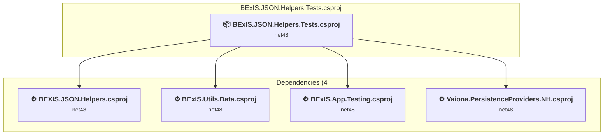

### API Compatibility

| Category | Count | Impact |
| :--- | :---: | :--- |
| 🔴 Binary Incompatible | 0 | High - Require code changes |
| 🟡 Source Incompatible | 0 | Medium - Needs re-compilation and potential conflicting API error fixing |
| 🔵 Behavioral change | 0 | Low - Behavioral changes that may require testing at runtime |
| ✅ Compatible | 62 |  |
| ***Total APIs Analyzed*** | ***62*** |  |

<a id="componentsjsonbexisjsonhelpersbexisjsonhelperscsproj"></a>
### Components\JSON\BEXIS.JSON.Helpers\BEXIS.JSON.Helpers.csproj

#### Project Info

- **Current Target Framework:** net48
- **Proposed Target Framework:** net8.0
- **SDK-style**: False
- **Project Kind:** ClassicClassLibrary
- **Dependencies**: 3
- **Dependants**: 5
- **Number of Files**: 3
- **Number of Files with Incidents**: 1
- **Lines of Code**: 638
- **Estimated LOC to modify**: 0+ (at least 0,0% of the project)

#### Dependency Graph

Legend:
📦 SDK-style project
⚙️ Classic project

```mermaid
flowchart TB
    subgraph upstream["Dependants (5)"]
        P24["<b>⚙️&nbsp;BExIS.Dim.Helpers.csproj</b><br/><small>net48</small>"]
        P36["<b>⚙️&nbsp;BExIS.Xml.Helpers.UnitTests.csproj</b><br/><small>net48</small>"]
        P59["<b>⚙️&nbsp;BExIS.Modules.Dcm.UI.csproj</b><br/><small>net48</small>"]
        P60["<b>📦&nbsp;BExIS.JSON.Helpers.Tests.csproj</b><br/><small>net48</small>"]
        P71["<b>⚙️&nbsp;BExIS.Modules.Dim.UI.csproj</b><br/><small>net48</small>"]
        click P24 "#modulesdimbexisdimhelperbexisdimhelperscsproj"
        click P36 "#componentsxmlbexisxmlhelpersunittestsbexisxmlhelpersunittestscsproj"
        click P59 "#consolebexiswebshellareasdcmbexismodulesdcmuibexismodulesdcmuicsproj"
        click P60 "#componentsjsonbexisjsonhelperstestsbexisjsonhelperstestscsproj"
        click P71 "#consolebexiswebshellareasdimbexismodulesdimuibexismodulesdimuicsproj"
    end
    subgraph current["BEXIS.JSON.Helpers.csproj"]
        MAIN["<b>⚙️&nbsp;BEXIS.JSON.Helpers.csproj</b><br/><small>net48</small>"]
        click MAIN "#componentsjsonbexisjsonhelpersbexisjsonhelperscsproj"
    end
    subgraph downstream["Dependencies (3"]
        P4["<b>⚙️&nbsp;BExIS.Dlm.Entities.csproj</b><br/><small>net48</small>"]
        P6["<b>⚙️&nbsp;BExIS.Dlm.Services.csproj</b><br/><small>net48</small>"]
        P17["<b>⚙️&nbsp;BExIS.Xml.Helpers.csproj</b><br/><small>net48</small>"]
        click P4 "#componentsdlmbexisdlmentitiesbexisdlmentitiescsproj"
        click P6 "#componentsdlmbexisdlmservicesbexisdlmservicescsproj"
        click P17 "#componentsxmlbexisxmlhelpersbexisxmlhelperscsproj"
    end
    P24 --> MAIN
    P36 --> MAIN
    P59 --> MAIN
    P60 --> MAIN
    P71 --> MAIN
    MAIN --> P4
    MAIN --> P6
    MAIN --> P17

```

### API Compatibility

| Category | Count | Impact |
| :--- | :---: | :--- |
| 🔴 Binary Incompatible | 0 | High - Require code changes |
| 🟡 Source Incompatible | 0 | Medium - Needs re-compilation and potential conflicting API error fixing |
| 🔵 Behavioral change | 0 | Low - Behavioral changes that may require testing at runtime |
| ✅ Compatible | 624 |  |
| ***Total APIs Analyzed*** | ***624*** |  |

<a id="componentsuibexisuitestsbexisuitestscsproj"></a>
### Components\UI\BExIS.UI.Tests\BExIS.UI.Tests.csproj

#### Project Info

- **Current Target Framework:** net48
- **Proposed Target Framework:** net8.0
- **SDK-style**: False
- **Project Kind:** ClassicClassLibrary
- **Dependencies**: 23
- **Dependants**: 0
- **Number of Files**: 11
- **Number of Files with Incidents**: 1
- **Lines of Code**: 293
- **Estimated LOC to modify**: 0+ (at least 0,0% of the project)

#### Dependency Graph

Legend:
📦 SDK-style project
⚙️ Classic project

```mermaid
flowchart TB
    subgraph current["BExIS.UI.Tests.csproj"]
        MAIN["<b>⚙️&nbsp;BExIS.UI.Tests.csproj</b><br/><small>net48</small>"]
        click MAIN "#componentsuibexisuitestsbexisuitestscsproj"
    end
    subgraph downstream["Dependencies (23"]
        P30["<b>⚙️&nbsp;BExIS.App.Bootstrap.csproj</b><br/><small>net48</small>"]
        P31["<b>⚙️&nbsp;BExIS.App.Testing.csproj</b><br/><small>net48</small>"]
        P14["<b>⚙️&nbsp;BExIS.IO.Transform.Input.csproj</b><br/><small>net48</small>"]
        P42["<b>⚙️&nbsp;Vaiona.Core.csproj</b><br/><small>net48</small>"]
        P44["<b>⚙️&nbsp;Vaiona.Entities.Orm.NH.csproj</b><br/><small>net48</small>"]
        P43["<b>⚙️&nbsp;Vaiona.Entities.csproj</b><br/><small>net48</small>"]
        P45["<b>⚙️&nbsp;Vaiona.IoC.csproj</b><br/><small>net48</small>"]
        P58["<b>⚙️&nbsp;Vaiona.Logging.csproj</b><br/><small>net48</small>"]
        P46["<b>⚙️&nbsp;Vaiona.Model.csproj</b><br/><small>net48</small>"]
        P47["<b>⚙️&nbsp;Vaiona.MultiTenancy.Api.csproj</b><br/><small>net48</small>"]
        P48["<b>⚙️&nbsp;Vaiona.MultiTenancy.Services.csproj</b><br/><small>net48</small>"]
        P49["<b>⚙️&nbsp;Vaiona.Persistence.Api.csproj</b><br/><small>net48</small>"]
        P51["<b>⚙️&nbsp;Vaiona.Persistence.NH.csproj</b><br/><small>net48</small>"]
        P50["<b>⚙️&nbsp;Vaiona.PersistenceProviders.NH.csproj</b><br/><small>net48</small>"]
        P52["<b>⚙️&nbsp;Vaiona.Utils.csproj</b><br/><small>net48</small>"]
        P55["<b>⚙️&nbsp;Vaiona.Web.Mvc.Modularity.csproj</b><br/><small>net48</small>"]
        P54["<b>⚙️&nbsp;Vaiona.Web.Mvc.csproj</b><br/><small>net48</small>"]
        P56["<b>⚙️&nbsp;Vaiona.Web.Security.csproj</b><br/><small>net48</small>"]
        P53["<b>⚙️&nbsp;Vaiona.Web.csproj</b><br/><small>net48</small>"]
        P26["<b>⚙️&nbsp;BExIS.UI.csproj</b><br/><small>net48</small>"]
        P4["<b>⚙️&nbsp;BExIS.Dlm.Entities.csproj</b><br/><small>net48</small>"]
        P27["<b>⚙️&nbsp;BExIS.Utils.Data.csproj</b><br/><small>net48</small>"]
        P22["<b>⚙️&nbsp;BExIS.Utils.csproj</b><br/><small>net48</small>"]
        click P30 "#componentsappbexisappbootstrapbexisappbootstrapcsproj"
        click P31 "#componentsappbexisapptestingbexisapptestingcsproj"
        click P14 "#componentsiobexisiotransforminputbexisiotransforminputcsproj"
        click P42 "#componentsvaionavaionacorevaionacorecsproj"
        click P44 "#componentsvaionavaionaentitiesormnhvaionaentitiesormnhcsproj"
        click P43 "#componentsvaionavaionaentitiesvaionaentitiescsproj"
        click P45 "#componentsvaionavaionaiocvaionaioccsproj"
        click P58 "#componentsvaionavaionaloggingvaionaloggingcsproj"
        click P46 "#componentsvaionavaionamodelvaionamodelcsproj"
        click P47 "#componentsvaionavaionamultitenancyapivaionamultitenancyapicsproj"
        click P48 "#componentsvaionavaionamultitenancyservicesvaionamultitenancyservicescsproj"
        click P49 "#componentsvaionavaionapersistenceapivaionapersistenceapicsproj"
        click P51 "#componentsvaionavaionapersistencenhvaionapersistencenhcsproj"
        click P50 "#componentsvaionavaionapersistenceprovidersnhvaionapersistenceprovidersnhcsproj"
        click P52 "#componentsvaionavaionautilsvaionautilscsproj"
        click P55 "#componentsvaionavaionawebmvcmodularityvaionawebmvcmodularitycsproj"
        click P54 "#componentsvaionavaionawebmvcvaionawebmvccsproj"
        click P56 "#componentsvaionavaionawebsecurityvaionawebsecuritycsproj"
        click P53 "#componentsvaionavaionawebvaionawebcsproj"
        click P26 "#componentsuibexisuibexisuicsproj"
        click P4 "#componentsdlmbexisdlmentitiesbexisdlmentitiescsproj"
        click P27 "#componentsutilsbexisutilsdatabexisutilsdatacsproj"
        click P22 "#componentsutilsbexisutilsbexisutilscsproj"
    end
    MAIN --> P30
    MAIN --> P31
    MAIN --> P14
    MAIN --> P42
    MAIN --> P44
    MAIN --> P43
    MAIN --> P45
    MAIN --> P58
    MAIN --> P46
    MAIN --> P47
    MAIN --> P48
    MAIN --> P49
    MAIN --> P51
    MAIN --> P50
    MAIN --> P52
    MAIN --> P55
    MAIN --> P54
    MAIN --> P56
    MAIN --> P53
    MAIN --> P26
    MAIN --> P4
    MAIN --> P27
    MAIN --> P22

```

### API Compatibility

| Category | Count | Impact |
| :--- | :---: | :--- |
| 🔴 Binary Incompatible | 0 | High - Require code changes |
| 🟡 Source Incompatible | 0 | Medium - Needs re-compilation and potential conflicting API error fixing |
| 🔵 Behavioral change | 0 | Low - Behavioral changes that may require testing at runtime |
| ✅ Compatible | 118 |  |
| ***Total APIs Analyzed*** | ***118*** |  |

<a id="componentsuibexisuibexisuicsproj"></a>
### Components\UI\BExIS.UI\BExIS.UI.csproj

#### Project Info

- **Current Target Framework:** net48
- **Proposed Target Framework:** net8.0
- **SDK-style**: False
- **Project Kind:** ClassicClassLibrary
- **Dependencies**: 15
- **Dependants**: 11
- **Number of Files**: 31
- **Number of Files with Incidents**: 2
- **Lines of Code**: 3951
- **Estimated LOC to modify**: 135+ (at least 3,4% of the project)

#### Dependency Graph

Legend:
📦 SDK-style project
⚙️ Classic project

```mermaid
flowchart TB
    subgraph upstream["Dependants (11)"]
        P7["<b>⚙️&nbsp;BExIS.Web.Shell.csproj</b><br/><small>net48</small>"]
        P24["<b>⚙️&nbsp;BExIS.Dim.Helpers.csproj</b><br/><small>net48</small>"]
        P27["<b>⚙️&nbsp;BExIS.Utils.Data.csproj</b><br/><small>net48</small>"]
        P59["<b>⚙️&nbsp;BExIS.Modules.Dcm.UI.csproj</b><br/><small>net48</small>"]
        P62["<b>⚙️&nbsp;BExIS.Modules.Rpm.UI.csproj</b><br/><small>net48</small>"]
        P63["<b>⚙️&nbsp;BExIS.Modules.Sam.UI.csproj</b><br/><small>net48</small>"]
        P67["<b>⚙️&nbsp;BExIS.Modules.Ddm.UI.csproj</b><br/><small>net48</small>"]
        P68["<b>⚙️&nbsp;BExIS.UI.Tests.csproj</b><br/><small>net48</small>"]
        P71["<b>⚙️&nbsp;BExIS.Modules.Dim.UI.csproj</b><br/><small>net48</small>"]
        P72["<b>⚙️&nbsp;BExIS.Modules.PUM.UI.csproj</b><br/><small>net48</small>"]
        P73["<b>⚙️&nbsp;BExIS.Modules.SMM.UI.csproj</b><br/><small>net48</small>"]
        click P7 "#consolebexiswebshellbexiswebshellcsproj"
        click P24 "#modulesdimbexisdimhelperbexisdimhelperscsproj"
        click P27 "#componentsutilsbexisutilsdatabexisutilsdatacsproj"
        click P59 "#consolebexiswebshellareasdcmbexismodulesdcmuibexismodulesdcmuicsproj"
        click P62 "#consolebexiswebshellareasrpmbexismodulesrpmuibexismodulesrpmuicsproj"
        click P63 "#consolebexiswebshellareassambexismodulessamuibexismodulessamuicsproj"
        click P67 "#consolebexiswebshellareasddmbexismodulesddmuibexismodulesddmuicsproj"
        click P68 "#componentsuibexisuitestsbexisuitestscsproj"
        click P71 "#consolebexiswebshellareasdimbexismodulesdimuibexismodulesdimuicsproj"
        click P72 "#consolebexiswebshellareaspumbexismodulespumuibexismodulespumuicsproj"
        click P73 "#consolebexiswebshellareassmmbexismodulessmmuibexismodulessmmuicsproj"
    end
    subgraph current["BExIS.UI.csproj"]
        MAIN["<b>⚙️&nbsp;BExIS.UI.csproj</b><br/><small>net48</small>"]
        click MAIN "#componentsuibexisuibexisuicsproj"
    end
    subgraph downstream["Dependencies (15"]
        P1["<b>⚙️&nbsp;BExIS.Security.Entities.csproj</b><br/><small>net48</small>"]
        P3["<b>⚙️&nbsp;BExIS.Security.Services.csproj</b><br/><small>net48</small>"]
        P4["<b>⚙️&nbsp;BExIS.Dlm.Entities.csproj</b><br/><small>net48</small>"]
        P21["<b>⚙️&nbsp;BExIS.IO.DataType.DisplayPattern.csproj</b><br/><small>net48</small>"]
        P14["<b>⚙️&nbsp;BExIS.IO.Transform.Input.csproj</b><br/><small>net48</small>"]
        P16["<b>⚙️&nbsp;BExIS.IO.Transform.Validation.csproj</b><br/><small>net48</small>"]
        P15["<b>⚙️&nbsp;BExIS.IO.csproj</b><br/><small>net48</small>"]
        P57["<b>⚙️&nbsp;BExIS.Utils.Config.csproj</b><br/><small>net48</small>"]
        P34["<b>⚙️&nbsp;BExIS.Utils.NH.csproj</b><br/><small>net48</small>"]
        P22["<b>⚙️&nbsp;BExIS.Utils.csproj</b><br/><small>net48</small>"]
        P43["<b>⚙️&nbsp;Vaiona.Entities.csproj</b><br/><small>net48</small>"]
        P58["<b>⚙️&nbsp;Vaiona.Logging.csproj</b><br/><small>net48</small>"]
        P52["<b>⚙️&nbsp;Vaiona.Utils.csproj</b><br/><small>net48</small>"]
        P55["<b>⚙️&nbsp;Vaiona.Web.Mvc.Modularity.csproj</b><br/><small>net48</small>"]
        P17["<b>⚙️&nbsp;BExIS.Xml.Helpers.csproj</b><br/><small>net48</small>"]
        click P1 "#componentsaaabexissecurityentitiesbexissecurityentitiescsproj"
        click P3 "#componentsaaabexissecurityservicesbexissecurityservicescsproj"
        click P4 "#componentsdlmbexisdlmentitiesbexisdlmentitiescsproj"
        click P21 "#componentsiobexisiodatatypedisplaypatternbexisiodatatypedisplaypatterncsproj"
        click P14 "#componentsiobexisiotransforminputbexisiotransforminputcsproj"
        click P16 "#componentsiobexisiotransformvalidationbexisiotransformvalidationcsproj"
        click P15 "#componentsiobexisiobexisiocsproj"
        click P57 "#componentsutilsbexisutilsconfigbexisutilsconfigcsproj"
        click P34 "#componentsutilsbexisutilsnhbexisutilsnhcsproj"
        click P22 "#componentsutilsbexisutilsbexisutilscsproj"
        click P43 "#componentsvaionavaionaentitiesvaionaentitiescsproj"
        click P58 "#componentsvaionavaionaloggingvaionaloggingcsproj"
        click P52 "#componentsvaionavaionautilsvaionautilscsproj"
        click P55 "#componentsvaionavaionawebmvcmodularityvaionawebmvcmodularitycsproj"
        click P17 "#componentsxmlbexisxmlhelpersbexisxmlhelperscsproj"
    end
    P7 --> MAIN
    P24 --> MAIN
    P27 --> MAIN
    P59 --> MAIN
    P62 --> MAIN
    P63 --> MAIN
    P67 --> MAIN
    P68 --> MAIN
    P71 --> MAIN
    P72 --> MAIN
    P73 --> MAIN
    MAIN --> P1
    MAIN --> P3
    MAIN --> P4
    MAIN --> P21
    MAIN --> P14
    MAIN --> P16
    MAIN --> P15
    MAIN --> P57
    MAIN --> P34
    MAIN --> P22
    MAIN --> P43
    MAIN --> P58
    MAIN --> P52
    MAIN --> P55
    MAIN --> P17

```

### API Compatibility

| Category | Count | Impact |
| :--- | :---: | :--- |
| 🔴 Binary Incompatible | 135 | High - Require code changes |
| 🟡 Source Incompatible | 0 | Medium - Needs re-compilation and potential conflicting API error fixing |
| 🔵 Behavioral change | 0 | Low - Behavioral changes that may require testing at runtime |
| ✅ Compatible | 3730 |  |
| ***Total APIs Analyzed*** | ***3865*** |  |

#### Project Technologies and Features

| Technology | Issues | Percentage | Migration Path |
| :--- | :---: | :---: | :--- |
| ASP.NET Framework (System.Web) | 135 | 100,0% | Legacy ASP.NET Framework APIs for web applications (System.Web.*) that don't exist in ASP.NET Core due to architectural differences. ASP.NET Core represents a complete redesign of the web framework. Migrate to ASP.NET Core equivalents or consider System.Web.Adapters package for compatibility. |

<a id="componentsutilsbexisutilsconfigbexisutilsconfigcsproj"></a>
### Components\Utils\BExIS.Utils.Config\BExIS.Utils.Config.csproj

#### Project Info

- **Current Target Framework:** net48
- **Proposed Target Framework:** net8.0
- **SDK-style**: False
- **Project Kind:** ClassicClassLibrary
- **Dependencies**: 2
- **Dependants**: 22
- **Number of Files**: 10
- **Number of Files with Incidents**: 4
- **Lines of Code**: 747
- **Estimated LOC to modify**: 25+ (at least 3,3% of the project)

#### Dependency Graph

Legend:
📦 SDK-style project
⚙️ Classic project

```mermaid
flowchart TB
    subgraph upstream["Dependants (22)"]
        P3["<b>⚙️&nbsp;BExIS.Security.Services.csproj</b><br/><small>net48</small>"]
        P7["<b>⚙️&nbsp;BExIS.Web.Shell.csproj</b><br/><small>net48</small>"]
        P13["<b>⚙️&nbsp;BExIS.Ddm.Providers.LuceneProvider.csproj</b><br/><small>net48</small>"]
        P15["<b>⚙️&nbsp;BExIS.IO.csproj</b><br/><small>net48</small>"]
        P22["<b>⚙️&nbsp;BExIS.Utils.csproj</b><br/><small>net48</small>"]
        P26["<b>⚙️&nbsp;BExIS.UI.csproj</b><br/><small>net48</small>"]
        P29["<b>⚙️&nbsp;BExIS.Modules.Bam.UI.csproj</b><br/><small>net48</small>"]
        P30["<b>⚙️&nbsp;BExIS.App.Bootstrap.csproj</b><br/><small>net48</small>"]
        P31["<b>⚙️&nbsp;BExIS.App.Testing.csproj</b><br/><small>net48</small>"]
        P32["<b>⚙️&nbsp;BExIS.IO.Tests.csproj</b><br/><small>net48</small>"]
        P35["<b>⚙️&nbsp;IDIV.Modules.Mmm.UI.csproj</b><br/><small>net48</small>"]
        P36["<b>⚙️&nbsp;BExIS.Xml.Helpers.UnitTests.csproj</b><br/><small>net48</small>"]
        P37["<b>⚙️&nbsp;BExIS.Security.Services.Tests.csproj</b><br/><small>net48</small>"]
        P38["<b>⚙️&nbsp;BExIS.Dim.Helpers.Tests.csproj</b><br/><small>net48</small>"]
        P40["<b>⚙️&nbsp;BExIS.Utils.Data.Tests.csproj</b><br/><small>net48</small>"]
        P54["<b>⚙️&nbsp;Vaiona.Web.Mvc.csproj</b><br/><small>net48</small>"]
        P59["<b>⚙️&nbsp;BExIS.Modules.Dcm.UI.csproj</b><br/><small>net48</small>"]
        P61["<b>⚙️&nbsp;BExIS.Dlm.Tests.csproj</b><br/><small>net48</small>"]
        P63["<b>⚙️&nbsp;BExIS.Modules.Sam.UI.csproj</b><br/><small>net48</small>"]
        P67["<b>⚙️&nbsp;BExIS.Modules.Ddm.UI.csproj</b><br/><small>net48</small>"]
        P71["<b>⚙️&nbsp;BExIS.Modules.Dim.UI.csproj</b><br/><small>net48</small>"]
        P73["<b>⚙️&nbsp;BExIS.Modules.SMM.UI.csproj</b><br/><small>net48</small>"]
        click P3 "#componentsaaabexissecurityservicesbexissecurityservicescsproj"
        click P7 "#consolebexiswebshellbexiswebshellcsproj"
        click P13 "#modulesddmbexisddmprovidersluceneproviderbexisddmprovidersluceneprovidercsproj"
        click P15 "#componentsiobexisiobexisiocsproj"
        click P22 "#componentsutilsbexisutilsbexisutilscsproj"
        click P26 "#componentsuibexisuibexisuicsproj"
        click P29 "#consolebexiswebshellareasbambexismodulesbamuicsproj"
        click P30 "#componentsappbexisappbootstrapbexisappbootstrapcsproj"
        click P31 "#componentsappbexisapptestingbexisapptestingcsproj"
        click P32 "#componentsiobexisiotestsbexisiotestscsproj"
        click P35 "#consolebexiswebshellareasmmmidivmodulesmmmuicsproj"
        click P36 "#componentsxmlbexisxmlhelpersunittestsbexisxmlhelpersunittestscsproj"
        click P37 "#componentsaaabexissecurityservicestestsbexissecurityservicestestscsproj"
        click P38 "#modulesdimbexisdimhelperstestsbexisdimhelperstestscsproj"
        click P40 "#componentsutilsbexisutilsdatatestsbexisutilsdatatestscsproj"
        click P54 "#componentsvaionavaionawebmvcvaionawebmvccsproj"
        click P59 "#consolebexiswebshellareasdcmbexismodulesdcmuibexismodulesdcmuicsproj"
        click P61 "#componentsdlmbexisdlmtestsbexisdlmtestscsproj"
        click P63 "#consolebexiswebshellareassambexismodulessamuibexismodulessamuicsproj"
        click P67 "#consolebexiswebshellareasddmbexismodulesddmuibexismodulesddmuicsproj"
        click P71 "#consolebexiswebshellareasdimbexismodulesdimuibexismodulesdimuicsproj"
        click P73 "#consolebexiswebshellareassmmbexismodulessmmuibexismodulessmmuicsproj"
    end
    subgraph current["BExIS.Utils.Config.csproj"]
        MAIN["<b>⚙️&nbsp;BExIS.Utils.Config.csproj</b><br/><small>net48</small>"]
        click MAIN "#componentsutilsbexisutilsconfigbexisutilsconfigcsproj"
    end
    subgraph downstream["Dependencies (2"]
        P45["<b>⚙️&nbsp;Vaiona.IoC.csproj</b><br/><small>net48</small>"]
        P52["<b>⚙️&nbsp;Vaiona.Utils.csproj</b><br/><small>net48</small>"]
        click P45 "#componentsvaionavaionaiocvaionaioccsproj"
        click P52 "#componentsvaionavaionautilsvaionautilscsproj"
    end
    P3 --> MAIN
    P7 --> MAIN
    P13 --> MAIN
    P15 --> MAIN
    P22 --> MAIN
    P26 --> MAIN
    P29 --> MAIN
    P30 --> MAIN
    P31 --> MAIN
    P32 --> MAIN
    P35 --> MAIN
    P36 --> MAIN
    P37 --> MAIN
    P38 --> MAIN
    P40 --> MAIN
    P54 --> MAIN
    P59 --> MAIN
    P61 --> MAIN
    P63 --> MAIN
    P67 --> MAIN
    P71 --> MAIN
    P73 --> MAIN
    MAIN --> P45
    MAIN --> P52

```

### API Compatibility

| Category | Count | Impact |
| :--- | :---: | :--- |
| 🔴 Binary Incompatible | 21 | High - Require code changes |
| 🟡 Source Incompatible | 4 | Medium - Needs re-compilation and potential conflicting API error fixing |
| 🔵 Behavioral change | 0 | Low - Behavioral changes that may require testing at runtime |
| ✅ Compatible | 570 |  |
| ***Total APIs Analyzed*** | ***595*** |  |

#### Project Technologies and Features

| Technology | Issues | Percentage | Migration Path |
| :--- | :---: | :---: | :--- |
| Legacy Configuration System | 4 | 16,0% | Legacy XML-based configuration system (app.config/web.config) that has been replaced by a more flexible configuration model in .NET Core. The old system was rigid and XML-based. Migrate to Microsoft.Extensions.Configuration with JSON/environment variables; use System.Configuration.ConfigurationManager NuGet package as interim bridge if needed. |
| ASP.NET Framework (System.Web) | 20 | 80,0% | Legacy ASP.NET Framework APIs for web applications (System.Web.*) that don't exist in ASP.NET Core due to architectural differences. ASP.NET Core represents a complete redesign of the web framework. Migrate to ASP.NET Core equivalents or consider System.Web.Adapters package for compatibility. |

<a id="componentsutilsbexisutilsdatatestsbexisutilsdatatestscsproj"></a>
### Components\Utils\BExIS.Utils.Data.Tests\BExIS.Utils.Data.Tests.csproj

#### Project Info

- **Current Target Framework:** net48
- **Proposed Target Framework:** net8.0
- **SDK-style**: False
- **Project Kind:** ClassicClassLibrary
- **Dependencies**: 8
- **Dependants**: 0
- **Number of Files**: 3
- **Number of Files with Incidents**: 1
- **Lines of Code**: 636
- **Estimated LOC to modify**: 0+ (at least 0,0% of the project)

#### Dependency Graph

Legend:
📦 SDK-style project
⚙️ Classic project

```mermaid
flowchart TB
    subgraph current["BExIS.Utils.Data.Tests.csproj"]
        MAIN["<b>⚙️&nbsp;BExIS.Utils.Data.Tests.csproj</b><br/><small>net48</small>"]
        click MAIN "#componentsutilsbexisutilsdatatestsbexisutilsdatatestscsproj"
    end
    subgraph downstream["Dependencies (8"]
        P31["<b>⚙️&nbsp;BExIS.App.Testing.csproj</b><br/><small>net48</small>"]
        P27["<b>⚙️&nbsp;BExIS.Utils.Data.csproj</b><br/><small>net48</small>"]
        P4["<b>⚙️&nbsp;BExIS.Dlm.Entities.csproj</b><br/><small>net48</small>"]
        P6["<b>⚙️&nbsp;BExIS.Dlm.Services.csproj</b><br/><small>net48</small>"]
        P43["<b>⚙️&nbsp;Vaiona.Entities.csproj</b><br/><small>net48</small>"]
        P49["<b>⚙️&nbsp;Vaiona.Persistence.Api.csproj</b><br/><small>net48</small>"]
        P50["<b>⚙️&nbsp;Vaiona.PersistenceProviders.NH.csproj</b><br/><small>net48</small>"]
        P57["<b>⚙️&nbsp;BExIS.Utils.Config.csproj</b><br/><small>net48</small>"]
        click P31 "#componentsappbexisapptestingbexisapptestingcsproj"
        click P27 "#componentsutilsbexisutilsdatabexisutilsdatacsproj"
        click P4 "#componentsdlmbexisdlmentitiesbexisdlmentitiescsproj"
        click P6 "#componentsdlmbexisdlmservicesbexisdlmservicescsproj"
        click P43 "#componentsvaionavaionaentitiesvaionaentitiescsproj"
        click P49 "#componentsvaionavaionapersistenceapivaionapersistenceapicsproj"
        click P50 "#componentsvaionavaionapersistenceprovidersnhvaionapersistenceprovidersnhcsproj"
        click P57 "#componentsutilsbexisutilsconfigbexisutilsconfigcsproj"
    end
    MAIN --> P31
    MAIN --> P27
    MAIN --> P4
    MAIN --> P6
    MAIN --> P43
    MAIN --> P49
    MAIN --> P50
    MAIN --> P57

```

### API Compatibility

| Category | Count | Impact |
| :--- | :---: | :--- |
| 🔴 Binary Incompatible | 0 | High - Require code changes |
| 🟡 Source Incompatible | 0 | Medium - Needs re-compilation and potential conflicting API error fixing |
| 🔵 Behavioral change | 0 | Low - Behavioral changes that may require testing at runtime |
| ✅ Compatible | 731 |  |
| ***Total APIs Analyzed*** | ***731*** |  |

<a id="componentsutilsbexisutilsdatabexisutilsdatacsproj"></a>
### Components\Utils\BExIS.Utils.Data\BExIS.Utils.Data.csproj

#### Project Info

- **Current Target Framework:** net48
- **Proposed Target Framework:** net8.0
- **SDK-style**: False
- **Project Kind:** ClassicClassLibrary
- **Dependencies**: 12
- **Dependants**: 15
- **Number of Files**: 8
- **Number of Files with Incidents**: 3
- **Lines of Code**: 2142
- **Estimated LOC to modify**: 54+ (at least 2,5% of the project)

#### Dependency Graph

Legend:
📦 SDK-style project
⚙️ Classic project

```mermaid
flowchart TB
    subgraph upstream["Dependants (15)"]
        P7["<b>⚙️&nbsp;BExIS.Web.Shell.csproj</b><br/><small>net48</small>"]
        P24["<b>⚙️&nbsp;BExIS.Dim.Helpers.csproj</b><br/><small>net48</small>"]
        P30["<b>⚙️&nbsp;BExIS.App.Bootstrap.csproj</b><br/><small>net48</small>"]
        P32["<b>⚙️&nbsp;BExIS.IO.Tests.csproj</b><br/><small>net48</small>"]
        P36["<b>⚙️&nbsp;BExIS.Xml.Helpers.UnitTests.csproj</b><br/><small>net48</small>"]
        P37["<b>⚙️&nbsp;BExIS.Security.Services.Tests.csproj</b><br/><small>net48</small>"]
        P40["<b>⚙️&nbsp;BExIS.Utils.Data.Tests.csproj</b><br/><small>net48</small>"]
        P41["<b>⚙️&nbsp;BExIS.Utils.Tests.csproj</b><br/><small>net48</small>"]
        P59["<b>⚙️&nbsp;BExIS.Modules.Dcm.UI.csproj</b><br/><small>net48</small>"]
        P60["<b>📦&nbsp;BExIS.JSON.Helpers.Tests.csproj</b><br/><small>net48</small>"]
        P61["<b>⚙️&nbsp;BExIS.Dlm.Tests.csproj</b><br/><small>net48</small>"]
        P62["<b>⚙️&nbsp;BExIS.Modules.Rpm.UI.csproj</b><br/><small>net48</small>"]
        P67["<b>⚙️&nbsp;BExIS.Modules.Ddm.UI.csproj</b><br/><small>net48</small>"]
        P68["<b>⚙️&nbsp;BExIS.UI.Tests.csproj</b><br/><small>net48</small>"]
        P71["<b>⚙️&nbsp;BExIS.Modules.Dim.UI.csproj</b><br/><small>net48</small>"]
        click P7 "#consolebexiswebshellbexiswebshellcsproj"
        click P24 "#modulesdimbexisdimhelperbexisdimhelperscsproj"
        click P30 "#componentsappbexisappbootstrapbexisappbootstrapcsproj"
        click P32 "#componentsiobexisiotestsbexisiotestscsproj"
        click P36 "#componentsxmlbexisxmlhelpersunittestsbexisxmlhelpersunittestscsproj"
        click P37 "#componentsaaabexissecurityservicestestsbexissecurityservicestestscsproj"
        click P40 "#componentsutilsbexisutilsdatatestsbexisutilsdatatestscsproj"
        click P41 "#componentsutilsbexisutilstestsbexisutilstestscsproj"
        click P59 "#consolebexiswebshellareasdcmbexismodulesdcmuibexismodulesdcmuicsproj"
        click P60 "#componentsjsonbexisjsonhelperstestsbexisjsonhelperstestscsproj"
        click P61 "#componentsdlmbexisdlmtestsbexisdlmtestscsproj"
        click P62 "#consolebexiswebshellareasrpmbexismodulesrpmuibexismodulesrpmuicsproj"
        click P67 "#consolebexiswebshellareasddmbexismodulesddmuibexismodulesddmuicsproj"
        click P68 "#componentsuibexisuitestsbexisuitestscsproj"
        click P71 "#consolebexiswebshellareasdimbexismodulesdimuibexismodulesdimuicsproj"
    end
    subgraph current["BExIS.Utils.Data.csproj"]
        MAIN["<b>⚙️&nbsp;BExIS.Utils.Data.csproj</b><br/><small>net48</small>"]
        click MAIN "#componentsutilsbexisutilsdatabexisutilsdatacsproj"
    end
    subgraph downstream["Dependencies (12"]
        P1["<b>⚙️&nbsp;BExIS.Security.Entities.csproj</b><br/><small>net48</small>"]
        P3["<b>⚙️&nbsp;BExIS.Security.Services.csproj</b><br/><small>net48</small>"]
        P4["<b>⚙️&nbsp;BExIS.Dlm.Entities.csproj</b><br/><small>net48</small>"]
        P6["<b>⚙️&nbsp;BExIS.Dlm.Services.csproj</b><br/><small>net48</small>"]
        P14["<b>⚙️&nbsp;BExIS.IO.Transform.Input.csproj</b><br/><small>net48</small>"]
        P15["<b>⚙️&nbsp;BExIS.IO.csproj</b><br/><small>net48</small>"]
        P26["<b>⚙️&nbsp;BExIS.UI.csproj</b><br/><small>net48</small>"]
        P43["<b>⚙️&nbsp;Vaiona.Entities.csproj</b><br/><small>net48</small>"]
        P46["<b>⚙️&nbsp;Vaiona.Model.csproj</b><br/><small>net48</small>"]
        P49["<b>⚙️&nbsp;Vaiona.Persistence.Api.csproj</b><br/><small>net48</small>"]
        P52["<b>⚙️&nbsp;Vaiona.Utils.csproj</b><br/><small>net48</small>"]
        P55["<b>⚙️&nbsp;Vaiona.Web.Mvc.Modularity.csproj</b><br/><small>net48</small>"]
        click P1 "#componentsaaabexissecurityentitiesbexissecurityentitiescsproj"
        click P3 "#componentsaaabexissecurityservicesbexissecurityservicescsproj"
        click P4 "#componentsdlmbexisdlmentitiesbexisdlmentitiescsproj"
        click P6 "#componentsdlmbexisdlmservicesbexisdlmservicescsproj"
        click P14 "#componentsiobexisiotransforminputbexisiotransforminputcsproj"
        click P15 "#componentsiobexisiobexisiocsproj"
        click P26 "#componentsuibexisuibexisuicsproj"
        click P43 "#componentsvaionavaionaentitiesvaionaentitiescsproj"
        click P46 "#componentsvaionavaionamodelvaionamodelcsproj"
        click P49 "#componentsvaionavaionapersistenceapivaionapersistenceapicsproj"
        click P52 "#componentsvaionavaionautilsvaionautilscsproj"
        click P55 "#componentsvaionavaionawebmvcmodularityvaionawebmvcmodularitycsproj"
    end
    P7 --> MAIN
    P24 --> MAIN
    P30 --> MAIN
    P32 --> MAIN
    P36 --> MAIN
    P37 --> MAIN
    P40 --> MAIN
    P41 --> MAIN
    P59 --> MAIN
    P60 --> MAIN
    P61 --> MAIN
    P62 --> MAIN
    P67 --> MAIN
    P68 --> MAIN
    P71 --> MAIN
    MAIN --> P1
    MAIN --> P3
    MAIN --> P4
    MAIN --> P6
    MAIN --> P14
    MAIN --> P15
    MAIN --> P26
    MAIN --> P43
    MAIN --> P46
    MAIN --> P49
    MAIN --> P52
    MAIN --> P55

```

### API Compatibility

| Category | Count | Impact |
| :--- | :---: | :--- |
| 🔴 Binary Incompatible | 53 | High - Require code changes |
| 🟡 Source Incompatible | 1 | Medium - Needs re-compilation and potential conflicting API error fixing |
| 🔵 Behavioral change | 0 | Low - Behavioral changes that may require testing at runtime |
| ✅ Compatible | 1141 |  |
| ***Total APIs Analyzed*** | ***1195*** |  |

#### Project Technologies and Features

| Technology | Issues | Percentage | Migration Path |
| :--- | :---: | :---: | :--- |
| Deprecated Remoting & Serialization | 1 | 1,9% | Legacy .NET Remoting, BinaryFormatter, and related serialization APIs that are deprecated and removed for security reasons. Remoting provided distributed object communication but had significant security vulnerabilities. Migrate to gRPC, HTTP APIs, or modern serialization (System.Text.Json, protobuf). |
| ASP.NET Framework (System.Web) | 53 | 98,1% | Legacy ASP.NET Framework APIs for web applications (System.Web.*) that don't exist in ASP.NET Core due to architectural differences. ASP.NET Core represents a complete redesign of the web framework. Migrate to ASP.NET Core equivalents or consider System.Web.Adapters package for compatibility. |

<a id="componentsutilsbexisutilsnhbexisutilsnhcsproj"></a>
### Components\Utils\BExIS.Utils.NH\BExIS.Utils.NH.csproj

#### Project Info

- **Current Target Framework:** net48
- **Proposed Target Framework:** net8.0
- **SDK-style**: False
- **Project Kind:** ClassicClassLibrary
- **Dependencies**: 0
- **Dependants**: 10
- **Number of Files**: 4
- **Number of Files with Incidents**: 1
- **Lines of Code**: 500
- **Estimated LOC to modify**: 0+ (at least 0,0% of the project)

#### Dependency Graph

Legend:
📦 SDK-style project
⚙️ Classic project

```mermaid
flowchart TB
    subgraph upstream["Dependants (10)"]
        P3["<b>⚙️&nbsp;BExIS.Security.Services.csproj</b><br/><small>net48</small>"]
        P5["<b>⚙️&nbsp;BExIS.Dlm.Orm.NH.csproj</b><br/><small>net48</small>"]
        P6["<b>⚙️&nbsp;BExIS.Dlm.Services.csproj</b><br/><small>net48</small>"]
        P26["<b>⚙️&nbsp;BExIS.UI.csproj</b><br/><small>net48</small>"]
        P59["<b>⚙️&nbsp;BExIS.Modules.Dcm.UI.csproj</b><br/><small>net48</small>"]
        P61["<b>⚙️&nbsp;BExIS.Dlm.Tests.csproj</b><br/><small>net48</small>"]
        P62["<b>⚙️&nbsp;BExIS.Modules.Rpm.UI.csproj</b><br/><small>net48</small>"]
        P63["<b>⚙️&nbsp;BExIS.Modules.Sam.UI.csproj</b><br/><small>net48</small>"]
        P67["<b>⚙️&nbsp;BExIS.Modules.Ddm.UI.csproj</b><br/><small>net48</small>"]
        P71["<b>⚙️&nbsp;BExIS.Modules.Dim.UI.csproj</b><br/><small>net48</small>"]
        click P3 "#componentsaaabexissecurityservicesbexissecurityservicescsproj"
        click P5 "#componentsdlmbexisdlmormnhbexisdlmormnhcsproj"
        click P6 "#componentsdlmbexisdlmservicesbexisdlmservicescsproj"
        click P26 "#componentsuibexisuibexisuicsproj"
        click P59 "#consolebexiswebshellareasdcmbexismodulesdcmuibexismodulesdcmuicsproj"
        click P61 "#componentsdlmbexisdlmtestsbexisdlmtestscsproj"
        click P62 "#consolebexiswebshellareasrpmbexismodulesrpmuibexismodulesrpmuicsproj"
        click P63 "#consolebexiswebshellareassambexismodulessamuibexismodulessamuicsproj"
        click P67 "#consolebexiswebshellareasddmbexismodulesddmuibexismodulesddmuicsproj"
        click P71 "#consolebexiswebshellareasdimbexismodulesdimuibexismodulesdimuicsproj"
    end
    subgraph current["BExIS.Utils.NH.csproj"]
        MAIN["<b>⚙️&nbsp;BExIS.Utils.NH.csproj</b><br/><small>net48</small>"]
        click MAIN "#componentsutilsbexisutilsnhbexisutilsnhcsproj"
    end
    P3 --> MAIN
    P5 --> MAIN
    P6 --> MAIN
    P26 --> MAIN
    P59 --> MAIN
    P61 --> MAIN
    P62 --> MAIN
    P63 --> MAIN
    P67 --> MAIN
    P71 --> MAIN

```

### API Compatibility

| Category | Count | Impact |
| :--- | :---: | :--- |
| 🔴 Binary Incompatible | 0 | High - Require code changes |
| 🟡 Source Incompatible | 0 | Medium - Needs re-compilation and potential conflicting API error fixing |
| 🔵 Behavioral change | 0 | Low - Behavioral changes that may require testing at runtime |
| ✅ Compatible | 344 |  |
| ***Total APIs Analyzed*** | ***344*** |  |

<a id="componentsutilsbexisutilstestsbexisutilstestscsproj"></a>
### Components\Utils\BExIS.Utils.Tests\BExIS.Utils.Tests.csproj

#### Project Info

- **Current Target Framework:** net48
- **Proposed Target Framework:** net8.0
- **SDK-style**: False
- **Project Kind:** ClassicClassLibrary
- **Dependencies**: 3
- **Dependants**: 0
- **Number of Files**: 4
- **Number of Files with Incidents**: 1
- **Lines of Code**: 193
- **Estimated LOC to modify**: 0+ (at least 0,0% of the project)

#### Dependency Graph

Legend:
📦 SDK-style project
⚙️ Classic project

```mermaid
flowchart TB
    subgraph current["BExIS.Utils.Tests.csproj"]
        MAIN["<b>⚙️&nbsp;BExIS.Utils.Tests.csproj</b><br/><small>net48</small>"]
        click MAIN "#componentsutilsbexisutilstestsbexisutilstestscsproj"
    end
    subgraph downstream["Dependencies (3"]
        P22["<b>⚙️&nbsp;BExIS.Utils.csproj</b><br/><small>net48</small>"]
        P50["<b>⚙️&nbsp;Vaiona.PersistenceProviders.NH.csproj</b><br/><small>net48</small>"]
        P27["<b>⚙️&nbsp;BExIS.Utils.Data.csproj</b><br/><small>net48</small>"]
        click P22 "#componentsutilsbexisutilsbexisutilscsproj"
        click P50 "#componentsvaionavaionapersistenceprovidersnhvaionapersistenceprovidersnhcsproj"
        click P27 "#componentsutilsbexisutilsdatabexisutilsdatacsproj"
    end
    MAIN --> P22
    MAIN --> P50
    MAIN --> P27

```

### API Compatibility

| Category | Count | Impact |
| :--- | :---: | :--- |
| 🔴 Binary Incompatible | 0 | High - Require code changes |
| 🟡 Source Incompatible | 0 | Medium - Needs re-compilation and potential conflicting API error fixing |
| 🔵 Behavioral change | 0 | Low - Behavioral changes that may require testing at runtime |
| ✅ Compatible | 106 |  |
| ***Total APIs Analyzed*** | ***106*** |  |

<a id="componentsutilsbexisutilsbexisutilscsproj"></a>
### Components\Utils\BExIS.Utils\BExIS.Utils.csproj

#### Project Info

- **Current Target Framework:** net48
- **Proposed Target Framework:** net8.0
- **SDK-style**: False
- **Project Kind:** ClassicClassLibrary
- **Dependencies**: 6
- **Dependants**: 20
- **Number of Files**: 295
- **Number of Files with Incidents**: 8
- **Lines of Code**: 3007
- **Estimated LOC to modify**: 175+ (at least 5,8% of the project)

#### Dependency Graph

Legend:
📦 SDK-style project
⚙️ Classic project

```mermaid
flowchart TB
    subgraph upstream["Dependants (20)"]
        P7["<b>⚙️&nbsp;BExIS.Web.Shell.csproj</b><br/><small>net48</small>"]
        P12["<b>⚙️&nbsp;BExIS.Ddm.Api.csproj</b><br/><small>net48</small>"]
        P13["<b>⚙️&nbsp;BExIS.Ddm.Providers.LuceneProvider.csproj</b><br/><small>net48</small>"]
        P14["<b>⚙️&nbsp;BExIS.IO.Transform.Input.csproj</b><br/><small>net48</small>"]
        P15["<b>⚙️&nbsp;BExIS.IO.csproj</b><br/><small>net48</small>"]
        P17["<b>⚙️&nbsp;BExIS.Xml.Helpers.csproj</b><br/><small>net48</small>"]
        P24["<b>⚙️&nbsp;BExIS.Dim.Helpers.csproj</b><br/><small>net48</small>"]
        P26["<b>⚙️&nbsp;BExIS.UI.csproj</b><br/><small>net48</small>"]
        P29["<b>⚙️&nbsp;BExIS.Modules.Bam.UI.csproj</b><br/><small>net48</small>"]
        P32["<b>⚙️&nbsp;BExIS.IO.Tests.csproj</b><br/><small>net48</small>"]
        P33["<b>⚙️&nbsp;BExIS.Modules.Vim.UI.csproj</b><br/><small>net48</small>"]
        P41["<b>⚙️&nbsp;BExIS.Utils.Tests.csproj</b><br/><small>net48</small>"]
        P59["<b>⚙️&nbsp;BExIS.Modules.Dcm.UI.csproj</b><br/><small>net48</small>"]
        P62["<b>⚙️&nbsp;BExIS.Modules.Rpm.UI.csproj</b><br/><small>net48</small>"]
        P63["<b>⚙️&nbsp;BExIS.Modules.Sam.UI.csproj</b><br/><small>net48</small>"]
        P67["<b>⚙️&nbsp;BExIS.Modules.Ddm.UI.csproj</b><br/><small>net48</small>"]
        P68["<b>⚙️&nbsp;BExIS.UI.Tests.csproj</b><br/><small>net48</small>"]
        P71["<b>⚙️&nbsp;BExIS.Modules.Dim.UI.csproj</b><br/><small>net48</small>"]
        P72["<b>⚙️&nbsp;BExIS.Modules.PUM.UI.csproj</b><br/><small>net48</small>"]
        P73["<b>⚙️&nbsp;BExIS.Modules.SMM.UI.csproj</b><br/><small>net48</small>"]
        click P7 "#consolebexiswebshellbexiswebshellcsproj"
        click P12 "#modulesddmbexisddmapibexisddmapicsproj"
        click P13 "#modulesddmbexisddmprovidersluceneproviderbexisddmprovidersluceneprovidercsproj"
        click P14 "#componentsiobexisiotransforminputbexisiotransforminputcsproj"
        click P15 "#componentsiobexisiobexisiocsproj"
        click P17 "#componentsxmlbexisxmlhelpersbexisxmlhelperscsproj"
        click P24 "#modulesdimbexisdimhelperbexisdimhelperscsproj"
        click P26 "#componentsuibexisuibexisuicsproj"
        click P29 "#consolebexiswebshellareasbambexismodulesbamuicsproj"
        click P32 "#componentsiobexisiotestsbexisiotestscsproj"
        click P33 "#consolebexiswebshellareasvimbexismodulesvimuicsproj"
        click P41 "#componentsutilsbexisutilstestsbexisutilstestscsproj"
        click P59 "#consolebexiswebshellareasdcmbexismodulesdcmuibexismodulesdcmuicsproj"
        click P62 "#consolebexiswebshellareasrpmbexismodulesrpmuibexismodulesrpmuicsproj"
        click P63 "#consolebexiswebshellareassambexismodulessamuibexismodulessamuicsproj"
        click P67 "#consolebexiswebshellareasddmbexismodulesddmuibexismodulesddmuicsproj"
        click P68 "#componentsuibexisuitestsbexisuitestscsproj"
        click P71 "#consolebexiswebshellareasdimbexismodulesdimuibexismodulesdimuicsproj"
        click P72 "#consolebexiswebshellareaspumbexismodulespumuibexismodulespumuicsproj"
        click P73 "#consolebexiswebshellareassmmbexismodulessmmuibexismodulessmmuicsproj"
    end
    subgraph current["BExIS.Utils.csproj"]
        MAIN["<b>⚙️&nbsp;BExIS.Utils.csproj</b><br/><small>net48</small>"]
        click MAIN "#componentsutilsbexisutilsbexisutilscsproj"
    end
    subgraph downstream["Dependencies (6"]
        P1["<b>⚙️&nbsp;BExIS.Security.Entities.csproj</b><br/><small>net48</small>"]
        P3["<b>⚙️&nbsp;BExIS.Security.Services.csproj</b><br/><small>net48</small>"]
        P43["<b>⚙️&nbsp;Vaiona.Entities.csproj</b><br/><small>net48</small>"]
        P52["<b>⚙️&nbsp;Vaiona.Utils.csproj</b><br/><small>net48</small>"]
        P55["<b>⚙️&nbsp;Vaiona.Web.Mvc.Modularity.csproj</b><br/><small>net48</small>"]
        P57["<b>⚙️&nbsp;BExIS.Utils.Config.csproj</b><br/><small>net48</small>"]
        click P1 "#componentsaaabexissecurityentitiesbexissecurityentitiescsproj"
        click P3 "#componentsaaabexissecurityservicesbexissecurityservicescsproj"
        click P43 "#componentsvaionavaionaentitiesvaionaentitiescsproj"
        click P52 "#componentsvaionavaionautilsvaionautilscsproj"
        click P55 "#componentsvaionavaionawebmvcmodularityvaionawebmvcmodularitycsproj"
        click P57 "#componentsutilsbexisutilsconfigbexisutilsconfigcsproj"
    end
    P7 --> MAIN
    P12 --> MAIN
    P13 --> MAIN
    P14 --> MAIN
    P15 --> MAIN
    P17 --> MAIN
    P24 --> MAIN
    P26 --> MAIN
    P29 --> MAIN
    P32 --> MAIN
    P33 --> MAIN
    P41 --> MAIN
    P59 --> MAIN
    P62 --> MAIN
    P63 --> MAIN
    P67 --> MAIN
    P68 --> MAIN
    P71 --> MAIN
    P72 --> MAIN
    P73 --> MAIN
    MAIN --> P1
    MAIN --> P3
    MAIN --> P43
    MAIN --> P52
    MAIN --> P55
    MAIN --> P57

```

### API Compatibility

| Category | Count | Impact |
| :--- | :---: | :--- |
| 🔴 Binary Incompatible | 117 | High - Require code changes |
| 🟡 Source Incompatible | 58 | Medium - Needs re-compilation and potential conflicting API error fixing |
| 🔵 Behavioral change | 0 | Low - Behavioral changes that may require testing at runtime |
| ✅ Compatible | 2447 |  |
| ***Total APIs Analyzed*** | ***2622*** |  |

#### Project Technologies and Features

| Technology | Issues | Percentage | Migration Path |
| :--- | :---: | :---: | :--- |
| ASP.NET Framework (System.Web) | 175 | 100,0% | Legacy ASP.NET Framework APIs for web applications (System.Web.*) that don't exist in ASP.NET Core due to architectural differences. ASP.NET Core represents a complete redesign of the web framework. Migrate to ASP.NET Core equivalents or consider System.Web.Adapters package for compatibility. |

<a id="componentsvaionavaionacorevaionacorecsproj"></a>
### Components\Vaiona\Vaiona.Core\Vaiona.Core.csproj

#### Project Info

- **Current Target Framework:** net48
- **Proposed Target Framework:** net8.0
- **SDK-style**: False
- **Project Kind:** ClassicClassLibrary
- **Dependencies**: 0
- **Dependants**: 2
- **Number of Files**: 6
- **Number of Files with Incidents**: 1
- **Lines of Code**: 900
- **Estimated LOC to modify**: 0+ (at least 0,0% of the project)

#### Dependency Graph

Legend:
📦 SDK-style project
⚙️ Classic project

```mermaid
flowchart TB
    subgraph upstream["Dependants (2)"]
        P43["<b>⚙️&nbsp;Vaiona.Entities.csproj</b><br/><small>net48</small>"]
        P68["<b>⚙️&nbsp;BExIS.UI.Tests.csproj</b><br/><small>net48</small>"]
        click P43 "#componentsvaionavaionaentitiesvaionaentitiescsproj"
        click P68 "#componentsuibexisuitestsbexisuitestscsproj"
    end
    subgraph current["Vaiona.Core.csproj"]
        MAIN["<b>⚙️&nbsp;Vaiona.Core.csproj</b><br/><small>net48</small>"]
        click MAIN "#componentsvaionavaionacorevaionacorecsproj"
    end
    P43 --> MAIN
    P68 --> MAIN

```

### API Compatibility

| Category | Count | Impact |
| :--- | :---: | :--- |
| 🔴 Binary Incompatible | 0 | High - Require code changes |
| 🟡 Source Incompatible | 0 | Medium - Needs re-compilation and potential conflicting API error fixing |
| 🔵 Behavioral change | 0 | Low - Behavioral changes that may require testing at runtime |
| ✅ Compatible | 861 |  |
| ***Total APIs Analyzed*** | ***861*** |  |

<a id="componentsvaionavaionaentitiesormnhvaionaentitiesormnhcsproj"></a>
### Components\Vaiona\Vaiona.Entities.Orm.NH\Vaiona.Entities.Orm.NH.csproj

#### Project Info

- **Current Target Framework:** net48
- **Proposed Target Framework:** net8.0
- **SDK-style**: False
- **Project Kind:** ClassicClassLibrary
- **Dependencies**: 0
- **Dependants**: 1
- **Number of Files**: 7
- **Number of Files with Incidents**: 1
- **Lines of Code**: 35
- **Estimated LOC to modify**: 0+ (at least 0,0% of the project)

#### Dependency Graph

Legend:
📦 SDK-style project
⚙️ Classic project

```mermaid
flowchart TB
    subgraph upstream["Dependants (1)"]
        P68["<b>⚙️&nbsp;BExIS.UI.Tests.csproj</b><br/><small>net48</small>"]
        click P68 "#componentsuibexisuitestsbexisuitestscsproj"
    end
    subgraph current["Vaiona.Entities.Orm.NH.csproj"]
        MAIN["<b>⚙️&nbsp;Vaiona.Entities.Orm.NH.csproj</b><br/><small>net48</small>"]
        click MAIN "#componentsvaionavaionaentitiesormnhvaionaentitiesormnhcsproj"
    end
    P68 --> MAIN

```

### API Compatibility

| Category | Count | Impact |
| :--- | :---: | :--- |
| 🔴 Binary Incompatible | 0 | High - Require code changes |
| 🟡 Source Incompatible | 0 | Medium - Needs re-compilation and potential conflicting API error fixing |
| 🔵 Behavioral change | 0 | Low - Behavioral changes that may require testing at runtime |
| ✅ Compatible | 0 |  |
| ***Total APIs Analyzed*** | ***0*** |  |

<a id="componentsvaionavaionaentitiesvaionaentitiescsproj"></a>
### Components\Vaiona\Vaiona.Entities\Vaiona.Entities.csproj

#### Project Info

- **Current Target Framework:** net48
- **Proposed Target Framework:** net8.0
- **SDK-style**: False
- **Project Kind:** ClassicClassLibrary
- **Dependencies**: 1
- **Dependants**: 37
- **Number of Files**: 17
- **Number of Files with Incidents**: 1
- **Lines of Code**: 702
- **Estimated LOC to modify**: 0+ (at least 0,0% of the project)

#### Dependency Graph

Legend:
📦 SDK-style project
⚙️ Classic project

```mermaid
flowchart TB
    subgraph upstream["Dependants (37)"]
        P1["<b>⚙️&nbsp;BExIS.Security.Entities.csproj</b><br/><small>net48</small>"]
        P4["<b>⚙️&nbsp;BExIS.Dlm.Entities.csproj</b><br/><small>net48</small>"]
        P6["<b>⚙️&nbsp;BExIS.Dlm.Services.csproj</b><br/><small>net48</small>"]
        P7["<b>⚙️&nbsp;BExIS.Web.Shell.csproj</b><br/><small>net48</small>"]
        P8["<b>⚙️&nbsp;BExIS.Ext.Services.csproj</b><br/><small>net48</small>"]
        P13["<b>⚙️&nbsp;BExIS.Ddm.Providers.LuceneProvider.csproj</b><br/><small>net48</small>"]
        P14["<b>⚙️&nbsp;BExIS.IO.Transform.Input.csproj</b><br/><small>net48</small>"]
        P16["<b>⚙️&nbsp;BExIS.IO.Transform.Validation.csproj</b><br/><small>net48</small>"]
        P17["<b>⚙️&nbsp;BExIS.Xml.Helpers.csproj</b><br/><small>net48</small>"]
        P20["<b>⚙️&nbsp;BExIS.Ext.Model.csproj</b><br/><small>net48</small>"]
        P22["<b>⚙️&nbsp;BExIS.Utils.csproj</b><br/><small>net48</small>"]
        P23["<b>⚙️&nbsp;BExIS.Dim.Entities.csproj</b><br/><small>net48</small>"]
        P24["<b>⚙️&nbsp;BExIS.Dim.Helpers.csproj</b><br/><small>net48</small>"]
        P26["<b>⚙️&nbsp;BExIS.UI.csproj</b><br/><small>net48</small>"]
        P27["<b>⚙️&nbsp;BExIS.Utils.Data.csproj</b><br/><small>net48</small>"]
        P29["<b>⚙️&nbsp;BExIS.Modules.Bam.UI.csproj</b><br/><small>net48</small>"]
        P30["<b>⚙️&nbsp;BExIS.App.Bootstrap.csproj</b><br/><small>net48</small>"]
        P32["<b>⚙️&nbsp;BExIS.IO.Tests.csproj</b><br/><small>net48</small>"]
        P33["<b>⚙️&nbsp;BExIS.Modules.Vim.UI.csproj</b><br/><small>net48</small>"]
        P35["<b>⚙️&nbsp;IDIV.Modules.Mmm.UI.csproj</b><br/><small>net48</small>"]
        P36["<b>⚙️&nbsp;BExIS.Xml.Helpers.UnitTests.csproj</b><br/><small>net48</small>"]
        P40["<b>⚙️&nbsp;BExIS.Utils.Data.Tests.csproj</b><br/><small>net48</small>"]
        P50["<b>⚙️&nbsp;Vaiona.PersistenceProviders.NH.csproj</b><br/><small>net48</small>"]
        P55["<b>⚙️&nbsp;Vaiona.Web.Mvc.Modularity.csproj</b><br/><small>net48</small>"]
        P56["<b>⚙️&nbsp;Vaiona.Web.Security.csproj</b><br/><small>net48</small>"]
        P58["<b>⚙️&nbsp;Vaiona.Logging.csproj</b><br/><small>net48</small>"]
        P59["<b>⚙️&nbsp;BExIS.Modules.Dcm.UI.csproj</b><br/><small>net48</small>"]
        P61["<b>⚙️&nbsp;BExIS.Dlm.Tests.csproj</b><br/><small>net48</small>"]
        P62["<b>⚙️&nbsp;BExIS.Modules.Rpm.UI.csproj</b><br/><small>net48</small>"]
        P63["<b>⚙️&nbsp;BExIS.Modules.Sam.UI.csproj</b><br/><small>net48</small>"]
        P66["<b>⚙️&nbsp;BExIS.Dim.Services.csproj</b><br/><small>net48</small>"]
        P67["<b>⚙️&nbsp;BExIS.Modules.Ddm.UI.csproj</b><br/><small>net48</small>"]
        P68["<b>⚙️&nbsp;BExIS.UI.Tests.csproj</b><br/><small>net48</small>"]
        P71["<b>⚙️&nbsp;BExIS.Modules.Dim.UI.csproj</b><br/><small>net48</small>"]
        P72["<b>⚙️&nbsp;BExIS.Modules.PUM.UI.csproj</b><br/><small>net48</small>"]
        P73["<b>⚙️&nbsp;BExIS.Modules.SMM.UI.csproj</b><br/><small>net48</small>"]
        click P1 "#componentsaaabexissecurityentitiesbexissecurityentitiescsproj"
        click P4 "#componentsdlmbexisdlmentitiesbexisdlmentitiescsproj"
        click P6 "#componentsdlmbexisdlmservicesbexisdlmservicescsproj"
        click P7 "#consolebexiswebshellbexiswebshellcsproj"
        click P8 "#componentsextbexisextservicesbexisextservicescsproj"
        click P13 "#modulesddmbexisddmprovidersluceneproviderbexisddmprovidersluceneprovidercsproj"
        click P14 "#componentsiobexisiotransforminputbexisiotransforminputcsproj"
        click P16 "#componentsiobexisiotransformvalidationbexisiotransformvalidationcsproj"
        click P17 "#componentsxmlbexisxmlhelpersbexisxmlhelperscsproj"
        click P20 "#componentsextbexisextmodelbexisextmodelcsproj"
        click P22 "#componentsutilsbexisutilsbexisutilscsproj"
        click P23 "#modulesdimbexisdimentitiesbexisdimentitiescsproj"
        click P24 "#modulesdimbexisdimhelperbexisdimhelperscsproj"
        click P26 "#componentsuibexisuibexisuicsproj"
        click P27 "#componentsutilsbexisutilsdatabexisutilsdatacsproj"
        click P29 "#consolebexiswebshellareasbambexismodulesbamuicsproj"
        click P30 "#componentsappbexisappbootstrapbexisappbootstrapcsproj"
        click P32 "#componentsiobexisiotestsbexisiotestscsproj"
        click P33 "#consolebexiswebshellareasvimbexismodulesvimuicsproj"
        click P35 "#consolebexiswebshellareasmmmidivmodulesmmmuicsproj"
        click P36 "#componentsxmlbexisxmlhelpersunittestsbexisxmlhelpersunittestscsproj"
        click P40 "#componentsutilsbexisutilsdatatestsbexisutilsdatatestscsproj"
        click P50 "#componentsvaionavaionapersistenceprovidersnhvaionapersistenceprovidersnhcsproj"
        click P55 "#componentsvaionavaionawebmvcmodularityvaionawebmvcmodularitycsproj"
        click P56 "#componentsvaionavaionawebsecurityvaionawebsecuritycsproj"
        click P58 "#componentsvaionavaionaloggingvaionaloggingcsproj"
        click P59 "#consolebexiswebshellareasdcmbexismodulesdcmuibexismodulesdcmuicsproj"
        click P61 "#componentsdlmbexisdlmtestsbexisdlmtestscsproj"
        click P62 "#consolebexiswebshellareasrpmbexismodulesrpmuibexismodulesrpmuicsproj"
        click P63 "#consolebexiswebshellareassambexismodulessamuibexismodulessamuicsproj"
        click P66 "#modulesdimbexisdimservicesbexisdimservicescsproj"
        click P67 "#consolebexiswebshellareasddmbexismodulesddmuibexismodulesddmuicsproj"
        click P68 "#componentsuibexisuitestsbexisuitestscsproj"
        click P71 "#consolebexiswebshellareasdimbexismodulesdimuibexismodulesdimuicsproj"
        click P72 "#consolebexiswebshellareaspumbexismodulespumuibexismodulespumuicsproj"
        click P73 "#consolebexiswebshellareassmmbexismodulessmmuibexismodulessmmuicsproj"
    end
    subgraph current["Vaiona.Entities.csproj"]
        MAIN["<b>⚙️&nbsp;Vaiona.Entities.csproj</b><br/><small>net48</small>"]
        click MAIN "#componentsvaionavaionaentitiesvaionaentitiescsproj"
    end
    subgraph downstream["Dependencies (1"]
        P42["<b>⚙️&nbsp;Vaiona.Core.csproj</b><br/><small>net48</small>"]
        click P42 "#componentsvaionavaionacorevaionacorecsproj"
    end
    P1 --> MAIN
    P4 --> MAIN
    P6 --> MAIN
    P7 --> MAIN
    P8 --> MAIN
    P13 --> MAIN
    P14 --> MAIN
    P16 --> MAIN
    P17 --> MAIN
    P20 --> MAIN
    P22 --> MAIN
    P23 --> MAIN
    P24 --> MAIN
    P26 --> MAIN
    P27 --> MAIN
    P29 --> MAIN
    P30 --> MAIN
    P32 --> MAIN
    P33 --> MAIN
    P35 --> MAIN
    P36 --> MAIN
    P40 --> MAIN
    P50 --> MAIN
    P55 --> MAIN
    P56 --> MAIN
    P58 --> MAIN
    P59 --> MAIN
    P61 --> MAIN
    P62 --> MAIN
    P63 --> MAIN
    P64 --> MAIN
    P66 --> MAIN
    P67 --> MAIN
    P68 --> MAIN
    P71 --> MAIN
    P72 --> MAIN
    P73 --> MAIN
    MAIN --> P42

```

### API Compatibility

| Category | Count | Impact |
| :--- | :---: | :--- |
| 🔴 Binary Incompatible | 0 | High - Require code changes |
| 🟡 Source Incompatible | 0 | Medium - Needs re-compilation and potential conflicting API error fixing |
| 🔵 Behavioral change | 0 | Low - Behavioral changes that may require testing at runtime |
| ✅ Compatible | 468 |  |
| ***Total APIs Analyzed*** | ***468*** |  |

<a id="componentsvaionavaionaiocvaionaioccsproj"></a>
### Components\Vaiona\Vaiona.IoC\Vaiona.IoC.csproj

#### Project Info

- **Current Target Framework:** net48
- **Proposed Target Framework:** net8.0
- **SDK-style**: False
- **Project Kind:** ClassicClassLibrary
- **Dependencies**: 1
- **Dependants**: 16
- **Number of Files**: 7
- **Number of Files with Incidents**: 4
- **Lines of Code**: 526
- **Estimated LOC to modify**: 110+ (at least 20,9% of the project)

#### Dependency Graph

Legend:
📦 SDK-style project
⚙️ Classic project

```mermaid
flowchart TB
    subgraph upstream["Dependants (16)"]
        P3["<b>⚙️&nbsp;BExIS.Security.Services.csproj</b><br/><small>net48</small>"]
        P7["<b>⚙️&nbsp;BExIS.Web.Shell.csproj</b><br/><small>net48</small>"]
        P8["<b>⚙️&nbsp;BExIS.Ext.Services.csproj</b><br/><small>net48</small>"]
        P30["<b>⚙️&nbsp;BExIS.App.Bootstrap.csproj</b><br/><small>net48</small>"]
        P31["<b>⚙️&nbsp;BExIS.App.Testing.csproj</b><br/><small>net48</small>"]
        P47["<b>⚙️&nbsp;Vaiona.MultiTenancy.Api.csproj</b><br/><small>net48</small>"]
        P49["<b>⚙️&nbsp;Vaiona.Persistence.Api.csproj</b><br/><small>net48</small>"]
        P50["<b>⚙️&nbsp;Vaiona.PersistenceProviders.NH.csproj</b><br/><small>net48</small>"]
        P56["<b>⚙️&nbsp;Vaiona.Web.Security.csproj</b><br/><small>net48</small>"]
        P57["<b>⚙️&nbsp;BExIS.Utils.Config.csproj</b><br/><small>net48</small>"]
        P58["<b>⚙️&nbsp;Vaiona.Logging.csproj</b><br/><small>net48</small>"]
        P59["<b>⚙️&nbsp;BExIS.Modules.Dcm.UI.csproj</b><br/><small>net48</small>"]
        P61["<b>⚙️&nbsp;BExIS.Dlm.Tests.csproj</b><br/><small>net48</small>"]
        P63["<b>⚙️&nbsp;BExIS.Modules.Sam.UI.csproj</b><br/><small>net48</small>"]
        P67["<b>⚙️&nbsp;BExIS.Modules.Ddm.UI.csproj</b><br/><small>net48</small>"]
        P68["<b>⚙️&nbsp;BExIS.UI.Tests.csproj</b><br/><small>net48</small>"]
        click P3 "#componentsaaabexissecurityservicesbexissecurityservicescsproj"
        click P7 "#consolebexiswebshellbexiswebshellcsproj"
        click P8 "#componentsextbexisextservicesbexisextservicescsproj"
        click P30 "#componentsappbexisappbootstrapbexisappbootstrapcsproj"
        click P31 "#componentsappbexisapptestingbexisapptestingcsproj"
        click P47 "#componentsvaionavaionamultitenancyapivaionamultitenancyapicsproj"
        click P49 "#componentsvaionavaionapersistenceapivaionapersistenceapicsproj"
        click P50 "#componentsvaionavaionapersistenceprovidersnhvaionapersistenceprovidersnhcsproj"
        click P56 "#componentsvaionavaionawebsecurityvaionawebsecuritycsproj"
        click P57 "#componentsutilsbexisutilsconfigbexisutilsconfigcsproj"
        click P58 "#componentsvaionavaionaloggingvaionaloggingcsproj"
        click P59 "#consolebexiswebshellareasdcmbexismodulesdcmuibexismodulesdcmuicsproj"
        click P61 "#componentsdlmbexisdlmtestsbexisdlmtestscsproj"
        click P63 "#consolebexiswebshellareassambexismodulessamuibexismodulessamuicsproj"
        click P67 "#consolebexiswebshellareasddmbexismodulesddmuibexismodulesddmuicsproj"
        click P68 "#componentsuibexisuitestsbexisuitestscsproj"
    end
    subgraph current["Vaiona.IoC.csproj"]
        MAIN["<b>⚙️&nbsp;Vaiona.IoC.csproj</b><br/><small>net48</small>"]
        click MAIN "#componentsvaionavaionaiocvaionaioccsproj"
    end
    subgraph downstream["Dependencies (1"]
        P52["<b>⚙️&nbsp;Vaiona.Utils.csproj</b><br/><small>net48</small>"]
        click P52 "#componentsvaionavaionautilsvaionautilscsproj"
    end
    P3 --> MAIN
    P7 --> MAIN
    P8 --> MAIN
    P30 --> MAIN
    P31 --> MAIN
    P47 --> MAIN
    P49 --> MAIN
    P50 --> MAIN
    P56 --> MAIN
    P57 --> MAIN
    P58 --> MAIN
    P59 --> MAIN
    P61 --> MAIN
    P63 --> MAIN
    P67 --> MAIN
    P68 --> MAIN
    MAIN --> P52

```

### API Compatibility

| Category | Count | Impact |
| :--- | :---: | :--- |
| 🔴 Binary Incompatible | 0 | High - Require code changes |
| 🟡 Source Incompatible | 110 | Medium - Needs re-compilation and potential conflicting API error fixing |
| 🔵 Behavioral change | 0 | Low - Behavioral changes that may require testing at runtime |
| ✅ Compatible | 360 |  |
| ***Total APIs Analyzed*** | ***470*** |  |

#### Project Technologies and Features

| Technology | Issues | Percentage | Migration Path |
| :--- | :---: | :---: | :--- |
| Legacy Configuration System | 22 | 20,0% | Legacy XML-based configuration system (app.config/web.config) that has been replaced by a more flexible configuration model in .NET Core. The old system was rigid and XML-based. Migrate to Microsoft.Extensions.Configuration with JSON/environment variables; use System.Configuration.ConfigurationManager NuGet package as interim bridge if needed. |
| ASP.NET Framework (System.Web) | 88 | 80,0% | Legacy ASP.NET Framework APIs for web applications (System.Web.*) that don't exist in ASP.NET Core due to architectural differences. ASP.NET Core represents a complete redesign of the web framework. Migrate to ASP.NET Core equivalents or consider System.Web.Adapters package for compatibility. |

<a id="componentsvaionavaionaloggingvaionaloggingcsproj"></a>
### Components\Vaiona\Vaiona.Logging\Vaiona.Logging.csproj

#### Project Info

- **Current Target Framework:** net48
- **Proposed Target Framework:** net8.0
- **SDK-style**: False
- **Project Kind:** ClassicClassLibrary
- **Dependencies**: 4
- **Dependants**: 18
- **Number of Files**: 9
- **Number of Files with Incidents**: 2
- **Lines of Code**: 614
- **Estimated LOC to modify**: 29+ (at least 4,7% of the project)

#### Dependency Graph

Legend:
📦 SDK-style project
⚙️ Classic project

```mermaid
flowchart TB
    subgraph upstream["Dependants (18)"]
        P6["<b>⚙️&nbsp;BExIS.Dlm.Services.csproj</b><br/><small>net48</small>"]
        P13["<b>⚙️&nbsp;BExIS.Ddm.Providers.LuceneProvider.csproj</b><br/><small>net48</small>"]
        P24["<b>⚙️&nbsp;BExIS.Dim.Helpers.csproj</b><br/><small>net48</small>"]
        P26["<b>⚙️&nbsp;BExIS.UI.csproj</b><br/><small>net48</small>"]
        P29["<b>⚙️&nbsp;BExIS.Modules.Bam.UI.csproj</b><br/><small>net48</small>"]
        P30["<b>⚙️&nbsp;BExIS.App.Bootstrap.csproj</b><br/><small>net48</small>"]
        P33["<b>⚙️&nbsp;BExIS.Modules.Vim.UI.csproj</b><br/><small>net48</small>"]
        P35["<b>⚙️&nbsp;IDIV.Modules.Mmm.UI.csproj</b><br/><small>net48</small>"]
        P50["<b>⚙️&nbsp;Vaiona.PersistenceProviders.NH.csproj</b><br/><small>net48</small>"]
        P55["<b>⚙️&nbsp;Vaiona.Web.Mvc.Modularity.csproj</b><br/><small>net48</small>"]
        P59["<b>⚙️&nbsp;BExIS.Modules.Dcm.UI.csproj</b><br/><small>net48</small>"]
        P62["<b>⚙️&nbsp;BExIS.Modules.Rpm.UI.csproj</b><br/><small>net48</small>"]
        P63["<b>⚙️&nbsp;BExIS.Modules.Sam.UI.csproj</b><br/><small>net48</small>"]
        P67["<b>⚙️&nbsp;BExIS.Modules.Ddm.UI.csproj</b><br/><small>net48</small>"]
        P68["<b>⚙️&nbsp;BExIS.UI.Tests.csproj</b><br/><small>net48</small>"]
        P71["<b>⚙️&nbsp;BExIS.Modules.Dim.UI.csproj</b><br/><small>net48</small>"]
        P72["<b>⚙️&nbsp;BExIS.Modules.PUM.UI.csproj</b><br/><small>net48</small>"]
        P73["<b>⚙️&nbsp;BExIS.Modules.SMM.UI.csproj</b><br/><small>net48</small>"]
        click P6 "#componentsdlmbexisdlmservicesbexisdlmservicescsproj"
        click P13 "#modulesddmbexisddmprovidersluceneproviderbexisddmprovidersluceneprovidercsproj"
        click P24 "#modulesdimbexisdimhelperbexisdimhelperscsproj"
        click P26 "#componentsuibexisuibexisuicsproj"
        click P29 "#consolebexiswebshellareasbambexismodulesbamuicsproj"
        click P30 "#componentsappbexisappbootstrapbexisappbootstrapcsproj"
        click P33 "#consolebexiswebshellareasvimbexismodulesvimuicsproj"
        click P35 "#consolebexiswebshellareasmmmidivmodulesmmmuicsproj"
        click P50 "#componentsvaionavaionapersistenceprovidersnhvaionapersistenceprovidersnhcsproj"
        click P55 "#componentsvaionavaionawebmvcmodularityvaionawebmvcmodularitycsproj"
        click P59 "#consolebexiswebshellareasdcmbexismodulesdcmuibexismodulesdcmuicsproj"
        click P62 "#consolebexiswebshellareasrpmbexismodulesrpmuibexismodulesrpmuicsproj"
        click P63 "#consolebexiswebshellareassambexismodulessamuibexismodulessamuicsproj"
        click P67 "#consolebexiswebshellareasddmbexismodulesddmuibexismodulesddmuicsproj"
        click P68 "#componentsuibexisuitestsbexisuitestscsproj"
        click P71 "#consolebexiswebshellareasdimbexismodulesdimuibexismodulesdimuicsproj"
        click P72 "#consolebexiswebshellareaspumbexismodulespumuibexismodulespumuicsproj"
        click P73 "#consolebexiswebshellareassmmbexismodulessmmuibexismodulessmmuicsproj"
    end
    subgraph current["Vaiona.Logging.csproj"]
        MAIN["<b>⚙️&nbsp;Vaiona.Logging.csproj</b><br/><small>net48</small>"]
        click MAIN "#componentsvaionavaionaloggingvaionaloggingcsproj"
    end
    subgraph downstream["Dependencies (4"]
        P43["<b>⚙️&nbsp;Vaiona.Entities.csproj</b><br/><small>net48</small>"]
        P45["<b>⚙️&nbsp;Vaiona.IoC.csproj</b><br/><small>net48</small>"]
        P49["<b>⚙️&nbsp;Vaiona.Persistence.Api.csproj</b><br/><small>net48</small>"]
        P52["<b>⚙️&nbsp;Vaiona.Utils.csproj</b><br/><small>net48</small>"]
        click P43 "#componentsvaionavaionaentitiesvaionaentitiescsproj"
        click P45 "#componentsvaionavaionaiocvaionaioccsproj"
        click P49 "#componentsvaionavaionapersistenceapivaionapersistenceapicsproj"
        click P52 "#componentsvaionavaionautilsvaionautilscsproj"
    end
    P6 --> MAIN
    P13 --> MAIN
    P24 --> MAIN
    P26 --> MAIN
    P29 --> MAIN
    P30 --> MAIN
    P33 --> MAIN
    P35 --> MAIN
    P50 --> MAIN
    P55 --> MAIN
    P59 --> MAIN
    P62 --> MAIN
    P63 --> MAIN
    P67 --> MAIN
    P68 --> MAIN
    P71 --> MAIN
    P72 --> MAIN
    P73 --> MAIN
    MAIN --> P43
    MAIN --> P45
    MAIN --> P49
    MAIN --> P52

```

### API Compatibility

| Category | Count | Impact |
| :--- | :---: | :--- |
| 🔴 Binary Incompatible | 0 | High - Require code changes |
| 🟡 Source Incompatible | 29 | Medium - Needs re-compilation and potential conflicting API error fixing |
| 🔵 Behavioral change | 0 | Low - Behavioral changes that may require testing at runtime |
| ✅ Compatible | 692 |  |
| ***Total APIs Analyzed*** | ***721*** |  |

#### Project Technologies and Features

| Technology | Issues | Percentage | Migration Path |
| :--- | :---: | :---: | :--- |
| ASP.NET Framework (System.Web) | 29 | 100,0% | Legacy ASP.NET Framework APIs for web applications (System.Web.*) that don't exist in ASP.NET Core due to architectural differences. ASP.NET Core represents a complete redesign of the web framework. Migrate to ASP.NET Core equivalents or consider System.Web.Adapters package for compatibility. |

<a id="componentsvaionavaionamodelvaionamodelcsproj"></a>
### Components\Vaiona\Vaiona.Model\Vaiona.Model.csproj

#### Project Info

- **Current Target Framework:** net48
- **Proposed Target Framework:** net8.0
- **SDK-style**: False
- **Project Kind:** ClassicClassLibrary
- **Dependencies**: 0
- **Dependants**: 13
- **Number of Files**: 4
- **Number of Files with Incidents**: 1
- **Lines of Code**: 380
- **Estimated LOC to modify**: 0+ (at least 0,0% of the project)

#### Dependency Graph

Legend:
📦 SDK-style project
⚙️ Classic project

```mermaid
flowchart TB
    subgraph upstream["Dependants (13)"]
        P7["<b>⚙️&nbsp;BExIS.Web.Shell.csproj</b><br/><small>net48</small>"]
        P27["<b>⚙️&nbsp;BExIS.Utils.Data.csproj</b><br/><small>net48</small>"]
        P30["<b>⚙️&nbsp;BExIS.App.Bootstrap.csproj</b><br/><small>net48</small>"]
        P31["<b>⚙️&nbsp;BExIS.App.Testing.csproj</b><br/><small>net48</small>"]
        P47["<b>⚙️&nbsp;Vaiona.MultiTenancy.Api.csproj</b><br/><small>net48</small>"]
        P48["<b>⚙️&nbsp;Vaiona.MultiTenancy.Services.csproj</b><br/><small>net48</small>"]
        P53["<b>⚙️&nbsp;Vaiona.Web.csproj</b><br/><small>net48</small>"]
        P54["<b>⚙️&nbsp;Vaiona.Web.Mvc.csproj</b><br/><small>net48</small>"]
        P59["<b>⚙️&nbsp;BExIS.Modules.Dcm.UI.csproj</b><br/><small>net48</small>"]
        P63["<b>⚙️&nbsp;BExIS.Modules.Sam.UI.csproj</b><br/><small>net48</small>"]
        P67["<b>⚙️&nbsp;BExIS.Modules.Ddm.UI.csproj</b><br/><small>net48</small>"]
        P68["<b>⚙️&nbsp;BExIS.UI.Tests.csproj</b><br/><small>net48</small>"]
        P71["<b>⚙️&nbsp;BExIS.Modules.Dim.UI.csproj</b><br/><small>net48</small>"]
        click P7 "#consolebexiswebshellbexiswebshellcsproj"
        click P27 "#componentsutilsbexisutilsdatabexisutilsdatacsproj"
        click P30 "#componentsappbexisappbootstrapbexisappbootstrapcsproj"
        click P31 "#componentsappbexisapptestingbexisapptestingcsproj"
        click P47 "#componentsvaionavaionamultitenancyapivaionamultitenancyapicsproj"
        click P48 "#componentsvaionavaionamultitenancyservicesvaionamultitenancyservicescsproj"
        click P53 "#componentsvaionavaionawebvaionawebcsproj"
        click P54 "#componentsvaionavaionawebmvcvaionawebmvccsproj"
        click P59 "#consolebexiswebshellareasdcmbexismodulesdcmuibexismodulesdcmuicsproj"
        click P63 "#consolebexiswebshellareassambexismodulessamuibexismodulessamuicsproj"
        click P67 "#consolebexiswebshellareasddmbexismodulesddmuibexismodulesddmuicsproj"
        click P68 "#componentsuibexisuitestsbexisuitestscsproj"
        click P71 "#consolebexiswebshellareasdimbexismodulesdimuibexismodulesdimuicsproj"
    end
    subgraph current["Vaiona.Model.csproj"]
        MAIN["<b>⚙️&nbsp;Vaiona.Model.csproj</b><br/><small>net48</small>"]
        click MAIN "#componentsvaionavaionamodelvaionamodelcsproj"
    end
    P7 --> MAIN
    P27 --> MAIN
    P30 --> MAIN
    P31 --> MAIN
    P47 --> MAIN
    P48 --> MAIN
    P53 --> MAIN
    P54 --> MAIN
    P59 --> MAIN
    P63 --> MAIN
    P67 --> MAIN
    P68 --> MAIN
    P71 --> MAIN

```

### API Compatibility

| Category | Count | Impact |
| :--- | :---: | :--- |
| 🔴 Binary Incompatible | 0 | High - Require code changes |
| 🟡 Source Incompatible | 0 | Medium - Needs re-compilation and potential conflicting API error fixing |
| 🔵 Behavioral change | 0 | Low - Behavioral changes that may require testing at runtime |
| ✅ Compatible | 461 |  |
| ***Total APIs Analyzed*** | ***461*** |  |

<a id="componentsvaionavaionamultitenancyapivaionamultitenancyapicsproj"></a>
### Components\Vaiona\Vaiona.MultiTenancy.Api\Vaiona.MultiTenancy.Api.csproj

#### Project Info

- **Current Target Framework:** net48
- **Proposed Target Framework:** net8.0
- **SDK-style**: False
- **Project Kind:** ClassicClassLibrary
- **Dependencies**: 2
- **Dependants**: 6
- **Number of Files**: 4
- **Number of Files with Incidents**: 2
- **Lines of Code**: 144
- **Estimated LOC to modify**: 1+ (at least 0,7% of the project)

#### Dependency Graph

Legend:
📦 SDK-style project
⚙️ Classic project

```mermaid
flowchart TB
    subgraph upstream["Dependants (6)"]
        P7["<b>⚙️&nbsp;BExIS.Web.Shell.csproj</b><br/><small>net48</small>"]
        P30["<b>⚙️&nbsp;BExIS.App.Bootstrap.csproj</b><br/><small>net48</small>"]
        P31["<b>⚙️&nbsp;BExIS.App.Testing.csproj</b><br/><small>net48</small>"]
        P48["<b>⚙️&nbsp;Vaiona.MultiTenancy.Services.csproj</b><br/><small>net48</small>"]
        P63["<b>⚙️&nbsp;BExIS.Modules.Sam.UI.csproj</b><br/><small>net48</small>"]
        P68["<b>⚙️&nbsp;BExIS.UI.Tests.csproj</b><br/><small>net48</small>"]
        click P7 "#consolebexiswebshellbexiswebshellcsproj"
        click P30 "#componentsappbexisappbootstrapbexisappbootstrapcsproj"
        click P31 "#componentsappbexisapptestingbexisapptestingcsproj"
        click P48 "#componentsvaionavaionamultitenancyservicesvaionamultitenancyservicescsproj"
        click P63 "#consolebexiswebshellareassambexismodulessamuibexismodulessamuicsproj"
        click P68 "#componentsuibexisuitestsbexisuitestscsproj"
    end
    subgraph current["Vaiona.MultiTenancy.Api.csproj"]
        MAIN["<b>⚙️&nbsp;Vaiona.MultiTenancy.Api.csproj</b><br/><small>net48</small>"]
        click MAIN "#componentsvaionavaionamultitenancyapivaionamultitenancyapicsproj"
    end
    subgraph downstream["Dependencies (2"]
        P45["<b>⚙️&nbsp;Vaiona.IoC.csproj</b><br/><small>net48</small>"]
        P46["<b>⚙️&nbsp;Vaiona.Model.csproj</b><br/><small>net48</small>"]
        click P45 "#componentsvaionavaionaiocvaionaioccsproj"
        click P46 "#componentsvaionavaionamodelvaionamodelcsproj"
    end
    P7 --> MAIN
    P30 --> MAIN
    P31 --> MAIN
    P48 --> MAIN
    P63 --> MAIN
    P68 --> MAIN
    MAIN --> P45
    MAIN --> P46

```

### API Compatibility

| Category | Count | Impact |
| :--- | :---: | :--- |
| 🔴 Binary Incompatible | 0 | High - Require code changes |
| 🟡 Source Incompatible | 1 | Medium - Needs re-compilation and potential conflicting API error fixing |
| 🔵 Behavioral change | 0 | Low - Behavioral changes that may require testing at runtime |
| ✅ Compatible | 21 |  |
| ***Total APIs Analyzed*** | ***22*** |  |

#### Project Technologies and Features

| Technology | Issues | Percentage | Migration Path |
| :--- | :---: | :---: | :--- |
| ASP.NET Framework (System.Web) | 1 | 100,0% | Legacy ASP.NET Framework APIs for web applications (System.Web.*) that don't exist in ASP.NET Core due to architectural differences. ASP.NET Core represents a complete redesign of the web framework. Migrate to ASP.NET Core equivalents or consider System.Web.Adapters package for compatibility. |

<a id="componentsvaionavaionamultitenancyservicesvaionamultitenancyservicescsproj"></a>
### Components\Vaiona\Vaiona.MultiTenancy.Services\Vaiona.MultiTenancy.Services.csproj

#### Project Info

- **Current Target Framework:** net48
- **Proposed Target Framework:** net8.0
- **SDK-style**: False
- **Project Kind:** ClassicClassLibrary
- **Dependencies**: 3
- **Dependants**: 4
- **Number of Files**: 5
- **Number of Files with Incidents**: 2
- **Lines of Code**: 846
- **Estimated LOC to modify**: 2+ (at least 0,2% of the project)

#### Dependency Graph

Legend:
📦 SDK-style project
⚙️ Classic project

```mermaid
flowchart TB
    subgraph upstream["Dependants (4)"]
        P8["<b>⚙️&nbsp;BExIS.Ext.Services.csproj</b><br/><small>net48</small>"]
        P30["<b>⚙️&nbsp;BExIS.App.Bootstrap.csproj</b><br/><small>net48</small>"]
        P63["<b>⚙️&nbsp;BExIS.Modules.Sam.UI.csproj</b><br/><small>net48</small>"]
        P68["<b>⚙️&nbsp;BExIS.UI.Tests.csproj</b><br/><small>net48</small>"]
        click P8 "#componentsextbexisextservicesbexisextservicescsproj"
        click P30 "#componentsappbexisappbootstrapbexisappbootstrapcsproj"
        click P63 "#consolebexiswebshellareassambexismodulessamuibexismodulessamuicsproj"
        click P68 "#componentsuibexisuitestsbexisuitestscsproj"
    end
    subgraph current["Vaiona.MultiTenancy.Services.csproj"]
        MAIN["<b>⚙️&nbsp;Vaiona.MultiTenancy.Services.csproj</b><br/><small>net48</small>"]
        click MAIN "#componentsvaionavaionamultitenancyservicesvaionamultitenancyservicescsproj"
    end
    subgraph downstream["Dependencies (3"]
        P46["<b>⚙️&nbsp;Vaiona.Model.csproj</b><br/><small>net48</small>"]
        P47["<b>⚙️&nbsp;Vaiona.MultiTenancy.Api.csproj</b><br/><small>net48</small>"]
        P52["<b>⚙️&nbsp;Vaiona.Utils.csproj</b><br/><small>net48</small>"]
        click P46 "#componentsvaionavaionamodelvaionamodelcsproj"
        click P47 "#componentsvaionavaionamultitenancyapivaionamultitenancyapicsproj"
        click P52 "#componentsvaionavaionautilsvaionautilscsproj"
    end
    P8 --> MAIN
    P30 --> MAIN
    P63 --> MAIN
    P68 --> MAIN
    MAIN --> P46
    MAIN --> P47
    MAIN --> P52

```

### API Compatibility

| Category | Count | Impact |
| :--- | :---: | :--- |
| 🔴 Binary Incompatible | 0 | High - Require code changes |
| 🟡 Source Incompatible | 2 | Medium - Needs re-compilation and potential conflicting API error fixing |
| 🔵 Behavioral change | 0 | Low - Behavioral changes that may require testing at runtime |
| ✅ Compatible | 864 |  |
| ***Total APIs Analyzed*** | ***866*** |  |

#### Project Technologies and Features

| Technology | Issues | Percentage | Migration Path |
| :--- | :---: | :---: | :--- |
| ASP.NET Framework (System.Web) | 2 | 100,0% | Legacy ASP.NET Framework APIs for web applications (System.Web.*) that don't exist in ASP.NET Core due to architectural differences. ASP.NET Core represents a complete redesign of the web framework. Migrate to ASP.NET Core equivalents or consider System.Web.Adapters package for compatibility. |

<a id="componentsvaionavaionapersistenceapivaionapersistenceapicsproj"></a>
### Components\Vaiona\Vaiona.Persistence.Api\Vaiona.Persistence.Api.csproj

#### Project Info

- **Current Target Framework:** net48
- **Proposed Target Framework:** net8.0
- **SDK-style**: False
- **Project Kind:** ClassicClassLibrary
- **Dependencies**: 2
- **Dependants**: 34
- **Number of Files**: 9
- **Number of Files with Incidents**: 1
- **Lines of Code**: 375
- **Estimated LOC to modify**: 0+ (at least 0,0% of the project)

#### Dependency Graph

Legend:
📦 SDK-style project
⚙️ Classic project

```mermaid
flowchart TB
    subgraph upstream["Dependants (34)"]
        P5["<b>⚙️&nbsp;BExIS.Dlm.Orm.NH.csproj</b><br/><small>net48</small>"]
        P6["<b>⚙️&nbsp;BExIS.Dlm.Services.csproj</b><br/><small>net48</small>"]
        P7["<b>⚙️&nbsp;BExIS.Web.Shell.csproj</b><br/><small>net48</small>"]
        P13["<b>⚙️&nbsp;BExIS.Ddm.Providers.LuceneProvider.csproj</b><br/><small>net48</small>"]
        P14["<b>⚙️&nbsp;BExIS.IO.Transform.Input.csproj</b><br/><small>net48</small>"]
        P17["<b>⚙️&nbsp;BExIS.Xml.Helpers.csproj</b><br/><small>net48</small>"]
        P24["<b>⚙️&nbsp;BExIS.Dim.Helpers.csproj</b><br/><small>net48</small>"]
        P27["<b>⚙️&nbsp;BExIS.Utils.Data.csproj</b><br/><small>net48</small>"]
        P29["<b>⚙️&nbsp;BExIS.Modules.Bam.UI.csproj</b><br/><small>net48</small>"]
        P30["<b>⚙️&nbsp;BExIS.App.Bootstrap.csproj</b><br/><small>net48</small>"]
        P31["<b>⚙️&nbsp;BExIS.App.Testing.csproj</b><br/><small>net48</small>"]
        P32["<b>⚙️&nbsp;BExIS.IO.Tests.csproj</b><br/><small>net48</small>"]
        P33["<b>⚙️&nbsp;BExIS.Modules.Vim.UI.csproj</b><br/><small>net48</small>"]
        P35["<b>⚙️&nbsp;IDIV.Modules.Mmm.UI.csproj</b><br/><small>net48</small>"]
        P36["<b>⚙️&nbsp;BExIS.Xml.Helpers.UnitTests.csproj</b><br/><small>net48</small>"]
        P38["<b>⚙️&nbsp;BExIS.Dim.Helpers.Tests.csproj</b><br/><small>net48</small>"]
        P40["<b>⚙️&nbsp;BExIS.Utils.Data.Tests.csproj</b><br/><small>net48</small>"]
        P50["<b>⚙️&nbsp;Vaiona.PersistenceProviders.NH.csproj</b><br/><small>net48</small>"]
        P51["<b>⚙️&nbsp;Vaiona.Persistence.NH.csproj</b><br/><small>net48</small>"]
        P53["<b>⚙️&nbsp;Vaiona.Web.csproj</b><br/><small>net48</small>"]
        P54["<b>⚙️&nbsp;Vaiona.Web.Mvc.csproj</b><br/><small>net48</small>"]
        P56["<b>⚙️&nbsp;Vaiona.Web.Security.csproj</b><br/><small>net48</small>"]
        P58["<b>⚙️&nbsp;Vaiona.Logging.csproj</b><br/><small>net48</small>"]
        P59["<b>⚙️&nbsp;BExIS.Modules.Dcm.UI.csproj</b><br/><small>net48</small>"]
        P61["<b>⚙️&nbsp;BExIS.Dlm.Tests.csproj</b><br/><small>net48</small>"]
        P62["<b>⚙️&nbsp;BExIS.Modules.Rpm.UI.csproj</b><br/><small>net48</small>"]
        P63["<b>⚙️&nbsp;BExIS.Modules.Sam.UI.csproj</b><br/><small>net48</small>"]
        P66["<b>⚙️&nbsp;BExIS.Dim.Services.csproj</b><br/><small>net48</small>"]
        P67["<b>⚙️&nbsp;BExIS.Modules.Ddm.UI.csproj</b><br/><small>net48</small>"]
        P68["<b>⚙️&nbsp;BExIS.UI.Tests.csproj</b><br/><small>net48</small>"]
        P71["<b>⚙️&nbsp;BExIS.Modules.Dim.UI.csproj</b><br/><small>net48</small>"]
        P72["<b>⚙️&nbsp;BExIS.Modules.PUM.UI.csproj</b><br/><small>net48</small>"]
        P73["<b>⚙️&nbsp;BExIS.Modules.SMM.UI.csproj</b><br/><small>net48</small>"]
        click P5 "#componentsdlmbexisdlmormnhbexisdlmormnhcsproj"
        click P6 "#componentsdlmbexisdlmservicesbexisdlmservicescsproj"
        click P7 "#consolebexiswebshellbexiswebshellcsproj"
        click P13 "#modulesddmbexisddmprovidersluceneproviderbexisddmprovidersluceneprovidercsproj"
        click P14 "#componentsiobexisiotransforminputbexisiotransforminputcsproj"
        click P17 "#componentsxmlbexisxmlhelpersbexisxmlhelperscsproj"
        click P24 "#modulesdimbexisdimhelperbexisdimhelperscsproj"
        click P27 "#componentsutilsbexisutilsdatabexisutilsdatacsproj"
        click P29 "#consolebexiswebshellareasbambexismodulesbamuicsproj"
        click P30 "#componentsappbexisappbootstrapbexisappbootstrapcsproj"
        click P31 "#componentsappbexisapptestingbexisapptestingcsproj"
        click P32 "#componentsiobexisiotestsbexisiotestscsproj"
        click P33 "#consolebexiswebshellareasvimbexismodulesvimuicsproj"
        click P35 "#consolebexiswebshellareasmmmidivmodulesmmmuicsproj"
        click P36 "#componentsxmlbexisxmlhelpersunittestsbexisxmlhelpersunittestscsproj"
        click P38 "#modulesdimbexisdimhelperstestsbexisdimhelperstestscsproj"
        click P40 "#componentsutilsbexisutilsdatatestsbexisutilsdatatestscsproj"
        click P50 "#componentsvaionavaionapersistenceprovidersnhvaionapersistenceprovidersnhcsproj"
        click P51 "#componentsvaionavaionapersistencenhvaionapersistencenhcsproj"
        click P53 "#componentsvaionavaionawebvaionawebcsproj"
        click P54 "#componentsvaionavaionawebmvcvaionawebmvccsproj"
        click P56 "#componentsvaionavaionawebsecurityvaionawebsecuritycsproj"
        click P58 "#componentsvaionavaionaloggingvaionaloggingcsproj"
        click P59 "#consolebexiswebshellareasdcmbexismodulesdcmuibexismodulesdcmuicsproj"
        click P61 "#componentsdlmbexisdlmtestsbexisdlmtestscsproj"
        click P62 "#consolebexiswebshellareasrpmbexismodulesrpmuibexismodulesrpmuicsproj"
        click P63 "#consolebexiswebshellareassambexismodulessamuibexismodulessamuicsproj"
        click P66 "#modulesdimbexisdimservicesbexisdimservicescsproj"
        click P67 "#consolebexiswebshellareasddmbexismodulesddmuibexismodulesddmuicsproj"
        click P68 "#componentsuibexisuitestsbexisuitestscsproj"
        click P71 "#consolebexiswebshellareasdimbexismodulesdimuibexismodulesdimuicsproj"
        click P72 "#consolebexiswebshellareaspumbexismodulespumuibexismodulespumuicsproj"
        click P73 "#consolebexiswebshellareassmmbexismodulessmmuibexismodulessmmuicsproj"
    end
    subgraph current["Vaiona.Persistence.Api.csproj"]
        MAIN["<b>⚙️&nbsp;Vaiona.Persistence.Api.csproj</b><br/><small>net48</small>"]
        click MAIN "#componentsvaionavaionapersistenceapivaionapersistenceapicsproj"
    end
    subgraph downstream["Dependencies (2"]
        P45["<b>⚙️&nbsp;Vaiona.IoC.csproj</b><br/><small>net48</small>"]
        P52["<b>⚙️&nbsp;Vaiona.Utils.csproj</b><br/><small>net48</small>"]
        click P45 "#componentsvaionavaionaiocvaionaioccsproj"
        click P52 "#componentsvaionavaionautilsvaionautilscsproj"
    end
    P5 --> MAIN
    P6 --> MAIN
    P7 --> MAIN
    P13 --> MAIN
    P14 --> MAIN
    P17 --> MAIN
    P24 --> MAIN
    P27 --> MAIN
    P29 --> MAIN
    P30 --> MAIN
    P31 --> MAIN
    P32 --> MAIN
    P33 --> MAIN
    P35 --> MAIN
    P36 --> MAIN
    P38 --> MAIN
    P40 --> MAIN
    P50 --> MAIN
    P51 --> MAIN
    P53 --> MAIN
    P54 --> MAIN
    P56 --> MAIN
    P58 --> MAIN
    P59 --> MAIN
    P61 --> MAIN
    P62 --> MAIN
    P63 --> MAIN
    P64 --> MAIN
    P66 --> MAIN
    P67 --> MAIN
    P68 --> MAIN
    P71 --> MAIN
    P72 --> MAIN
    P73 --> MAIN
    MAIN --> P45
    MAIN --> P52

```

### API Compatibility

| Category | Count | Impact |
| :--- | :---: | :--- |
| 🔴 Binary Incompatible | 0 | High - Require code changes |
| 🟡 Source Incompatible | 0 | Medium - Needs re-compilation and potential conflicting API error fixing |
| 🔵 Behavioral change | 0 | Low - Behavioral changes that may require testing at runtime |
| ✅ Compatible | 159 |  |
| ***Total APIs Analyzed*** | ***159*** |  |

<a id="componentsvaionavaionapersistencenhvaionapersistencenhcsproj"></a>
### Components\Vaiona\Vaiona.Persistence.NH\Vaiona.Persistence.NH.csproj

#### Project Info

- **Current Target Framework:** net48
- **Proposed Target Framework:** net8.0
- **SDK-style**: False
- **Project Kind:** ClassicClassLibrary
- **Dependencies**: 1
- **Dependants**: 4
- **Number of Files**: 6
- **Number of Files with Incidents**: 2
- **Lines of Code**: 896
- **Estimated LOC to modify**: 15+ (at least 1,7% of the project)

#### Dependency Graph

Legend:
📦 SDK-style project
⚙️ Classic project

```mermaid
flowchart TB
    subgraph upstream["Dependants (4)"]
        P7["<b>⚙️&nbsp;BExIS.Web.Shell.csproj</b><br/><small>net48</small>"]
        P30["<b>⚙️&nbsp;BExIS.App.Bootstrap.csproj</b><br/><small>net48</small>"]
        P31["<b>⚙️&nbsp;BExIS.App.Testing.csproj</b><br/><small>net48</small>"]
        P68["<b>⚙️&nbsp;BExIS.UI.Tests.csproj</b><br/><small>net48</small>"]
        click P7 "#consolebexiswebshellbexiswebshellcsproj"
        click P30 "#componentsappbexisappbootstrapbexisappbootstrapcsproj"
        click P31 "#componentsappbexisapptestingbexisapptestingcsproj"
        click P68 "#componentsuibexisuitestsbexisuitestscsproj"
    end
    subgraph current["Vaiona.Persistence.NH.csproj"]
        MAIN["<b>⚙️&nbsp;Vaiona.Persistence.NH.csproj</b><br/><small>net48</small>"]
        click MAIN "#componentsvaionavaionapersistencenhvaionapersistencenhcsproj"
    end
    subgraph downstream["Dependencies (1"]
        P49["<b>⚙️&nbsp;Vaiona.Persistence.Api.csproj</b><br/><small>net48</small>"]
        click P49 "#componentsvaionavaionapersistenceapivaionapersistenceapicsproj"
    end
    P7 --> MAIN
    P30 --> MAIN
    P31 --> MAIN
    P68 --> MAIN
    MAIN --> P49

```

### API Compatibility

| Category | Count | Impact |
| :--- | :---: | :--- |
| 🔴 Binary Incompatible | 4 | High - Require code changes |
| 🟡 Source Incompatible | 11 | Medium - Needs re-compilation and potential conflicting API error fixing |
| 🔵 Behavioral change | 0 | Low - Behavioral changes that may require testing at runtime |
| ✅ Compatible | 736 |  |
| ***Total APIs Analyzed*** | ***751*** |  |

#### Project Technologies and Features

| Technology | Issues | Percentage | Migration Path |
| :--- | :---: | :---: | :--- |
| Deprecated Remoting & Serialization | 4 | 26,7% | Legacy .NET Remoting, BinaryFormatter, and related serialization APIs that are deprecated and removed for security reasons. Remoting provided distributed object communication but had significant security vulnerabilities. Migrate to gRPC, HTTP APIs, or modern serialization (System.Text.Json, protobuf). |
| ASP.NET Framework (System.Web) | 11 | 73,3% | Legacy ASP.NET Framework APIs for web applications (System.Web.*) that don't exist in ASP.NET Core due to architectural differences. ASP.NET Core represents a complete redesign of the web framework. Migrate to ASP.NET Core equivalents or consider System.Web.Adapters package for compatibility. |

<a id="componentsvaionavaionapersistenceprovidersnhvaionapersistenceprovidersnhcsproj"></a>
### Components\Vaiona\Vaiona.PersistenceProviders.NH\Vaiona.PersistenceProviders.NH.csproj

#### Project Info

- **Current Target Framework:** net48
- **Proposed Target Framework:** net8.0
- **SDK-style**: False
- **Project Kind:** ClassicClassLibrary
- **Dependencies**: 6
- **Dependants**: 11
- **Number of Files**: 11
- **Number of Files with Incidents**: 4
- **Lines of Code**: 2305
- **Estimated LOC to modify**: 19+ (at least 0,8% of the project)

#### Dependency Graph

Legend:
📦 SDK-style project
⚙️ Classic project

```mermaid
flowchart TB
    subgraph upstream["Dependants (11)"]
        P7["<b>⚙️&nbsp;BExIS.Web.Shell.csproj</b><br/><small>net48</small>"]
        P30["<b>⚙️&nbsp;BExIS.App.Bootstrap.csproj</b><br/><small>net48</small>"]
        P31["<b>⚙️&nbsp;BExIS.App.Testing.csproj</b><br/><small>net48</small>"]
        P32["<b>⚙️&nbsp;BExIS.IO.Tests.csproj</b><br/><small>net48</small>"]
        P36["<b>⚙️&nbsp;BExIS.Xml.Helpers.UnitTests.csproj</b><br/><small>net48</small>"]
        P37["<b>⚙️&nbsp;BExIS.Security.Services.Tests.csproj</b><br/><small>net48</small>"]
        P40["<b>⚙️&nbsp;BExIS.Utils.Data.Tests.csproj</b><br/><small>net48</small>"]
        P41["<b>⚙️&nbsp;BExIS.Utils.Tests.csproj</b><br/><small>net48</small>"]
        P60["<b>📦&nbsp;BExIS.JSON.Helpers.Tests.csproj</b><br/><small>net48</small>"]
        P61["<b>⚙️&nbsp;BExIS.Dlm.Tests.csproj</b><br/><small>net48</small>"]
        P68["<b>⚙️&nbsp;BExIS.UI.Tests.csproj</b><br/><small>net48</small>"]
        click P7 "#consolebexiswebshellbexiswebshellcsproj"
        click P30 "#componentsappbexisappbootstrapbexisappbootstrapcsproj"
        click P31 "#componentsappbexisapptestingbexisapptestingcsproj"
        click P32 "#componentsiobexisiotestsbexisiotestscsproj"
        click P36 "#componentsxmlbexisxmlhelpersunittestsbexisxmlhelpersunittestscsproj"
        click P37 "#componentsaaabexissecurityservicestestsbexissecurityservicestestscsproj"
        click P40 "#componentsutilsbexisutilsdatatestsbexisutilsdatatestscsproj"
        click P41 "#componentsutilsbexisutilstestsbexisutilstestscsproj"
        click P60 "#componentsjsonbexisjsonhelperstestsbexisjsonhelperstestscsproj"
        click P61 "#componentsdlmbexisdlmtestsbexisdlmtestscsproj"
        click P68 "#componentsuibexisuitestsbexisuitestscsproj"
    end
    subgraph current["Vaiona.PersistenceProviders.NH.csproj"]
        MAIN["<b>⚙️&nbsp;Vaiona.PersistenceProviders.NH.csproj</b><br/><small>net48</small>"]
        click MAIN "#componentsvaionavaionapersistenceprovidersnhvaionapersistenceprovidersnhcsproj"
    end
    subgraph downstream["Dependencies (6"]
        P43["<b>⚙️&nbsp;Vaiona.Entities.csproj</b><br/><small>net48</small>"]
        P45["<b>⚙️&nbsp;Vaiona.IoC.csproj</b><br/><small>net48</small>"]
        P58["<b>⚙️&nbsp;Vaiona.Logging.csproj</b><br/><small>net48</small>"]
        P49["<b>⚙️&nbsp;Vaiona.Persistence.Api.csproj</b><br/><small>net48</small>"]
        P52["<b>⚙️&nbsp;Vaiona.Utils.csproj</b><br/><small>net48</small>"]
        P55["<b>⚙️&nbsp;Vaiona.Web.Mvc.Modularity.csproj</b><br/><small>net48</small>"]
        click P43 "#componentsvaionavaionaentitiesvaionaentitiescsproj"
        click P45 "#componentsvaionavaionaiocvaionaioccsproj"
        click P58 "#componentsvaionavaionaloggingvaionaloggingcsproj"
        click P49 "#componentsvaionavaionapersistenceapivaionapersistenceapicsproj"
        click P52 "#componentsvaionavaionautilsvaionautilscsproj"
        click P55 "#componentsvaionavaionawebmvcmodularityvaionawebmvcmodularitycsproj"
    end
    P7 --> MAIN
    P30 --> MAIN
    P31 --> MAIN
    P32 --> MAIN
    P36 --> MAIN
    P37 --> MAIN
    P40 --> MAIN
    P41 --> MAIN
    P60 --> MAIN
    P61 --> MAIN
    P68 --> MAIN
    MAIN --> P43
    MAIN --> P45
    MAIN --> P58
    MAIN --> P49
    MAIN --> P52
    MAIN --> P55

```

### API Compatibility

| Category | Count | Impact |
| :--- | :---: | :--- |
| 🔴 Binary Incompatible | 2 | High - Require code changes |
| 🟡 Source Incompatible | 17 | Medium - Needs re-compilation and potential conflicting API error fixing |
| 🔵 Behavioral change | 0 | Low - Behavioral changes that may require testing at runtime |
| ✅ Compatible | 1934 |  |
| ***Total APIs Analyzed*** | ***1953*** |  |

<a id="componentsvaionavaionautilsvaionautilscsproj"></a>
### Components\Vaiona\Vaiona.Utils\Vaiona.Utils.csproj

#### Project Info

- **Current Target Framework:** net48
- **Proposed Target Framework:** net8.0
- **SDK-style**: False
- **Project Kind:** ClassicClassLibrary
- **Dependencies**: 0
- **Dependants**: 37
- **Number of Files**: 9
- **Number of Files with Incidents**: 2
- **Lines of Code**: 1426
- **Estimated LOC to modify**: 86+ (at least 6,0% of the project)

#### Dependency Graph

Legend:
📦 SDK-style project
⚙️ Classic project

```mermaid
flowchart TB
    subgraph upstream["Dependants (37)"]
        P3["<b>⚙️&nbsp;BExIS.Security.Services.csproj</b><br/><small>net48</small>"]
        P5["<b>⚙️&nbsp;BExIS.Dlm.Orm.NH.csproj</b><br/><small>net48</small>"]
        P6["<b>⚙️&nbsp;BExIS.Dlm.Services.csproj</b><br/><small>net48</small>"]
        P7["<b>⚙️&nbsp;BExIS.Web.Shell.csproj</b><br/><small>net48</small>"]
        P8["<b>⚙️&nbsp;BExIS.Ext.Services.csproj</b><br/><small>net48</small>"]
        P13["<b>⚙️&nbsp;BExIS.Ddm.Providers.LuceneProvider.csproj</b><br/><small>net48</small>"]
        P17["<b>⚙️&nbsp;BExIS.Xml.Helpers.csproj</b><br/><small>net48</small>"]
        P22["<b>⚙️&nbsp;BExIS.Utils.csproj</b><br/><small>net48</small>"]
        P24["<b>⚙️&nbsp;BExIS.Dim.Helpers.csproj</b><br/><small>net48</small>"]
        P26["<b>⚙️&nbsp;BExIS.UI.csproj</b><br/><small>net48</small>"]
        P27["<b>⚙️&nbsp;BExIS.Utils.Data.csproj</b><br/><small>net48</small>"]
        P29["<b>⚙️&nbsp;BExIS.Modules.Bam.UI.csproj</b><br/><small>net48</small>"]
        P30["<b>⚙️&nbsp;BExIS.App.Bootstrap.csproj</b><br/><small>net48</small>"]
        P31["<b>⚙️&nbsp;BExIS.App.Testing.csproj</b><br/><small>net48</small>"]
        P32["<b>⚙️&nbsp;BExIS.IO.Tests.csproj</b><br/><small>net48</small>"]
        P33["<b>⚙️&nbsp;BExIS.Modules.Vim.UI.csproj</b><br/><small>net48</small>"]
        P35["<b>⚙️&nbsp;IDIV.Modules.Mmm.UI.csproj</b><br/><small>net48</small>"]
        P36["<b>⚙️&nbsp;BExIS.Xml.Helpers.UnitTests.csproj</b><br/><small>net48</small>"]
        P38["<b>⚙️&nbsp;BExIS.Dim.Helpers.Tests.csproj</b><br/><small>net48</small>"]
        P45["<b>⚙️&nbsp;Vaiona.IoC.csproj</b><br/><small>net48</small>"]
        P48["<b>⚙️&nbsp;Vaiona.MultiTenancy.Services.csproj</b><br/><small>net48</small>"]
        P49["<b>⚙️&nbsp;Vaiona.Persistence.Api.csproj</b><br/><small>net48</small>"]
        P50["<b>⚙️&nbsp;Vaiona.PersistenceProviders.NH.csproj</b><br/><small>net48</small>"]
        P54["<b>⚙️&nbsp;Vaiona.Web.Mvc.csproj</b><br/><small>net48</small>"]
        P55["<b>⚙️&nbsp;Vaiona.Web.Mvc.Modularity.csproj</b><br/><small>net48</small>"]
        P57["<b>⚙️&nbsp;BExIS.Utils.Config.csproj</b><br/><small>net48</small>"]
        P58["<b>⚙️&nbsp;Vaiona.Logging.csproj</b><br/><small>net48</small>"]
        P59["<b>⚙️&nbsp;BExIS.Modules.Dcm.UI.csproj</b><br/><small>net48</small>"]
        P62["<b>⚙️&nbsp;BExIS.Modules.Rpm.UI.csproj</b><br/><small>net48</small>"]
        P63["<b>⚙️&nbsp;BExIS.Modules.Sam.UI.csproj</b><br/><small>net48</small>"]
        P66["<b>⚙️&nbsp;BExIS.Dim.Services.csproj</b><br/><small>net48</small>"]
        P67["<b>⚙️&nbsp;BExIS.Modules.Ddm.UI.csproj</b><br/><small>net48</small>"]
        P68["<b>⚙️&nbsp;BExIS.UI.Tests.csproj</b><br/><small>net48</small>"]
        P71["<b>⚙️&nbsp;BExIS.Modules.Dim.UI.csproj</b><br/><small>net48</small>"]
        P72["<b>⚙️&nbsp;BExIS.Modules.PUM.UI.csproj</b><br/><small>net48</small>"]
        P73["<b>⚙️&nbsp;BExIS.Modules.SMM.UI.csproj</b><br/><small>net48</small>"]
        click P3 "#componentsaaabexissecurityservicesbexissecurityservicescsproj"
        click P5 "#componentsdlmbexisdlmormnhbexisdlmormnhcsproj"
        click P6 "#componentsdlmbexisdlmservicesbexisdlmservicescsproj"
        click P7 "#consolebexiswebshellbexiswebshellcsproj"
        click P8 "#componentsextbexisextservicesbexisextservicescsproj"
        click P13 "#modulesddmbexisddmprovidersluceneproviderbexisddmprovidersluceneprovidercsproj"
        click P17 "#componentsxmlbexisxmlhelpersbexisxmlhelperscsproj"
        click P22 "#componentsutilsbexisutilsbexisutilscsproj"
        click P24 "#modulesdimbexisdimhelperbexisdimhelperscsproj"
        click P26 "#componentsuibexisuibexisuicsproj"
        click P27 "#componentsutilsbexisutilsdatabexisutilsdatacsproj"
        click P29 "#consolebexiswebshellareasbambexismodulesbamuicsproj"
        click P30 "#componentsappbexisappbootstrapbexisappbootstrapcsproj"
        click P31 "#componentsappbexisapptestingbexisapptestingcsproj"
        click P32 "#componentsiobexisiotestsbexisiotestscsproj"
        click P33 "#consolebexiswebshellareasvimbexismodulesvimuicsproj"
        click P35 "#consolebexiswebshellareasmmmidivmodulesmmmuicsproj"
        click P36 "#componentsxmlbexisxmlhelpersunittestsbexisxmlhelpersunittestscsproj"
        click P38 "#modulesdimbexisdimhelperstestsbexisdimhelperstestscsproj"
        click P45 "#componentsvaionavaionaiocvaionaioccsproj"
        click P48 "#componentsvaionavaionamultitenancyservicesvaionamultitenancyservicescsproj"
        click P49 "#componentsvaionavaionapersistenceapivaionapersistenceapicsproj"
        click P50 "#componentsvaionavaionapersistenceprovidersnhvaionapersistenceprovidersnhcsproj"
        click P54 "#componentsvaionavaionawebmvcvaionawebmvccsproj"
        click P55 "#componentsvaionavaionawebmvcmodularityvaionawebmvcmodularitycsproj"
        click P57 "#componentsutilsbexisutilsconfigbexisutilsconfigcsproj"
        click P58 "#componentsvaionavaionaloggingvaionaloggingcsproj"
        click P59 "#consolebexiswebshellareasdcmbexismodulesdcmuibexismodulesdcmuicsproj"
        click P62 "#consolebexiswebshellareasrpmbexismodulesrpmuibexismodulesrpmuicsproj"
        click P63 "#consolebexiswebshellareassambexismodulessamuibexismodulessamuicsproj"
        click P66 "#modulesdimbexisdimservicesbexisdimservicescsproj"
        click P67 "#consolebexiswebshellareasddmbexismodulesddmuibexismodulesddmuicsproj"
        click P68 "#componentsuibexisuitestsbexisuitestscsproj"
        click P71 "#consolebexiswebshellareasdimbexismodulesdimuibexismodulesdimuicsproj"
        click P72 "#consolebexiswebshellareaspumbexismodulespumuibexismodulespumuicsproj"
        click P73 "#consolebexiswebshellareassmmbexismodulessmmuibexismodulessmmuicsproj"
    end
    subgraph current["Vaiona.Utils.csproj"]
        MAIN["<b>⚙️&nbsp;Vaiona.Utils.csproj</b><br/><small>net48</small>"]
        click MAIN "#componentsvaionavaionautilsvaionautilscsproj"
    end
    P3 --> MAIN
    P5 --> MAIN
    P6 --> MAIN
    P7 --> MAIN
    P8 --> MAIN
    P13 --> MAIN
    P17 --> MAIN
    P22 --> MAIN
    P24 --> MAIN
    P26 --> MAIN
    P27 --> MAIN
    P29 --> MAIN
    P30 --> MAIN
    P31 --> MAIN
    P32 --> MAIN
    P33 --> MAIN
    P35 --> MAIN
    P36 --> MAIN
    P38 --> MAIN
    P45 --> MAIN
    P48 --> MAIN
    P49 --> MAIN
    P50 --> MAIN
    P54 --> MAIN
    P55 --> MAIN
    P57 --> MAIN
    P58 --> MAIN
    P59 --> MAIN
    P62 --> MAIN
    P63 --> MAIN
    P64 --> MAIN
    P66 --> MAIN
    P67 --> MAIN
    P68 --> MAIN
    P71 --> MAIN
    P72 --> MAIN
    P73 --> MAIN

```

### API Compatibility

| Category | Count | Impact |
| :--- | :---: | :--- |
| 🔴 Binary Incompatible | 4 | High - Require code changes |
| 🟡 Source Incompatible | 82 | Medium - Needs re-compilation and potential conflicting API error fixing |
| 🔵 Behavioral change | 0 | Low - Behavioral changes that may require testing at runtime |
| ✅ Compatible | 1385 |  |
| ***Total APIs Analyzed*** | ***1471*** |  |

#### Project Technologies and Features

| Technology | Issues | Percentage | Migration Path |
| :--- | :---: | :---: | :--- |
| Legacy Configuration System | 55 | 64,0% | Legacy XML-based configuration system (app.config/web.config) that has been replaced by a more flexible configuration model in .NET Core. The old system was rigid and XML-based. Migrate to Microsoft.Extensions.Configuration with JSON/environment variables; use System.Configuration.ConfigurationManager NuGet package as interim bridge if needed. |
| ASP.NET Framework (System.Web) | 30 | 34,9% | Legacy ASP.NET Framework APIs for web applications (System.Web.*) that don't exist in ASP.NET Core due to architectural differences. ASP.NET Core represents a complete redesign of the web framework. Migrate to ASP.NET Core equivalents or consider System.Web.Adapters package for compatibility. |

<a id="componentsvaionavaionawebmvcmodularityvaionawebmvcmodularitycsproj"></a>
### Components\Vaiona\Vaiona.Web.Mvc.Modularity\Vaiona.Web.Mvc.Modularity.csproj

#### Project Info

- **Current Target Framework:** net48
- **Proposed Target Framework:** net8.0
- **SDK-style**: False
- **Project Kind:** ClassicClassLibrary
- **Dependencies**: 3
- **Dependants**: 20
- **Number of Files**: 11
- **Number of Files with Incidents**: 6
- **Lines of Code**: 1756
- **Estimated LOC to modify**: 202+ (at least 11,5% of the project)

#### Dependency Graph

Legend:
📦 SDK-style project
⚙️ Classic project

```mermaid
flowchart TB
    subgraph upstream["Dependants (20)"]
        P3["<b>⚙️&nbsp;BExIS.Security.Services.csproj</b><br/><small>net48</small>"]
        P7["<b>⚙️&nbsp;BExIS.Web.Shell.csproj</b><br/><small>net48</small>"]
        P22["<b>⚙️&nbsp;BExIS.Utils.csproj</b><br/><small>net48</small>"]
        P24["<b>⚙️&nbsp;BExIS.Dim.Helpers.csproj</b><br/><small>net48</small>"]
        P26["<b>⚙️&nbsp;BExIS.UI.csproj</b><br/><small>net48</small>"]
        P27["<b>⚙️&nbsp;BExIS.Utils.Data.csproj</b><br/><small>net48</small>"]
        P29["<b>⚙️&nbsp;BExIS.Modules.Bam.UI.csproj</b><br/><small>net48</small>"]
        P30["<b>⚙️&nbsp;BExIS.App.Bootstrap.csproj</b><br/><small>net48</small>"]
        P31["<b>⚙️&nbsp;BExIS.App.Testing.csproj</b><br/><small>net48</small>"]
        P33["<b>⚙️&nbsp;BExIS.Modules.Vim.UI.csproj</b><br/><small>net48</small>"]
        P35["<b>⚙️&nbsp;IDIV.Modules.Mmm.UI.csproj</b><br/><small>net48</small>"]
        P50["<b>⚙️&nbsp;Vaiona.PersistenceProviders.NH.csproj</b><br/><small>net48</small>"]
        P59["<b>⚙️&nbsp;BExIS.Modules.Dcm.UI.csproj</b><br/><small>net48</small>"]
        P62["<b>⚙️&nbsp;BExIS.Modules.Rpm.UI.csproj</b><br/><small>net48</small>"]
        P63["<b>⚙️&nbsp;BExIS.Modules.Sam.UI.csproj</b><br/><small>net48</small>"]
        P67["<b>⚙️&nbsp;BExIS.Modules.Ddm.UI.csproj</b><br/><small>net48</small>"]
        P68["<b>⚙️&nbsp;BExIS.UI.Tests.csproj</b><br/><small>net48</small>"]
        P71["<b>⚙️&nbsp;BExIS.Modules.Dim.UI.csproj</b><br/><small>net48</small>"]
        P72["<b>⚙️&nbsp;BExIS.Modules.PUM.UI.csproj</b><br/><small>net48</small>"]
        P73["<b>⚙️&nbsp;BExIS.Modules.SMM.UI.csproj</b><br/><small>net48</small>"]
        click P3 "#componentsaaabexissecurityservicesbexissecurityservicescsproj"
        click P7 "#consolebexiswebshellbexiswebshellcsproj"
        click P22 "#componentsutilsbexisutilsbexisutilscsproj"
        click P24 "#modulesdimbexisdimhelperbexisdimhelperscsproj"
        click P26 "#componentsuibexisuibexisuicsproj"
        click P27 "#componentsutilsbexisutilsdatabexisutilsdatacsproj"
        click P29 "#consolebexiswebshellareasbambexismodulesbamuicsproj"
        click P30 "#componentsappbexisappbootstrapbexisappbootstrapcsproj"
        click P31 "#componentsappbexisapptestingbexisapptestingcsproj"
        click P33 "#consolebexiswebshellareasvimbexismodulesvimuicsproj"
        click P35 "#consolebexiswebshellareasmmmidivmodulesmmmuicsproj"
        click P50 "#componentsvaionavaionapersistenceprovidersnhvaionapersistenceprovidersnhcsproj"
        click P59 "#consolebexiswebshellareasdcmbexismodulesdcmuibexismodulesdcmuicsproj"
        click P62 "#consolebexiswebshellareasrpmbexismodulesrpmuibexismodulesrpmuicsproj"
        click P63 "#consolebexiswebshellareassambexismodulessamuibexismodulessamuicsproj"
        click P67 "#consolebexiswebshellareasddmbexismodulesddmuibexismodulesddmuicsproj"
        click P68 "#componentsuibexisuitestsbexisuitestscsproj"
        click P71 "#consolebexiswebshellareasdimbexismodulesdimuibexismodulesdimuicsproj"
        click P72 "#consolebexiswebshellareaspumbexismodulespumuibexismodulespumuicsproj"
        click P73 "#consolebexiswebshellareassmmbexismodulessmmuibexismodulessmmuicsproj"
    end
    subgraph current["Vaiona.Web.Mvc.Modularity.csproj"]
        MAIN["<b>⚙️&nbsp;Vaiona.Web.Mvc.Modularity.csproj</b><br/><small>net48</small>"]
        click MAIN "#componentsvaionavaionawebmvcmodularityvaionawebmvcmodularitycsproj"
    end
    subgraph downstream["Dependencies (3"]
        P43["<b>⚙️&nbsp;Vaiona.Entities.csproj</b><br/><small>net48</small>"]
        P58["<b>⚙️&nbsp;Vaiona.Logging.csproj</b><br/><small>net48</small>"]
        P52["<b>⚙️&nbsp;Vaiona.Utils.csproj</b><br/><small>net48</small>"]
        click P43 "#componentsvaionavaionaentitiesvaionaentitiescsproj"
        click P58 "#componentsvaionavaionaloggingvaionaloggingcsproj"
        click P52 "#componentsvaionavaionautilsvaionautilscsproj"
    end
    P3 --> MAIN
    P7 --> MAIN
    P22 --> MAIN
    P24 --> MAIN
    P26 --> MAIN
    P27 --> MAIN
    P29 --> MAIN
    P30 --> MAIN
    P31 --> MAIN
    P33 --> MAIN
    P35 --> MAIN
    P50 --> MAIN
    P59 --> MAIN
    P62 --> MAIN
    P63 --> MAIN
    P67 --> MAIN
    P68 --> MAIN
    P71 --> MAIN
    P72 --> MAIN
    P73 --> MAIN
    MAIN --> P43
    MAIN --> P58
    MAIN --> P52

```

### API Compatibility

| Category | Count | Impact |
| :--- | :---: | :--- |
| 🔴 Binary Incompatible | 179 | High - Require code changes |
| 🟡 Source Incompatible | 23 | Medium - Needs re-compilation and potential conflicting API error fixing |
| 🔵 Behavioral change | 0 | Low - Behavioral changes that may require testing at runtime |
| ✅ Compatible | 1964 |  |
| ***Total APIs Analyzed*** | ***2166*** |  |

#### Project Technologies and Features

| Technology | Issues | Percentage | Migration Path |
| :--- | :---: | :---: | :--- |
| ASP.NET Framework (System.Web) | 195 | 96,5% | Legacy ASP.NET Framework APIs for web applications (System.Web.*) that don't exist in ASP.NET Core due to architectural differences. ASP.NET Core represents a complete redesign of the web framework. Migrate to ASP.NET Core equivalents or consider System.Web.Adapters package for compatibility. |

<a id="componentsvaionavaionawebmvcvaionawebmvccsproj"></a>
### Components\Vaiona\Vaiona.Web.Mvc\Vaiona.Web.Mvc.csproj

#### Project Info

- **Current Target Framework:** net48
- **Proposed Target Framework:** net8.0
- **SDK-style**: False
- **Project Kind:** ClassicClassLibrary
- **Dependencies**: 5
- **Dependants**: 13
- **Number of Files**: 15
- **Number of Files with Incidents**: 11
- **Lines of Code**: 892
- **Estimated LOC to modify**: 185+ (at least 20,7% of the project)

#### Dependency Graph

Legend:
📦 SDK-style project
⚙️ Classic project

```mermaid
flowchart TB
    subgraph upstream["Dependants (13)"]
        P7["<b>⚙️&nbsp;BExIS.Web.Shell.csproj</b><br/><small>net48</small>"]
        P29["<b>⚙️&nbsp;BExIS.Modules.Bam.UI.csproj</b><br/><small>net48</small>"]
        P33["<b>⚙️&nbsp;BExIS.Modules.Vim.UI.csproj</b><br/><small>net48</small>"]
        P35["<b>⚙️&nbsp;IDIV.Modules.Mmm.UI.csproj</b><br/><small>net48</small>"]
        P56["<b>⚙️&nbsp;Vaiona.Web.Security.csproj</b><br/><small>net48</small>"]
        P59["<b>⚙️&nbsp;BExIS.Modules.Dcm.UI.csproj</b><br/><small>net48</small>"]
        P62["<b>⚙️&nbsp;BExIS.Modules.Rpm.UI.csproj</b><br/><small>net48</small>"]
        P63["<b>⚙️&nbsp;BExIS.Modules.Sam.UI.csproj</b><br/><small>net48</small>"]
        P67["<b>⚙️&nbsp;BExIS.Modules.Ddm.UI.csproj</b><br/><small>net48</small>"]
        P68["<b>⚙️&nbsp;BExIS.UI.Tests.csproj</b><br/><small>net48</small>"]
        P71["<b>⚙️&nbsp;BExIS.Modules.Dim.UI.csproj</b><br/><small>net48</small>"]
        P72["<b>⚙️&nbsp;BExIS.Modules.PUM.UI.csproj</b><br/><small>net48</small>"]
        P73["<b>⚙️&nbsp;BExIS.Modules.SMM.UI.csproj</b><br/><small>net48</small>"]
        click P7 "#consolebexiswebshellbexiswebshellcsproj"
        click P29 "#consolebexiswebshellareasbambexismodulesbamuicsproj"
        click P33 "#consolebexiswebshellareasvimbexismodulesvimuicsproj"
        click P35 "#consolebexiswebshellareasmmmidivmodulesmmmuicsproj"
        click P56 "#componentsvaionavaionawebsecurityvaionawebsecuritycsproj"
        click P59 "#consolebexiswebshellareasdcmbexismodulesdcmuibexismodulesdcmuicsproj"
        click P62 "#consolebexiswebshellareasrpmbexismodulesrpmuibexismodulesrpmuicsproj"
        click P63 "#consolebexiswebshellareassambexismodulessamuibexismodulessamuicsproj"
        click P67 "#consolebexiswebshellareasddmbexismodulesddmuibexismodulesddmuicsproj"
        click P68 "#componentsuibexisuitestsbexisuitestscsproj"
        click P71 "#consolebexiswebshellareasdimbexismodulesdimuibexismodulesdimuicsproj"
        click P72 "#consolebexiswebshellareaspumbexismodulespumuibexismodulespumuicsproj"
        click P73 "#consolebexiswebshellareassmmbexismodulessmmuibexismodulessmmuicsproj"
    end
    subgraph current["Vaiona.Web.Mvc.csproj"]
        MAIN["<b>⚙️&nbsp;Vaiona.Web.Mvc.csproj</b><br/><small>net48</small>"]
        click MAIN "#componentsvaionavaionawebmvcvaionawebmvccsproj"
    end
    subgraph downstream["Dependencies (5"]
        P57["<b>⚙️&nbsp;BExIS.Utils.Config.csproj</b><br/><small>net48</small>"]
        P46["<b>⚙️&nbsp;Vaiona.Model.csproj</b><br/><small>net48</small>"]
        P49["<b>⚙️&nbsp;Vaiona.Persistence.Api.csproj</b><br/><small>net48</small>"]
        P52["<b>⚙️&nbsp;Vaiona.Utils.csproj</b><br/><small>net48</small>"]
        P53["<b>⚙️&nbsp;Vaiona.Web.csproj</b><br/><small>net48</small>"]
        click P57 "#componentsutilsbexisutilsconfigbexisutilsconfigcsproj"
        click P46 "#componentsvaionavaionamodelvaionamodelcsproj"
        click P49 "#componentsvaionavaionapersistenceapivaionapersistenceapicsproj"
        click P52 "#componentsvaionavaionautilsvaionautilscsproj"
        click P53 "#componentsvaionavaionawebvaionawebcsproj"
    end
    P7 --> MAIN
    P29 --> MAIN
    P33 --> MAIN
    P35 --> MAIN
    P56 --> MAIN
    P59 --> MAIN
    P62 --> MAIN
    P63 --> MAIN
    P67 --> MAIN
    P68 --> MAIN
    P71 --> MAIN
    P72 --> MAIN
    P73 --> MAIN
    MAIN --> P57
    MAIN --> P46
    MAIN --> P49
    MAIN --> P52
    MAIN --> P53

```

### API Compatibility

| Category | Count | Impact |
| :--- | :---: | :--- |
| 🔴 Binary Incompatible | 134 | High - Require code changes |
| 🟡 Source Incompatible | 51 | Medium - Needs re-compilation and potential conflicting API error fixing |
| 🔵 Behavioral change | 0 | Low - Behavioral changes that may require testing at runtime |
| ✅ Compatible | 784 |  |
| ***Total APIs Analyzed*** | ***969*** |  |

#### Project Technologies and Features

| Technology | Issues | Percentage | Migration Path |
| :--- | :---: | :---: | :--- |
| ASP.NET Framework (System.Web) | 178 | 96,2% | Legacy ASP.NET Framework APIs for web applications (System.Web.*) that don't exist in ASP.NET Core due to architectural differences. ASP.NET Core represents a complete redesign of the web framework. Migrate to ASP.NET Core equivalents or consider System.Web.Adapters package for compatibility. |

<a id="componentsvaionavaionawebsecurityvaionawebsecuritycsproj"></a>
### Components\Vaiona\Vaiona.Web.Security\Vaiona.Web.Security.csproj

#### Project Info

- **Current Target Framework:** net48
- **Proposed Target Framework:** net8.0
- **SDK-style**: False
- **Project Kind:** ClassicClassLibrary
- **Dependencies**: 4
- **Dependants**: 1
- **Number of Files**: 14
- **Number of Files with Incidents**: 7
- **Lines of Code**: 1110
- **Estimated LOC to modify**: 111+ (at least 10,0% of the project)

#### Dependency Graph

Legend:
📦 SDK-style project
⚙️ Classic project

```mermaid
flowchart TB
    subgraph upstream["Dependants (1)"]
        P68["<b>⚙️&nbsp;BExIS.UI.Tests.csproj</b><br/><small>net48</small>"]
        click P68 "#componentsuibexisuitestsbexisuitestscsproj"
    end
    subgraph current["Vaiona.Web.Security.csproj"]
        MAIN["<b>⚙️&nbsp;Vaiona.Web.Security.csproj</b><br/><small>net48</small>"]
        click MAIN "#componentsvaionavaionawebsecurityvaionawebsecuritycsproj"
    end
    subgraph downstream["Dependencies (4"]
        P43["<b>⚙️&nbsp;Vaiona.Entities.csproj</b><br/><small>net48</small>"]
        P45["<b>⚙️&nbsp;Vaiona.IoC.csproj</b><br/><small>net48</small>"]
        P49["<b>⚙️&nbsp;Vaiona.Persistence.Api.csproj</b><br/><small>net48</small>"]
        P54["<b>⚙️&nbsp;Vaiona.Web.Mvc.csproj</b><br/><small>net48</small>"]
        click P43 "#componentsvaionavaionaentitiesvaionaentitiescsproj"
        click P45 "#componentsvaionavaionaiocvaionaioccsproj"
        click P49 "#componentsvaionavaionapersistenceapivaionapersistenceapicsproj"
        click P54 "#componentsvaionavaionawebmvcvaionawebmvccsproj"
    end
    P68 --> MAIN
    MAIN --> P43
    MAIN --> P45
    MAIN --> P49
    MAIN --> P54

```

### API Compatibility

| Category | Count | Impact |
| :--- | :---: | :--- |
| 🔴 Binary Incompatible | 60 | High - Require code changes |
| 🟡 Source Incompatible | 51 | Medium - Needs re-compilation and potential conflicting API error fixing |
| 🔵 Behavioral change | 0 | Low - Behavioral changes that may require testing at runtime |
| ✅ Compatible | 753 |  |
| ***Total APIs Analyzed*** | ***864*** |  |

#### Project Technologies and Features

| Technology | Issues | Percentage | Migration Path |
| :--- | :---: | :---: | :--- |
| Legacy Configuration System | 10 | 9,0% | Legacy XML-based configuration system (app.config/web.config) that has been replaced by a more flexible configuration model in .NET Core. The old system was rigid and XML-based. Migrate to Microsoft.Extensions.Configuration with JSON/environment variables; use System.Configuration.ConfigurationManager NuGet package as interim bridge if needed. |
| ASP.NET Framework (System.Web) | 81 | 73,0% | Legacy ASP.NET Framework APIs for web applications (System.Web.*) that don't exist in ASP.NET Core due to architectural differences. ASP.NET Core represents a complete redesign of the web framework. Migrate to ASP.NET Core equivalents or consider System.Web.Adapters package for compatibility. |

<a id="componentsvaionavaionawebvaionawebcsproj"></a>
### Components\Vaiona\Vaiona.Web\Vaiona.Web.csproj

#### Project Info

- **Current Target Framework:** net48
- **Proposed Target Framework:** net8.0
- **SDK-style**: False
- **Project Kind:** ClassicClassLibrary
- **Dependencies**: 2
- **Dependants**: 7
- **Number of Files**: 5
- **Number of Files with Incidents**: 4
- **Lines of Code**: 190
- **Estimated LOC to modify**: 35+ (at least 18,4% of the project)

#### Dependency Graph

Legend:
📦 SDK-style project
⚙️ Classic project

```mermaid
flowchart TB
    subgraph upstream["Dependants (7)"]
        P7["<b>⚙️&nbsp;BExIS.Web.Shell.csproj</b><br/><small>net48</small>"]
        P54["<b>⚙️&nbsp;Vaiona.Web.Mvc.csproj</b><br/><small>net48</small>"]
        P59["<b>⚙️&nbsp;BExIS.Modules.Dcm.UI.csproj</b><br/><small>net48</small>"]
        P63["<b>⚙️&nbsp;BExIS.Modules.Sam.UI.csproj</b><br/><small>net48</small>"]
        P67["<b>⚙️&nbsp;BExIS.Modules.Ddm.UI.csproj</b><br/><small>net48</small>"]
        P68["<b>⚙️&nbsp;BExIS.UI.Tests.csproj</b><br/><small>net48</small>"]
        P71["<b>⚙️&nbsp;BExIS.Modules.Dim.UI.csproj</b><br/><small>net48</small>"]
        click P7 "#consolebexiswebshellbexiswebshellcsproj"
        click P54 "#componentsvaionavaionawebmvcvaionawebmvccsproj"
        click P59 "#consolebexiswebshellareasdcmbexismodulesdcmuibexismodulesdcmuicsproj"
        click P63 "#consolebexiswebshellareassambexismodulessamuibexismodulessamuicsproj"
        click P67 "#consolebexiswebshellareasddmbexismodulesddmuibexismodulesddmuicsproj"
        click P68 "#componentsuibexisuitestsbexisuitestscsproj"
        click P71 "#consolebexiswebshellareasdimbexismodulesdimuibexismodulesdimuicsproj"
    end
    subgraph current["Vaiona.Web.csproj"]
        MAIN["<b>⚙️&nbsp;Vaiona.Web.csproj</b><br/><small>net48</small>"]
        click MAIN "#componentsvaionavaionawebvaionawebcsproj"
    end
    subgraph downstream["Dependencies (2"]
        P46["<b>⚙️&nbsp;Vaiona.Model.csproj</b><br/><small>net48</small>"]
        P49["<b>⚙️&nbsp;Vaiona.Persistence.Api.csproj</b><br/><small>net48</small>"]
        click P46 "#componentsvaionavaionamodelvaionamodelcsproj"
        click P49 "#componentsvaionavaionapersistenceapivaionapersistenceapicsproj"
    end
    P7 --> MAIN
    P54 --> MAIN
    P59 --> MAIN
    P63 --> MAIN
    P67 --> MAIN
    P68 --> MAIN
    P71 --> MAIN
    MAIN --> P46
    MAIN --> P49

```

### API Compatibility

| Category | Count | Impact |
| :--- | :---: | :--- |
| 🔴 Binary Incompatible | 0 | High - Require code changes |
| 🟡 Source Incompatible | 35 | Medium - Needs re-compilation and potential conflicting API error fixing |
| 🔵 Behavioral change | 0 | Low - Behavioral changes that may require testing at runtime |
| ✅ Compatible | 74 |  |
| ***Total APIs Analyzed*** | ***109*** |  |

#### Project Technologies and Features

| Technology | Issues | Percentage | Migration Path |
| :--- | :---: | :---: | :--- |
| ASP.NET Framework (System.Web) | 35 | 100,0% | Legacy ASP.NET Framework APIs for web applications (System.Web.*) that don't exist in ASP.NET Core due to architectural differences. ASP.NET Core represents a complete redesign of the web framework. Migrate to ASP.NET Core equivalents or consider System.Web.Adapters package for compatibility. |

<a id="componentsxmlbexisxmlhelpersunittestsbexisxmlhelpersunittestscsproj"></a>
### Components\XML\BExIS.Xml.Helpers.UnitTests\BExIS.Xml.Helpers.UnitTests.csproj

#### Project Info

- **Current Target Framework:** net48
- **Proposed Target Framework:** net8.0
- **SDK-style**: False
- **Project Kind:** ClassicClassLibrary
- **Dependencies**: 11
- **Dependants**: 0
- **Number of Files**: 21
- **Number of Files with Incidents**: 1
- **Lines of Code**: 1560
- **Estimated LOC to modify**: 0+ (at least 0,0% of the project)

#### Dependency Graph

Legend:
📦 SDK-style project
⚙️ Classic project

```mermaid
flowchart TB
    subgraph current["BExIS.Xml.Helpers.UnitTests.csproj"]
        MAIN["<b>⚙️&nbsp;BExIS.Xml.Helpers.UnitTests.csproj</b><br/><small>net48</small>"]
        click MAIN "#componentsxmlbexisxmlhelpersunittestsbexisxmlhelpersunittestscsproj"
    end
    subgraph downstream["Dependencies (11"]
        P31["<b>⚙️&nbsp;BExIS.App.Testing.csproj</b><br/><small>net48</small>"]
        P4["<b>⚙️&nbsp;BExIS.Dlm.Entities.csproj</b><br/><small>net48</small>"]
        P6["<b>⚙️&nbsp;BExIS.Dlm.Services.csproj</b><br/><small>net48</small>"]
        P39["<b>⚙️&nbsp;BEXIS.JSON.Helpers.csproj</b><br/><small>net48</small>"]
        P57["<b>⚙️&nbsp;BExIS.Utils.Config.csproj</b><br/><small>net48</small>"]
        P27["<b>⚙️&nbsp;BExIS.Utils.Data.csproj</b><br/><small>net48</small>"]
        P43["<b>⚙️&nbsp;Vaiona.Entities.csproj</b><br/><small>net48</small>"]
        P49["<b>⚙️&nbsp;Vaiona.Persistence.Api.csproj</b><br/><small>net48</small>"]
        P50["<b>⚙️&nbsp;Vaiona.PersistenceProviders.NH.csproj</b><br/><small>net48</small>"]
        P52["<b>⚙️&nbsp;Vaiona.Utils.csproj</b><br/><small>net48</small>"]
        P17["<b>⚙️&nbsp;BExIS.Xml.Helpers.csproj</b><br/><small>net48</small>"]
        click P31 "#componentsappbexisapptestingbexisapptestingcsproj"
        click P4 "#componentsdlmbexisdlmentitiesbexisdlmentitiescsproj"
        click P6 "#componentsdlmbexisdlmservicesbexisdlmservicescsproj"
        click P39 "#componentsjsonbexisjsonhelpersbexisjsonhelperscsproj"
        click P57 "#componentsutilsbexisutilsconfigbexisutilsconfigcsproj"
        click P27 "#componentsutilsbexisutilsdatabexisutilsdatacsproj"
        click P43 "#componentsvaionavaionaentitiesvaionaentitiescsproj"
        click P49 "#componentsvaionavaionapersistenceapivaionapersistenceapicsproj"
        click P50 "#componentsvaionavaionapersistenceprovidersnhvaionapersistenceprovidersnhcsproj"
        click P52 "#componentsvaionavaionautilsvaionautilscsproj"
        click P17 "#componentsxmlbexisxmlhelpersbexisxmlhelperscsproj"
    end
    MAIN --> P31
    MAIN --> P4
    MAIN --> P6
    MAIN --> P39
    MAIN --> P57
    MAIN --> P27
    MAIN --> P43
    MAIN --> P49
    MAIN --> P50
    MAIN --> P52
    MAIN --> P17

```

### API Compatibility

| Category | Count | Impact |
| :--- | :---: | :--- |
| 🔴 Binary Incompatible | 0 | High - Require code changes |
| 🟡 Source Incompatible | 0 | Medium - Needs re-compilation and potential conflicting API error fixing |
| 🔵 Behavioral change | 0 | Low - Behavioral changes that may require testing at runtime |
| ✅ Compatible | 2098 |  |
| ***Total APIs Analyzed*** | ***2098*** |  |

<a id="componentsxmlbexisxmlhelpersbexisxmlhelperscsproj"></a>
### Components\XML\BExIS.Xml.Helpers\BExIS.Xml.Helpers.csproj

#### Project Info

- **Current Target Framework:** net48
- **Proposed Target Framework:** net8.0
- **SDK-style**: False
- **Project Kind:** ClassicClassLibrary
- **Dependencies**: 10
- **Dependants**: 16
- **Number of Files**: 19
- **Number of Files with Incidents**: 2
- **Lines of Code**: 9627
- **Estimated LOC to modify**: 3+ (at least 0,0% of the project)

#### Dependency Graph

Legend:
📦 SDK-style project
⚙️ Classic project

```mermaid
flowchart TB
    subgraph upstream["Dependants (16)"]
        P7["<b>⚙️&nbsp;BExIS.Web.Shell.csproj</b><br/><small>net48</small>"]
        P13["<b>⚙️&nbsp;BExIS.Ddm.Providers.LuceneProvider.csproj</b><br/><small>net48</small>"]
        P21["<b>⚙️&nbsp;BExIS.IO.DataType.DisplayPattern.csproj</b><br/><small>net48</small>"]
        P24["<b>⚙️&nbsp;BExIS.Dim.Helpers.csproj</b><br/><small>net48</small>"]
        P26["<b>⚙️&nbsp;BExIS.UI.csproj</b><br/><small>net48</small>"]
        P29["<b>⚙️&nbsp;BExIS.Modules.Bam.UI.csproj</b><br/><small>net48</small>"]
        P36["<b>⚙️&nbsp;BExIS.Xml.Helpers.UnitTests.csproj</b><br/><small>net48</small>"]
        P39["<b>⚙️&nbsp;BEXIS.JSON.Helpers.csproj</b><br/><small>net48</small>"]
        P59["<b>⚙️&nbsp;BExIS.Modules.Dcm.UI.csproj</b><br/><small>net48</small>"]
        P61["<b>⚙️&nbsp;BExIS.Dlm.Tests.csproj</b><br/><small>net48</small>"]
        P63["<b>⚙️&nbsp;BExIS.Modules.Sam.UI.csproj</b><br/><small>net48</small>"]
        P67["<b>⚙️&nbsp;BExIS.Modules.Ddm.UI.csproj</b><br/><small>net48</small>"]
        P71["<b>⚙️&nbsp;BExIS.Modules.Dim.UI.csproj</b><br/><small>net48</small>"]
        P72["<b>⚙️&nbsp;BExIS.Modules.PUM.UI.csproj</b><br/><small>net48</small>"]
        P73["<b>⚙️&nbsp;BExIS.Modules.SMM.UI.csproj</b><br/><small>net48</small>"]
        click P7 "#consolebexiswebshellbexiswebshellcsproj"
        click P13 "#modulesddmbexisddmprovidersluceneproviderbexisddmprovidersluceneprovidercsproj"
        click P21 "#componentsiobexisiodatatypedisplaypatternbexisiodatatypedisplaypatterncsproj"
        click P24 "#modulesdimbexisdimhelperbexisdimhelperscsproj"
        click P26 "#componentsuibexisuibexisuicsproj"
        click P29 "#consolebexiswebshellareasbambexismodulesbamuicsproj"
        click P36 "#componentsxmlbexisxmlhelpersunittestsbexisxmlhelpersunittestscsproj"
        click P39 "#componentsjsonbexisjsonhelpersbexisjsonhelperscsproj"
        click P59 "#consolebexiswebshellareasdcmbexismodulesdcmuibexismodulesdcmuicsproj"
        click P61 "#componentsdlmbexisdlmtestsbexisdlmtestscsproj"
        click P63 "#consolebexiswebshellareassambexismodulessamuibexismodulessamuicsproj"
        click P67 "#consolebexiswebshellareasddmbexismodulesddmuibexismodulesddmuicsproj"
        click P71 "#consolebexiswebshellareasdimbexismodulesdimuibexismodulesdimuicsproj"
        click P72 "#consolebexiswebshellareaspumbexismodulespumuibexismodulespumuicsproj"
        click P73 "#consolebexiswebshellareassmmbexismodulessmmuibexismodulessmmuicsproj"
    end
    subgraph current["BExIS.Xml.Helpers.csproj"]
        MAIN["<b>⚙️&nbsp;BExIS.Xml.Helpers.csproj</b><br/><small>net48</small>"]
        click MAIN "#componentsxmlbexisxmlhelpersbexisxmlhelperscsproj"
    end
    subgraph downstream["Dependencies (10"]
        P3["<b>⚙️&nbsp;BExIS.Security.Services.csproj</b><br/><small>net48</small>"]
        P4["<b>⚙️&nbsp;BExIS.Dlm.Entities.csproj</b><br/><small>net48</small>"]
        P6["<b>⚙️&nbsp;BExIS.Dlm.Services.csproj</b><br/><small>net48</small>"]
        P16["<b>⚙️&nbsp;BExIS.IO.Transform.Validation.csproj</b><br/><small>net48</small>"]
        P15["<b>⚙️&nbsp;BExIS.IO.csproj</b><br/><small>net48</small>"]
        P22["<b>⚙️&nbsp;BExIS.Utils.csproj</b><br/><small>net48</small>"]
        P43["<b>⚙️&nbsp;Vaiona.Entities.csproj</b><br/><small>net48</small>"]
        P49["<b>⚙️&nbsp;Vaiona.Persistence.Api.csproj</b><br/><small>net48</small>"]
        P52["<b>⚙️&nbsp;Vaiona.Utils.csproj</b><br/><small>net48</small>"]
        P18["<b>⚙️&nbsp;BExIS.Xml.Models.csproj</b><br/><small>net48</small>"]
        click P3 "#componentsaaabexissecurityservicesbexissecurityservicescsproj"
        click P4 "#componentsdlmbexisdlmentitiesbexisdlmentitiescsproj"
        click P6 "#componentsdlmbexisdlmservicesbexisdlmservicescsproj"
        click P16 "#componentsiobexisiotransformvalidationbexisiotransformvalidationcsproj"
        click P15 "#componentsiobexisiobexisiocsproj"
        click P22 "#componentsutilsbexisutilsbexisutilscsproj"
        click P43 "#componentsvaionavaionaentitiesvaionaentitiescsproj"
        click P49 "#componentsvaionavaionapersistenceapivaionapersistenceapicsproj"
        click P52 "#componentsvaionavaionautilsvaionautilscsproj"
        click P18 "#componentsxmlbexisxmlmodelsbexisxmlmodelscsproj"
    end
    P7 --> MAIN
    P13 --> MAIN
    P21 --> MAIN
    P24 --> MAIN
    P26 --> MAIN
    P29 --> MAIN
    P36 --> MAIN
    P39 --> MAIN
    P59 --> MAIN
    P61 --> MAIN
    P63 --> MAIN
    P64 --> MAIN
    P67 --> MAIN
    P71 --> MAIN
    P72 --> MAIN
    P73 --> MAIN
    MAIN --> P3
    MAIN --> P4
    MAIN --> P6
    MAIN --> P16
    MAIN --> P15
    MAIN --> P22
    MAIN --> P43
    MAIN --> P49
    MAIN --> P52
    MAIN --> P18

```

### API Compatibility

| Category | Count | Impact |
| :--- | :---: | :--- |
| 🔴 Binary Incompatible | 0 | High - Require code changes |
| 🟡 Source Incompatible | 3 | Medium - Needs re-compilation and potential conflicting API error fixing |
| 🔵 Behavioral change | 0 | Low - Behavioral changes that may require testing at runtime |
| ✅ Compatible | 8043 |  |
| ***Total APIs Analyzed*** | ***8046*** |  |

<a id="componentsxmlbexisxmlmodelsbexisxmlmodelscsproj"></a>
### Components\XML\BExIS.Xml.Models\BExIS.Xml.Models.csproj

#### Project Info

- **Current Target Framework:** net48
- **Proposed Target Framework:** net8.0
- **SDK-style**: False
- **Project Kind:** ClassicClassLibrary
- **Dependencies**: 0
- **Dependants**: 3
- **Number of Files**: 7
- **Number of Files with Incidents**: 1
- **Lines of Code**: 347
- **Estimated LOC to modify**: 0+ (at least 0,0% of the project)

#### Dependency Graph

Legend:
📦 SDK-style project
⚙️ Classic project

```mermaid
flowchart TB
    subgraph upstream["Dependants (3)"]
        P17["<b>⚙️&nbsp;BExIS.Xml.Helpers.csproj</b><br/><small>net48</small>"]
        P59["<b>⚙️&nbsp;BExIS.Modules.Dcm.UI.csproj</b><br/><small>net48</small>"]
        click P17 "#componentsxmlbexisxmlhelpersbexisxmlhelperscsproj"
        click P59 "#consolebexiswebshellareasdcmbexismodulesdcmuibexismodulesdcmuicsproj"
    end
    subgraph current["BExIS.Xml.Models.csproj"]
        MAIN["<b>⚙️&nbsp;BExIS.Xml.Models.csproj</b><br/><small>net48</small>"]
        click MAIN "#componentsxmlbexisxmlmodelsbexisxmlmodelscsproj"
    end
    P17 --> MAIN
    P59 --> MAIN
    P64 --> MAIN

```

### API Compatibility

| Category | Count | Impact |
| :--- | :---: | :--- |
| 🔴 Binary Incompatible | 0 | High - Require code changes |
| 🟡 Source Incompatible | 0 | Medium - Needs re-compilation and potential conflicting API error fixing |
| 🔵 Behavioral change | 0 | Low - Behavioral changes that may require testing at runtime |
| ✅ Compatible | 376 |  |
| ***Total APIs Analyzed*** | ***376*** |  |

<a id="consolebexiswebshellareasbambexismodulesbamuicsproj"></a>
### Console\BExIS.Web.Shell\Areas\BAM\BExIS.Modules.Bam.UI.csproj

#### Project Info

- **Current Target Framework:** net48
- **Proposed Target Framework:** net8.0
- **SDK-style**: False
- **Project Kind:** Wap
- **Dependencies**: 14
- **Dependants**: 0
- **Number of Files**: 80
- **Number of Files with Incidents**: 8
- **Lines of Code**: 4232
- **Estimated LOC to modify**: 275+ (at least 6,5% of the project)

#### Dependency Graph

Legend:
📦 SDK-style project
⚙️ Classic project

```mermaid
flowchart TB
    subgraph current["BExIS.Modules.Bam.UI.csproj"]
        MAIN["<b>⚙️&nbsp;BExIS.Modules.Bam.UI.csproj</b><br/><small>net48</small>"]
        click MAIN "#consolebexiswebshellareasbambexismodulesbamuicsproj"
    end
    subgraph downstream["Dependencies (14"]
        P1["<b>⚙️&nbsp;BExIS.Security.Entities.csproj</b><br/><small>net48</small>"]
        P3["<b>⚙️&nbsp;BExIS.Security.Services.csproj</b><br/><small>net48</small>"]
        P4["<b>⚙️&nbsp;BExIS.Dlm.Entities.csproj</b><br/><small>net48</small>"]
        P6["<b>⚙️&nbsp;BExIS.Dlm.Services.csproj</b><br/><small>net48</small>"]
        P16["<b>⚙️&nbsp;BExIS.IO.Transform.Validation.csproj</b><br/><small>net48</small>"]
        P57["<b>⚙️&nbsp;BExIS.Utils.Config.csproj</b><br/><small>net48</small>"]
        P43["<b>⚙️&nbsp;Vaiona.Entities.csproj</b><br/><small>net48</small>"]
        P58["<b>⚙️&nbsp;Vaiona.Logging.csproj</b><br/><small>net48</small>"]
        P49["<b>⚙️&nbsp;Vaiona.Persistence.Api.csproj</b><br/><small>net48</small>"]
        P52["<b>⚙️&nbsp;Vaiona.Utils.csproj</b><br/><small>net48</small>"]
        P55["<b>⚙️&nbsp;Vaiona.Web.Mvc.Modularity.csproj</b><br/><small>net48</small>"]
        P54["<b>⚙️&nbsp;Vaiona.Web.Mvc.csproj</b><br/><small>net48</small>"]
        P22["<b>⚙️&nbsp;BExIS.Utils.csproj</b><br/><small>net48</small>"]
        P17["<b>⚙️&nbsp;BExIS.Xml.Helpers.csproj</b><br/><small>net48</small>"]
        click P1 "#componentsaaabexissecurityentitiesbexissecurityentitiescsproj"
        click P3 "#componentsaaabexissecurityservicesbexissecurityservicescsproj"
        click P4 "#componentsdlmbexisdlmentitiesbexisdlmentitiescsproj"
        click P6 "#componentsdlmbexisdlmservicesbexisdlmservicescsproj"
        click P16 "#componentsiobexisiotransformvalidationbexisiotransformvalidationcsproj"
        click P57 "#componentsutilsbexisutilsconfigbexisutilsconfigcsproj"
        click P43 "#componentsvaionavaionaentitiesvaionaentitiescsproj"
        click P58 "#componentsvaionavaionaloggingvaionaloggingcsproj"
        click P49 "#componentsvaionavaionapersistenceapivaionapersistenceapicsproj"
        click P52 "#componentsvaionavaionautilsvaionautilscsproj"
        click P55 "#componentsvaionavaionawebmvcmodularityvaionawebmvcmodularitycsproj"
        click P54 "#componentsvaionavaionawebmvcvaionawebmvccsproj"
        click P22 "#componentsutilsbexisutilsbexisutilscsproj"
        click P17 "#componentsxmlbexisxmlhelpersbexisxmlhelperscsproj"
    end
    MAIN --> P1
    MAIN --> P3
    MAIN --> P4
    MAIN --> P6
    MAIN --> P16
    MAIN --> P57
    MAIN --> P43
    MAIN --> P58
    MAIN --> P49
    MAIN --> P52
    MAIN --> P55
    MAIN --> P54
    MAIN --> P22
    MAIN --> P17

```

### API Compatibility

| Category | Count | Impact |
| :--- | :---: | :--- |
| 🔴 Binary Incompatible | 224 | High - Require code changes |
| 🟡 Source Incompatible | 51 | Medium - Needs re-compilation and potential conflicting API error fixing |
| 🔵 Behavioral change | 0 | Low - Behavioral changes that may require testing at runtime |
| ✅ Compatible | 2183 |  |
| ***Total APIs Analyzed*** | ***2458*** |  |

#### Project Technologies and Features

| Technology | Issues | Percentage | Migration Path |
| :--- | :---: | :---: | :--- |
| ASP.NET Framework (System.Web) | 246 | 89,5% | Legacy ASP.NET Framework APIs for web applications (System.Web.*) that don't exist in ASP.NET Core due to architectural differences. ASP.NET Core represents a complete redesign of the web framework. Migrate to ASP.NET Core equivalents or consider System.Web.Adapters package for compatibility. |

<a id="consolebexiswebshellareasdcmbexismodulesdcmuibexismodulesdcmuicsproj"></a>
### Console\BExIS.Web.Shell\Areas\DCM\BExIS.Modules.Dcm.UI\BExIS.Modules.Dcm.UI.csproj

#### Project Info

- **Current Target Framework:** net48
- **Proposed Target Framework:** net8.0
- **SDK-style**: False
- **Project Kind:** Wap
- **Dependencies**: 37
- **Dependants**: 1
- **Number of Files**: 418
- **Number of Files with Incidents**: 40
- **Lines of Code**: 28583
- **Estimated LOC to modify**: 2342+ (at least 8,2% of the project)

#### Dependency Graph

Legend:
📦 SDK-style project
⚙️ Classic project

```mermaid
flowchart TB
    subgraph upstream["Dependants (1)"]
        P67["<b>⚙️&nbsp;BExIS.Modules.Ddm.UI.csproj</b><br/><small>net48</small>"]
        click P67 "#consolebexiswebshellareasddmbexismodulesddmuibexismodulesddmuicsproj"
    end
    subgraph current["BExIS.Modules.Dcm.UI.csproj"]
        MAIN["<b>⚙️&nbsp;BExIS.Modules.Dcm.UI.csproj</b><br/><small>net48</small>"]
        click MAIN "#consolebexiswebshellareasdcmbexismodulesdcmuibexismodulesdcmuicsproj"
    end
    subgraph downstream["Dependencies (37"]
        P1["<b>⚙️&nbsp;BExIS.Security.Entities.csproj</b><br/><small>net48</small>"]
        P3["<b>⚙️&nbsp;BExIS.Security.Services.csproj</b><br/><small>net48</small>"]
        P30["<b>⚙️&nbsp;BExIS.App.Bootstrap.csproj</b><br/><small>net48</small>"]
        P4["<b>⚙️&nbsp;BExIS.Dlm.Entities.csproj</b><br/><small>net48</small>"]
        P6["<b>⚙️&nbsp;BExIS.Dlm.Services.csproj</b><br/><small>net48</small>"]
        P21["<b>⚙️&nbsp;BExIS.IO.DataType.DisplayPattern.csproj</b><br/><small>net48</small>"]
        P14["<b>⚙️&nbsp;BExIS.IO.Transform.Input.csproj</b><br/><small>net48</small>"]
        P16["<b>⚙️&nbsp;BExIS.IO.Transform.Validation.csproj</b><br/><small>net48</small>"]
        P15["<b>⚙️&nbsp;BExIS.IO.csproj</b><br/><small>net48</small>"]
        P39["<b>⚙️&nbsp;BEXIS.JSON.Helpers.csproj</b><br/><small>net48</small>"]
        P26["<b>⚙️&nbsp;BExIS.UI.csproj</b><br/><small>net48</small>"]
        P57["<b>⚙️&nbsp;BExIS.Utils.Config.csproj</b><br/><small>net48</small>"]
        P27["<b>⚙️&nbsp;BExIS.Utils.Data.csproj</b><br/><small>net48</small>"]
        P34["<b>⚙️&nbsp;BExIS.Utils.NH.csproj</b><br/><small>net48</small>"]
        P22["<b>⚙️&nbsp;BExIS.Utils.csproj</b><br/><small>net48</small>"]
        P43["<b>⚙️&nbsp;Vaiona.Entities.csproj</b><br/><small>net48</small>"]
        P45["<b>⚙️&nbsp;Vaiona.IoC.csproj</b><br/><small>net48</small>"]
        P58["<b>⚙️&nbsp;Vaiona.Logging.csproj</b><br/><small>net48</small>"]
        P46["<b>⚙️&nbsp;Vaiona.Model.csproj</b><br/><small>net48</small>"]
        P49["<b>⚙️&nbsp;Vaiona.Persistence.Api.csproj</b><br/><small>net48</small>"]
        P52["<b>⚙️&nbsp;Vaiona.Utils.csproj</b><br/><small>net48</small>"]
        P55["<b>⚙️&nbsp;Vaiona.Web.Mvc.Modularity.csproj</b><br/><small>net48</small>"]
        P54["<b>⚙️&nbsp;Vaiona.Web.Mvc.csproj</b><br/><small>net48</small>"]
        P53["<b>⚙️&nbsp;Vaiona.Web.csproj</b><br/><small>net48</small>"]
        P17["<b>⚙️&nbsp;BExIS.Xml.Helpers.csproj</b><br/><small>net48</small>"]
        P18["<b>⚙️&nbsp;BExIS.Xml.Models.csproj</b><br/><small>net48</small>"]
        P9["<b>⚙️&nbsp;BExIS.Dcm.CreateDatasetWizard.csproj</b><br/><small>net48</small>"]
        P19["<b>⚙️&nbsp;BExIS.Dcm.ImportMetadataStructureWizard.csproj</b><br/><small>net48</small>"]
        P11["<b>⚙️&nbsp;BExIS.Dcm.UploadWizard.csproj</b><br/><small>net48</small>"]
        P10["<b>⚙️&nbsp;BExIS.Dcm.Wizard.csproj</b><br/><small>net48</small>"]
        P12["<b>⚙️&nbsp;BExIS.Ddm.Api.csproj</b><br/><small>net48</small>"]
        P13["<b>⚙️&nbsp;BExIS.Ddm.Providers.LuceneProvider.csproj</b><br/><small>net48</small>"]
        P23["<b>⚙️&nbsp;BExIS.Dim.Entities.csproj</b><br/><small>net48</small>"]
        P24["<b>⚙️&nbsp;BExIS.Dim.Helpers.csproj</b><br/><small>net48</small>"]
        P66["<b>⚙️&nbsp;BExIS.Dim.Services.csproj</b><br/><small>net48</small>"]
        P71["<b>⚙️&nbsp;BExIS.Modules.Dim.UI.csproj</b><br/><small>net48</small>"]
        click P1 "#componentsaaabexissecurityentitiesbexissecurityentitiescsproj"
        click P3 "#componentsaaabexissecurityservicesbexissecurityservicescsproj"
        click P30 "#componentsappbexisappbootstrapbexisappbootstrapcsproj"
        click P4 "#componentsdlmbexisdlmentitiesbexisdlmentitiescsproj"
        click P6 "#componentsdlmbexisdlmservicesbexisdlmservicescsproj"
        click P21 "#componentsiobexisiodatatypedisplaypatternbexisiodatatypedisplaypatterncsproj"
        click P14 "#componentsiobexisiotransforminputbexisiotransforminputcsproj"
        click P16 "#componentsiobexisiotransformvalidationbexisiotransformvalidationcsproj"
        click P15 "#componentsiobexisiobexisiocsproj"
        click P39 "#componentsjsonbexisjsonhelpersbexisjsonhelperscsproj"
        click P26 "#componentsuibexisuibexisuicsproj"
        click P57 "#componentsutilsbexisutilsconfigbexisutilsconfigcsproj"
        click P27 "#componentsutilsbexisutilsdatabexisutilsdatacsproj"
        click P34 "#componentsutilsbexisutilsnhbexisutilsnhcsproj"
        click P22 "#componentsutilsbexisutilsbexisutilscsproj"
        click P43 "#componentsvaionavaionaentitiesvaionaentitiescsproj"
        click P45 "#componentsvaionavaionaiocvaionaioccsproj"
        click P58 "#componentsvaionavaionaloggingvaionaloggingcsproj"
        click P46 "#componentsvaionavaionamodelvaionamodelcsproj"
        click P49 "#componentsvaionavaionapersistenceapivaionapersistenceapicsproj"
        click P52 "#componentsvaionavaionautilsvaionautilscsproj"
        click P55 "#componentsvaionavaionawebmvcmodularityvaionawebmvcmodularitycsproj"
        click P54 "#componentsvaionavaionawebmvcvaionawebmvccsproj"
        click P53 "#componentsvaionavaionawebvaionawebcsproj"
        click P17 "#componentsxmlbexisxmlhelpersbexisxmlhelperscsproj"
        click P18 "#componentsxmlbexisxmlmodelsbexisxmlmodelscsproj"
        click P9 "#modulesdcmbexisdcmcreatedatasetwizardbexisdcmcreatedatasetwizardcsproj"
        click P19 "#modulesdcmbexisdcmimportmetadatastructurebexisdcmimportmetadatastructurewizardcsproj"
        click P11 "#modulesdcmbexisdcmuploadwizardbexisdcmuploadwizardcsproj"
        click P10 "#modulesdcmbexisdcmwizardbexisdcmwizardcsproj"
        click P12 "#modulesddmbexisddmapibexisddmapicsproj"
        click P13 "#modulesddmbexisddmprovidersluceneproviderbexisddmprovidersluceneprovidercsproj"
        click P23 "#modulesdimbexisdimentitiesbexisdimentitiescsproj"
        click P24 "#modulesdimbexisdimhelperbexisdimhelperscsproj"
        click P66 "#modulesdimbexisdimservicesbexisdimservicescsproj"
        click P71 "#consolebexiswebshellareasdimbexismodulesdimuibexismodulesdimuicsproj"
    end
    P67 --> MAIN
    MAIN --> P1
    MAIN --> P3
    MAIN --> P30
    MAIN --> P4
    MAIN --> P6
    MAIN --> P21
    MAIN --> P14
    MAIN --> P64
    MAIN --> P16
    MAIN --> P15
    MAIN --> P39
    MAIN --> P26
    MAIN --> P57
    MAIN --> P27
    MAIN --> P34
    MAIN --> P22
    MAIN --> P43
    MAIN --> P45
    MAIN --> P58
    MAIN --> P46
    MAIN --> P49
    MAIN --> P52
    MAIN --> P55
    MAIN --> P54
    MAIN --> P53
    MAIN --> P17
    MAIN --> P18
    MAIN --> P9
    MAIN --> P19
    MAIN --> P11
    MAIN --> P10
    MAIN --> P12
    MAIN --> P13
    MAIN --> P23
    MAIN --> P24
    MAIN --> P66
    MAIN --> P71

```

### API Compatibility

| Category | Count | Impact |
| :--- | :---: | :--- |
| 🔴 Binary Incompatible | 1835 | High - Require code changes |
| 🟡 Source Incompatible | 507 | Medium - Needs re-compilation and potential conflicting API error fixing |
| 🔵 Behavioral change | 0 | Low - Behavioral changes that may require testing at runtime |
| ✅ Compatible | 19947 |  |
| ***Total APIs Analyzed*** | ***22289*** |  |

#### Project Technologies and Features

| Technology | Issues | Percentage | Migration Path |
| :--- | :---: | :---: | :--- |
| GDI+ / System.Drawing | 29 | 1,2% | System.Drawing APIs for 2D graphics, imaging, and printing that are available via NuGet package System.Drawing.Common. Note: Not recommended for server scenarios due to Windows dependencies; consider cross-platform alternatives like SkiaSharp or ImageSharp for new code. |
| ASP.NET Framework (System.Web) | 2185 | 93,3% | Legacy ASP.NET Framework APIs for web applications (System.Web.*) that don't exist in ASP.NET Core due to architectural differences. ASP.NET Core represents a complete redesign of the web framework. Migrate to ASP.NET Core equivalents or consider System.Web.Adapters package for compatibility. |

<a id="consolebexiswebshellareasddmbexismodulesddmuibexismodulesddmuicsproj"></a>
### Console\BExIS.Web.Shell\Areas\DDM\BExIS.Modules.Ddm.UI\BExIS.Modules.Ddm.UI.csproj

#### Project Info

- **Current Target Framework:** net48
- **Proposed Target Framework:** net8.0
- **SDK-style**: False
- **Project Kind:** Wap
- **Dependencies**: 29
- **Dependants**: 0
- **Number of Files**: 117
- **Number of Files with Incidents**: 21
- **Lines of Code**: 13366
- **Estimated LOC to modify**: 1443+ (at least 10,8% of the project)

#### Dependency Graph

Legend:
📦 SDK-style project
⚙️ Classic project

```mermaid
flowchart TB
    subgraph current["BExIS.Modules.Ddm.UI.csproj"]
        MAIN["<b>⚙️&nbsp;BExIS.Modules.Ddm.UI.csproj</b><br/><small>net48</small>"]
        click MAIN "#consolebexiswebshellareasddmbexismodulesddmuibexismodulesddmuicsproj"
    end
    subgraph downstream["Dependencies (29"]
        P1["<b>⚙️&nbsp;BExIS.Security.Entities.csproj</b><br/><small>net48</small>"]
        P3["<b>⚙️&nbsp;BExIS.Security.Services.csproj</b><br/><small>net48</small>"]
        P30["<b>⚙️&nbsp;BExIS.App.Bootstrap.csproj</b><br/><small>net48</small>"]
        P4["<b>⚙️&nbsp;BExIS.Dlm.Entities.csproj</b><br/><small>net48</small>"]
        P6["<b>⚙️&nbsp;BExIS.Dlm.Services.csproj</b><br/><small>net48</small>"]
        P21["<b>⚙️&nbsp;BExIS.IO.DataType.DisplayPattern.csproj</b><br/><small>net48</small>"]
        P15["<b>⚙️&nbsp;BExIS.IO.csproj</b><br/><small>net48</small>"]
        P26["<b>⚙️&nbsp;BExIS.UI.csproj</b><br/><small>net48</small>"]
        P57["<b>⚙️&nbsp;BExIS.Utils.Config.csproj</b><br/><small>net48</small>"]
        P27["<b>⚙️&nbsp;BExIS.Utils.Data.csproj</b><br/><small>net48</small>"]
        P34["<b>⚙️&nbsp;BExIS.Utils.NH.csproj</b><br/><small>net48</small>"]
        P22["<b>⚙️&nbsp;BExIS.Utils.csproj</b><br/><small>net48</small>"]
        P43["<b>⚙️&nbsp;Vaiona.Entities.csproj</b><br/><small>net48</small>"]
        P45["<b>⚙️&nbsp;Vaiona.IoC.csproj</b><br/><small>net48</small>"]
        P58["<b>⚙️&nbsp;Vaiona.Logging.csproj</b><br/><small>net48</small>"]
        P46["<b>⚙️&nbsp;Vaiona.Model.csproj</b><br/><small>net48</small>"]
        P49["<b>⚙️&nbsp;Vaiona.Persistence.Api.csproj</b><br/><small>net48</small>"]
        P52["<b>⚙️&nbsp;Vaiona.Utils.csproj</b><br/><small>net48</small>"]
        P55["<b>⚙️&nbsp;Vaiona.Web.Mvc.Modularity.csproj</b><br/><small>net48</small>"]
        P54["<b>⚙️&nbsp;Vaiona.Web.Mvc.csproj</b><br/><small>net48</small>"]
        P53["<b>⚙️&nbsp;Vaiona.Web.csproj</b><br/><small>net48</small>"]
        P17["<b>⚙️&nbsp;BExIS.Xml.Helpers.csproj</b><br/><small>net48</small>"]
        P12["<b>⚙️&nbsp;BExIS.Ddm.Api.csproj</b><br/><small>net48</small>"]
        P13["<b>⚙️&nbsp;BExIS.Ddm.Providers.LuceneProvider.csproj</b><br/><small>net48</small>"]
        P23["<b>⚙️&nbsp;BExIS.Dim.Entities.csproj</b><br/><small>net48</small>"]
        P24["<b>⚙️&nbsp;BExIS.Dim.Helpers.csproj</b><br/><small>net48</small>"]
        P66["<b>⚙️&nbsp;BExIS.Dim.Services.csproj</b><br/><small>net48</small>"]
        P59["<b>⚙️&nbsp;BExIS.Modules.Dcm.UI.csproj</b><br/><small>net48</small>"]
        click P1 "#componentsaaabexissecurityentitiesbexissecurityentitiescsproj"
        click P3 "#componentsaaabexissecurityservicesbexissecurityservicescsproj"
        click P30 "#componentsappbexisappbootstrapbexisappbootstrapcsproj"
        click P4 "#componentsdlmbexisdlmentitiesbexisdlmentitiescsproj"
        click P6 "#componentsdlmbexisdlmservicesbexisdlmservicescsproj"
        click P21 "#componentsiobexisiodatatypedisplaypatternbexisiodatatypedisplaypatterncsproj"
        click P15 "#componentsiobexisiobexisiocsproj"
        click P26 "#componentsuibexisuibexisuicsproj"
        click P57 "#componentsutilsbexisutilsconfigbexisutilsconfigcsproj"
        click P27 "#componentsutilsbexisutilsdatabexisutilsdatacsproj"
        click P34 "#componentsutilsbexisutilsnhbexisutilsnhcsproj"
        click P22 "#componentsutilsbexisutilsbexisutilscsproj"
        click P43 "#componentsvaionavaionaentitiesvaionaentitiescsproj"
        click P45 "#componentsvaionavaionaiocvaionaioccsproj"
        click P58 "#componentsvaionavaionaloggingvaionaloggingcsproj"
        click P46 "#componentsvaionavaionamodelvaionamodelcsproj"
        click P49 "#componentsvaionavaionapersistenceapivaionapersistenceapicsproj"
        click P52 "#componentsvaionavaionautilsvaionautilscsproj"
        click P55 "#componentsvaionavaionawebmvcmodularityvaionawebmvcmodularitycsproj"
        click P54 "#componentsvaionavaionawebmvcvaionawebmvccsproj"
        click P53 "#componentsvaionavaionawebvaionawebcsproj"
        click P17 "#componentsxmlbexisxmlhelpersbexisxmlhelperscsproj"
        click P12 "#modulesddmbexisddmapibexisddmapicsproj"
        click P13 "#modulesddmbexisddmprovidersluceneproviderbexisddmprovidersluceneprovidercsproj"
        click P23 "#modulesdimbexisdimentitiesbexisdimentitiescsproj"
        click P24 "#modulesdimbexisdimhelperbexisdimhelperscsproj"
        click P66 "#modulesdimbexisdimservicesbexisdimservicescsproj"
        click P59 "#consolebexiswebshellareasdcmbexismodulesdcmuibexismodulesdcmuicsproj"
    end
    MAIN --> P1
    MAIN --> P3
    MAIN --> P30
    MAIN --> P4
    MAIN --> P6
    MAIN --> P21
    MAIN --> P64
    MAIN --> P15
    MAIN --> P26
    MAIN --> P57
    MAIN --> P27
    MAIN --> P34
    MAIN --> P22
    MAIN --> P43
    MAIN --> P45
    MAIN --> P58
    MAIN --> P46
    MAIN --> P49
    MAIN --> P52
    MAIN --> P55
    MAIN --> P54
    MAIN --> P53
    MAIN --> P17
    MAIN --> P12
    MAIN --> P13
    MAIN --> P23
    MAIN --> P24
    MAIN --> P66
    MAIN --> P59

```

### API Compatibility

| Category | Count | Impact |
| :--- | :---: | :--- |
| 🔴 Binary Incompatible | 1049 | High - Require code changes |
| 🟡 Source Incompatible | 394 | Medium - Needs re-compilation and potential conflicting API error fixing |
| 🔵 Behavioral change | 0 | Low - Behavioral changes that may require testing at runtime |
| ✅ Compatible | 5692 |  |
| ***Total APIs Analyzed*** | ***7135*** |  |

#### Project Technologies and Features

| Technology | Issues | Percentage | Migration Path |
| :--- | :---: | :---: | :--- |
| ASP.NET Framework (System.Web) | 1367 | 94,7% | Legacy ASP.NET Framework APIs for web applications (System.Web.*) that don't exist in ASP.NET Core due to architectural differences. ASP.NET Core represents a complete redesign of the web framework. Migrate to ASP.NET Core equivalents or consider System.Web.Adapters package for compatibility. |

<a id="consolebexiswebshellareasdimbexismodulesdimuibexismodulesdimuicsproj"></a>
### Console\BExIS.Web.Shell\Areas\DIM\BExIS.Modules.Dim.UI\BExIS.Modules.Dim.UI.csproj

#### Project Info

- **Current Target Framework:** net48
- **Proposed Target Framework:** net8.0
- **SDK-style**: False
- **Project Kind:** Wap
- **Dependencies**: 26
- **Dependants**: 2
- **Number of Files**: 407
- **Number of Files with Incidents**: 26
- **Lines of Code**: 15769
- **Estimated LOC to modify**: 1010+ (at least 6,4% of the project)

#### Dependency Graph

Legend:
📦 SDK-style project
⚙️ Classic project

```mermaid
flowchart TB
    subgraph upstream["Dependants (2)"]
        P59["<b>⚙️&nbsp;BExIS.Modules.Dcm.UI.csproj</b><br/><small>net48</small>"]
        P73["<b>⚙️&nbsp;BExIS.Modules.SMM.UI.csproj</b><br/><small>net48</small>"]
        click P59 "#consolebexiswebshellareasdcmbexismodulesdcmuibexismodulesdcmuicsproj"
        click P73 "#consolebexiswebshellareassmmbexismodulessmmuibexismodulessmmuicsproj"
    end
    subgraph current["BExIS.Modules.Dim.UI.csproj"]
        MAIN["<b>⚙️&nbsp;BExIS.Modules.Dim.UI.csproj</b><br/><small>net48</small>"]
        click MAIN "#consolebexiswebshellareasdimbexismodulesdimuibexismodulesdimuicsproj"
    end
    subgraph downstream["Dependencies (26"]
        P1["<b>⚙️&nbsp;BExIS.Security.Entities.csproj</b><br/><small>net48</small>"]
        P3["<b>⚙️&nbsp;BExIS.Security.Services.csproj</b><br/><small>net48</small>"]
        P30["<b>⚙️&nbsp;BExIS.App.Bootstrap.csproj</b><br/><small>net48</small>"]
        P4["<b>⚙️&nbsp;BExIS.Dlm.Entities.csproj</b><br/><small>net48</small>"]
        P6["<b>⚙️&nbsp;BExIS.Dlm.Services.csproj</b><br/><small>net48</small>"]
        P21["<b>⚙️&nbsp;BExIS.IO.DataType.DisplayPattern.csproj</b><br/><small>net48</small>"]
        P15["<b>⚙️&nbsp;BExIS.IO.csproj</b><br/><small>net48</small>"]
        P39["<b>⚙️&nbsp;BEXIS.JSON.Helpers.csproj</b><br/><small>net48</small>"]
        P26["<b>⚙️&nbsp;BExIS.UI.csproj</b><br/><small>net48</small>"]
        P57["<b>⚙️&nbsp;BExIS.Utils.Config.csproj</b><br/><small>net48</small>"]
        P27["<b>⚙️&nbsp;BExIS.Utils.Data.csproj</b><br/><small>net48</small>"]
        P34["<b>⚙️&nbsp;BExIS.Utils.NH.csproj</b><br/><small>net48</small>"]
        P22["<b>⚙️&nbsp;BExIS.Utils.csproj</b><br/><small>net48</small>"]
        P43["<b>⚙️&nbsp;Vaiona.Entities.csproj</b><br/><small>net48</small>"]
        P58["<b>⚙️&nbsp;Vaiona.Logging.csproj</b><br/><small>net48</small>"]
        P46["<b>⚙️&nbsp;Vaiona.Model.csproj</b><br/><small>net48</small>"]
        P49["<b>⚙️&nbsp;Vaiona.Persistence.Api.csproj</b><br/><small>net48</small>"]
        P52["<b>⚙️&nbsp;Vaiona.Utils.csproj</b><br/><small>net48</small>"]
        P55["<b>⚙️&nbsp;Vaiona.Web.Mvc.Modularity.csproj</b><br/><small>net48</small>"]
        P54["<b>⚙️&nbsp;Vaiona.Web.Mvc.csproj</b><br/><small>net48</small>"]
        P53["<b>⚙️&nbsp;Vaiona.Web.csproj</b><br/><small>net48</small>"]
        P17["<b>⚙️&nbsp;BExIS.Xml.Helpers.csproj</b><br/><small>net48</small>"]
        P23["<b>⚙️&nbsp;BExIS.Dim.Entities.csproj</b><br/><small>net48</small>"]
        P24["<b>⚙️&nbsp;BExIS.Dim.Helpers.csproj</b><br/><small>net48</small>"]
        P66["<b>⚙️&nbsp;BExIS.Dim.Services.csproj</b><br/><small>net48</small>"]
        click P1 "#componentsaaabexissecurityentitiesbexissecurityentitiescsproj"
        click P3 "#componentsaaabexissecurityservicesbexissecurityservicescsproj"
        click P30 "#componentsappbexisappbootstrapbexisappbootstrapcsproj"
        click P4 "#componentsdlmbexisdlmentitiesbexisdlmentitiescsproj"
        click P6 "#componentsdlmbexisdlmservicesbexisdlmservicescsproj"
        click P21 "#componentsiobexisiodatatypedisplaypatternbexisiodatatypedisplaypatterncsproj"
        click P15 "#componentsiobexisiobexisiocsproj"
        click P39 "#componentsjsonbexisjsonhelpersbexisjsonhelperscsproj"
        click P26 "#componentsuibexisuibexisuicsproj"
        click P57 "#componentsutilsbexisutilsconfigbexisutilsconfigcsproj"
        click P27 "#componentsutilsbexisutilsdatabexisutilsdatacsproj"
        click P34 "#componentsutilsbexisutilsnhbexisutilsnhcsproj"
        click P22 "#componentsutilsbexisutilsbexisutilscsproj"
        click P43 "#componentsvaionavaionaentitiesvaionaentitiescsproj"
        click P58 "#componentsvaionavaionaloggingvaionaloggingcsproj"
        click P46 "#componentsvaionavaionamodelvaionamodelcsproj"
        click P49 "#componentsvaionavaionapersistenceapivaionapersistenceapicsproj"
        click P52 "#componentsvaionavaionautilsvaionautilscsproj"
        click P55 "#componentsvaionavaionawebmvcmodularityvaionawebmvcmodularitycsproj"
        click P54 "#componentsvaionavaionawebmvcvaionawebmvccsproj"
        click P53 "#componentsvaionavaionawebvaionawebcsproj"
        click P17 "#componentsxmlbexisxmlhelpersbexisxmlhelperscsproj"
        click P23 "#modulesdimbexisdimentitiesbexisdimentitiescsproj"
        click P24 "#modulesdimbexisdimhelperbexisdimhelperscsproj"
        click P66 "#modulesdimbexisdimservicesbexisdimservicescsproj"
    end
    P59 --> MAIN
    P73 --> MAIN
    MAIN --> P1
    MAIN --> P3
    MAIN --> P30
    MAIN --> P4
    MAIN --> P6
    MAIN --> P21
    MAIN --> P64
    MAIN --> P15
    MAIN --> P39
    MAIN --> P26
    MAIN --> P57
    MAIN --> P27
    MAIN --> P34
    MAIN --> P22
    MAIN --> P43
    MAIN --> P58
    MAIN --> P46
    MAIN --> P49
    MAIN --> P52
    MAIN --> P55
    MAIN --> P54
    MAIN --> P53
    MAIN --> P17
    MAIN --> P23
    MAIN --> P24
    MAIN --> P66

```

### API Compatibility

| Category | Count | Impact |
| :--- | :---: | :--- |
| 🔴 Binary Incompatible | 765 | High - Require code changes |
| 🟡 Source Incompatible | 245 | Medium - Needs re-compilation and potential conflicting API error fixing |
| 🔵 Behavioral change | 0 | Low - Behavioral changes that may require testing at runtime |
| ✅ Compatible | 10105 |  |
| ***Total APIs Analyzed*** | ***11115*** |  |

#### Project Technologies and Features

| Technology | Issues | Percentage | Migration Path |
| :--- | :---: | :---: | :--- |
| Legacy Configuration System | 2 | 0,2% | Legacy XML-based configuration system (app.config/web.config) that has been replaced by a more flexible configuration model in .NET Core. The old system was rigid and XML-based. Migrate to Microsoft.Extensions.Configuration with JSON/environment variables; use System.Configuration.ConfigurationManager NuGet package as interim bridge if needed. |
| ASP.NET Framework (System.Web) | 768 | 76,0% | Legacy ASP.NET Framework APIs for web applications (System.Web.*) that don't exist in ASP.NET Core due to architectural differences. ASP.NET Core represents a complete redesign of the web framework. Migrate to ASP.NET Core equivalents or consider System.Web.Adapters package for compatibility. |

<a id="consolebexiswebshellareasmmmidivmodulesmmmuicsproj"></a>
### Console\BExIS.Web.Shell\Areas\MMM\IDIV.Modules.Mmm.UI.csproj

#### Project Info

- **Current Target Framework:** net48
- **Proposed Target Framework:** net8.0
- **SDK-style**: False
- **Project Kind:** Wap
- **Dependencies**: 14
- **Dependants**: 0
- **Number of Files**: 56
- **Number of Files with Incidents**: 3
- **Lines of Code**: 2044
- **Estimated LOC to modify**: 243+ (at least 11,9% of the project)

#### Dependency Graph

Legend:
📦 SDK-style project
⚙️ Classic project

```mermaid
flowchart TB
    subgraph current["IDIV.Modules.Mmm.UI.csproj"]
        MAIN["<b>⚙️&nbsp;IDIV.Modules.Mmm.UI.csproj</b><br/><small>net48</small>"]
        click MAIN "#consolebexiswebshellareasmmmidivmodulesmmmuicsproj"
    end
    subgraph downstream["Dependencies (14"]
        P1["<b>⚙️&nbsp;BExIS.Security.Entities.csproj</b><br/><small>net48</small>"]
        P3["<b>⚙️&nbsp;BExIS.Security.Services.csproj</b><br/><small>net48</small>"]
        P4["<b>⚙️&nbsp;BExIS.Dlm.Entities.csproj</b><br/><small>net48</small>"]
        P6["<b>⚙️&nbsp;BExIS.Dlm.Services.csproj</b><br/><small>net48</small>"]
        P15["<b>⚙️&nbsp;BExIS.IO.csproj</b><br/><small>net48</small>"]
        P57["<b>⚙️&nbsp;BExIS.Utils.Config.csproj</b><br/><small>net48</small>"]
        P43["<b>⚙️&nbsp;Vaiona.Entities.csproj</b><br/><small>net48</small>"]
        P58["<b>⚙️&nbsp;Vaiona.Logging.csproj</b><br/><small>net48</small>"]
        P49["<b>⚙️&nbsp;Vaiona.Persistence.Api.csproj</b><br/><small>net48</small>"]
        P52["<b>⚙️&nbsp;Vaiona.Utils.csproj</b><br/><small>net48</small>"]
        P55["<b>⚙️&nbsp;Vaiona.Web.Mvc.Modularity.csproj</b><br/><small>net48</small>"]
        P54["<b>⚙️&nbsp;Vaiona.Web.Mvc.csproj</b><br/><small>net48</small>"]
        P23["<b>⚙️&nbsp;BExIS.Dim.Entities.csproj</b><br/><small>net48</small>"]
        P24["<b>⚙️&nbsp;BExIS.Dim.Helpers.csproj</b><br/><small>net48</small>"]
        click P1 "#componentsaaabexissecurityentitiesbexissecurityentitiescsproj"
        click P3 "#componentsaaabexissecurityservicesbexissecurityservicescsproj"
        click P4 "#componentsdlmbexisdlmentitiesbexisdlmentitiescsproj"
        click P6 "#componentsdlmbexisdlmservicesbexisdlmservicescsproj"
        click P15 "#componentsiobexisiobexisiocsproj"
        click P57 "#componentsutilsbexisutilsconfigbexisutilsconfigcsproj"
        click P43 "#componentsvaionavaionaentitiesvaionaentitiescsproj"
        click P58 "#componentsvaionavaionaloggingvaionaloggingcsproj"
        click P49 "#componentsvaionavaionapersistenceapivaionapersistenceapicsproj"
        click P52 "#componentsvaionavaionautilsvaionautilscsproj"
        click P55 "#componentsvaionavaionawebmvcmodularityvaionawebmvcmodularitycsproj"
        click P54 "#componentsvaionavaionawebmvcvaionawebmvccsproj"
        click P23 "#modulesdimbexisdimentitiesbexisdimentitiescsproj"
        click P24 "#modulesdimbexisdimhelperbexisdimhelperscsproj"
    end
    MAIN --> P1
    MAIN --> P3
    MAIN --> P4
    MAIN --> P6
    MAIN --> P15
    MAIN --> P57
    MAIN --> P43
    MAIN --> P58
    MAIN --> P49
    MAIN --> P52
    MAIN --> P55
    MAIN --> P54
    MAIN --> P23
    MAIN --> P24

```

### API Compatibility

| Category | Count | Impact |
| :--- | :---: | :--- |
| 🔴 Binary Incompatible | 135 | High - Require code changes |
| 🟡 Source Incompatible | 108 | Medium - Needs re-compilation and potential conflicting API error fixing |
| 🔵 Behavioral change | 0 | Low - Behavioral changes that may require testing at runtime |
| ✅ Compatible | 1000 |  |
| ***Total APIs Analyzed*** | ***1243*** |  |

#### Project Technologies and Features

| Technology | Issues | Percentage | Migration Path |
| :--- | :---: | :---: | :--- |
| ASP.NET Framework (System.Web) | 239 | 98,4% | Legacy ASP.NET Framework APIs for web applications (System.Web.*) that don't exist in ASP.NET Core due to architectural differences. ASP.NET Core represents a complete redesign of the web framework. Migrate to ASP.NET Core equivalents or consider System.Web.Adapters package for compatibility. |

<a id="consolebexiswebshellareaspumbexismodulespumuibexismodulespumuicsproj"></a>
### Console\BExIS.Web.Shell\Areas\PUM\BExIS.Modules.PUM.UI\BExIS.Modules.PUM.UI.csproj

#### Project Info

- **Current Target Framework:** net48
- **Proposed Target Framework:** net8.0
- **SDK-style**: False
- **Project Kind:** Wap
- **Dependencies**: 14
- **Dependants**: 0
- **Number of Files**: 36
- **Number of Files with Incidents**: 5
- **Lines of Code**: 299
- **Estimated LOC to modify**: 45+ (at least 15,1% of the project)

#### Dependency Graph

Legend:
📦 SDK-style project
⚙️ Classic project

```mermaid
flowchart TB
    subgraph current["BExIS.Modules.PUM.UI.csproj"]
        MAIN["<b>⚙️&nbsp;BExIS.Modules.PUM.UI.csproj</b><br/><small>net48</small>"]
        click MAIN "#consolebexiswebshellareaspumbexismodulespumuibexismodulespumuicsproj"
    end
    subgraph downstream["Dependencies (14"]
        P1["<b>⚙️&nbsp;BExIS.Security.Entities.csproj</b><br/><small>net48</small>"]
        P3["<b>⚙️&nbsp;BExIS.Security.Services.csproj</b><br/><small>net48</small>"]
        P4["<b>⚙️&nbsp;BExIS.Dlm.Entities.csproj</b><br/><small>net48</small>"]
        P6["<b>⚙️&nbsp;BExIS.Dlm.Services.csproj</b><br/><small>net48</small>"]
        P16["<b>⚙️&nbsp;BExIS.IO.Transform.Validation.csproj</b><br/><small>net48</small>"]
        P26["<b>⚙️&nbsp;BExIS.UI.csproj</b><br/><small>net48</small>"]
        P43["<b>⚙️&nbsp;Vaiona.Entities.csproj</b><br/><small>net48</small>"]
        P58["<b>⚙️&nbsp;Vaiona.Logging.csproj</b><br/><small>net48</small>"]
        P49["<b>⚙️&nbsp;Vaiona.Persistence.Api.csproj</b><br/><small>net48</small>"]
        P52["<b>⚙️&nbsp;Vaiona.Utils.csproj</b><br/><small>net48</small>"]
        P55["<b>⚙️&nbsp;Vaiona.Web.Mvc.Modularity.csproj</b><br/><small>net48</small>"]
        P54["<b>⚙️&nbsp;Vaiona.Web.Mvc.csproj</b><br/><small>net48</small>"]
        P22["<b>⚙️&nbsp;BExIS.Utils.csproj</b><br/><small>net48</small>"]
        P17["<b>⚙️&nbsp;BExIS.Xml.Helpers.csproj</b><br/><small>net48</small>"]
        click P1 "#componentsaaabexissecurityentitiesbexissecurityentitiescsproj"
        click P3 "#componentsaaabexissecurityservicesbexissecurityservicescsproj"
        click P4 "#componentsdlmbexisdlmentitiesbexisdlmentitiescsproj"
        click P6 "#componentsdlmbexisdlmservicesbexisdlmservicescsproj"
        click P16 "#componentsiobexisiotransformvalidationbexisiotransformvalidationcsproj"
        click P26 "#componentsuibexisuibexisuicsproj"
        click P43 "#componentsvaionavaionaentitiesvaionaentitiescsproj"
        click P58 "#componentsvaionavaionaloggingvaionaloggingcsproj"
        click P49 "#componentsvaionavaionapersistenceapivaionapersistenceapicsproj"
        click P52 "#componentsvaionavaionautilsvaionautilscsproj"
        click P55 "#componentsvaionavaionawebmvcmodularityvaionawebmvcmodularitycsproj"
        click P54 "#componentsvaionavaionawebmvcvaionawebmvccsproj"
        click P22 "#componentsutilsbexisutilsbexisutilscsproj"
        click P17 "#componentsxmlbexisxmlhelpersbexisxmlhelperscsproj"
    end
    MAIN --> P1
    MAIN --> P3
    MAIN --> P4
    MAIN --> P6
    MAIN --> P16
    MAIN --> P26
    MAIN --> P43
    MAIN --> P58
    MAIN --> P49
    MAIN --> P52
    MAIN --> P55
    MAIN --> P54
    MAIN --> P22
    MAIN --> P17

```

### API Compatibility

| Category | Count | Impact |
| :--- | :---: | :--- |
| 🔴 Binary Incompatible | 45 | High - Require code changes |
| 🟡 Source Incompatible | 0 | Medium - Needs re-compilation and potential conflicting API error fixing |
| 🔵 Behavioral change | 0 | Low - Behavioral changes that may require testing at runtime |
| ✅ Compatible | 55 |  |
| ***Total APIs Analyzed*** | ***100*** |  |

#### Project Technologies and Features

| Technology | Issues | Percentage | Migration Path |
| :--- | :---: | :---: | :--- |
| ASP.NET Framework (System.Web) | 45 | 100,0% | Legacy ASP.NET Framework APIs for web applications (System.Web.*) that don't exist in ASP.NET Core due to architectural differences. ASP.NET Core represents a complete redesign of the web framework. Migrate to ASP.NET Core equivalents or consider System.Web.Adapters package for compatibility. |

<a id="consolebexiswebshellareasrpmbexismodulesrpmuibexismodulesrpmuicsproj"></a>
### Console\BExIS.Web.Shell\Areas\RPM\BExIS.Modules.Rpm.UI\BExIS.Modules.Rpm.UI.csproj

#### Project Info

- **Current Target Framework:** net48
- **Proposed Target Framework:** net8.0
- **SDK-style**: False
- **Project Kind:** Wap
- **Dependencies**: 21
- **Dependants**: 1
- **Number of Files**: 55
- **Number of Files with Incidents**: 14
- **Lines of Code**: 7699
- **Estimated LOC to modify**: 988+ (at least 12,8% of the project)

#### Dependency Graph

Legend:
📦 SDK-style project
⚙️ Classic project

```mermaid
flowchart TB
    subgraph upstream["Dependants (1)"]
        P65["<b>⚙️&nbsp;BExIS.Modules.Rpm.UI.Tests.csproj</b><br/><small>net48</small>"]
        click P65 "#modulesrpmbexismodulesrpmuitestsbexismodulesrpmuitestscsproj"
    end
    subgraph current["BExIS.Modules.Rpm.UI.csproj"]
        MAIN["<b>⚙️&nbsp;BExIS.Modules.Rpm.UI.csproj</b><br/><small>net48</small>"]
        click MAIN "#consolebexiswebshellareasrpmbexismodulesrpmuibexismodulesrpmuicsproj"
    end
    subgraph downstream["Dependencies (21"]
        P1["<b>⚙️&nbsp;BExIS.Security.Entities.csproj</b><br/><small>net48</small>"]
        P3["<b>⚙️&nbsp;BExIS.Security.Services.csproj</b><br/><small>net48</small>"]
        P30["<b>⚙️&nbsp;BExIS.App.Bootstrap.csproj</b><br/><small>net48</small>"]
        P4["<b>⚙️&nbsp;BExIS.Dlm.Entities.csproj</b><br/><small>net48</small>"]
        P6["<b>⚙️&nbsp;BExIS.Dlm.Services.csproj</b><br/><small>net48</small>"]
        P21["<b>⚙️&nbsp;BExIS.IO.DataType.DisplayPattern.csproj</b><br/><small>net48</small>"]
        P14["<b>⚙️&nbsp;BExIS.IO.Transform.Input.csproj</b><br/><small>net48</small>"]
        P15["<b>⚙️&nbsp;BExIS.IO.csproj</b><br/><small>net48</small>"]
        P26["<b>⚙️&nbsp;BExIS.UI.csproj</b><br/><small>net48</small>"]
        P27["<b>⚙️&nbsp;BExIS.Utils.Data.csproj</b><br/><small>net48</small>"]
        P34["<b>⚙️&nbsp;BExIS.Utils.NH.csproj</b><br/><small>net48</small>"]
        P22["<b>⚙️&nbsp;BExIS.Utils.csproj</b><br/><small>net48</small>"]
        P43["<b>⚙️&nbsp;Vaiona.Entities.csproj</b><br/><small>net48</small>"]
        P58["<b>⚙️&nbsp;Vaiona.Logging.csproj</b><br/><small>net48</small>"]
        P49["<b>⚙️&nbsp;Vaiona.Persistence.Api.csproj</b><br/><small>net48</small>"]
        P52["<b>⚙️&nbsp;Vaiona.Utils.csproj</b><br/><small>net48</small>"]
        P55["<b>⚙️&nbsp;Vaiona.Web.Mvc.Modularity.csproj</b><br/><small>net48</small>"]
        P54["<b>⚙️&nbsp;Vaiona.Web.Mvc.csproj</b><br/><small>net48</small>"]
        P23["<b>⚙️&nbsp;BExIS.Dim.Entities.csproj</b><br/><small>net48</small>"]
        P24["<b>⚙️&nbsp;BExIS.Dim.Helpers.csproj</b><br/><small>net48</small>"]
        click P1 "#componentsaaabexissecurityentitiesbexissecurityentitiescsproj"
        click P3 "#componentsaaabexissecurityservicesbexissecurityservicescsproj"
        click P30 "#componentsappbexisappbootstrapbexisappbootstrapcsproj"
        click P4 "#componentsdlmbexisdlmentitiesbexisdlmentitiescsproj"
        click P6 "#componentsdlmbexisdlmservicesbexisdlmservicescsproj"
        click P21 "#componentsiobexisiodatatypedisplaypatternbexisiodatatypedisplaypatterncsproj"
        click P14 "#componentsiobexisiotransforminputbexisiotransforminputcsproj"
        click P15 "#componentsiobexisiobexisiocsproj"
        click P26 "#componentsuibexisuibexisuicsproj"
        click P27 "#componentsutilsbexisutilsdatabexisutilsdatacsproj"
        click P34 "#componentsutilsbexisutilsnhbexisutilsnhcsproj"
        click P22 "#componentsutilsbexisutilsbexisutilscsproj"
        click P43 "#componentsvaionavaionaentitiesvaionaentitiescsproj"
        click P58 "#componentsvaionavaionaloggingvaionaloggingcsproj"
        click P49 "#componentsvaionavaionapersistenceapivaionapersistenceapicsproj"
        click P52 "#componentsvaionavaionautilsvaionautilscsproj"
        click P55 "#componentsvaionavaionawebmvcmodularityvaionawebmvcmodularitycsproj"
        click P54 "#componentsvaionavaionawebmvcvaionawebmvccsproj"
        click P23 "#modulesdimbexisdimentitiesbexisdimentitiescsproj"
        click P24 "#modulesdimbexisdimhelperbexisdimhelperscsproj"
    end
    P65 --> MAIN
    MAIN --> P1
    MAIN --> P3
    MAIN --> P30
    MAIN --> P4
    MAIN --> P6
    MAIN --> P21
    MAIN --> P14
    MAIN --> P64
    MAIN --> P15
    MAIN --> P26
    MAIN --> P27
    MAIN --> P34
    MAIN --> P22
    MAIN --> P43
    MAIN --> P58
    MAIN --> P49
    MAIN --> P52
    MAIN --> P55
    MAIN --> P54
    MAIN --> P23
    MAIN --> P24

```

### API Compatibility

| Category | Count | Impact |
| :--- | :---: | :--- |
| 🔴 Binary Incompatible | 901 | High - Require code changes |
| 🟡 Source Incompatible | 87 | Medium - Needs re-compilation and potential conflicting API error fixing |
| 🔵 Behavioral change | 0 | Low - Behavioral changes that may require testing at runtime |
| ✅ Compatible | 6970 |  |
| ***Total APIs Analyzed*** | ***7958*** |  |

#### Project Technologies and Features

| Technology | Issues | Percentage | Migration Path |
| :--- | :---: | :---: | :--- |
| ASP.NET Framework (System.Web) | 972 | 98,4% | Legacy ASP.NET Framework APIs for web applications (System.Web.*) that don't exist in ASP.NET Core due to architectural differences. ASP.NET Core represents a complete redesign of the web framework. Migrate to ASP.NET Core equivalents or consider System.Web.Adapters package for compatibility. |

<a id="consolebexiswebshellareassambexismodulessamuibexismodulessamuicsproj"></a>
### Console\BExIS.Web.Shell\Areas\SAM\BExIS.Modules.Sam.UI\BExIS.Modules.Sam.UI.csproj

#### Project Info

- **Current Target Framework:** net48
- **Proposed Target Framework:** net8.0
- **SDK-style**: False
- **Project Kind:** Wap
- **Dependencies**: 22
- **Dependants**: 0
- **Number of Files**: 104
- **Number of Files with Incidents**: 21
- **Lines of Code**: 7962
- **Estimated LOC to modify**: 796+ (at least 10,0% of the project)

#### Dependency Graph

Legend:
📦 SDK-style project
⚙️ Classic project

```mermaid
flowchart TB
    subgraph current["BExIS.Modules.Sam.UI.csproj"]
        MAIN["<b>⚙️&nbsp;BExIS.Modules.Sam.UI.csproj</b><br/><small>net48</small>"]
        click MAIN "#consolebexiswebshellareassambexismodulessamuibexismodulessamuicsproj"
    end
    subgraph downstream["Dependencies (22"]
        P1["<b>⚙️&nbsp;BExIS.Security.Entities.csproj</b><br/><small>net48</small>"]
        P3["<b>⚙️&nbsp;BExIS.Security.Services.csproj</b><br/><small>net48</small>"]
        P30["<b>⚙️&nbsp;BExIS.App.Bootstrap.csproj</b><br/><small>net48</small>"]
        P4["<b>⚙️&nbsp;BExIS.Dlm.Entities.csproj</b><br/><small>net48</small>"]
        P6["<b>⚙️&nbsp;BExIS.Dlm.Services.csproj</b><br/><small>net48</small>"]
        P8["<b>⚙️&nbsp;BExIS.Ext.Services.csproj</b><br/><small>net48</small>"]
        P26["<b>⚙️&nbsp;BExIS.UI.csproj</b><br/><small>net48</small>"]
        P57["<b>⚙️&nbsp;BExIS.Utils.Config.csproj</b><br/><small>net48</small>"]
        P34["<b>⚙️&nbsp;BExIS.Utils.NH.csproj</b><br/><small>net48</small>"]
        P22["<b>⚙️&nbsp;BExIS.Utils.csproj</b><br/><small>net48</small>"]
        P43["<b>⚙️&nbsp;Vaiona.Entities.csproj</b><br/><small>net48</small>"]
        P45["<b>⚙️&nbsp;Vaiona.IoC.csproj</b><br/><small>net48</small>"]
        P58["<b>⚙️&nbsp;Vaiona.Logging.csproj</b><br/><small>net48</small>"]
        P46["<b>⚙️&nbsp;Vaiona.Model.csproj</b><br/><small>net48</small>"]
        P47["<b>⚙️&nbsp;Vaiona.MultiTenancy.Api.csproj</b><br/><small>net48</small>"]
        P48["<b>⚙️&nbsp;Vaiona.MultiTenancy.Services.csproj</b><br/><small>net48</small>"]
        P49["<b>⚙️&nbsp;Vaiona.Persistence.Api.csproj</b><br/><small>net48</small>"]
        P52["<b>⚙️&nbsp;Vaiona.Utils.csproj</b><br/><small>net48</small>"]
        P55["<b>⚙️&nbsp;Vaiona.Web.Mvc.Modularity.csproj</b><br/><small>net48</small>"]
        P54["<b>⚙️&nbsp;Vaiona.Web.Mvc.csproj</b><br/><small>net48</small>"]
        P53["<b>⚙️&nbsp;Vaiona.Web.csproj</b><br/><small>net48</small>"]
        P17["<b>⚙️&nbsp;BExIS.Xml.Helpers.csproj</b><br/><small>net48</small>"]
        click P1 "#componentsaaabexissecurityentitiesbexissecurityentitiescsproj"
        click P3 "#componentsaaabexissecurityservicesbexissecurityservicescsproj"
        click P30 "#componentsappbexisappbootstrapbexisappbootstrapcsproj"
        click P4 "#componentsdlmbexisdlmentitiesbexisdlmentitiescsproj"
        click P6 "#componentsdlmbexisdlmservicesbexisdlmservicescsproj"
        click P8 "#componentsextbexisextservicesbexisextservicescsproj"
        click P26 "#componentsuibexisuibexisuicsproj"
        click P57 "#componentsutilsbexisutilsconfigbexisutilsconfigcsproj"
        click P34 "#componentsutilsbexisutilsnhbexisutilsnhcsproj"
        click P22 "#componentsutilsbexisutilsbexisutilscsproj"
        click P43 "#componentsvaionavaionaentitiesvaionaentitiescsproj"
        click P45 "#componentsvaionavaionaiocvaionaioccsproj"
        click P58 "#componentsvaionavaionaloggingvaionaloggingcsproj"
        click P46 "#componentsvaionavaionamodelvaionamodelcsproj"
        click P47 "#componentsvaionavaionamultitenancyapivaionamultitenancyapicsproj"
        click P48 "#componentsvaionavaionamultitenancyservicesvaionamultitenancyservicescsproj"
        click P49 "#componentsvaionavaionapersistenceapivaionapersistenceapicsproj"
        click P52 "#componentsvaionavaionautilsvaionautilscsproj"
        click P55 "#componentsvaionavaionawebmvcmodularityvaionawebmvcmodularitycsproj"
        click P54 "#componentsvaionavaionawebmvcvaionawebmvccsproj"
        click P53 "#componentsvaionavaionawebvaionawebcsproj"
        click P17 "#componentsxmlbexisxmlhelpersbexisxmlhelperscsproj"
    end
    MAIN --> P1
    MAIN --> P3
    MAIN --> P30
    MAIN --> P4
    MAIN --> P6
    MAIN --> P8
    MAIN --> P26
    MAIN --> P57
    MAIN --> P34
    MAIN --> P22
    MAIN --> P43
    MAIN --> P45
    MAIN --> P58
    MAIN --> P46
    MAIN --> P47
    MAIN --> P48
    MAIN --> P49
    MAIN --> P52
    MAIN --> P55
    MAIN --> P54
    MAIN --> P53
    MAIN --> P17

```

### API Compatibility

| Category | Count | Impact |
| :--- | :---: | :--- |
| 🔴 Binary Incompatible | 724 | High - Require code changes |
| 🟡 Source Incompatible | 72 | Medium - Needs re-compilation and potential conflicting API error fixing |
| 🔵 Behavioral change | 0 | Low - Behavioral changes that may require testing at runtime |
| ✅ Compatible | 4155 |  |
| ***Total APIs Analyzed*** | ***4951*** |  |

#### Project Technologies and Features

| Technology | Issues | Percentage | Migration Path |
| :--- | :---: | :---: | :--- |
| ASP.NET Framework (System.Web) | 712 | 89,4% | Legacy ASP.NET Framework APIs for web applications (System.Web.*) that don't exist in ASP.NET Core due to architectural differences. ASP.NET Core represents a complete redesign of the web framework. Migrate to ASP.NET Core equivalents or consider System.Web.Adapters package for compatibility. |

<a id="consolebexiswebshellareassmmbexismodulessmmuibexismodulessmmuicsproj"></a>
### Console\BExIS.Web.Shell\Areas\SMM\BExIS.Modules.SMM.UI\BExIS.Modules.SMM.UI.csproj

#### Project Info

- **Current Target Framework:** net48
- **Proposed Target Framework:** net8.0
- **SDK-style**: False
- **Project Kind:** Wap
- **Dependencies**: 19
- **Dependants**: 0
- **Number of Files**: 59
- **Number of Files with Incidents**: 8
- **Lines of Code**: 3135
- **Estimated LOC to modify**: 336+ (at least 10,7% of the project)

#### Dependency Graph

Legend:
📦 SDK-style project
⚙️ Classic project

```mermaid
flowchart TB
    subgraph current["BExIS.Modules.SMM.UI.csproj"]
        MAIN["<b>⚙️&nbsp;BExIS.Modules.SMM.UI.csproj</b><br/><small>net48</small>"]
        click MAIN "#consolebexiswebshellareassmmbexismodulessmmuibexismodulessmmuicsproj"
    end
    subgraph downstream["Dependencies (19"]
        P1["<b>⚙️&nbsp;BExIS.Security.Entities.csproj</b><br/><small>net48</small>"]
        P3["<b>⚙️&nbsp;BExIS.Security.Services.csproj</b><br/><small>net48</small>"]
        P4["<b>⚙️&nbsp;BExIS.Dlm.Entities.csproj</b><br/><small>net48</small>"]
        P6["<b>⚙️&nbsp;BExIS.Dlm.Services.csproj</b><br/><small>net48</small>"]
        P16["<b>⚙️&nbsp;BExIS.IO.Transform.Validation.csproj</b><br/><small>net48</small>"]
        P43["<b>⚙️&nbsp;Vaiona.Entities.csproj</b><br/><small>net48</small>"]
        P58["<b>⚙️&nbsp;Vaiona.Logging.csproj</b><br/><small>net48</small>"]
        P49["<b>⚙️&nbsp;Vaiona.Persistence.Api.csproj</b><br/><small>net48</small>"]
        P52["<b>⚙️&nbsp;Vaiona.Utils.csproj</b><br/><small>net48</small>"]
        P55["<b>⚙️&nbsp;Vaiona.Web.Mvc.Modularity.csproj</b><br/><small>net48</small>"]
        P54["<b>⚙️&nbsp;Vaiona.Web.Mvc.csproj</b><br/><small>net48</small>"]
        P22["<b>⚙️&nbsp;BExIS.Utils.csproj</b><br/><small>net48</small>"]
        P17["<b>⚙️&nbsp;BExIS.Xml.Helpers.csproj</b><br/><small>net48</small>"]
        P30["<b>⚙️&nbsp;BExIS.App.Bootstrap.csproj</b><br/><small>net48</small>"]
        P26["<b>⚙️&nbsp;BExIS.UI.csproj</b><br/><small>net48</small>"]
        P57["<b>⚙️&nbsp;BExIS.Utils.Config.csproj</b><br/><small>net48</small>"]
        P23["<b>⚙️&nbsp;BExIS.Dim.Entities.csproj</b><br/><small>net48</small>"]
        P71["<b>⚙️&nbsp;BExIS.Modules.Dim.UI.csproj</b><br/><small>net48</small>"]
        click P1 "#componentsaaabexissecurityentitiesbexissecurityentitiescsproj"
        click P3 "#componentsaaabexissecurityservicesbexissecurityservicescsproj"
        click P4 "#componentsdlmbexisdlmentitiesbexisdlmentitiescsproj"
        click P6 "#componentsdlmbexisdlmservicesbexisdlmservicescsproj"
        click P16 "#componentsiobexisiotransformvalidationbexisiotransformvalidationcsproj"
        click P43 "#componentsvaionavaionaentitiesvaionaentitiescsproj"
        click P58 "#componentsvaionavaionaloggingvaionaloggingcsproj"
        click P49 "#componentsvaionavaionapersistenceapivaionapersistenceapicsproj"
        click P52 "#componentsvaionavaionautilsvaionautilscsproj"
        click P55 "#componentsvaionavaionawebmvcmodularityvaionawebmvcmodularitycsproj"
        click P54 "#componentsvaionavaionawebmvcvaionawebmvccsproj"
        click P22 "#componentsutilsbexisutilsbexisutilscsproj"
        click P17 "#componentsxmlbexisxmlhelpersbexisxmlhelperscsproj"
        click P30 "#componentsappbexisappbootstrapbexisappbootstrapcsproj"
        click P26 "#componentsuibexisuibexisuicsproj"
        click P57 "#componentsutilsbexisutilsconfigbexisutilsconfigcsproj"
        click P23 "#modulesdimbexisdimentitiesbexisdimentitiescsproj"
        click P71 "#consolebexiswebshellareasdimbexismodulesdimuibexismodulesdimuicsproj"
    end
    MAIN --> P1
    MAIN --> P3
    MAIN --> P4
    MAIN --> P6
    MAIN --> P16
    MAIN --> P64
    MAIN --> P43
    MAIN --> P58
    MAIN --> P49
    MAIN --> P52
    MAIN --> P55
    MAIN --> P54
    MAIN --> P22
    MAIN --> P17
    MAIN --> P30
    MAIN --> P26
    MAIN --> P57
    MAIN --> P23
    MAIN --> P71

```

### API Compatibility

| Category | Count | Impact |
| :--- | :---: | :--- |
| 🔴 Binary Incompatible | 321 | High - Require code changes |
| 🟡 Source Incompatible | 15 | Medium - Needs re-compilation and potential conflicting API error fixing |
| 🔵 Behavioral change | 0 | Low - Behavioral changes that may require testing at runtime |
| ✅ Compatible | 2894 |  |
| ***Total APIs Analyzed*** | ***3230*** |  |

#### Project Technologies and Features

| Technology | Issues | Percentage | Migration Path |
| :--- | :---: | :---: | :--- |
| IdentityModel & Claims-based Security | 7 | 2,1% | Windows Identity Foundation (WIF), SAML, and claims-based authentication APIs that have been replaced by modern identity libraries. WIF was the original identity framework for .NET Framework. Migrate to Microsoft.IdentityModel.* packages (modern identity stack). |
| ASP.NET Framework (System.Web) | 329 | 97,9% | Legacy ASP.NET Framework APIs for web applications (System.Web.*) that don't exist in ASP.NET Core due to architectural differences. ASP.NET Core represents a complete redesign of the web framework. Migrate to ASP.NET Core equivalents or consider System.Web.Adapters package for compatibility. |

<a id="consolebexiswebshellareasvimbexismodulesvimuicsproj"></a>
### Console\BExIS.Web.Shell\Areas\VIM\BExIS.Modules.Vim.UI.csproj

#### Project Info

- **Current Target Framework:** net48
- **Proposed Target Framework:** net8.0
- **SDK-style**: False
- **Project Kind:** Wap
- **Dependencies**: 11
- **Dependants**: 0
- **Number of Files**: 246
- **Number of Files with Incidents**: 2
- **Lines of Code**: 684
- **Estimated LOC to modify**: 5+ (at least 0,7% of the project)

#### Dependency Graph

Legend:
📦 SDK-style project
⚙️ Classic project

```mermaid
flowchart TB
    subgraph current["BExIS.Modules.Vim.UI.csproj"]
        MAIN["<b>⚙️&nbsp;BExIS.Modules.Vim.UI.csproj</b><br/><small>net48</small>"]
        click MAIN "#consolebexiswebshellareasvimbexismodulesvimuicsproj"
    end
    subgraph downstream["Dependencies (11"]
        P1["<b>⚙️&nbsp;BExIS.Security.Entities.csproj</b><br/><small>net48</small>"]
        P3["<b>⚙️&nbsp;BExIS.Security.Services.csproj</b><br/><small>net48</small>"]
        P4["<b>⚙️&nbsp;BExIS.Dlm.Entities.csproj</b><br/><small>net48</small>"]
        P6["<b>⚙️&nbsp;BExIS.Dlm.Services.csproj</b><br/><small>net48</small>"]
        P22["<b>⚙️&nbsp;BExIS.Utils.csproj</b><br/><small>net48</small>"]
        P43["<b>⚙️&nbsp;Vaiona.Entities.csproj</b><br/><small>net48</small>"]
        P58["<b>⚙️&nbsp;Vaiona.Logging.csproj</b><br/><small>net48</small>"]
        P49["<b>⚙️&nbsp;Vaiona.Persistence.Api.csproj</b><br/><small>net48</small>"]
        P52["<b>⚙️&nbsp;Vaiona.Utils.csproj</b><br/><small>net48</small>"]
        P55["<b>⚙️&nbsp;Vaiona.Web.Mvc.Modularity.csproj</b><br/><small>net48</small>"]
        P54["<b>⚙️&nbsp;Vaiona.Web.Mvc.csproj</b><br/><small>net48</small>"]
        click P1 "#componentsaaabexissecurityentitiesbexissecurityentitiescsproj"
        click P3 "#componentsaaabexissecurityservicesbexissecurityservicescsproj"
        click P4 "#componentsdlmbexisdlmentitiesbexisdlmentitiescsproj"
        click P6 "#componentsdlmbexisdlmservicesbexisdlmservicescsproj"
        click P22 "#componentsutilsbexisutilsbexisutilscsproj"
        click P43 "#componentsvaionavaionaentitiesvaionaentitiescsproj"
        click P58 "#componentsvaionavaionaloggingvaionaloggingcsproj"
        click P49 "#componentsvaionavaionapersistenceapivaionapersistenceapicsproj"
        click P52 "#componentsvaionavaionautilsvaionautilscsproj"
        click P55 "#componentsvaionavaionawebmvcmodularityvaionawebmvcmodularitycsproj"
        click P54 "#componentsvaionavaionawebmvcvaionawebmvccsproj"
    end
    MAIN --> P1
    MAIN --> P3
    MAIN --> P4
    MAIN --> P6
    MAIN --> P22
    MAIN --> P43
    MAIN --> P58
    MAIN --> P49
    MAIN --> P52
    MAIN --> P55
    MAIN --> P54

```

### API Compatibility

| Category | Count | Impact |
| :--- | :---: | :--- |
| 🔴 Binary Incompatible | 5 | High - Require code changes |
| 🟡 Source Incompatible | 0 | Medium - Needs re-compilation and potential conflicting API error fixing |
| 🔵 Behavioral change | 0 | Low - Behavioral changes that may require testing at runtime |
| ✅ Compatible | 264 |  |
| ***Total APIs Analyzed*** | ***269*** |  |

#### Project Technologies and Features

| Technology | Issues | Percentage | Migration Path |
| :--- | :---: | :---: | :--- |
| ASP.NET Framework (System.Web) | 5 | 100,0% | Legacy ASP.NET Framework APIs for web applications (System.Web.*) that don't exist in ASP.NET Core due to architectural differences. ASP.NET Core represents a complete redesign of the web framework. Migrate to ASP.NET Core equivalents or consider System.Web.Adapters package for compatibility. |

<a id="consolebexiswebshellbexiswebshellcsproj"></a>
### Console\BExIS.Web.Shell\BExIS.Web.Shell.csproj

#### Project Info

- **Current Target Framework:** net48
- **Proposed Target Framework:** net8.0
- **SDK-style**: False
- **Project Kind:** Wap
- **Dependencies**: 22
- **Dependants**: 0
- **Number of Files**: 774
- **Number of Files with Incidents**: 28
- **Lines of Code**: 6963
- **Estimated LOC to modify**: 1159+ (at least 16,6% of the project)

#### Dependency Graph

Legend:
📦 SDK-style project
⚙️ Classic project

```mermaid
flowchart TB
    subgraph current["BExIS.Web.Shell.csproj"]
        MAIN["<b>⚙️&nbsp;BExIS.Web.Shell.csproj</b><br/><small>net48</small>"]
        click MAIN "#consolebexiswebshellbexiswebshellcsproj"
    end
    subgraph downstream["Dependencies (22"]
        P1["<b>⚙️&nbsp;BExIS.Security.Entities.csproj</b><br/><small>net48</small>"]
        P3["<b>⚙️&nbsp;BExIS.Security.Services.csproj</b><br/><small>net48</small>"]
        P30["<b>⚙️&nbsp;BExIS.App.Bootstrap.csproj</b><br/><small>net48</small>"]
        P4["<b>⚙️&nbsp;BExIS.Dlm.Entities.csproj</b><br/><small>net48</small>"]
        P6["<b>⚙️&nbsp;BExIS.Dlm.Services.csproj</b><br/><small>net48</small>"]
        P26["<b>⚙️&nbsp;BExIS.UI.csproj</b><br/><small>net48</small>"]
        P57["<b>⚙️&nbsp;BExIS.Utils.Config.csproj</b><br/><small>net48</small>"]
        P27["<b>⚙️&nbsp;BExIS.Utils.Data.csproj</b><br/><small>net48</small>"]
        P22["<b>⚙️&nbsp;BExIS.Utils.csproj</b><br/><small>net48</small>"]
        P43["<b>⚙️&nbsp;Vaiona.Entities.csproj</b><br/><small>net48</small>"]
        P45["<b>⚙️&nbsp;Vaiona.IoC.csproj</b><br/><small>net48</small>"]
        P46["<b>⚙️&nbsp;Vaiona.Model.csproj</b><br/><small>net48</small>"]
        P47["<b>⚙️&nbsp;Vaiona.MultiTenancy.Api.csproj</b><br/><small>net48</small>"]
        P49["<b>⚙️&nbsp;Vaiona.Persistence.Api.csproj</b><br/><small>net48</small>"]
        P51["<b>⚙️&nbsp;Vaiona.Persistence.NH.csproj</b><br/><small>net48</small>"]
        P50["<b>⚙️&nbsp;Vaiona.PersistenceProviders.NH.csproj</b><br/><small>net48</small>"]
        P52["<b>⚙️&nbsp;Vaiona.Utils.csproj</b><br/><small>net48</small>"]
        P55["<b>⚙️&nbsp;Vaiona.Web.Mvc.Modularity.csproj</b><br/><small>net48</small>"]
        P54["<b>⚙️&nbsp;Vaiona.Web.Mvc.csproj</b><br/><small>net48</small>"]
        P53["<b>⚙️&nbsp;Vaiona.Web.csproj</b><br/><small>net48</small>"]
        P17["<b>⚙️&nbsp;BExIS.Xml.Helpers.csproj</b><br/><small>net48</small>"]
        P13["<b>⚙️&nbsp;BExIS.Ddm.Providers.LuceneProvider.csproj</b><br/><small>net48</small>"]
        click P1 "#componentsaaabexissecurityentitiesbexissecurityentitiescsproj"
        click P3 "#componentsaaabexissecurityservicesbexissecurityservicescsproj"
        click P30 "#componentsappbexisappbootstrapbexisappbootstrapcsproj"
        click P4 "#componentsdlmbexisdlmentitiesbexisdlmentitiescsproj"
        click P6 "#componentsdlmbexisdlmservicesbexisdlmservicescsproj"
        click P26 "#componentsuibexisuibexisuicsproj"
        click P57 "#componentsutilsbexisutilsconfigbexisutilsconfigcsproj"
        click P27 "#componentsutilsbexisutilsdatabexisutilsdatacsproj"
        click P22 "#componentsutilsbexisutilsbexisutilscsproj"
        click P43 "#componentsvaionavaionaentitiesvaionaentitiescsproj"
        click P45 "#componentsvaionavaionaiocvaionaioccsproj"
        click P46 "#componentsvaionavaionamodelvaionamodelcsproj"
        click P47 "#componentsvaionavaionamultitenancyapivaionamultitenancyapicsproj"
        click P49 "#componentsvaionavaionapersistenceapivaionapersistenceapicsproj"
        click P51 "#componentsvaionavaionapersistencenhvaionapersistencenhcsproj"
        click P50 "#componentsvaionavaionapersistenceprovidersnhvaionapersistenceprovidersnhcsproj"
        click P52 "#componentsvaionavaionautilsvaionautilscsproj"
        click P55 "#componentsvaionavaionawebmvcmodularityvaionawebmvcmodularitycsproj"
        click P54 "#componentsvaionavaionawebmvcvaionawebmvccsproj"
        click P53 "#componentsvaionavaionawebvaionawebcsproj"
        click P17 "#componentsxmlbexisxmlhelpersbexisxmlhelperscsproj"
        click P13 "#modulesddmbexisddmprovidersluceneproviderbexisddmprovidersluceneprovidercsproj"
    end
    MAIN --> P1
    MAIN --> P3
    MAIN --> P30
    MAIN --> P4
    MAIN --> P6
    MAIN --> P26
    MAIN --> P57
    MAIN --> P27
    MAIN --> P22
    MAIN --> P43
    MAIN --> P45
    MAIN --> P46
    MAIN --> P47
    MAIN --> P49
    MAIN --> P51
    MAIN --> P50
    MAIN --> P52
    MAIN --> P55
    MAIN --> P54
    MAIN --> P53
    MAIN --> P17
    MAIN --> P13

```

### API Compatibility

| Category | Count | Impact |
| :--- | :---: | :--- |
| 🔴 Binary Incompatible | 894 | High - Require code changes |
| 🟡 Source Incompatible | 265 | Medium - Needs re-compilation and potential conflicting API error fixing |
| 🔵 Behavioral change | 0 | Low - Behavioral changes that may require testing at runtime |
| ✅ Compatible | 3370 |  |
| ***Total APIs Analyzed*** | ***4529*** |  |

#### Project Technologies and Features

| Technology | Issues | Percentage | Migration Path |
| :--- | :---: | :---: | :--- |
| IdentityModel & Claims-based Security | 28 | 2,4% | Windows Identity Foundation (WIF), SAML, and claims-based authentication APIs that have been replaced by modern identity libraries. WIF was the original identity framework for .NET Framework. Migrate to Microsoft.IdentityModel.* packages (modern identity stack). |
| Legacy Configuration System | 10 | 0,9% | Legacy XML-based configuration system (app.config/web.config) that has been replaced by a more flexible configuration model in .NET Core. The old system was rigid and XML-based. Migrate to Microsoft.Extensions.Configuration with JSON/environment variables; use System.Configuration.ConfigurationManager NuGet package as interim bridge if needed. |
| ASP.NET Framework (System.Web) | 1037 | 89,5% | Legacy ASP.NET Framework APIs for web applications (System.Web.*) that don't exist in ASP.NET Core due to architectural differences. ASP.NET Core represents a complete redesign of the web framework. Migrate to ASP.NET Core equivalents or consider System.Web.Adapters package for compatibility. |

<a id="modulesdcmbexisdcmcreatedatasetwizardbexisdcmcreatedatasetwizardcsproj"></a>
### Modules\DCM\BExIS.Dcm.CreateDatasetWizard\BExIS.Dcm.CreateDatasetWizard.csproj

#### Project Info

- **Current Target Framework:** net48
- **Proposed Target Framework:** net8.0
- **SDK-style**: False
- **Project Kind:** ClassicClassLibrary
- **Dependencies**: 1
- **Dependants**: 1
- **Number of Files**: 3
- **Number of Files with Incidents**: 1
- **Lines of Code**: 1033
- **Estimated LOC to modify**: 0+ (at least 0,0% of the project)

#### Dependency Graph

Legend:
📦 SDK-style project
⚙️ Classic project

```mermaid
flowchart TB
    subgraph upstream["Dependants (1)"]
        P59["<b>⚙️&nbsp;BExIS.Modules.Dcm.UI.csproj</b><br/><small>net48</small>"]
        click P59 "#consolebexiswebshellareasdcmbexismodulesdcmuibexismodulesdcmuicsproj"
    end
    subgraph current["BExIS.Dcm.CreateDatasetWizard.csproj"]
        MAIN["<b>⚙️&nbsp;BExIS.Dcm.CreateDatasetWizard.csproj</b><br/><small>net48</small>"]
        click MAIN "#modulesdcmbexisdcmcreatedatasetwizardbexisdcmcreatedatasetwizardcsproj"
    end
    subgraph downstream["Dependencies (1"]
        P10["<b>⚙️&nbsp;BExIS.Dcm.Wizard.csproj</b><br/><small>net48</small>"]
        click P10 "#modulesdcmbexisdcmwizardbexisdcmwizardcsproj"
    end
    P59 --> MAIN
    MAIN --> P10

```

### API Compatibility

| Category | Count | Impact |
| :--- | :---: | :--- |
| 🔴 Binary Incompatible | 0 | High - Require code changes |
| 🟡 Source Incompatible | 0 | Medium - Needs re-compilation and potential conflicting API error fixing |
| 🔵 Behavioral change | 0 | Low - Behavioral changes that may require testing at runtime |
| ✅ Compatible | 262 |  |
| ***Total APIs Analyzed*** | ***262*** |  |

<a id="modulesdcmbexisdcmimportmetadatastructurebexisdcmimportmetadatastructurewizardcsproj"></a>
### Modules\DCM\BExIS.Dcm.ImportMetadataStructure\BExIS.Dcm.ImportMetadataStructureWizard.csproj

#### Project Info

- **Current Target Framework:** net48
- **Proposed Target Framework:** net8.0
- **SDK-style**: False
- **Project Kind:** ClassicClassLibrary
- **Dependencies**: 1
- **Dependants**: 1
- **Number of Files**: 4
- **Number of Files with Incidents**: 1
- **Lines of Code**: 208
- **Estimated LOC to modify**: 0+ (at least 0,0% of the project)

#### Dependency Graph

Legend:
📦 SDK-style project
⚙️ Classic project

```mermaid
flowchart TB
    subgraph upstream["Dependants (1)"]
        P59["<b>⚙️&nbsp;BExIS.Modules.Dcm.UI.csproj</b><br/><small>net48</small>"]
        click P59 "#consolebexiswebshellareasdcmbexismodulesdcmuibexismodulesdcmuicsproj"
    end
    subgraph current["BExIS.Dcm.ImportMetadataStructureWizard.csproj"]
        MAIN["<b>⚙️&nbsp;BExIS.Dcm.ImportMetadataStructureWizard.csproj</b><br/><small>net48</small>"]
        click MAIN "#modulesdcmbexisdcmimportmetadatastructurebexisdcmimportmetadatastructurewizardcsproj"
    end
    subgraph downstream["Dependencies (1"]
        P10["<b>⚙️&nbsp;BExIS.Dcm.Wizard.csproj</b><br/><small>net48</small>"]
        click P10 "#modulesdcmbexisdcmwizardbexisdcmwizardcsproj"
    end
    P59 --> MAIN
    MAIN --> P10

```

### API Compatibility

| Category | Count | Impact |
| :--- | :---: | :--- |
| 🔴 Binary Incompatible | 0 | High - Require code changes |
| 🟡 Source Incompatible | 0 | Medium - Needs re-compilation and potential conflicting API error fixing |
| 🔵 Behavioral change | 0 | Low - Behavioral changes that may require testing at runtime |
| ✅ Compatible | 126 |  |
| ***Total APIs Analyzed*** | ***126*** |  |

<a id="modulesdcmbexisdcmuploadwizardbexisdcmuploadwizardcsproj"></a>
### Modules\DCM\BExIS.Dcm.UploadWizard\BExIS.Dcm.UploadWizard.csproj

#### Project Info

- **Current Target Framework:** net48
- **Proposed Target Framework:** net8.0
- **SDK-style**: False
- **Project Kind:** ClassicClassLibrary
- **Dependencies**: 1
- **Dependants**: 1
- **Number of Files**: 3
- **Number of Files with Incidents**: 1
- **Lines of Code**: 273
- **Estimated LOC to modify**: 0+ (at least 0,0% of the project)

#### Dependency Graph

Legend:
📦 SDK-style project
⚙️ Classic project

```mermaid
flowchart TB
    subgraph upstream["Dependants (1)"]
        P59["<b>⚙️&nbsp;BExIS.Modules.Dcm.UI.csproj</b><br/><small>net48</small>"]
        click P59 "#consolebexiswebshellareasdcmbexismodulesdcmuibexismodulesdcmuicsproj"
    end
    subgraph current["BExIS.Dcm.UploadWizard.csproj"]
        MAIN["<b>⚙️&nbsp;BExIS.Dcm.UploadWizard.csproj</b><br/><small>net48</small>"]
        click MAIN "#modulesdcmbexisdcmuploadwizardbexisdcmuploadwizardcsproj"
    end
    subgraph downstream["Dependencies (1"]
        P10["<b>⚙️&nbsp;BExIS.Dcm.Wizard.csproj</b><br/><small>net48</small>"]
        click P10 "#modulesdcmbexisdcmwizardbexisdcmwizardcsproj"
    end
    P59 --> MAIN
    MAIN --> P10

```

### API Compatibility

| Category | Count | Impact |
| :--- | :---: | :--- |
| 🔴 Binary Incompatible | 0 | High - Require code changes |
| 🟡 Source Incompatible | 0 | Medium - Needs re-compilation and potential conflicting API error fixing |
| 🔵 Behavioral change | 0 | Low - Behavioral changes that may require testing at runtime |
| ✅ Compatible | 178 |  |
| ***Total APIs Analyzed*** | ***178*** |  |

<a id="modulesdcmbexisdcmwizardbexisdcmwizardcsproj"></a>
### Modules\DCM\BExIS.Dcm.Wizard\BExIS.Dcm.Wizard.csproj

#### Project Info

- **Current Target Framework:** net48
- **Proposed Target Framework:** net8.0
- **SDK-style**: False
- **Project Kind:** ClassicClassLibrary
- **Dependencies**: 0
- **Dependants**: 4
- **Number of Files**: 4
- **Number of Files with Incidents**: 1
- **Lines of Code**: 608
- **Estimated LOC to modify**: 0+ (at least 0,0% of the project)

#### Dependency Graph

Legend:
📦 SDK-style project
⚙️ Classic project

```mermaid
flowchart TB
    subgraph upstream["Dependants (4)"]
        P9["<b>⚙️&nbsp;BExIS.Dcm.CreateDatasetWizard.csproj</b><br/><small>net48</small>"]
        P11["<b>⚙️&nbsp;BExIS.Dcm.UploadWizard.csproj</b><br/><small>net48</small>"]
        P19["<b>⚙️&nbsp;BExIS.Dcm.ImportMetadataStructureWizard.csproj</b><br/><small>net48</small>"]
        P59["<b>⚙️&nbsp;BExIS.Modules.Dcm.UI.csproj</b><br/><small>net48</small>"]
        click P9 "#modulesdcmbexisdcmcreatedatasetwizardbexisdcmcreatedatasetwizardcsproj"
        click P11 "#modulesdcmbexisdcmuploadwizardbexisdcmuploadwizardcsproj"
        click P19 "#modulesdcmbexisdcmimportmetadatastructurebexisdcmimportmetadatastructurewizardcsproj"
        click P59 "#consolebexiswebshellareasdcmbexismodulesdcmuibexismodulesdcmuicsproj"
    end
    subgraph current["BExIS.Dcm.Wizard.csproj"]
        MAIN["<b>⚙️&nbsp;BExIS.Dcm.Wizard.csproj</b><br/><small>net48</small>"]
        click MAIN "#modulesdcmbexisdcmwizardbexisdcmwizardcsproj"
    end
    P9 --> MAIN
    P11 --> MAIN
    P19 --> MAIN
    P59 --> MAIN

```

### API Compatibility

| Category | Count | Impact |
| :--- | :---: | :--- |
| 🔴 Binary Incompatible | 0 | High - Require code changes |
| 🟡 Source Incompatible | 0 | Medium - Needs re-compilation and potential conflicting API error fixing |
| 🔵 Behavioral change | 0 | Low - Behavioral changes that may require testing at runtime |
| ✅ Compatible | 346 |  |
| ***Total APIs Analyzed*** | ***346*** |  |

<a id="modulesddmbexisddmapibexisddmapicsproj"></a>
### Modules\DDM\BExIS.Ddm.Api\BExIS.Ddm.Api.csproj

#### Project Info

- **Current Target Framework:** net48
- **Proposed Target Framework:** net8.0
- **SDK-style**: False
- **Project Kind:** ClassicClassLibrary
- **Dependencies**: 1
- **Dependants**: 3
- **Number of Files**: 3
- **Number of Files with Incidents**: 1
- **Lines of Code**: 188
- **Estimated LOC to modify**: 0+ (at least 0,0% of the project)

#### Dependency Graph

Legend:
📦 SDK-style project
⚙️ Classic project

```mermaid
flowchart TB
    subgraph upstream["Dependants (3)"]
        P13["<b>⚙️&nbsp;BExIS.Ddm.Providers.LuceneProvider.csproj</b><br/><small>net48</small>"]
        P59["<b>⚙️&nbsp;BExIS.Modules.Dcm.UI.csproj</b><br/><small>net48</small>"]
        P67["<b>⚙️&nbsp;BExIS.Modules.Ddm.UI.csproj</b><br/><small>net48</small>"]
        click P13 "#modulesddmbexisddmprovidersluceneproviderbexisddmprovidersluceneprovidercsproj"
        click P59 "#consolebexiswebshellareasdcmbexismodulesdcmuibexismodulesdcmuicsproj"
        click P67 "#consolebexiswebshellareasddmbexismodulesddmuibexismodulesddmuicsproj"
    end
    subgraph current["BExIS.Ddm.Api.csproj"]
        MAIN["<b>⚙️&nbsp;BExIS.Ddm.Api.csproj</b><br/><small>net48</small>"]
        click MAIN "#modulesddmbexisddmapibexisddmapicsproj"
    end
    subgraph downstream["Dependencies (1"]
        P22["<b>⚙️&nbsp;BExIS.Utils.csproj</b><br/><small>net48</small>"]
        click P22 "#componentsutilsbexisutilsbexisutilscsproj"
    end
    P13 --> MAIN
    P59 --> MAIN
    P67 --> MAIN
    MAIN --> P22

```

### API Compatibility

| Category | Count | Impact |
| :--- | :---: | :--- |
| 🔴 Binary Incompatible | 0 | High - Require code changes |
| 🟡 Source Incompatible | 0 | Medium - Needs re-compilation and potential conflicting API error fixing |
| 🔵 Behavioral change | 0 | Low - Behavioral changes that may require testing at runtime |
| ✅ Compatible | 32 |  |
| ***Total APIs Analyzed*** | ***32*** |  |

<a id="modulesddmbexisddmprovidersluceneproviderbexisddmprovidersluceneprovidercsproj"></a>
### Modules\DDM\BExIS.Ddm.Providers.LuceneProvider\BExIS.Ddm.Providers.LuceneProvider.csproj

#### Project Info

- **Current Target Framework:** net48
- **Proposed Target Framework:** net8.0
- **SDK-style**: False
- **Project Kind:** ClassicClassLibrary
- **Dependencies**: 14
- **Dependants**: 3
- **Number of Files**: 26
- **Number of Files with Incidents**: 1
- **Lines of Code**: 3632
- **Estimated LOC to modify**: 0+ (at least 0,0% of the project)

#### Dependency Graph

Legend:
📦 SDK-style project
⚙️ Classic project

```mermaid
flowchart TB
    subgraph upstream["Dependants (3)"]
        P7["<b>⚙️&nbsp;BExIS.Web.Shell.csproj</b><br/><small>net48</small>"]
        P59["<b>⚙️&nbsp;BExIS.Modules.Dcm.UI.csproj</b><br/><small>net48</small>"]
        P67["<b>⚙️&nbsp;BExIS.Modules.Ddm.UI.csproj</b><br/><small>net48</small>"]
        click P7 "#consolebexiswebshellbexiswebshellcsproj"
        click P59 "#consolebexiswebshellareasdcmbexismodulesdcmuibexismodulesdcmuicsproj"
        click P67 "#consolebexiswebshellareasddmbexismodulesddmuibexismodulesddmuicsproj"
    end
    subgraph current["BExIS.Ddm.Providers.LuceneProvider.csproj"]
        MAIN["<b>⚙️&nbsp;BExIS.Ddm.Providers.LuceneProvider.csproj</b><br/><small>net48</small>"]
        click MAIN "#modulesddmbexisddmprovidersluceneproviderbexisddmprovidersluceneprovidercsproj"
    end
    subgraph downstream["Dependencies (14"]
        P1["<b>⚙️&nbsp;BExIS.Security.Entities.csproj</b><br/><small>net48</small>"]
        P3["<b>⚙️&nbsp;BExIS.Security.Services.csproj</b><br/><small>net48</small>"]
        P4["<b>⚙️&nbsp;BExIS.Dlm.Entities.csproj</b><br/><small>net48</small>"]
        P6["<b>⚙️&nbsp;BExIS.Dlm.Services.csproj</b><br/><small>net48</small>"]
        P57["<b>⚙️&nbsp;BExIS.Utils.Config.csproj</b><br/><small>net48</small>"]
        P22["<b>⚙️&nbsp;BExIS.Utils.csproj</b><br/><small>net48</small>"]
        P43["<b>⚙️&nbsp;Vaiona.Entities.csproj</b><br/><small>net48</small>"]
        P58["<b>⚙️&nbsp;Vaiona.Logging.csproj</b><br/><small>net48</small>"]
        P49["<b>⚙️&nbsp;Vaiona.Persistence.Api.csproj</b><br/><small>net48</small>"]
        P52["<b>⚙️&nbsp;Vaiona.Utils.csproj</b><br/><small>net48</small>"]
        P17["<b>⚙️&nbsp;BExIS.Xml.Helpers.csproj</b><br/><small>net48</small>"]
        P23["<b>⚙️&nbsp;BExIS.Dim.Entities.csproj</b><br/><small>net48</small>"]
        P66["<b>⚙️&nbsp;BExIS.Dim.Services.csproj</b><br/><small>net48</small>"]
        P12["<b>⚙️&nbsp;BExIS.Ddm.Api.csproj</b><br/><small>net48</small>"]
        click P1 "#componentsaaabexissecurityentitiesbexissecurityentitiescsproj"
        click P3 "#componentsaaabexissecurityservicesbexissecurityservicescsproj"
        click P4 "#componentsdlmbexisdlmentitiesbexisdlmentitiescsproj"
        click P6 "#componentsdlmbexisdlmservicesbexisdlmservicescsproj"
        click P57 "#componentsutilsbexisutilsconfigbexisutilsconfigcsproj"
        click P22 "#componentsutilsbexisutilsbexisutilscsproj"
        click P43 "#componentsvaionavaionaentitiesvaionaentitiescsproj"
        click P58 "#componentsvaionavaionaloggingvaionaloggingcsproj"
        click P49 "#componentsvaionavaionapersistenceapivaionapersistenceapicsproj"
        click P52 "#componentsvaionavaionautilsvaionautilscsproj"
        click P17 "#componentsxmlbexisxmlhelpersbexisxmlhelperscsproj"
        click P23 "#modulesdimbexisdimentitiesbexisdimentitiescsproj"
        click P66 "#modulesdimbexisdimservicesbexisdimservicescsproj"
        click P12 "#modulesddmbexisddmapibexisddmapicsproj"
    end
    P7 --> MAIN
    P59 --> MAIN
    P67 --> MAIN
    MAIN --> P1
    MAIN --> P3
    MAIN --> P4
    MAIN --> P6
    MAIN --> P57
    MAIN --> P22
    MAIN --> P43
    MAIN --> P58
    MAIN --> P49
    MAIN --> P52
    MAIN --> P17
    MAIN --> P23
    MAIN --> P66
    MAIN --> P12

```

### API Compatibility

| Category | Count | Impact |
| :--- | :---: | :--- |
| 🔴 Binary Incompatible | 0 | High - Require code changes |
| 🟡 Source Incompatible | 0 | Medium - Needs re-compilation and potential conflicting API error fixing |
| 🔵 Behavioral change | 0 | Low - Behavioral changes that may require testing at runtime |
| ✅ Compatible | 4473 |  |
| ***Total APIs Analyzed*** | ***4473*** |  |

<a id="modulesdimbexisdimentitiesbexisdimentitiescsproj"></a>
### Modules\DIM\BExIS.Dim.Entities\BExIS.Dim.Entities.csproj

#### Project Info

- **Current Target Framework:** net48
- **Proposed Target Framework:** net8.0
- **SDK-style**: False
- **Project Kind:** ClassicClassLibrary
- **Dependencies**: 2
- **Dependants**: 10
- **Number of Files**: 14
- **Number of Files with Incidents**: 1
- **Lines of Code**: 802
- **Estimated LOC to modify**: 0+ (at least 0,0% of the project)

#### Dependency Graph

Legend:
📦 SDK-style project
⚙️ Classic project

```mermaid
flowchart TB
    subgraph upstream["Dependants (10)"]
        P13["<b>⚙️&nbsp;BExIS.Ddm.Providers.LuceneProvider.csproj</b><br/><small>net48</small>"]
        P24["<b>⚙️&nbsp;BExIS.Dim.Helpers.csproj</b><br/><small>net48</small>"]
        P35["<b>⚙️&nbsp;IDIV.Modules.Mmm.UI.csproj</b><br/><small>net48</small>"]
        P38["<b>⚙️&nbsp;BExIS.Dim.Helpers.Tests.csproj</b><br/><small>net48</small>"]
        P59["<b>⚙️&nbsp;BExIS.Modules.Dcm.UI.csproj</b><br/><small>net48</small>"]
        P62["<b>⚙️&nbsp;BExIS.Modules.Rpm.UI.csproj</b><br/><small>net48</small>"]
        P66["<b>⚙️&nbsp;BExIS.Dim.Services.csproj</b><br/><small>net48</small>"]
        P67["<b>⚙️&nbsp;BExIS.Modules.Ddm.UI.csproj</b><br/><small>net48</small>"]
        P71["<b>⚙️&nbsp;BExIS.Modules.Dim.UI.csproj</b><br/><small>net48</small>"]
        P73["<b>⚙️&nbsp;BExIS.Modules.SMM.UI.csproj</b><br/><small>net48</small>"]
        click P13 "#modulesddmbexisddmprovidersluceneproviderbexisddmprovidersluceneprovidercsproj"
        click P24 "#modulesdimbexisdimhelperbexisdimhelperscsproj"
        click P35 "#consolebexiswebshellareasmmmidivmodulesmmmuicsproj"
        click P38 "#modulesdimbexisdimhelperstestsbexisdimhelperstestscsproj"
        click P59 "#consolebexiswebshellareasdcmbexismodulesdcmuibexismodulesdcmuicsproj"
        click P62 "#consolebexiswebshellareasrpmbexismodulesrpmuibexismodulesrpmuicsproj"
        click P66 "#modulesdimbexisdimservicesbexisdimservicescsproj"
        click P67 "#consolebexiswebshellareasddmbexismodulesddmuibexismodulesddmuicsproj"
        click P71 "#consolebexiswebshellareasdimbexismodulesdimuibexismodulesdimuicsproj"
        click P73 "#consolebexiswebshellareassmmbexismodulessmmuibexismodulessmmuicsproj"
    end
    subgraph current["BExIS.Dim.Entities.csproj"]
        MAIN["<b>⚙️&nbsp;BExIS.Dim.Entities.csproj</b><br/><small>net48</small>"]
        click MAIN "#modulesdimbexisdimentitiesbexisdimentitiescsproj"
    end
    subgraph downstream["Dependencies (2"]
        P4["<b>⚙️&nbsp;BExIS.Dlm.Entities.csproj</b><br/><small>net48</small>"]
        P43["<b>⚙️&nbsp;Vaiona.Entities.csproj</b><br/><small>net48</small>"]
        click P4 "#componentsdlmbexisdlmentitiesbexisdlmentitiescsproj"
        click P43 "#componentsvaionavaionaentitiesvaionaentitiescsproj"
    end
    P13 --> MAIN
    P24 --> MAIN
    P35 --> MAIN
    P38 --> MAIN
    P59 --> MAIN
    P62 --> MAIN
    P66 --> MAIN
    P67 --> MAIN
    P71 --> MAIN
    P73 --> MAIN
    MAIN --> P4
    MAIN --> P43

```

### API Compatibility

| Category | Count | Impact |
| :--- | :---: | :--- |
| 🔴 Binary Incompatible | 0 | High - Require code changes |
| 🟡 Source Incompatible | 0 | Medium - Needs re-compilation and potential conflicting API error fixing |
| 🔵 Behavioral change | 0 | Low - Behavioral changes that may require testing at runtime |
| ✅ Compatible | 897 |  |
| ***Total APIs Analyzed*** | ***897*** |  |

<a id="modulesdimbexisdimhelperbexisdimhelperscsproj"></a>
### Modules\DIM\BExIS.Dim.Helper\BExIS.Dim.Helpers.csproj

#### Project Info

- **Current Target Framework:** net48
- **Proposed Target Framework:** net8.0
- **SDK-style**: False
- **Project Kind:** ClassicClassLibrary
- **Dependencies**: 18
- **Dependants**: 5
- **Number of Files**: 24
- **Number of Files with Incidents**: 3
- **Lines of Code**: 4777
- **Estimated LOC to modify**: 44+ (at least 0,9% of the project)

#### Dependency Graph

Legend:
📦 SDK-style project
⚙️ Classic project

```mermaid
flowchart TB
    subgraph upstream["Dependants (5)"]
        P35["<b>⚙️&nbsp;IDIV.Modules.Mmm.UI.csproj</b><br/><small>net48</small>"]
        P59["<b>⚙️&nbsp;BExIS.Modules.Dcm.UI.csproj</b><br/><small>net48</small>"]
        P62["<b>⚙️&nbsp;BExIS.Modules.Rpm.UI.csproj</b><br/><small>net48</small>"]
        P67["<b>⚙️&nbsp;BExIS.Modules.Ddm.UI.csproj</b><br/><small>net48</small>"]
        P71["<b>⚙️&nbsp;BExIS.Modules.Dim.UI.csproj</b><br/><small>net48</small>"]
        click P35 "#consolebexiswebshellareasmmmidivmodulesmmmuicsproj"
        click P59 "#consolebexiswebshellareasdcmbexismodulesdcmuibexismodulesdcmuicsproj"
        click P62 "#consolebexiswebshellareasrpmbexismodulesrpmuibexismodulesrpmuicsproj"
        click P67 "#consolebexiswebshellareasddmbexismodulesddmuibexismodulesddmuicsproj"
        click P71 "#consolebexiswebshellareasdimbexismodulesdimuibexismodulesdimuicsproj"
    end
    subgraph current["BExIS.Dim.Helpers.csproj"]
        MAIN["<b>⚙️&nbsp;BExIS.Dim.Helpers.csproj</b><br/><small>net48</small>"]
        click MAIN "#modulesdimbexisdimhelperbexisdimhelperscsproj"
    end
    subgraph downstream["Dependencies (18"]
        P1["<b>⚙️&nbsp;BExIS.Security.Entities.csproj</b><br/><small>net48</small>"]
        P3["<b>⚙️&nbsp;BExIS.Security.Services.csproj</b><br/><small>net48</small>"]
        P4["<b>⚙️&nbsp;BExIS.Dlm.Entities.csproj</b><br/><small>net48</small>"]
        P6["<b>⚙️&nbsp;BExIS.Dlm.Services.csproj</b><br/><small>net48</small>"]
        P15["<b>⚙️&nbsp;BExIS.IO.csproj</b><br/><small>net48</small>"]
        P39["<b>⚙️&nbsp;BEXIS.JSON.Helpers.csproj</b><br/><small>net48</small>"]
        P26["<b>⚙️&nbsp;BExIS.UI.csproj</b><br/><small>net48</small>"]
        P27["<b>⚙️&nbsp;BExIS.Utils.Data.csproj</b><br/><small>net48</small>"]
        P22["<b>⚙️&nbsp;BExIS.Utils.csproj</b><br/><small>net48</small>"]
        P43["<b>⚙️&nbsp;Vaiona.Entities.csproj</b><br/><small>net48</small>"]
        P58["<b>⚙️&nbsp;Vaiona.Logging.csproj</b><br/><small>net48</small>"]
        P49["<b>⚙️&nbsp;Vaiona.Persistence.Api.csproj</b><br/><small>net48</small>"]
        P52["<b>⚙️&nbsp;Vaiona.Utils.csproj</b><br/><small>net48</small>"]
        P55["<b>⚙️&nbsp;Vaiona.Web.Mvc.Modularity.csproj</b><br/><small>net48</small>"]
        P17["<b>⚙️&nbsp;BExIS.Xml.Helpers.csproj</b><br/><small>net48</small>"]
        P23["<b>⚙️&nbsp;BExIS.Dim.Entities.csproj</b><br/><small>net48</small>"]
        P66["<b>⚙️&nbsp;BExIS.Dim.Services.csproj</b><br/><small>net48</small>"]
        click P1 "#componentsaaabexissecurityentitiesbexissecurityentitiescsproj"
        click P3 "#componentsaaabexissecurityservicesbexissecurityservicescsproj"
        click P4 "#componentsdlmbexisdlmentitiesbexisdlmentitiescsproj"
        click P6 "#componentsdlmbexisdlmservicesbexisdlmservicescsproj"
        click P15 "#componentsiobexisiobexisiocsproj"
        click P39 "#componentsjsonbexisjsonhelpersbexisjsonhelperscsproj"
        click P26 "#componentsuibexisuibexisuicsproj"
        click P27 "#componentsutilsbexisutilsdatabexisutilsdatacsproj"
        click P22 "#componentsutilsbexisutilsbexisutilscsproj"
        click P43 "#componentsvaionavaionaentitiesvaionaentitiescsproj"
        click P58 "#componentsvaionavaionaloggingvaionaloggingcsproj"
        click P49 "#componentsvaionavaionapersistenceapivaionapersistenceapicsproj"
        click P52 "#componentsvaionavaionautilsvaionautilscsproj"
        click P55 "#componentsvaionavaionawebmvcmodularityvaionawebmvcmodularitycsproj"
        click P17 "#componentsxmlbexisxmlhelpersbexisxmlhelperscsproj"
        click P23 "#modulesdimbexisdimentitiesbexisdimentitiescsproj"
        click P66 "#modulesdimbexisdimservicesbexisdimservicescsproj"
    end
    P35 --> MAIN
    P59 --> MAIN
    P62 --> MAIN
    P67 --> MAIN
    P71 --> MAIN
    MAIN --> P1
    MAIN --> P3
    MAIN --> P4
    MAIN --> P6
    MAIN --> P64
    MAIN --> P15
    MAIN --> P39
    MAIN --> P26
    MAIN --> P27
    MAIN --> P22
    MAIN --> P43
    MAIN --> P58
    MAIN --> P49
    MAIN --> P52
    MAIN --> P55
    MAIN --> P17
    MAIN --> P23
    MAIN --> P66

```

### API Compatibility

| Category | Count | Impact |
| :--- | :---: | :--- |
| 🔴 Binary Incompatible | 0 | High - Require code changes |
| 🟡 Source Incompatible | 44 | Medium - Needs re-compilation and potential conflicting API error fixing |
| 🔵 Behavioral change | 0 | Low - Behavioral changes that may require testing at runtime |
| ✅ Compatible | 4104 |  |
| ***Total APIs Analyzed*** | ***4148*** |  |

#### Project Technologies and Features

| Technology | Issues | Percentage | Migration Path |
| :--- | :---: | :---: | :--- |
| ASP.NET Framework (System.Web) | 44 | 100,0% | Legacy ASP.NET Framework APIs for web applications (System.Web.*) that don't exist in ASP.NET Core due to architectural differences. ASP.NET Core represents a complete redesign of the web framework. Migrate to ASP.NET Core equivalents or consider System.Web.Adapters package for compatibility. |

<a id="modulesdimbexisdimhelperstestsbexisdimhelperstestscsproj"></a>
### Modules\DIM\BExIS.Dim.Helpers.Tests\BExIS.Dim.Helpers.Tests.csproj

#### Project Info

- **Current Target Framework:** net48
- **Proposed Target Framework:** net8.0
- **SDK-style**: False
- **Project Kind:** ClassicClassLibrary
- **Dependencies**: 6
- **Dependants**: 0
- **Number of Files**: 13
- **Number of Files with Incidents**: 1
- **Lines of Code**: 137
- **Estimated LOC to modify**: 0+ (at least 0,0% of the project)

#### Dependency Graph

Legend:
📦 SDK-style project
⚙️ Classic project

```mermaid
flowchart TB
    subgraph current["BExIS.Dim.Helpers.Tests.csproj"]
        MAIN["<b>⚙️&nbsp;BExIS.Dim.Helpers.Tests.csproj</b><br/><small>net48</small>"]
        click MAIN "#modulesdimbexisdimhelperstestsbexisdimhelperstestscsproj"
    end
    subgraph downstream["Dependencies (6"]
        P31["<b>⚙️&nbsp;BExIS.App.Testing.csproj</b><br/><small>net48</small>"]
        P57["<b>⚙️&nbsp;BExIS.Utils.Config.csproj</b><br/><small>net48</small>"]
        P49["<b>⚙️&nbsp;Vaiona.Persistence.Api.csproj</b><br/><small>net48</small>"]
        P52["<b>⚙️&nbsp;Vaiona.Utils.csproj</b><br/><small>net48</small>"]
        P23["<b>⚙️&nbsp;BExIS.Dim.Entities.csproj</b><br/><small>net48</small>"]
        P66["<b>⚙️&nbsp;BExIS.Dim.Services.csproj</b><br/><small>net48</small>"]
        click P31 "#componentsappbexisapptestingbexisapptestingcsproj"
        click P57 "#componentsutilsbexisutilsconfigbexisutilsconfigcsproj"
        click P49 "#componentsvaionavaionapersistenceapivaionapersistenceapicsproj"
        click P52 "#componentsvaionavaionautilsvaionautilscsproj"
        click P23 "#modulesdimbexisdimentitiesbexisdimentitiescsproj"
        click P66 "#modulesdimbexisdimservicesbexisdimservicescsproj"
    end
    MAIN --> P31
    MAIN --> P57
    MAIN --> P49
    MAIN --> P52
    MAIN --> P23
    MAIN --> P66

```

### API Compatibility

| Category | Count | Impact |
| :--- | :---: | :--- |
| 🔴 Binary Incompatible | 0 | High - Require code changes |
| 🟡 Source Incompatible | 0 | Medium - Needs re-compilation and potential conflicting API error fixing |
| 🔵 Behavioral change | 0 | Low - Behavioral changes that may require testing at runtime |
| ✅ Compatible | 42 |  |
| ***Total APIs Analyzed*** | ***42*** |  |

<a id="modulesdimbexisdimnhormbexisdimormnhcsproj"></a>
### Modules\DIM\BExIS.Dim.NH.ORM\BExIS.Dim.Orm.NH.csproj

#### Project Info

- **Current Target Framework:** net48
- **Proposed Target Framework:** net8.0
- **SDK-style**: False
- **Project Kind:** ClassicClassLibrary
- **Dependencies**: 0
- **Dependants**: 0
- **Number of Files**: 11
- **Number of Files with Incidents**: 1
- **Lines of Code**: 35
- **Estimated LOC to modify**: 0+ (at least 0,0% of the project)

#### Dependency Graph

Legend:
📦 SDK-style project
⚙️ Classic project

```mermaid
flowchart TB
    subgraph current["BExIS.Dim.Orm.NH.csproj"]
        MAIN["<b>⚙️&nbsp;BExIS.Dim.Orm.NH.csproj</b><br/><small>net48</small>"]
        click MAIN "#modulesdimbexisdimnhormbexisdimormnhcsproj"
    end

```

### API Compatibility

| Category | Count | Impact |
| :--- | :---: | :--- |
| 🔴 Binary Incompatible | 0 | High - Require code changes |
| 🟡 Source Incompatible | 0 | Medium - Needs re-compilation and potential conflicting API error fixing |
| 🔵 Behavioral change | 0 | Low - Behavioral changes that may require testing at runtime |
| ✅ Compatible | 0 |  |
| ***Total APIs Analyzed*** | ***0*** |  |

<a id="modulesdimbexisdimservicesbexisdimservicescsproj"></a>
### Modules\DIM\BExIS.Dim.Services\BExIS.Dim.Services.csproj

#### Project Info

- **Current Target Framework:** net48
- **Proposed Target Framework:** net8.0
- **SDK-style**: False
- **Project Kind:** ClassicClassLibrary
- **Dependencies**: 5
- **Dependants**: 6
- **Number of Files**: 7
- **Number of Files with Incidents**: 1
- **Lines of Code**: 1543
- **Estimated LOC to modify**: 0+ (at least 0,0% of the project)

#### Dependency Graph

Legend:
📦 SDK-style project
⚙️ Classic project

```mermaid
flowchart TB
    subgraph upstream["Dependants (6)"]
        P13["<b>⚙️&nbsp;BExIS.Ddm.Providers.LuceneProvider.csproj</b><br/><small>net48</small>"]
        P24["<b>⚙️&nbsp;BExIS.Dim.Helpers.csproj</b><br/><small>net48</small>"]
        P38["<b>⚙️&nbsp;BExIS.Dim.Helpers.Tests.csproj</b><br/><small>net48</small>"]
        P59["<b>⚙️&nbsp;BExIS.Modules.Dcm.UI.csproj</b><br/><small>net48</small>"]
        P67["<b>⚙️&nbsp;BExIS.Modules.Ddm.UI.csproj</b><br/><small>net48</small>"]
        P71["<b>⚙️&nbsp;BExIS.Modules.Dim.UI.csproj</b><br/><small>net48</small>"]
        click P13 "#modulesddmbexisddmprovidersluceneproviderbexisddmprovidersluceneprovidercsproj"
        click P24 "#modulesdimbexisdimhelperbexisdimhelperscsproj"
        click P38 "#modulesdimbexisdimhelperstestsbexisdimhelperstestscsproj"
        click P59 "#consolebexiswebshellareasdcmbexismodulesdcmuibexismodulesdcmuicsproj"
        click P67 "#consolebexiswebshellareasddmbexismodulesddmuibexismodulesddmuicsproj"
        click P71 "#consolebexiswebshellareasdimbexismodulesdimuibexismodulesdimuicsproj"
    end
    subgraph current["BExIS.Dim.Services.csproj"]
        MAIN["<b>⚙️&nbsp;BExIS.Dim.Services.csproj</b><br/><small>net48</small>"]
        click MAIN "#modulesdimbexisdimservicesbexisdimservicescsproj"
    end
    subgraph downstream["Dependencies (5"]
        P4["<b>⚙️&nbsp;BExIS.Dlm.Entities.csproj</b><br/><small>net48</small>"]
        P43["<b>⚙️&nbsp;Vaiona.Entities.csproj</b><br/><small>net48</small>"]
        P49["<b>⚙️&nbsp;Vaiona.Persistence.Api.csproj</b><br/><small>net48</small>"]
        P52["<b>⚙️&nbsp;Vaiona.Utils.csproj</b><br/><small>net48</small>"]
        P23["<b>⚙️&nbsp;BExIS.Dim.Entities.csproj</b><br/><small>net48</small>"]
        click P4 "#componentsdlmbexisdlmentitiesbexisdlmentitiescsproj"
        click P43 "#componentsvaionavaionaentitiesvaionaentitiescsproj"
        click P49 "#componentsvaionavaionapersistenceapivaionapersistenceapicsproj"
        click P52 "#componentsvaionavaionautilsvaionautilscsproj"
        click P23 "#modulesdimbexisdimentitiesbexisdimentitiescsproj"
    end
    P13 --> MAIN
    P24 --> MAIN
    P38 --> MAIN
    P59 --> MAIN
    P67 --> MAIN
    P71 --> MAIN
    MAIN --> P4
    MAIN --> P43
    MAIN --> P49
    MAIN --> P52
    MAIN --> P23

```

### API Compatibility

| Category | Count | Impact |
| :--- | :---: | :--- |
| 🔴 Binary Incompatible | 0 | High - Require code changes |
| 🟡 Source Incompatible | 0 | Medium - Needs re-compilation and potential conflicting API error fixing |
| 🔵 Behavioral change | 0 | Low - Behavioral changes that may require testing at runtime |
| ✅ Compatible | 832 |  |
| ***Total APIs Analyzed*** | ***832*** |  |

<a id="modulesrpmbexismodulesrpmuitestsbexismodulesrpmuitestscsproj"></a>
### Modules\RPM\BExIS.Modules.Rpm.UI.Tests\BExIS.Modules.Rpm.UI.Tests.csproj

#### Project Info

- **Current Target Framework:** net48
- **Proposed Target Framework:** net8.0
- **SDK-style**: False
- **Project Kind:** ClassicClassLibrary
- **Dependencies**: 2
- **Dependants**: 0
- **Number of Files**: 2
- **Number of Files with Incidents**: 1
- **Lines of Code**: 47
- **Estimated LOC to modify**: 0+ (at least 0,0% of the project)

#### Dependency Graph

Legend:
📦 SDK-style project
⚙️ Classic project

```mermaid
flowchart TB
    subgraph current["BExIS.Modules.Rpm.UI.Tests.csproj"]
        MAIN["<b>⚙️&nbsp;BExIS.Modules.Rpm.UI.Tests.csproj</b><br/><small>net48</small>"]
        click MAIN "#modulesrpmbexismodulesrpmuitestsbexismodulesrpmuitestscsproj"
    end
    subgraph downstream["Dependencies (2"]
        P31["<b>⚙️&nbsp;BExIS.App.Testing.csproj</b><br/><small>net48</small>"]
        P62["<b>⚙️&nbsp;BExIS.Modules.Rpm.UI.csproj</b><br/><small>net48</small>"]
        click P31 "#componentsappbexisapptestingbexisapptestingcsproj"
        click P62 "#consolebexiswebshellareasrpmbexismodulesrpmuibexismodulesrpmuicsproj"
    end
    MAIN --> P31
    MAIN --> P62

```

### API Compatibility

| Category | Count | Impact |
| :--- | :---: | :--- |
| 🔴 Binary Incompatible | 0 | High - Require code changes |
| 🟡 Source Incompatible | 0 | Medium - Needs re-compilation and potential conflicting API error fixing |
| 🔵 Behavioral change | 0 | Low - Behavioral changes that may require testing at runtime |
| ✅ Compatible | 11 |  |
| ***Total APIs Analyzed*** | ***11*** |  |

<a id="modulessambexissamprovidersldapbexissamprovidersldapcsproj"></a>
### Modules\SAM\BExIS.Sam.Providers.Ldap\BExIS.Sam.Providers.Ldap.csproj

#### Project Info

- **Current Target Framework:** net48
- **Proposed Target Framework:** net8.0
- **SDK-style**: False
- **Project Kind:** ClassicClassLibrary
- **Dependencies**: 0
- **Dependants**: 0
- **Number of Files**: 6
- **Number of Files with Incidents**: 1
- **Lines of Code**: 130
- **Estimated LOC to modify**: 0+ (at least 0,0% of the project)

#### Dependency Graph

Legend:
📦 SDK-style project
⚙️ Classic project

```mermaid
flowchart TB
    subgraph current["BExIS.Sam.Providers.Ldap.csproj"]
        MAIN["<b>⚙️&nbsp;BExIS.Sam.Providers.Ldap.csproj</b><br/><small>net48</small>"]
        click MAIN "#modulessambexissamprovidersldapbexissamprovidersldapcsproj"
    end

```

### API Compatibility

| Category | Count | Impact |
| :--- | :---: | :--- |
| 🔴 Binary Incompatible | 0 | High - Require code changes |
| 🟡 Source Incompatible | 0 | Medium - Needs re-compilation and potential conflicting API error fixing |
| 🔵 Behavioral change | 0 | Low - Behavioral changes that may require testing at runtime |
| ✅ Compatible | 121 |  |
| ***Total APIs Analyzed*** | ***121*** |  |

